# 1. PROBLEMÁTICA RESUELTA

## Problema

El sistema aborda la gestión de evidencias académicas que requieren archivos, atributos, asignaciones a instrumentos y evaluación por una persona autorizada.
Afecta a docentes que documentan su actividad, a evaluadores que emiten dictámenes y a quienes administran usuarios, catálogos y convocatorias.
La forma en que esas personas realizaban el proceso antes de ODEA es **NO DETERMINADO**.

## Solución que aporta el sistema

ODEA centraliza la captura de evidencias, el acceso a sus archivos y la evaluación por instrumento y contexto académico, con historial y reportes PDF y ZIP.
También ofrece extracción documental local, revisión humana de metadatos y propuestas académicas cuando existen reglas activas y fuentes validadas. [Rutas del menú](../config/menu_config.php) · [Procesador documental](../services/documentos/DocumentoProcessor.php)

## Roles de usuario

| ID | Nombre en `roles.nombre` | Alcance identificado |
|---:|---|---|
| 1 | Super Usuario | Gestión de usuarios, catálogos, estructura académica, evidencias, evaluación y reportes. La guarda de páginas concede acceso general al rol 1. Los controladores aplican además sus propias condiciones de operación. |
| 2 | Administrador | Gestión de usuarios, instrumentos, tipos documentales, atributos, periodos, convocatorias, versiones y fuentes. Consulta expedientes, carga evidencias a nombre de docentes activos y puede evaluar, cerrar o modificar evaluaciones según el flujo. El código protege al Super Usuario frente a activación, desactivación y eliminación por rol 2. La matriz institucional completa de asignación de roles en altas y ediciones es **NO DETERMINADO**. |
| 3 | Evaluador | Consulta la bandeja y los documentos correspondientes a los instrumentos asignados. Registra resultados, observaciones e historial dentro de su alcance. El servidor impide cerrar una evaluación y modificar una cerrada o atribuida a otro responsable. |
| 4 | Docente | Alta pública pendiente, acceso a perfil y expediente, carga y edición de evidencias propias, captura de atributos, revisión humana de extracción, confirmación o rechazo de propuestas, consulta de calificaciones e historial y descarga de reportes autorizados. El perfil propio es de consulta. |

La visibilidad del menú y la autorización del servidor se comprueban en puntos distintos del código. [Menú](../config/menu_config.php) · [Permiso de página](../config/validacion-permiso.php) · [Reglas de seguridad](../config/seguridad.php) · [Guardado de evaluación](../controllers/evaluador/evaluacion-save.php)

# 2. ESTRUCTURA

## Stack y versiones

| Capa | Implementación y versión constatada |
|---|---|
| Backend | PHP sin framework de aplicación identificado. PHP 8.0.30 ejecutado en QA. El encabezado del volcado también indica PHP 8.0.30. El README recomienda 8.1 o superior. |
| Acceso a datos | `mysqli`, consultas preparadas, transacciones y cotejamiento de esquema según módulo. `config/conexion.php` activa `utf8mb4`. |
| Motor | MariaDB 10.4.32 en QA, tablas InnoDB. El repositorio documenta MySQL como alternativa. Versiones de MySQL validadas en este contexto: **NO DETERMINADO**. |
| Interfaz | HTML, CSS propio en `styles/global.css`, JavaScript del navegador, Fetch y XMLHttpRequest. jQuery 3.7.1, DataTables 2.1.4 con Responsive 3.0.2 y SweetAlert2 rama 11 por CDN. Subversión de SweetAlert2 resuelta en cada navegador: **NO DETERMINADO**. |
| PDF y ZIP | FPDF 1.86 en `fpdf/fpdf.php` y `ZipArchive` de PHP. El endpoint ZIP ofrece una página de descargas individuales si falta `ZipArchive`. |
| Procesamiento local | Adaptadores PHP con `proc_open`, `pdftotext`, `pdftoppm` y Tesseract. QA utilizó Poppler 26.09.0 y Tesseract 5.4.0. No se identificó un adaptador de API externa activo. |
| Instalador SQL de referencia | El encabezado del volcado declara phpMyAdmin 5.2.1. |
| Servidor | Instalación documentada con XAMPP y Apache. En QA se usó el servidor integrado de PHP en bucle local con almacén y enrutador de prueba propios. Versión exacta de Apache en despliegue **NO DETERMINADO**. |
| Dependencias ejecutables | `mysqli`, `fileinfo`, `mbstring`, sesiones y JSON. `zip` para generar archivos ZIP. Los ejecutables OCR se necesitan solo para proveedor `local`. Node.js se usa en la prueba `tests/criterios_categoria.js`. |

[Fuentes de dependencias](DEPENDENCIAS.md) · [Cabecera de FPDF](../fpdf/fpdf.php) · [Referencias CDN](../views/evaluador/evaluacion.php) · [Entorno QA](qa_integral/07_entorno_qa.md)

## Árbol de carpetas y archivos

```text
gestor_evidencias/
├─ index.php — Redirección al login
├─ README.md — Instalación y descripción
├─ .gitignore — Exclusión de archivos cargados
├─ assets/ — Recursos visuales
│  ├─ icons/ — Iconos de la aplicación
│  │  ├─ favicon.ico — Icono de navegador
├─ components/ — Plantillas, menú y modales
│  ├─ layout/ — Cabecera, menú y plantillas
│  │  ├─ footer.php — Archivo de components
│  │  ├─ header.php — Renderiza cabecera y prepara envío CSRF en solicitudes locales de la interfaz.
│  │  ├─ left-menu.php — Renderiza enlaces del menú filtrados por rol.
│  │  ├─ plantilla-vacia.php — Archivo de components
│  │  ├─ plantilla.php — Archivo de components
│  │  ├─ template_with_menu.php — Archivo de components
│  ├─ modals/ — Formularios modales
│  │  ├─ modal-agregar-atributo-tipo.php — Captura definición de atributo y validaciones por grupo de almacenamiento.
│  │  ├─ modal-agregar-evidencia.php — Carga con barra de progreso y advertencias por coincidencias.
│  │  ├─ modal-agregar-tipo-evidencia.php — Alta de tipo y asociaciones documentales.
│  │  ├─ modal-agregar-usuario.php — Formulario de alta administrativa y asignación de instrumentos.
│  │  ├─ modal-descargar-archivos.php — Selecciona documentos del listado aceptado y solicita ZIP.
│  │  ├─ modal-editar-atributo-tipo.php — Actualiza definición de atributo ya configurada.
│  │  ├─ modal-editar-evidencia-detalle.php — Construye y envía campos de atributos por grupo y multiplicidad.
│  │  ├─ modal-editar-evidencia.php — Edita datos de evidencia y reemplaza archivo si se elige.
│  │  ├─ modal-editar-instrumento.php — Configura tipo de calificación y rango.
│  │  ├─ modal-editar-tipo-evidencia.php — Edición de tipo y asociaciones.
│  │  ├─ modal-editar-usuario.php — Lee y edita una cuenta con sus asignaciones.
│  │  ├─ modal-evaluar-evidencia.php — Visor, evaluación por instrumento y versión e historial.
│  ├─ ui/ — Ayuda e iconos
│  │  ├─ ayuda-contextual.php — Renderiza ayuda contextual según ruta y rol.
│  │  ├─ icons-gallery.php — Archivo de components
├─ config/ — Conexión, permisos y servicios de negocio en PHP
│  ├─ autenticacion.php — Funciones compartidas de autenticacion
│  ├─ clasificacion_documental.php — Funciones compartidas de clasificacion documental
│  ├─ conexion.php — Configura mysqli desde GESTOR_DB_* y fija utf8mb4.
│  ├─ csrf.php — Funciones compartidas de csrf
│  ├─ documentos.php — Funciones compartidas de documentos
│  ├─ esquemas_metadatos_documentales.php — Funciones compartidas de esquemas metadatos documentales
│  ├─ evaluaciones.php — Funciones compartidas de evaluaciones
│  ├─ evidencias.php — Funciones compartidas de evidencias
│  ├─ gestion_academica.php — Funciones compartidas de gestion academica
│  ├─ menu_config.php — Define títulos, rutas, iconos y conjuntos de roles de las opciones de navegación.
│  ├─ paths.php — Define rutas físicas y calcula BASE_URL.
│  ├─ procesamiento_documental.php — Funciones compartidas de procesamiento documental
│  ├─ reportes.php — Funciones compartidas de reportes
│  ├─ seguridad.php — Funciones compartidas de seguridad
│  ├─ sesion.php — Funciones compartidas de sesion
│  ├─ tableros.php — Funciones compartidas de tableros
│  ├─ validacion-permiso.php — Comprueba autorización de página por rol, menú y rutas extendidas.
│  ├─ validacion.php — Protege pantallas con sesión y cuenta activa.
├─ controllers/ — Operaciones HTTP
│  ├─ admin/ — Gestión administrativa
│  │  ├─ atributo-tipo-eliminar.php — Elimina físicamente la definición de atributo seleccionada.
│  │  ├─ atributo-tipo-get.php — Consulta la definición de un atributo documental.
│  │  ├─ atributo-tipo-insert.php — Agrega una definición de atributo a un tipo.
│  │  ├─ atributo-tipo-update.php — Edita una definición de atributo.
│  │  ├─ gestion-academica-api.php — Devuelve catálogos y jerarquías de la gestión académica.
│  │  ├─ gestion-academica-save.php — Despacha mutaciones transaccionales de periodos, convocatorias, versiones y estructura de criterios.
│  │  ├─ instrumento-eliminar-definitivo.php — Elimina un instrumento cuando no existen referencias que deban conservarse.
│  │  ├─ instrumento-eliminar.php — Activa o desactiva un instrumento conservando sus relaciones.
│  │  ├─ instrumento-get.php — Lee la configuración de calificación de un instrumento.
│  │  ├─ instrumento-insert.php — Da de alta un instrumento con calificación por aprobación.
│  │  ├─ instrumento-update.php — Modifica la forma de calificar y el rango numérico.
│  │  ├─ tipo-evidencia-eliminar.php — Elimina físicamente el tipo documental y sus asociaciones dentro de una transacción.
│  │  ├─ tipo-evidencia-get.php — Consulta tipo documental y relaciones con instrumentos.
│  │  ├─ tipo-evidencia-insert.php — Agrega un tipo documental y sus asociaciones.
│  │  ├─ tipo-evidencia-update.php — Edita nombre, descripción y asociaciones de un tipo documental.
│  │  ├─ usuario-eliminar-definitivo.php — Elimina una cuenta elegible y sus evidencias sin historial protegido.
│  │  ├─ usuario-eliminar.php — Cambia el estado de activación de la cuenta.
│  │  ├─ usuario-get.php — Devuelve la cuenta seleccionada y asignaciones si es Evaluador.
│  │  ├─ usuario-insert.php — Crea una cuenta administrativa y guarda asignaciones del Evaluador.
│  │  ├─ usuario-update.php — Edita una cuenta y reemplaza sus asignaciones cuando corresponde.
│  ├─ comunes/ — Registro público y descargas
│  │  ├─ descargas-api.php — Lista dictámenes con archivo y crea ZIP de la selección autorizada.
│  │  ├─ registro-save.php — Registra exclusivamente una cuenta Docente pendiente.
│  ├─ docente/ — Evidencias y procesamiento
│  │  ├─ clasificacion-decidir.php — Confirma o rechaza una propuesta y agrega historial.
│  │  ├─ clasificacion-ejecutar.php — Compara el documento con reglas académicas vigentes.
│  │  ├─ evidencia-archivo.php — Muestra el visor o entrega un archivo autorizado por ruta física resuelta en servidor.
│  │  ├─ evidencia-atributos-get.php — Devuelve atributos y valores renderizados para consulta.
│  │  ├─ evidencia-detalle-get.php — Devuelve definiciones y valores para editar atributos del documento.
│  │  ├─ evidencia-detalle-save.php — Valida y persiste valores de atributos y anexos.
│  │  ├─ evidencia-eliminar.php — Oculta la evidencia mediante ocultar=1.
│  │  ├─ evidencia-get.php — Lee la evidencia editable para llenar el formulario de actualización.
│  │  ├─ evidencia-insert.php — Guarda documento principal, detecta coincidencias y encola extracción.
│  │  ├─ evidencia-update.php — Edita título y tipo, con reemplazo opcional del archivo.
│  │  ├─ metadatos-revision-save.php — Persiste la revisión humana de metadatos con control de versión.
│  │  ├─ procesamiento-estado.php — Enumera trabajos documentales vinculados a una evidencia.
│  │  ├─ procesamiento-reintentar.php — Solicita reencolado de trabajo ERROR o CANCELADO.
│  │  ├─ procesamiento-resultado.php — Devuelve texto extraído y metadatos guardados.
│  ├─ evaluador/ — Consulta, guardado e historial
│  │  ├─ evaluacion-get.php — Prepara el modal de evaluación con instrumentos, versiones y resultados.
│  │  ├─ evaluacion-historial.php — Consulta los eventos del par evidencia–instrumento.
│  │  ├─ evaluacion-save.php — Guarda el dictamen vigente y su evento histórico en una transacción.
├─ docs/ — Documentación y evidencia QA
│  ├─ FICHA_TECNICA_ODEA.md — Ficha técnica
│  ├─ qa_integral/ — Informes, capturas y manifiestos
│  │  ├─ 06_manifiesto_datos_persistentes.md — Inventario QA persistente
│  │  ├─ INFORME_FINAL_ODEA.md — Informe consolidado de QA
├─ fpdf/ — Librería PDF incluida en el checkout
│  ├─ font/ — Métricas de fuentes
│  ├─ fpdf.php — Generador FPDF 1.86
├─ public/ — Entrada, autenticación, registro y logout
│  ├─ acceder.php — Autentica una cuenta activa y regenera el identificador de sesión.
│  ├─ index-old.php — Página anterior de acceso
│  ├─ login.php — Presenta el formulario de autenticación y mensajes de retorno.
│  ├─ logout.php — Cierra la sesión autenticada y su cookie.
│  ├─ registro.php — Presenta alta pública de un Docente pendiente de activación.
├─ scripts/ — Herramientas CLI y worker
│  ├─ backfill_document_hashes.php — Calcula metadatos para documentos sin hash; escribe solo con la opción explícita.
│  ├─ procesamiento-documental-worker.php — Reclama trabajos y aplica el proveedor documental configurado.
├─ services/ — Adaptadores de extracción
│  ├─ documentos/ — Pipeline documental local
│  │  ├─ DocumentoProcessor.php — Adaptadores de extracción y OCR
├─ sql/ — Volcado, migraciones y demostración
│  ├─ gestor_evidencia_produccion_v2.sql — Esquema y semilla base
│  ├─ migrations/ — Cambios de esquema
│  │  ├─ 20261118_integridad_documental.sql — Migración integridad documental
│  │  ├─ 20261119_modelo_academico_versionado.sql — Migración modelo academico versionado
│  │  ├─ 20261120_historial_estados_evaluacion.sql — Migración historial estados evaluacion
│  │  ├─ 20261121_procesamiento_documental.sql — Migración procesamiento documental
│  │  ├─ 20261122_revision_metadatos_documentales.sql — Migración revision metadatos documentales
│  │  ├─ 20261123_motor_clasificacion_multiinstrumento.sql — Migración motor clasificacion multiinstrumento
│  │  ├─ 20261124_gestion_academica.down.sql — Reversión condicional del modelo académico
│  ├─ prueba/ — Datos y PDF ficticios
│  │  ├─ Evidencia de prueba.pdf — Documento sintético para la semilla
│  │  ├─ demostracion_completa.sql — Semilla aditiva de demostración
│  │  ├─ preparar_archivos_demo.ps1 — Copia y verifica PDF de prueba
│  │  ├─ usuarios_demo.csv — Cuentas ficticias por rol
├─ styles/ — Estilos de la interfaz
│  ├─ global-old.css — Hoja de estilo anterior
│  ├─ global.css — Estilos activos
├─ tests/ — Pruebas PHP y JavaScript
│  ├─ autenticacion.php — Prueba del módulo autenticacion
│  ├─ ayuda_contextual.php — Prueba del módulo ayuda contextual
│  ├─ clasificacion_documental.php — Prueba del módulo clasificacion documental
│  ├─ criterios_categoria.js — Prueba del módulo criterios categoria
│  ├─ csrf.php — Prueba del módulo csrf
│  ├─ documentos.php — Prueba del módulo documentos
│  ├─ gestion_academica.php — Prueba del módulo gestion academica
│  ├─ instrumentos.php — Prueba del módulo instrumentos
│  ├─ metadatos_documentales.php — Prueba del módulo metadatos documentales
│  ├─ procesamiento_documental.php — Prueba del módulo procesamiento documental
│  ├─ reportes.php — Prueba del módulo reportes
│  ├─ tableros.php — Prueba del módulo tableros
├─ uploads/ — Almacén local documental
│  ├─ files/ — Archivos físicos y control de acceso directo
│  │  ├─ .htaccess — Deniega la publicación directa
├─ views/ — Pantallas y fragmentos AJAX
│  ├─ admin/ — Pantallas administrativas
│  │  ├─ admin-ui-styles.php — Archivo de views
│  │  ├─ atributos-tipo.php — Administra definiciones de atributos del tipo seleccionado.
│  │  ├─ convocatorias.php — Selecciona la vista de configuración de convocatorias.
│  │  ├─ criterios-evaluacion.php — Selecciona la vista de versiones y criterios.
│  │  ├─ fuentes-normativas.php — Selecciona la vista de fuentes normativas.
│  │  ├─ gestion-academica.php — Implementa la interfaz común de gestión académica y sus formularios AJAX.
│  │  ├─ gestion-usuarios.php — Gestiona usuarios y asignaciones por modales.
│  │  ├─ instrumentos.php — Administra instrumentos, activación y configuración de calificación.
│  │  ├─ periodos-academicos.php — Selecciona la vista de configuración de periodos.
│  │  ├─ tipos-evidencia.php — Administra tipos documentales y asociaciones a instrumentos.
│  │  ├─ vista-atributos-tipo.php — Renderiza atributos de un tipo.
│  │  ├─ vista-gestion-usuarios.php — Renderiza las filas de usuarios y asignaciones.
│  │  ├─ vista-instrumentos.php — Renderiza el listado de instrumentos.
│  │  ├─ vista-tipos-evidencia.php — Renderiza tipos documentales con instrumentos asociados.
│  ├─ comunes/ — Resumen y perfil
│  │  ├─ dashboard-administrador.php — Muestra resumen de usuarios, docentes, evidencias y gestión académica.
│  │  ├─ dashboard-docente.php — Muestra expedientes, evidencias propias y resultados por instrumento.
│  │  ├─ dashboard-evaluador.php — Muestra instrumentos asignados, cola y estado de revisión.
│  │  ├─ index.php — Despacha el tablero asociado al rol vigente.
│  │  ├─ perfil-usuario.php — Lee el perfil de una cuenta seleccionada para consulta administrativa.
│  │  ├─ perfil.php — Muestra nombre, correo y rol de la cuenta actual.
│  ├─ docente/ — Expediente, evidencias y reportes
│  │  ├─ aplicaciones-academicas.php — Muestra aplicaciones, propuestas, requisitos y decisiones humanas.
│  │  ├─ calificaciones-pdf.php — Genera reporte PDF de dictámenes y atributos.
│  │  ├─ calificaciones-recibidas.php — Presenta calificaciones, dictamen por contexto y filtros de reportes.
│  │  ├─ evidencia-detalle.php — Consulta documento y atributos y muestra aplicaciones académicas.
│  │  ├─ expediente.php — Reúne evidencias, dictámenes e historial del Docente.
│  │  ├─ gestion-evidencias.php — Gestiona búsqueda de evidencias y abre formularios y estado documental.
│  │  ├─ revision-metadatos.php — Presenta original y sugerencias para revisión humana.
│  │  ├─ student_dashboard.php — Pantalla de ejemplo independiente
│  │  ├─ teacher_dashboard.php — Pantalla de ejemplo independiente
│  │  ├─ vista-calificaciones-recibidas.php — Lista evidencias y distintivos de dictamen por instrumento.
│  │  ├─ vista-evidencia-detalle.php — Renderiza atributos y sus valores en el detalle.
│  │  ├─ vista-gestion-evidencias.php — Devuelve tabla de evidencias conforme al alcance.
│  ├─ evaluador/ — Bandeja y autorización de instrumentos
│  │  ├─ campos-instrumentos-evaluador.php — Renderiza el selector de instrumentos para usuarios con rol 3.
│  │  ├─ evaluacion.php — Presenta bandeja de evaluación y filtros por instrumento, búsqueda y estado.
│  │  ├─ permisos-instrumentos.php — Archivo de views
│  │  ├─ vista-evaluacion.php — Construye la tabla con completitud documental y progreso de calificación.
```

## Variables de entorno y configuración

| Nombre | Uso | Ejemplo no sensible | Valor por omisión en código |
|---|---|---|---|
| `GESTOR_DB_HOST` | Host de MariaDB/MySQL | `127.0.0.1` | `127.0.0.1` |
| `GESTOR_DB_PORT` | Puerto convertido a entero | `3318` | `3308` |
| `GESTOR_DB_NAME` | Esquema activo | `odea_qa` | `gestor_evidencia_produccion` |
| `GESTOR_DB_USER` | Usuario SQL del proceso | `odea_app` | `root` |
| `GESTOR_DB_PASSWORD` | Secreto SQL del proceso | `<secreto privado>` | cadena vacía |
| `ODEA_DOCUMENT_PROCESSOR` | Proveedor del worker | `local` | `disabled`, también para valores no reconocidos |
| `ODEA_PDFTOTEXT_BIN` | Binario de extracción de texto PDF | `C:/tools/poppler/pdftotext.exe` | `pdftotext` |
| `ODEA_PDFTOPPM_BIN` | Binario de rasterización PDF | `C:/tools/poppler/pdftoppm.exe` | `pdftoppm` |
| `ODEA_TESSERACT_BIN` | Binario de OCR | `C:/tools/tesseract/tesseract.exe` | `tesseract` |
| `ODEA_OCR_LANG` | Idiomas instalados para OCR | `eng` | `spa+eng` |

`BASE_DIR`, `COMPONENTS_DIR`, `CONFIG_DIR`, `CONTROLLERS_DIR` y `BASE_URL` son constantes derivadas por `config/paths.php`. Para la URL intervienen `DOCUMENT_ROOT` y, como alternativa, `SCRIPT_NAME`. El proyecto usa `getenv()`. El código no carga un archivo `.env`. La raíz documental es `uploads/files/`, con acceso directo bloqueado cuando Apache aplica su `.htaccess`. Configurar `upload_max_filesize` y `post_max_size` de PHP para que permitan el límite de aplicación y el cuerpo multipart. [Conexión](../config/conexion.php) · [Rutas](../config/paths.php) · [Reglas del almacén](../uploads/files/.htaccess)

## Instalación desde cero y comprobación

1. Colocar el checkout en `C:\xampp\htdocs\ODEA\gestor_evidencias`. En XAMPP, habilitar las extensiones PHP de la tabla anterior, iniciar Apache y MariaDB, y verificar el puerto de MariaDB. La ubicación relativa al DocumentRoot determina la URL.
2. Crear un esquema vacío para la instalación local aislada. Usar phpMyAdmin o la consola de MariaDB con una cuenta autorizada. Ejemplo desde la raíz del checkout, con el puerto de la instalación como parámetro:

   ```powershell
   $usuarioInstalacion = Read-Host "Usuario SQL de instalación"
   & C:/xampp/mysql/bin/mysql.exe -h 127.0.0.1 -P 3308 -u $usuarioInstalacion -p
   ```

   Dentro del cliente SQL, ejecutar:

   ```sql
   CREATE DATABASE odea_qa CHARACTER SET utf8mb4 COLLATE utf8mb4_general_ci ·
   USE odea_qa ·
   SOURCE sql/gestor_evidencia_produccion_v2.sql ·
   SOURCE sql/migrations/20261118_integridad_documental.sql ·
   SOURCE sql/migrations/20261119_modelo_academico_versionado.sql ·
   SOURCE sql/migrations/20261120_historial_estados_evaluacion.sql ·
   SOURCE sql/migrations/20261121_procesamiento_documental.sql ·
   SOURCE sql/migrations/20261122_revision_metadatos_documentales.sql ·
   SOURCE sql/migrations/20261123_motor_clasificacion_multiinstrumento.sql ·
   ```

   En phpMyAdmin se importa el mismo orden sobre el esquema seleccionado. `20261124_gestion_academica.down.sql` es un procedimiento de reversión con guardas. La instalación utiliza los seis SQL ascendentes.
3. Inyectar los cinco `GESTOR_DB_*` en el proceso web y en cualquier CLI que deba conectarse al mismo entorno. Usar privilegios de ejecución acordes al esquema. La cuenta que aplica migraciones requiere permisos para su DDL y triggers. Reiniciar el proceso web si se cambia su entorno. La contraseña se proporciona por el mecanismo privado de la instalación.
4. Confirmar que existe `uploads/files/`, que PHP puede escribir y que el servidor bloquea acceso directo. Para archivos de demostración extendida, ejecutar `powershell -NoProfile -ExecutionPolicy Bypass -File .\sql\prueba\preparar_archivos_demo.ps1` e importar `sql/prueba/demostracion_completa.sql` en una base aislada. El volcado SQL incluye referencias a archivos, mientras que los binarios se respaldan y copian por separado.
5. Abrir `http://localhost/ODEA/gestor_evidencias/public/login.php`. Verificar HTTP 200, autenticar una cuenta de prueba activa y confirmar la redirección a `views/comunes/index.php` y su menú. Como comprobación de esquema, `SHOW TABLES` debe listar los módulos instalados. Probar el visor con un archivo cuya evidencia tenga acceso legítimo.
6. Para OCR, instalar los tres binarios en la máquina del worker, configurar sus rutas y los idiomas de Tesseract. En una terminal con el entorno SQL de QA, definir `ODEA_DOCUMENT_PROCESSOR=local`, cargar un documento sintético por la interfaz y ejecutar `C:\xampp\php\php.exe scripts\procesamiento-documental-worker.php --once`. Consultar Estado de procesamiento y verificar texto disponible si el trabajo finalizó correctamente.

[Instalación v2](../sql/README_produccion.md) · [Demostración SQL y archivos](../sql/prueba/README_demo.md) · [Worker local](../scripts/procesamiento-documental-worker.php)

# 3. FUNCIONES

Las rutas HTTP son relativas a `BASE_URL`. Los ejemplos indican estructura y valores sintéticos. En archivos que leen una superglobal sin exigir el verbo HTTP, `GET` y `POST` identifican la fuente de los campos. Los contratos internos se describen con su firma de código. Los errores listados son ramas observables o excepciones con texto/código definido en cada entrada. El formato interno de las excepciones no interceptadas depende del entorno PHP.

## Rutas, módulos y componentes

### F-01 · index.php

- **ID:** F-01
- **Nombre y ubicación:** `index.php` en `index.php:1` · [Código](../index.php)
- **Propósito:** Entrada raíz que redirige a public/login.php.
- **Entradas:** HTTP sin parámetros funcionales.
- **Salidas:** HTTP 302 con Location relativo public/login.php.
- **Errores posibles:** NO DETERMINADO para un mensaje explícito propio · consultar errores del llamador o ruta enlazada.
- **Precondiciones:** Pública.
- **Dependencias:** `public/login.php`

### F-02 · login.php

- **ID:** F-02
- **Nombre y ubicación:** `login.php` en `public/login.php:1` · [Código](../public/login.php)
- **Propósito:** Presenta el formulario de autenticación y mensajes de retorno.
- **Entradas:** GET csrf y err son indicadores leídos por la vista. El formulario envía email, password y csrf_token.
- **Salidas:** HTML con formulario que envía POST a public/acceder.php.
- **Errores posibles:** NO DETERMINADO para un mensaje explícito propio · consultar errores del llamador o ruta enlazada.
- **Precondiciones:** Pública · inicia sesión técnica para emitir token.
- **Dependencias:** `components/layout/header.php`, `components/layout/footer.php`, `csrf_token()`

### F-03 · acceder.php

- **ID:** F-03
- **Nombre y ubicación:** `acceder.php` en `public/acceder.php:1` · [Código](../public/acceder.php)
- **Propósito:** Autentica una cuenta activa y regenera el identificador de sesión.
- **Entradas:** POST: email y password, cadenas obligatorias para autenticar · csrf_token válido.
- **Salidas:** HTTP 302, Location: views/comunes/index.php bajo BASE_URL.
- **Errores posibles:** CSRF rechazado → public/login.php?csrf=1. Credenciales inválidas, cuenta inactiva o sesión no creada → public/login.php?err=1.
- **Precondiciones:** Pública · sesión técnica y usuarios/roles.
- **Dependencias:** `config/csrf.php`, `config/autenticacion.php`, `config/conexion.php`, `public/login.php`, `views/comunes/index.php`, `iniciarSesionSegura()`, `csrf_token_valido()`, `autenticarUsuario()`, `crearSesionAutenticada()`

### F-04 · registro-save.php

- **ID:** F-04
- **Nombre y ubicación:** `registro-save.php` en `controllers/comunes/registro-save.php:1` · [Código](../controllers/comunes/registro-save.php)
- **Propósito:** Registra exclusivamente una cuenta Docente pendiente.
- **Entradas:** POST: nombre, apellidop, email, password, password_confirm obligatorios · apellidom opcional en servidor. Email válido y único · contraseñas iguales de 12–72 bytes · csrf_token.
- **Salidas:** HTTP 302, public/registro.php?msg=pending.
- **Errores posibles:** Método distinto de POST → redirección al registro. CSRF inválido → ?err=csrf. Alta rechazada → ?err=empty, invalid, password, exists o database según registrarDocente().
- **Precondiciones:** Sesión técnica · rol Docente existente.
- **Dependencias:** `config/csrf.php`, `config/autenticacion.php`, `config/conexion.php`, `public/registro.php`, `csrf_token_valido()`, `registrarDocente()`

### F-05 · registro.php

- **ID:** F-05
- **Nombre y ubicación:** `registro.php` en `public/registro.php:1` · [Código](../public/registro.php)
- **Propósito:** Presenta alta pública de un Docente pendiente de activación.
- **Entradas:** GET: msg y err opcionales. Formulario: nombre, apellidop, apellidom, email, password, password_confirm, csrf_token.
- **Salidas:** HTML con formulario y mensajes de retorno.
- **Errores posibles:** NO DETERMINADO para un mensaje explícito propio · consultar errores del llamador o ruta enlazada.
- **Precondiciones:** Pública · sesión técnica.
- **Dependencias:** `components/layout/header.php`, `components/layout/footer.php`, `controllers/comunes/registro-save.php`, `csrf_token()`

### F-06 · logout.php

- **ID:** F-06
- **Nombre y ubicación:** `logout.php` en `public/logout.php:1` · [Código](../public/logout.php)
- **Propósito:** Cierra la sesión autenticada y su cookie.
- **Entradas:** POST y token CSRF válido.
- **Salidas:** HTTP 302, public/login.php?logout=1.
- **Errores posibles:** Método distinto de POST o CSRF inválido → HTTP 419 y texto «La sesión o el token de seguridad venció. Recarga la página e inténtalo nuevamente.».
- **Precondiciones:** Sesión con token válido.
- **Dependencias:** `config/csrf.php`, `public/login.php`, `iniciarSesionSegura()`, `csrf_token_valido()`, `destruirSesionSegura()`

### F-07 · header.php

- **ID:** F-07
- **Nombre y ubicación:** `header.php` en `components/layout/header.php:1` · [Código](../components/layout/header.php)
- **Propósito:** Renderiza cabecera y prepara envío CSRF en solicitudes locales de la interfaz.
- **Entradas:** Sesión, BASE_URL y variables de presentación.
- **Salidas:** HTML con meta csrf-token y lógica de cabecera.
- **Errores posibles:** NO DETERMINADO para un mensaje explícito propio · consultar errores del llamador o ruta enlazada.
- **Precondiciones:** Inclusión por la vista.
- **Dependencias:** `config/paths.php`, `views/comunes/perfil.php`, `public/logout.php`, `iniciarSesionSegura()`, `csrf_token()`

### F-08 · left-menu.php

- **ID:** F-08
- **Nombre y ubicación:** `left-menu.php` en `components/layout/left-menu.php:1` · [Código](../components/layout/left-menu.php)
- **Propósito:** Renderiza enlaces del menú filtrados por rol.
- **Entradas:** MENU_CONFIG y rol de sesión.
- **Salidas:** HTML de navegación.
- **Errores posibles:** NO DETERMINADO para un mensaje explícito propio · consultar errores del llamador o ruta enlazada.
- **Precondiciones:** Inclusión por la vista.
- **Dependencias:** `config/paths.php`, `config/menu_config.php`, `public/login.php`, `iniciarSesionSegura()`

### F-09 · modal-agregar-atributo-tipo.php

- **ID:** F-09
- **Nombre y ubicación:** `modal-agregar-atributo-tipo.php` en `components/modals/modal-agregar-atributo-tipo.php:1` · [Código](../components/modals/modal-agregar-atributo-tipo.php)
- **Propósito:** Captura definición de atributo y validaciones por grupo de almacenamiento.
- **Entradas:** id_tipo_evidencia y campos del controlador de alta.
- **Salidas:** HTML y resultado AJAX.
- **Errores posibles:** NO DETERMINADO para un mensaje explícito propio · consultar errores del llamador o ruta enlazada.
- **Precondiciones:** Tipo existente y administración.
- **Dependencias:** `tipos_atributo`, `atributos_tipo_evidencia`, `controllers/admin/atributo-tipo-insert.php`, `SweetAlert2`

### F-10 · modal-agregar-evidencia.php

- **ID:** F-10
- **Nombre y ubicación:** `modal-agregar-evidencia.php` en `components/modals/modal-agregar-evidencia.php:1` · [Código](../components/modals/modal-agregar-evidencia.php)
- **Propósito:** Carga con barra de progreso y advertencias por coincidencias.
- **Entradas:** titulo, id_tipo_evidencia, archivo e id_docente para roles 1/2.
- **Salidas:** HTML, progreso de XHR y resultado de evidencia.
- **Errores posibles:** NO DETERMINADO para un mensaje explícito propio · consultar errores del llamador o ruta enlazada.
- **Precondiciones:** Roles 1/2/4 habilitados.
- **Dependencias:** `tipos_de_evidencia`, `atributos_tipo_evidencia`, `tipos_atributo`, `usuarios`, `controllers/docente/evidencia-insert.php`, `SweetAlert2`

### F-11 · modal-agregar-tipo-evidencia.php

- **ID:** F-11
- **Nombre y ubicación:** `modal-agregar-tipo-evidencia.php` en `components/modals/modal-agregar-tipo-evidencia.php:1` · [Código](../components/modals/modal-agregar-tipo-evidencia.php)
- **Propósito:** Alta de tipo y asociaciones documentales.
- **Entradas:** nombre_tipo, descripcion e instrumentos[].
- **Salidas:** HTML y redirección a atributos con id_tipo al crearse.
- **Errores posibles:** NO DETERMINADO para un mensaje explícito propio · consultar errores del llamador o ruta enlazada.
- **Precondiciones:** Gestión de tipos de evidencias.
- **Dependencias:** `instrumentos`, `controllers/admin/tipo-evidencia-insert.php`, `views/admin/atributos-tipo.php`, `SweetAlert2`

### F-12 · modal-agregar-usuario.php

- **ID:** F-12
- **Nombre y ubicación:** `modal-agregar-usuario.php` en `components/modals/modal-agregar-usuario.php:1` · [Código](../components/modals/modal-agregar-usuario.php)
- **Propósito:** Formulario de alta administrativa y asignación de instrumentos.
- **Entradas:** nombre, apellidop, apellidom, correo, password, confirm_password, rol, activo e instrumentos[].
- **Salidas:** HTML y resultado AJAX de alta.
- **Errores posibles:** NO DETERMINADO para un mensaje explícito propio · consultar errores del llamador o ruta enlazada.
- **Precondiciones:** Gestión de usuarios.
- **Dependencias:** `roles`, `config/conexion.php`, `views/evaluador/campos-instrumentos-evaluador.php`, `controllers/admin/usuario-insert.php`, `SweetAlert2`

### F-13 · modal-descargar-archivos.php

- **ID:** F-13
- **Nombre y ubicación:** `modal-descargar-archivos.php` en `components/modals/modal-descargar-archivos.php:1` · [Código](../components/modals/modal-descargar-archivos.php)
- **Propósito:** Selecciona documentos del listado aceptado y solicita ZIP.
- **Entradas:** Instrumento, contexto de reportes, ids elegidos.
- **Salidas:** HTML y enlace de descarga al endpoint oficial.
- **Errores posibles:** NO DETERMINADO para un mensaje explícito propio · consultar errores del llamador o ruta enlazada.
- **Precondiciones:** Instrumento autorizado y documentos admitidos.
- **Dependencias:** `controllers/comunes/descargas-api.php`, `iniciarSesionSegura()`

### F-14 · modal-editar-atributo-tipo.php

- **ID:** F-14
- **Nombre y ubicación:** `modal-editar-atributo-tipo.php` en `components/modals/modal-editar-atributo-tipo.php:1` · [Código](../components/modals/modal-editar-atributo-tipo.php)
- **Propósito:** Actualiza definición de atributo ya configurada.
- **Entradas:** id_ate y campos del controlador de edición.
- **Salidas:** HTML y resultado AJAX.
- **Errores posibles:** NO DETERMINADO para un mensaje explícito propio · consultar errores del llamador o ruta enlazada.
- **Precondiciones:** Tipo existente y administración.
- **Dependencias:** `tipos_atributo`, `controllers/admin/atributo-tipo-get.php`, `controllers/admin/atributo-tipo-update.php`, `SweetAlert2`

### F-15 · modal-editar-evidencia-detalle.php

- **ID:** F-15
- **Nombre y ubicación:** `modal-editar-evidencia-detalle.php` en `components/modals/modal-editar-evidencia-detalle.php:1` · [Código](../components/modals/modal-editar-evidencia-detalle.php)
- **Propósito:** Construye y envía campos de atributos por grupo y multiplicidad.
- **Entradas:** id_evidencia y valores/archivos agrupados por id_ate.
- **Salidas:** HTML dinámico y resultado AJAX.
- **Errores posibles:** NO DETERMINADO para un mensaje explícito propio · consultar errores del llamador o ruta enlazada.
- **Precondiciones:** Permiso de edición.
- **Dependencias:** `controllers/docente/evidencia-archivo.php`, `controllers/docente/evidencia-detalle-get.php`, `controllers/docente/evidencia-detalle-save.php`, `SweetAlert2`

### F-16 · modal-editar-evidencia.php

- **ID:** F-16
- **Nombre y ubicación:** `modal-editar-evidencia.php` en `components/modals/modal-editar-evidencia.php:1` · [Código](../components/modals/modal-editar-evidencia.php)
- **Propósito:** Edita datos de evidencia y reemplaza archivo si se elige.
- **Entradas:** id_evidencia, titulo, id_tipo_evidencia y archivo opcional.
- **Salidas:** HTML y resultado AJAX.
- **Errores posibles:** NO DETERMINADO para un mensaje explícito propio · consultar errores del llamador o ruta enlazada.
- **Precondiciones:** Permiso de edición.
- **Dependencias:** `tipos_de_evidencia`, `controllers/docente/evidencia-get.php`, `controllers/docente/evidencia-update.php`, `SweetAlert2`

### F-17 · modal-editar-instrumento.php

- **ID:** F-17
- **Nombre y ubicación:** `modal-editar-instrumento.php` en `components/modals/modal-editar-instrumento.php:1` · [Código](../components/modals/modal-editar-instrumento.php)
- **Propósito:** Configura tipo de calificación y rango.
- **Entradas:** id_instrumento, tipo_calificacion, min_calificacion, max_calificacion.
- **Salidas:** HTML y resultado AJAX de guardado.
- **Errores posibles:** NO DETERMINADO para un mensaje explícito propio · consultar errores del llamador o ruta enlazada.
- **Precondiciones:** Gestión de instrumentos.
- **Dependencias:** `controllers/admin/instrumento-get.php`, `controllers/admin/instrumento-update.php`, `SweetAlert2`

### F-18 · modal-editar-tipo-evidencia.php

- **ID:** F-18
- **Nombre y ubicación:** `modal-editar-tipo-evidencia.php` en `components/modals/modal-editar-tipo-evidencia.php:1` · [Código](../components/modals/modal-editar-tipo-evidencia.php)
- **Propósito:** Edición de tipo y asociaciones.
- **Entradas:** id_tipo_evidencia, nombre_tipo, descripcion e instrumentos[].
- **Salidas:** HTML y resultado AJAX.
- **Errores posibles:** NO DETERMINADO para un mensaje explícito propio · consultar errores del llamador o ruta enlazada.
- **Precondiciones:** Gestión de tipos de evidencias.
- **Dependencias:** `instrumentos`, `controllers/admin/tipo-evidencia-get.php`, `controllers/admin/tipo-evidencia-update.php`, `SweetAlert2`

### F-19 · modal-editar-usuario.php

- **ID:** F-19
- **Nombre y ubicación:** `modal-editar-usuario.php` en `components/modals/modal-editar-usuario.php:1` · [Código](../components/modals/modal-editar-usuario.php)
- **Propósito:** Lee y edita una cuenta con sus asignaciones.
- **Entradas:** ID seleccionado, datos y password opcional.
- **Salidas:** HTML y resultado AJAX de guardado.
- **Errores posibles:** NO DETERMINADO para un mensaje explícito propio · consultar errores del llamador o ruta enlazada.
- **Precondiciones:** Gestión de usuarios.
- **Dependencias:** `roles`, `views/evaluador/campos-instrumentos-evaluador.php`, `controllers/admin/usuario-get.php`, `controllers/admin/usuario-update.php`, `SweetAlert2`

### F-20 · modal-evaluar-evidencia.php

- **ID:** F-20
- **Nombre y ubicación:** `modal-evaluar-evidencia.php` en `components/modals/modal-evaluar-evidencia.php:1` · [Código](../components/modals/modal-evaluar-evidencia.php)
- **Propósito:** Visor, evaluación por instrumento y versión e historial.
- **Entradas:** ID de evidencia, instrumento, versión y campos del guardado.
- **Salidas:** HTML con modal y mensajes de evaluación.
- **Errores posibles:** NO DETERMINADO para un mensaje explícito propio · consultar errores del llamador o ruta enlazada.
- **Precondiciones:** Sesión, alcance y autorización correspondiente.
- **Dependencias:** `controllers/docente/evidencia-atributos-get.php`, `controllers/evaluador/evaluacion-get.php`, `controllers/evaluador/evaluacion-save.php`, `controllers/evaluador/evaluacion-historial.php`, `controllers/docente/evidencia-archivo.php`, `SweetAlert2`

### F-21 · ayuda-contextual.php

- **ID:** F-21
- **Nombre y ubicación:** `ayuda-contextual.php` en `components/ui/ayuda-contextual.php:1` · [Código](../components/ui/ayuda-contextual.php)
- **Propósito:** Renderiza ayuda contextual según ruta y rol.
- **Entradas:** Contexto de ruta y rol.
- **Salidas:** HTML de ayuda cuando existe configuración.
- **Errores posibles:** NO DETERMINADO para un mensaje explícito propio · consultar errores del llamador o ruta enlazada.
- **Precondiciones:** Inclusión por la interfaz.
- **Dependencias:** `views/admin/convocatorias.php`, `views/admin/criterios-evaluacion.php`, `views/docente/gestion-evidencias.php`, `views/evaluador/evaluacion.php`, `odeaAyudaHtml()`, `odeaAyudaData()`, `odeaRenderAyudaContextual()`

### F-22 · conexion.php

- **ID:** F-22
- **Nombre y ubicación:** `conexion.php` en `config/conexion.php:1` · [Código](../config/conexion.php)
- **Propósito:** Configura mysqli desde GESTOR_DB_* y fija utf8mb4.
- **Entradas:** Variables de entorno de la sección 2.
- **Salidas:** Variable $conn inicializada como mysqli.
- **Errores posibles:** Fallo de conexión o de configuración de utf8mb4 → HTTP 503, «El servicio de base de datos no está disponible.».
- **Precondiciones:** Servidor y credenciales válidos.
- **Dependencias:** NO DETERMINADO para dependencias externas.

### F-23 · menu_config.php

- **ID:** F-23
- **Nombre y ubicación:** `menu_config.php` en `config/menu_config.php:1` · [Código](../config/menu_config.php)
- **Propósito:** Define títulos, rutas, iconos y conjuntos de roles de las opciones de navegación.
- **Entradas:** Array MENU_CONFIG del código · sin parámetros HTTP propios.
- **Salidas:** Menú que incluye Resumen, Evidencias y Perfil para 1–4.
- **Errores posibles:** NO DETERMINADO para un mensaje explícito propio · consultar errores del llamador o ruta enlazada.
- **Precondiciones:** Inclusión por interfaz y guardas.
- **Dependencias:** `views/comunes/index.php`, `views/docente/expediente.php`, `views/admin/gestion-usuarios.php`, `views/admin/tipos-evidencia.php`, `views/docente/gestion-evidencias.php`, `views/admin/instrumentos.php`, `views/admin/convocatorias.php`, `views/admin/periodos-academicos.php`, `views/admin/criterios-evaluacion.php`, `views/admin/fuentes-normativas.php`, `views/evaluador/evaluacion.php`, `views/docente/calificaciones-recibidas.php`, `views/comunes/perfil.php`

### F-24 · paths.php

- **ID:** F-24
- **Nombre y ubicación:** `paths.php` en `config/paths.php:1` · [Código](../config/paths.php)
- **Propósito:** Define rutas físicas y calcula BASE_URL.
- **Entradas:** DOCUMENT_ROOT y SCRIPT_NAME opcionales · rutas del checkout.
- **Salidas:** BASE_DIR, COMPONENTS_DIR, CONFIG_DIR, CONTROLLERS_DIR y BASE_URL definidos.
- **Errores posibles:** NO DETERMINADO para un mensaje explícito propio · consultar errores del llamador o ruta enlazada.
- **Precondiciones:** Inclusión PHP.
- **Dependencias:** NO DETERMINADO para dependencias externas.

### F-25 · validacion-permiso.php

- **ID:** F-25
- **Nombre y ubicación:** `validacion-permiso.php` en `config/validacion-permiso.php:1` · [Código](../config/validacion-permiso.php)
- **Propósito:** Comprueba autorización de página por rol, menú y rutas extendidas.
- **Entradas:** PHP_SELF, rol de sesión y MENU_CONFIG.
- **Salidas:** Continúa con permiso o redirige a views/comunes/index.php.
- **Errores posibles:** Ruta no autorizada → redirección a views/comunes/index.php.
- **Precondiciones:** Ruta autenticada.
- **Dependencias:** `config/menu_config.php`, `views/comunes/index.php`, `iniciarSesionSegura()`

### F-26 · validacion.php

- **ID:** F-26
- **Nombre y ubicación:** `validacion.php` en `config/validacion.php:1` · [Código](../config/validacion.php)
- **Propósito:** Protege pantallas con sesión y cuenta activa.
- **Entradas:** Sesión y datos de la cuenta actual.
- **Salidas:** Continúa la ejecución o redirige al login.
- **Errores posibles:** Sesión inválida o ausente → HTTP 401 JSON en controladores · en vistas, redirección a public/login.php.
- **Precondiciones:** Base de datos y sesión.
- **Dependencias:** `public/login.php`, `iniciarSesionSegura()`, `seguridadUsuarioActual()`

### F-27 · atributo-tipo-eliminar.php

- **ID:** F-27
- **Nombre y ubicación:** `atributo-tipo-eliminar.php` en `controllers/admin/atributo-tipo-eliminar.php:1` · [Código](../controllers/admin/atributo-tipo-eliminar.php)
- **Propósito:** Elimina físicamente la definición de atributo seleccionada.
- **Entradas:** POST id_ate positivo.
- **Salidas:** JSON {"status":"ok","message":"Atributo eliminado."}.
- **Errores posibles:** `if ($id <= 0)` → status=error, «ID inválido.» · Rama de rechazo o validación → status=error, «No se pudo eliminar:» · Token inválido cuando se exige → HTTP 419. · Facultad de catálogo ausente → HTTP 403.
- **Precondiciones:** Gestión de tipos y CSRF. La FK del esquema elimina valores dependientes por CASCADE.
- **Dependencias:** `atributos_tipo_evidencia`, `config/paths.php`, `config/conexion.php`, `views/evaluador/permisos-instrumentos.php`, `exigirGestion()`

### F-28 · atributo-tipo-get.php

- **ID:** F-28
- **Nombre y ubicación:** `atributo-tipo-get.php` en `controllers/admin/atributo-tipo-get.php:1` · [Código](../controllers/admin/atributo-tipo-get.php)
- **Propósito:** Consulta la definición de un atributo documental.
- **Entradas:** GET id entero positivo.
- **Salidas:** JSON status=ok y atributo.
- **Errores posibles:** `if ($id <= 0)` → status=error, «ID inválido.» · Rama de rechazo o validación → status=error, «Atributo no encontrado.» · Token inválido cuando se exige → HTTP 419. · Facultad de catálogo ausente → HTTP 403.
- **Precondiciones:** Gestión de tipos de evidencia.
- **Dependencias:** `atributos_tipo_evidencia`, `config/paths.php`, `config/conexion.php`, `views/evaluador/permisos-instrumentos.php`, `exigirGestion()`

### F-29 · atributo-tipo-insert.php

- **ID:** F-29
- **Nombre y ubicación:** `atributo-tipo-insert.php` en `controllers/admin/atributo-tipo-insert.php:1` · [Código](../controllers/admin/atributo-tipo-insert.php)
- **Propósito:** Agrega una definición de atributo a un tipo.
- **Entradas:** POST requeridos id_tipo_evidencia, id_tipo_atributo, nombre_atributo, slug · orden, descripcion, requerido, unico_por_evidencia, multiple, min_longitud, max_longitud, min_valor, max_valor, opciones_json dependen de configuración.
- **Salidas:** JSON {"status":"ok","message":"Atributo creado.","id":9}.
- **Errores posibles:** `if ($id_tipo <= 0 || $id_tipo_atributo <= 0 || !$nombre || !$slug)` → status=error, «Datos incompletos.» · `if (!preg_match('/^[a-z0-9_]+$/', $slug))` → status=error, «El slug solo permite minúsculas, dígitos y guion bajo.» · `if (!is_null($min_len) && !is_null($max_len) && $min_len > $max_len)` → status=error, «min_longitud no puede ser mayor que max_longitud.» · `if (!is_null($min_val) && !is_null($max_val) && $min_val > $max_val)` → status=error, «min_valor no puede ser mayor que max_valor.» · `if (!$stmtC)` → status=error, «Error prep (unicidad):» · `if ($stmtC->num_rows > 0)` → status=error, «Ya existe un atributo con ese slug en este tipo.» · `if (json_last_error() !== JSON_ERROR_NONE)` → status=error, «Opciones (JSON) inválido.» · `if (!$stmt)` → status=error, «Error de preparación:» · Rama de rechazo o validación → status=error, «Error al crear:» · Token inválido cuando se exige → HTTP 419. · Facultad de catálogo ausente → HTTP 403.
- **Precondiciones:** Gestión de tipos de evidencia y CSRF · catálogos existentes.
- **Dependencias:** `atributos_tipo_evidencia`, `config/paths.php`, `config/conexion.php`, `views/evaluador/permisos-instrumentos.php`, `exigirGestion()`

### F-30 · atributo-tipo-update.php

- **ID:** F-30
- **Nombre y ubicación:** `atributo-tipo-update.php` en `controllers/admin/atributo-tipo-update.php:1` · [Código](../controllers/admin/atributo-tipo-update.php)
- **Propósito:** Edita una definición de atributo.
- **Entradas:** POST id_ate, id_tipo_atributo, nombre_atributo, slug · campos opcionales de despliegue y validación iguales a alta.
- **Salidas:** JSON {"status":"ok","message":"Atributo actualizado."}.
- **Errores posibles:** `if ($id <= 0 || $id_tipo_atributo <= 0 || !$nombre || !$slug)` → status=error, «Datos incompletos.» · `if (!preg_match('/^[a-z0-9_]+$/', $slug))` → status=error, «El slug solo permite minúsculas, dígitos y guion bajo.» · `if (!is_null($min_len) && !is_null($max_len) && $min_len > $max_len)` → status=error, «min_longitud > max_longitud.» · `if (!is_null($min_val) && !is_null($max_val) && $min_val > $max_val)` → status=error, «min_valor > max_valor.» · `if (!$st)` → status=error, «Error prep:» · `if (!$tipoRow)` → status=error, «Atributo inexistente.» · `if (!$st2)` → status=error, «Error prep (unicidad):» · `if ($st2->num_rows > 0)` → status=error, «Ya existe otro atributo con ese slug en este tipo.» · `if (json_last_error() !== JSON_ERROR_NONE)` → status=error, «Opciones (JSON) inválido.» · `if (!$stmt)` → status=error, «Error de preparación:» · Rama de rechazo o validación → status=error, «Error al actualizar:» · Token inválido cuando se exige → HTTP 419. · Facultad de catálogo ausente → HTTP 403.
- **Precondiciones:** Gestión de tipos de evidencia y CSRF.
- **Dependencias:** `atributos_tipo_evidencia`, `config/paths.php`, `config/conexion.php`, `views/evaluador/permisos-instrumentos.php`, `exigirGestion()`

### F-31 · gestion-academica-api.php

- **ID:** F-31
- **Nombre y ubicación:** `gestion-academica-api.php` en `controllers/admin/gestion-academica-api.php:1` · [Código](../controllers/admin/gestion-academica-api.php)
- **Propósito:** Devuelve catálogos y jerarquías de la gestión académica.
- **Entradas:** GET, sin parámetros funcionales.
- **Salidas:** HTTP 200 JSON status=ok · data con instrumentos, tipos_documentales, periodos, convocatorias, versiones, categorias, criterios, subcriterios, requisitos, fuentes.
- **Errores posibles:** `if (($_SERVER['REQUEST_METHOD'] ?? '') !== 'GET')` → HTTP 405, «Método no permitido.» · `if (!academicaTablasInstaladas($conn))` → HTTP 503, «El modelo académico todavía no está instalado en esta base. Revisa y aplica la migración en el entorno de desarrollo autorizado.» · `if (http_response_code() === 403)` → HTTP 403, «No tienes permisos para consultar la configuración académica.» · `catch (Throwable $e)` → HTTP 500, «No se pudo consultar la configuración académica.»
- **Precondiciones:** Roles 1/2 activos · tablas académicas instaladas.
- **Dependencias:** `instrumentos`, `tipos_de_evidencia`, `periodos_academicos`, `convocatorias`, `versiones_criterios`, `categorias_academicas`, `criterios_academicos`, `subcriterios_academicos`, `requisitos_documentales`, `fuentes_normativas`, `usuarios`, `config/conexion.php`, `config/gestion_academica.php`, `academicaApiError()`, `academicaUsuarioAdmin()`, `academicaTablasInstaladas()`

### F-32 · gestion-academica-save.php

- **ID:** F-32
- **Nombre y ubicación:** `gestion-academica-save.php` en `controllers/admin/gestion-academica-save.php:1` · [Código](../controllers/admin/gestion-academica-save.php)
- **Propósito:** Despacha mutaciones transaccionales de periodos, convocatorias, versiones y estructura de criterios.
- **Entradas:** POST accion requerida, campos según el subcaso documentado · CSRF.
- **Salidas:** HTTP 200 JSON {"status":"ok","message":"Cambios guardados correctamente.","id":3,"accion":"periodo_save"}.
- **Errores posibles:** `if(!$value||$value<1)` → «$label no es válido.» · `if($from===false||$to===false)` → «La fecha debe tener formato válido AAAA-MM-DD.» · `if($from&&$to&&$to<$from)` → «La fecha final no puede ser anterior a la inicial.» · `if(!$ok)` → «Los registros seleccionados deben pertenecer a la misma versión borrador.» · `if(!is_array($values))` → «Relación de datos no válida.» · `if(($_SERVER['REQUEST_METHOD']??'')!=='POST')` → HTTP 405, «Método no permitido.» · `if(!academicaTablasInstaladas($conn))` → HTTP 503, «El modelo académico no está instalado en esta base.» · `if(!in_array($state,['BORRADOR','ACTIVO','INACTIVO'],true))` → «Estado de periodo no válido.» · `if(!academicaFila($conn,'SELECT id_instrumento FROM instrumentos WHERE id_instrumento=? AND activo=1','i',[$instrument]))` → «Selecciona un instrumento activo.» · `if($id&&$state!=='ACTIVO'&&academicaFila($conn,"SELECT id_convocatoria FROM convocatorias WHERE id_periodo=? AND estado='ACTIVA' LIMIT 1 FOR UPDATE",'i',[$id]))` → «No se puede desactivar un periodo con convocatorias activas.» · `if(!$period)` → «El periodo ya no existe.» · `if(academicaFila($conn,'SELECT id_convocatoria FROM convocatorias WHERE id_periodo=? LIMIT 1','i',[$id]))` → «No se puede eliminar: una convocatoria ya está asociada a este periodo.» · `if(!$periodRow)` → «El periodo debe pertenecer al mismo instrumento de la convocatoria.» · `if(!$row)` → «La convocatoria no existe.» · `if($row['estado']!=='BORRADOR')` → «Solo se editan convocatorias en borrador.» · `if($row['estado']!=='BORRADOR')` → «Solo una convocatoria en borrador puede activarse.» · `if($row['estado_periodo']!=='ACTIVO')` → «Activa primero el periodo académico asociado.» · `if(!$published)` → «Publica una versión de criterios validada antes de activar la convocatoria.» · `if($row['estado']!=='ACTIVA')` → «Solo se pueden cerrar convocatorias activas.» · `if(!in_array($row['estado'],['BORRADOR','ACTIVA'],true))` → «La convocatoria no puede pasar a inactiva desde su estado actual.» · Rama de rechazo o validación → «Transición de estado no permitida.» · `if(!academicaFila($conn,"SELECT id_convocatoria FROM convocatorias WHERE id_convocatoria=? AND estado IN ('BORRADOR','ACTIVA')",'i',[$call]))` → «Solo se crean versiones en convocatorias borrador o activas.» · `if(!$row||$row['estado']!=='BORRADOR')` → «Solo se editan versiones en borrador.» · `if((int)$row['id_convocatoria']!==$call)` → «La versión pertenece a otra convocatoria.» · `if($count===0)` → «Agrega al menos una categoría antes de publicar.» · `if($count===0)` → «Agrega al menos un criterio antes de publicar.» · `if($missing>0)` → «Asocia a cada criterio al menos una fuente normativa validada antes de publicar.» · `if(!$src)` → «La versión de origen no existe.» · `if(!academicaFila($conn,"SELECT id_convocatoria FROM convocatorias WHERE id_convocatoria=? AND estado IN ('BORRADOR','ACTIVA')",'i',[$call]))` → «La convocatoria de origen debe estar en borrador o activa para clonar la versión.» · `if($weight!==null&&($weight===false||$weight<0))` → «Ponderación no válida.» · `if($rule!==''&&json_decode($rule,true)===null)` → «La regla opcional debe ser JSON válido.» · `if($mandatory===null&&isset($_POST['obligatorio'])&&$_POST['obligatorio']!=='')` → «Obligatoriedad no válida.» · `if(!academicaFila($conn,'SELECT id_tipo_evidencia FROM tipos_de_evidencia WHERE id_tipo_evidencia=?','i',[$type]))` → «Uno de los tipos documentales no existe.» · `if($publication===false)` → «Fecha de publicación no válida.» · `if($url&&!filter_var($url,FILTER_VALIDATE_URL))` → «La referencia debe ser una URL válida.» · `if(!in_array($state,['PENDIENTE','VALIDADA','RECHAZADA'],true))` → «Estado de validación no válido.» · Rama de rechazo o validación → «Operación académica no reconocida.» · `catch(mysqli_sql_exception $e)` → HTTP 409, «No se guardó el registro. Revisa códigos duplicados y relaciones seleccionadas.» · `catch(Throwable $e)` → HTTP 500, «No se pudo guardar la configuración académica.» · Token inválido cuando se exige → HTTP 419.
- **Precondiciones:** Roles 1/2 activos · tablas académicas instaladas.
- **Dependencias:** `instrumentos`, `convocatorias`, `periodos_academicos`, `versiones_criterios`, `categorias_academicas`, `criterios_academicos`, `criterio_fuente_normativa`, `fuentes_normativas`, `subcriterios_academicos`, `requisitos_documentales`, `requisito_tipo_documental`, `actividades_academicas`, `criterio_actividad`, `reglas_clasificacion_documental`, `requisito_criterio`, `requisito_subcriterio`, `tipos_de_evidencia`, `config/conexion.php`, `config/csrf.php`, `config/gestion_academica.php`, `academicaGuardarJson()`, `acaId()`, `acaDates()`, `academicaFecha()`, `acaAssertVersionParent()`, `acaTableExists()`, `acaIdsPost()`, `academicaUsuarioAdmin()`, `csrf_exigir()`, `academicaTablasInstaladas()`, `academicaTexto()`, `academicaFila()`, `academicaVersionBorrador()`

### F-33 · instrumento-eliminar-definitivo.php

- **ID:** F-33
- **Nombre y ubicación:** `instrumento-eliminar-definitivo.php` en `controllers/admin/instrumento-eliminar-definitivo.php:1` · [Código](../controllers/admin/instrumento-eliminar-definitivo.php)
- **Propósito:** Elimina un instrumento cuando no existen referencias que deban conservarse.
- **Entradas:** POST id_instrumento positivo.
- **Salidas:** HTTP 200 JSON status=ok y message.
- **Errores posibles:** `if (($_SERVER['REQUEST_METHOD'] ?? '') !== 'POST')` → HTTP 405, «Método no permitido.» · `if (!$id || $id < 1)` → HTTP 400, «ID de instrumento inválido.» · `if (!$exists)` → HTTP 404, «El instrumento ya no existe.» · `if (instrumentoTieneReferencias($conn, $id))` → HTTP 409, «No se puede eliminar por completo: hay evaluaciones, convocatorias u otros registros relacionados. Usa Desactivar para conservar el historial.» · `if ($deleted !== 1)` → «El instrumento no pudo eliminarse.» · `catch (Throwable $e)` → HTTP 500, «No se pudo eliminar el instrumento. Inténtalo nuevamente.» · Token inválido cuando se exige → HTTP 419. · Facultad de catálogo ausente → HTTP 403.
- **Precondiciones:** Gestión de instrumentos y CSRF · comprobación de referencias.
- **Dependencias:** `instrumentos`, `config/conexion.php`, `views/evaluador/permisos-instrumentos.php`, `instrumentoEliminarJson()`, `instrumentoTablaExiste()`, `instrumentoTieneReferencias()`, `exigirGestion()`

### F-34 · instrumento-eliminar.php

- **ID:** F-34
- **Nombre y ubicación:** `instrumento-eliminar.php` en `controllers/admin/instrumento-eliminar.php:1` · [Código](../controllers/admin/instrumento-eliminar.php)
- **Propósito:** Activa o desactiva un instrumento conservando sus relaciones.
- **Entradas:** POST id_instrumento entero positivo y accion activar|desactivar.
- **Salidas:** JSON status=ok con mensaje de estado.
- **Errores posibles:** `if (($_SERVER['REQUEST_METHOD'] ?? '') !== 'POST')` → HTTP 405, «Método no permitido.» · `if (!$id || $id < 1)` → HTTP 400, «ID de instrumento inválido.» · `if (!in_array($action, ['desactivar', 'activar'], true))` → HTTP 400, «Acción de instrumento inválida.» · `if (!$row)` → HTTP 404, «El instrumento ya no existe.» · `if (($action === 'desactivar' && !$isActive) || ($action === 'activar' && $isActive))` → HTTP 409, «El estado del instrumento cambió. Actualiza la lista e inténtalo otra vez.» · `catch (Throwable $e)` → HTTP 500, «No se pudo cambiar el estado del instrumento. Inténtalo nuevamente.» · Token inválido cuando se exige → HTTP 419. · Facultad de catálogo ausente → HTTP 403.
- **Precondiciones:** Gestión de instrumentos y CSRF.
- **Dependencias:** `instrumentos`, `config/conexion.php`, `views/evaluador/permisos-instrumentos.php`, `instrumentoEstadoJson()`, `exigirGestion()`

### F-35 · instrumento-get.php

- **ID:** F-35
- **Nombre y ubicación:** `instrumento-get.php` en `controllers/admin/instrumento-get.php:1` · [Código](../controllers/admin/instrumento-get.php)
- **Propósito:** Lee la configuración de calificación de un instrumento.
- **Entradas:** GET id entero positivo.
- **Salidas:** JSON status=ok, instrumento.
- **Errores posibles:** `if ($id <= 0)` → status=error, «ID inválido.» · Rama de rechazo o validación → status=error, «Instrumento no encontrado.» · Token inválido cuando se exige → HTTP 419. · Facultad de catálogo ausente → HTTP 403.
- **Precondiciones:** Gestión de instrumentos.
- **Dependencias:** `instrumentos`, `config/paths.php`, `config/conexion.php`, `views/evaluador/permisos-instrumentos.php`, `exigirGestion()`

### F-36 · instrumento-insert.php

- **ID:** F-36
- **Nombre y ubicación:** `instrumento-insert.php` en `controllers/admin/instrumento-insert.php:1` · [Código](../controllers/admin/instrumento-insert.php)
- **Propósito:** Da de alta un instrumento con calificación por aprobación.
- **Entradas:** POST abreviatura (hasta 20), nombre_completo (hasta 150) · ambos requeridos y únicos.
- **Salidas:** HTTP 201 JSON status=ok, id y message.
- **Errores posibles:** `if ($abrev === '' || $nombre === '' || mb_strlen($abrev, 'UTF-8') > 20 || mb_strlen($nombre, 'UTF-8') > 150)` → HTTP 422, «Indica una abreviatura (hasta 20 caracteres) y un nombre (hasta 150).» · `if (preg_match('/[\x00-\x1F\x7F]/u', $abrev . $nombre))` → HTTP 422, «El nombre y la abreviatura contienen caracteres no permitidos.» · `if ((int)$e->getCode() === 1062)` → HTTP 409, «Ya existe un instrumento con esa abreviatura.» · `catch (mysqli_sql_exception $e)` → HTTP 500, «No se pudo crear el instrumento. Inténtalo nuevamente.» · `catch (Throwable $e)` → HTTP 500, «No se pudo crear el instrumento. Inténtalo nuevamente.» · Token inválido cuando se exige → HTTP 419. · Facultad de catálogo ausente → HTTP 403.
- **Precondiciones:** Gestión de instrumentos y CSRF.
- **Dependencias:** `instrumentos`, `config/conexion.php`, `views/evaluador/permisos-instrumentos.php`, `exigirGestion()`, `instrumentoInsertarJson()`

### F-37 · instrumento-update.php

- **ID:** F-37
- **Nombre y ubicación:** `instrumento-update.php` en `controllers/admin/instrumento-update.php:1` · [Código](../controllers/admin/instrumento-update.php)
- **Propósito:** Modifica la forma de calificar y el rango numérico.
- **Entradas:** POST id_instrumento positivo, tipo_calificacion APROBACION|NUMERICA · min_calificacion y max_calificacion requeridos para NUMERICA y ordenados.
- **Salidas:** JSON {"status":"ok","message":"Instrumento actualizado."}.
- **Errores posibles:** `if ($id <= 0)` → status=error, «ID inválido.» · `if ($tipo !== 'APROBACION' && $tipo !== 'NUMERICA')` → status=error, «Tipo de calificación inválido.» · `if ($min === null || $max === null)` → status=error, «Para calificación numérica, mínimo y máximo son requeridos.» · `if (!is_numeric($min) || !is_numeric($max))` → status=error, «Mínimo y máximo deben ser numéricos.» · `if ($min > $max)` → status=error, «El mínimo no puede ser mayor que el máximo.» · Rama de rechazo o validación → status=error, «Error al actualizar:» · Token inválido cuando se exige → HTTP 419. · Facultad de catálogo ausente → HTTP 403.
- **Precondiciones:** Gestión de instrumentos y CSRF.
- **Dependencias:** `instrumentos`, `config/paths.php`, `config/conexion.php`, `views/evaluador/permisos-instrumentos.php`, `exigirGestion()`

### F-38 · tipo-evidencia-eliminar.php

- **ID:** F-38
- **Nombre y ubicación:** `tipo-evidencia-eliminar.php` en `controllers/admin/tipo-evidencia-eliminar.php:1` · [Código](../controllers/admin/tipo-evidencia-eliminar.php)
- **Propósito:** Elimina físicamente el tipo documental y sus asociaciones dentro de una transacción.
- **Entradas:** POST id_tipo_evidencia positivo.
- **Salidas:** JSON {"status":"ok","message":"Tipo eliminado."}.
- **Errores posibles:** `if ($id <= 0)` → status=error, «ID inválido.» · `catch (Exception $e)` → status=error, «No se pudo eliminar:» · Token inválido cuando se exige → HTTP 419. · Facultad de catálogo ausente → HTTP 403.
- **Precondiciones:** Gestión de tipos y CSRF. Aplican FK, incluida cascada de evidencias y restricciones de referencias en otros módulos.
- **Dependencias:** `instrumento_tipo_evidencia`, `tipos_de_evidencia`, `config/paths.php`, `config/conexion.php`, `views/evaluador/permisos-instrumentos.php`, `exigirGestion()`

### F-39 · tipo-evidencia-get.php

- **ID:** F-39
- **Nombre y ubicación:** `tipo-evidencia-get.php` en `controllers/admin/tipo-evidencia-get.php:1` · [Código](../controllers/admin/tipo-evidencia-get.php)
- **Propósito:** Consulta tipo documental y relaciones con instrumentos.
- **Entradas:** GET id entero positivo.
- **Salidas:** JSON status=ok, tipo e instrumentos.
- **Errores posibles:** `if ($id <= 0)` → status=error, «ID inválido.» · `if (!($row = $res->fetch_assoc()))` → status=error, «Tipo no encontrado.» · Token inválido cuando se exige → HTTP 419. · Facultad de catálogo ausente → HTTP 403.
- **Precondiciones:** Gestión de tipos de evidencia.
- **Dependencias:** `tipos_de_evidencia`, `instrumento_tipo_evidencia`, `config/paths.php`, `config/conexion.php`, `views/evaluador/permisos-instrumentos.php`, `exigirGestion()`

### F-40 · tipo-evidencia-insert.php

- **ID:** F-40
- **Nombre y ubicación:** `tipo-evidencia-insert.php` en `controllers/admin/tipo-evidencia-insert.php:1` · [Código](../controllers/admin/tipo-evidencia-insert.php)
- **Propósito:** Agrega un tipo documental y sus asociaciones.
- **Entradas:** POST nombre_tipo requerido y único · descripcion opcional · instrumentos[] como IDs.
- **Salidas:** JSON {"status":"ok","message":"Tipo creado.","id":7}.
- **Errores posibles:** `if (!$nombre)` → status=error, «El nombre del tipo es obligatorio.» · `if (mb_strlen($nombre) > 100)` → status=error, «El nombre supera 100 caracteres.» · `if ($stmt->num_rows > 0)` → status=error, «Ya existe un tipo con ese nombre.» · `if ($iid <= 0)` → «Instrumento invalido.» · `catch (Exception $e)` → status=error, «Error al crear:» · Token inválido cuando se exige → HTTP 419. · Facultad de catálogo ausente → HTTP 403.
- **Precondiciones:** Gestión de tipos de evidencia y CSRF.
- **Dependencias:** `tipos_de_evidencia`, `instrumento_tipo_evidencia`, `config/paths.php`, `config/conexion.php`, `views/evaluador/permisos-instrumentos.php`, `exigirGestion()`

### F-41 · tipo-evidencia-update.php

- **ID:** F-41
- **Nombre y ubicación:** `tipo-evidencia-update.php` en `controllers/admin/tipo-evidencia-update.php:1` · [Código](../controllers/admin/tipo-evidencia-update.php)
- **Propósito:** Edita nombre, descripción y asociaciones de un tipo documental.
- **Entradas:** POST id_tipo_evidencia positivo y nombre_tipo requerido · descripcion e instrumentos[] opcionales.
- **Salidas:** JSON {"status":"ok","message":"Tipo actualizado."}.
- **Errores posibles:** `if ($id <= 0)` → status=error, «ID inválido.» · `if (!$nombre)` → status=error, «El nombre del tipo es obligatorio.» · `if (mb_strlen($nombre) > 100)` → status=error, «El nombre supera 100 caracteres.» · `if ($stmt->num_rows > 0)` → status=error, «Ya existe otro tipo con ese nombre.» · `if ($iid <= 0)` → «Instrumento invalido.» · `catch (Exception $e)` → status=error, «Error al actualizar:» · Token inválido cuando se exige → HTTP 419. · Facultad de catálogo ausente → HTTP 403.
- **Precondiciones:** Gestión de tipos de evidencia y CSRF.
- **Dependencias:** `tipos_de_evidencia`, `instrumento_tipo_evidencia`, `config/paths.php`, `config/conexion.php`, `views/evaluador/permisos-instrumentos.php`, `exigirGestion()`

### F-42 · usuario-eliminar-definitivo.php

- **ID:** F-42
- **Nombre y ubicación:** `usuario-eliminar-definitivo.php` en `controllers/admin/usuario-eliminar-definitivo.php:1` · [Código](../controllers/admin/usuario-eliminar-definitivo.php)
- **Propósito:** Elimina una cuenta elegible y sus evidencias sin historial protegido.
- **Entradas:** POST id_usuario positivo.
- **Salidas:** HTTP 200 JSON {"status":"ok","message":"Usuario y evidencias sin historial protegido eliminados por completo."}.
- **Errores posibles:** `if (($_SERVER['REQUEST_METHOD'] ?? '') !== 'POST')` → HTTP 405, «Método no permitido.» · `if (!$targetId || $targetId < 1)` → HTTP 400, «ID de usuario inválido.» · `if ((int)$actor['id_usuario'] === $targetId)` → HTTP 409, «No puedes eliminar tu propia cuenta.» · `if (!$target)` → HTTP 404, «El usuario ya no existe.» · `if ((int)$actor['rol'] === 2 && (int)$target['rol'] === 1)` → HTTP 403, «Un administrador no puede eliminar una cuenta de Super Usuario.» · `if ($admins <= 1)` → HTTP 409, «No se puede eliminar la última cuenta administrativa activa.» · `if ($hasRatings)` → HTTP 409, «Esta cuenta tiene calificaciones legadas en evidencias de terceros. Desactívala para conservar la atribución histórica.» · `if ($st->affected_rows !== 1)` → «No se eliminó el usuario.» · `catch (Throwable $e)` → HTTP 500, «No se pudo completar la eliminación. Inténtalo nuevamente.» · Token inválido cuando se exige → HTTP 419. · Facultad de catálogo ausente → HTTP 403.
- **Precondiciones:** Gestión de usuarios, CSRF y cuenta elegible · rol 2 no puede eliminar al Super Usuario.
- **Dependencias:** `usuarios`, `evidencias`, `evidencia_valores_atributo`, `origenes_trabajo_documental`, `calificacion_evidencia`, `evaluador_instrumento`, `config/conexion.php`, `views/evaluador/permisos-instrumentos.php`, `config/seguridad.php`, `usuarioEliminarDefinitivoJson()`, `usuarioEliminarDefinitivoTabla()`, `exigirGestion()`, `usuarioActualInstrumentos()`, `seguridadResolverArchivo()`

### F-43 · usuario-eliminar.php

- **ID:** F-43
- **Nombre y ubicación:** `usuario-eliminar.php` en `controllers/admin/usuario-eliminar.php:1` · [Código](../controllers/admin/usuario-eliminar.php)
- **Propósito:** Cambia el estado de activación de la cuenta.
- **Entradas:** POST id_usuario positivo y accion activar|desactivar si se envía.
- **Salidas:** JSON status=ok con mensaje de estado y datos devueltos por usuarioEliminarJson.
- **Errores posibles:** `if (($_SERVER['REQUEST_METHOD'] ?? '') !== 'POST')` → HTTP 405, «Método no permitido.» · `if (!$targetId || $targetId < 1)` → HTTP 400, «ID de usuario inválido.» · `if ($action !== '' && !in_array($action, ['activar', 'desactivar'], true))` → HTTP 400, «Acción de cuenta inválida.» · `if ((int)$actor['id_usuario'] === $targetId)` → HTTP 409, «No puedes desactivar tu propia cuenta.» · `if (!$target)` → HTTP 404, «El usuario ya no existe.» · `if ((int)$actor['rol'] === 2 && (int)$target['rol'] === 1)` → HTTP 403, «Un administrador no puede cambiar el estado de una cuenta de Super Usuario.» · `if (($requestedAction === 'desactivar' && !$isActive) || ($requestedAction === 'activar' && $isActive))` → HTTP 409, «El estado de la cuenta cambió. Actualiza la lista e inténtalo otra vez.» · `if ($admins <= 1)` → HTTP 409, «No se puede desactivar la última cuenta administrativa activa.» · `catch (Throwable $e)` → HTTP 500, «No se pudo desactivar la cuenta. Inténtalo nuevamente.» · Token inválido cuando se exige → HTTP 419. · Facultad de catálogo ausente → HTTP 403.
- **Precondiciones:** Gestión de usuarios y CSRF · restricciones sobre cuenta propia y última cuenta administrativa activa.
- **Dependencias:** `usuarios`, `evaluador_instrumento`, `config/conexion.php`, `views/evaluador/permisos-instrumentos.php`, `usuarioEliminarJson()`, `exigirGestion()`, `usuarioActualInstrumentos()`

### F-44 · usuario-get.php

- **ID:** F-44
- **Nombre y ubicación:** `usuario-get.php` en `controllers/admin/usuario-get.php:1` · [Código](../controllers/admin/usuario-get.php)
- **Propósito:** Devuelve la cuenta seleccionada y asignaciones si es Evaluador.
- **Entradas:** GET id entero positivo.
- **Salidas:** JSON status=ok, user con id_usuario, nombre, apellidop, apellidom, correo, rol, activo, instrumentos.
- **Errores posibles:** `if ($id <= 0)` → status=error, «ID inválido» · Rama de rechazo o validación → status=error, «Usuario no encontrado» · Token inválido cuando se exige → HTTP 419. · Facultad de catálogo ausente → HTTP 403.
- **Precondiciones:** Gestión de usuarios · cuenta objetivo existente.
- **Dependencias:** `usuarios`, `evaluador_instrumento`, `config/paths.php`, `config/conexion.php`, `views/evaluador/permisos-instrumentos.php`, `exigirGestion()`

### F-45 · usuario-insert.php

- **ID:** F-45
- **Nombre y ubicación:** `usuario-insert.php` en `controllers/admin/usuario-insert.php:1` · [Código](../controllers/admin/usuario-insert.php)
- **Propósito:** Crea una cuenta administrativa y guarda asignaciones del Evaluador.
- **Entradas:** POST nombre, apellidop, apellidom, correo, password, confirm_password y rol · activo opcional · instrumentos[] opcional para rol 3. Correo único y contraseñas coincidentes.
- **Salidas:** JSON {"status":"ok","message":"Usuario creado correctamente.","id":5}.
- **Errores posibles:** `if (!$nombre || !$apellidop || !$apellidom || !$correo || !$password || !$confirm || !$rol)` → status=error, «Datos incompletos.» · `if (!filter_var($correo, FILTER_VALIDATE_EMAIL))` → status=error, «Correo inválido.» · `if ($password !== $confirm)` → status=error, «Las contraseñas no coinciden.» · `if ($stmt->num_rows > 0)` → status=error, «El correo ya está en uso.» · Rama de rechazo o validación → status=error, «Error al registrar usuario:» · `catch (Throwable $e)` → status=error, «No se pudo guardar el usuario:» · Token inválido cuando se exige → HTTP 419. · Facultad de catálogo ausente → HTTP 403.
- **Precondiciones:** Gestión de usuarios y CSRF.
- **Dependencias:** `usuarios`, `config/conexion.php`, `views/evaluador/permisos-instrumentos.php`, `exigirGestion()`, `guardarInstrumentosEvaluador()`

### F-46 · usuario-update.php

- **ID:** F-46
- **Nombre y ubicación:** `usuario-update.php` en `controllers/admin/usuario-update.php:1` · [Código](../controllers/admin/usuario-update.php)
- **Propósito:** Edita una cuenta y reemplaza sus asignaciones cuando corresponde.
- **Entradas:** POST id_usuario positivo, nombre, apellidop, apellidom, correo y rol obligatorios · activo opcional con valor 1 · password y confirm_password para cambiar contraseña · instrumentos[] para rol 3.
- **Salidas:** JSON {"status":"ok","message":"Usuario actualizado."}.
- **Errores posibles:** `if ($id <= 0 || !$nombre || !$apellidop || !$apellidom || !$correo || !$rol)` → status=error, «Datos incompletos.» · `if (!filter_var($correo, FILTER_VALIDATE_EMAIL))` → status=error, «Correo inválido.» · `if ($stmtC->num_rows > 0)` → status=error, «El correo ya está en uso por otro usuario.» · `if (!$existente->get_result()->fetch_assoc())` → «Usuario inexistente.» · `if ($pass !== $confirm)` → status=error, «Las contraseñas no coinciden.» · Rama de rechazo o validación → status=error, «Error al actualizar:» · `catch (Throwable $e)` → status=error, «No se pudo guardar el usuario. Verifica los datos y los instrumentos seleccionados.» · Token inválido cuando se exige → HTTP 419. · Facultad de catálogo ausente → HTTP 403.
- **Precondiciones:** Gestión de usuarios y CSRF.
- **Dependencias:** `usuarios`, `config/paths.php`, `config/conexion.php`, `views/evaluador/permisos-instrumentos.php`, `exigirGestion()`, `guardarInstrumentosEvaluador()`

### F-47 · descargas-api.php

- **ID:** F-47
- **Nombre y ubicación:** `descargas-api.php` en `controllers/comunes/descargas-api.php:1` · [Código](../controllers/comunes/descargas-api.php)
- **Propósito:** Lista dictámenes con archivo y crea ZIP de la selección autorizada.
- **Entradas:** GET action list|zip e instrumento positivo · convocatoria, version, estado, solo_aceptadas opcionales · ids separados por coma son obligatorios para zip.
- **Salidas:** List: JSON status=ok, instrumento, items. ZIP: application/zip attachment · alternativa HTML si ZipArchive falta.
- **Errores posibles:** Sesión inválida → 401. Instrumento o parámetros inválidos → 400. Instrumento fuera de alcance → 403. Sin aprobadas o archivos elegibles → 404. Fallo de creación del ZIP → 500. · `if ($instId <= 0 || $idsStr === '')` → HTTP 400, «Parámetros inválidos» · `if (!seguridadPuedeAccederInstrumento($conn, $usuarioActual, $instId))` → HTTP 403, «No autorizado para este instrumento» · `if (empty($ids))` → HTTP 400, «IDs inválidos» · `if (empty($aprobadas))` → HTTP 404, «No hay aprobadas» · `if (empty($seleccion))` → HTTP 404, «Ninguna evidencia válida» · `if ($zip->open($zipPath, ZipArchive::CREATE|ZipArchive::OVERWRITE) !== true)` → HTTP 500, «No se pudo crear el ZIP» · `if ($added === 0 || !is_file($zipPath))` → HTTP 404, «No se agregaron archivos» · Rama de rechazo o validación → HTTP 400, «Acción inválida»
- **Precondiciones:** Usuario activo, instrumento autorizado, documento existente · ZIP solo de aceptadas/aprobadas.
- **Dependencias:** `instrumentos`, `config/sesion.php`, `config/conexion.php`, `config/seguridad.php`, `config/reportes.php`, `controllers/docente/evidencia-archivo.php`, `seguridadUsuarioActual()`, `safe_filename()`, `reportesArchivos()`, `reportesFiltrosContexto()`, `reportesConsultarDictamenes()`, `seguridadPuedeAccederInstrumento()`, `seguridadResolverArchivo()`, `ZipArchive`

### F-48 · clasificacion-decidir.php

- **ID:** F-48
- **Nombre y ubicación:** `clasificacion-decidir.php` en `controllers/docente/clasificacion-decidir.php:1` · [Código](../controllers/docente/clasificacion-decidir.php)
- **Propósito:** Confirma o rechaza una propuesta y agrega historial.
- **Entradas:** POST id_propuesta positivo, decision CONFIRMADA|RECHAZADA, motivo opcional · CSRF.
- **Salidas:** JSON status=ok con mensaje.
- **Errores posibles:** `if(!seguridadTieneRol($user,[1,2,4]))` → HTTP 403, «No tienes permiso para validar propuestas.» · `if($proposal<1||mb_strlen($reason)>1000)` → HTTP 400, «La solicitud no es válida.» · `if(!$e||(int)$e['ocultar']!==0||!seguridadPuedeEditarEvidencia($user,$e))` → HTTP 403, «No tienes permiso para esta propuesta.» · `catch(Throwable $ex)` → HTTP 422, «No se pudo guardar la validación.» · Token inválido cuando se exige → HTTP 419.
- **Precondiciones:** Propietario o roles 1/2, propuesta accesible.
- **Dependencias:** `propuestas_clasificacion_documental`, `evidencia_aplicaciones_academicas`, `evidencias`, `config/paths.php`, `config/conexion.php`, `config/validacion.php`, `config/csrf.php`, `config/seguridad.php`, `config/clasificacion_documental.php`, `csrf_exigir()`, `decidirClasificacionJson()`, `seguridadUsuarioActual()`, `seguridadTieneRol()`, `seguridadPuedeEditarEvidencia()`, `clasificacionDecidir()`

### F-49 · clasificacion-ejecutar.php

- **ID:** F-49
- **Nombre y ubicación:** `clasificacion-ejecutar.php` en `controllers/docente/clasificacion-ejecutar.php:1` · [Código](../controllers/docente/clasificacion-ejecutar.php)
- **Propósito:** Compara el documento con reglas académicas vigentes.
- **Entradas:** POST id_evidencia entero positivo y CSRF.
- **Salidas:** JSON status=ok, disponible, aplicaciones y mensaje · aplicaciones=[] es una salida posible.
- **Errores posibles:** `if(!seguridadTieneRol($user,[1,2,4]))` → HTTP 403, «No tienes permiso para generar propuestas.» · `if($id<1)` → HTTP 400, «Evidencia no válida.» · `if(!$e||(int)$e['ocultar']!==0||!seguridadPuedeEditarEvidencia($user,$e))` → HTTP 403, «Solo el propietario o un rol administrativo puede generar propuestas.» · `catch(Throwable $ex)` → HTTP 500, «No fue posible evaluar las reglas configuradas.» · Token inválido cuando se exige → HTTP 419.
- **Precondiciones:** Propietario o roles 1/2 · motor instalado, extracción para proponer y reglas validadas.
- **Dependencias:** `evidencias`, `config/paths.php`, `config/conexion.php`, `config/validacion.php`, `config/csrf.php`, `config/seguridad.php`, `config/clasificacion_documental.php`, `csrf_exigir()`, `clasificarJson()`, `seguridadUsuarioActual()`, `seguridadTieneRol()`, `seguridadPuedeEditarEvidencia()`, `clasificacionEjecutar()`

### F-50 · evidencia-archivo.php

- **ID:** F-50
- **Nombre y ubicación:** `evidencia-archivo.php` en `controllers/docente/evidencia-archivo.php:1` · [Código](../controllers/docente/evidencia-archivo.php)
- **Propósito:** Muestra el visor o entrega un archivo autorizado por ruta física resuelta en servidor.
- **Entradas:** GET id requerido · valor_archivo_id opcional para anexo · presencia de contenido o descargar para entregar bytes.
- **Salidas:** HTTP 200 HTML del visor o bytes. PDF inline con contenido=1 y attachment con descargar.
- **Errores posibles:** `if (!$usuario['id_usuario'])` → HTTP 401, «Inicia sesión para consultar el documento.» · `if ($id <= 0)` → HTTP 400, «Evidencia inválida.» · `if (!$evidencia)` → HTTP 404, «La evidencia no está disponible.» · `if (!evidenciaPuedeVer($conn, $usuario, $evidencia))` → HTTP 403, «No tienes acceso al documento de esta evidencia.» · `if (!$ruta)` → HTTP 404, «El archivo no está disponible. Solicita que se vuelva a cargar.» · `if (!$descarga && !$visible)` → HTTP 415, «Este formato no admite vista previa. Utiliza la opción Descargar.» · Token inválido cuando se exige → HTTP 419.
- **Precondiciones:** Cuenta activa, evidencia visible y autorización por rol/alcance · archivo existente.
- **Dependencias:** `evidencia_valores_atributo`, `evidencias`, `config/paths.php`, `config/conexion.php`, `config/evidencias.php`, `config/seguridad.php`, `evidenciaUsuarioActual()`, `archivoError()`, `evidenciaPuedeVer()`, `seguridadResolverArchivo()`

### F-51 · evidencia-atributos-get.php

- **ID:** F-51
- **Nombre y ubicación:** `evidencia-atributos-get.php` en `controllers/docente/evidencia-atributos-get.php:1` · [Código](../controllers/docente/evidencia-atributos-get.php)
- **Propósito:** Devuelve atributos y valores renderizados para consulta.
- **Entradas:** GET id entero positivo.
- **Salidas:** JSON status=ok, atributos con valores_render.
- **Errores posibles:** Token inválido cuando se exige → HTTP 419.
- **Precondiciones:** Acceso a evidencia, incluido Evaluador según instrumentos.
- **Dependencias:** `evidencias`, `tipos_de_evidencia`, `atributos_tipo_evidencia`, `tipos_atributo`, `evidencia_valores_atributo`, `config/paths.php`, `config/conexion.php`, `config/validacion.php`, `config/evidencias.php`, `evidenciaUsuarioActual()`, `evidenciaPuedeVer()`, `render_valor()`

### F-52 · evidencia-detalle-get.php

- **ID:** F-52
- **Nombre y ubicación:** `evidencia-detalle-get.php` en `controllers/docente/evidencia-detalle-get.php:1` · [Código](../controllers/docente/evidencia-detalle-get.php)
- **Propósito:** Devuelve definiciones y valores para editar atributos del documento.
- **Entradas:** GET id entero positivo.
- **Salidas:** JSON status=ok con evidencia/atributos según el controlador.
- **Errores posibles:** Token inválido cuando se exige → HTTP 419.
- **Precondiciones:** Acceso a la evidencia y cuenta activa.
- **Dependencias:** `evidencias`, `tipos_de_evidencia`, `atributos_tipo_evidencia`, `tipos_atributo`, `evidencia_valores_atributo`, `config/paths.php`, `config/conexion.php`, `config/validacion.php`, `config/evidencias.php`, `evidenciaUsuarioActual()`, `evidenciaPuedeVer()`

### F-53 · evidencia-detalle-save.php

- **ID:** F-53
- **Nombre y ubicación:** `evidencia-detalle-save.php` en `controllers/docente/evidencia-detalle-save.php:1` · [Código](../controllers/docente/evidencia-detalle-save.php)
- **Propósito:** Valida y persiste valores de atributos y anexos.
- **Entradas:** POST multipart id_evidencia · indice y valores agrupados por id_ate mediante valor_texto, valor_largo, valor_int, valor_decimal, valor_fecha, valor_bool, valor_json y archivos valor_archivo. Requeridos y restricciones según definición.
- **Salidas:** JSON {"status":"ok","advertencias":[],"procesamiento":[]}.
- **Errores posibles:** `if (!is_dir($baseUploadDir) && !mkdir($baseUploadDir, 0775, true) && !is_dir($baseUploadDir))` → «No se pudo crear la carpeta de archivos.» · `if (($unico || !$multi) && $cnt > 1)` → «El atributo {$a['nombre_atributo']} es único y no puede tener múltiples valores.» · `if ($val_texto === '' && $req)` → «{$a['nombre_atributo']}: valor requerido.» · `if ($maxL && mb_strlen($val_texto) > $maxL)` → «{$a['nombre_atributo']}: supera longitud máxima.» · `if ($minL && mb_strlen($val_texto) < $minL)` → «{$a['nombre_atributo']}: por debajo de longitud mínima.» · `if ($regex && $val_texto !== '' && !preg_match('/'.$regex.'/i', $val_texto))` → «{$a['nombre_atributo']}: formato inválido.» · `if ($val_largo === '' && $req)` → «{$a['nombre_atributo']}: valor requerido.» · `if ($maxL && mb_strlen($val_largo) > $maxL)` → «{$a['nombre_atributo']}: supera longitud máxima.» · `if ($minL && mb_strlen($val_largo) < $minL)` → «{$a['nombre_atributo']}: por debajo de longitud mínima.» · `if ($req)` → «{$a['nombre_atributo']}: valor requerido.» · `if (!is_numeric($raw))` → «{$a['nombre_atributo']}: debe ser entero.» · `if ($minV !== null && $val_int < $minV)` → «{$a['nombre_atributo']}: menor que mínimo.» · `if ($maxV !== null && $val_int > $maxV)` → «{$a['nombre_atributo']}: mayor que máximo.» · `if (!is_numeric($raw))` → «{$a['nombre_atributo']}: debe ser número.» · `if ($minV !== null && $val_decimal < $minV)` → «{$a['nombre_atributo']}: menor que mínimo.» · `if ($maxV !== null && $val_decimal > $maxV)` → «{$a['nombre_atributo']}: mayor que máximo.» · `if ($req)` → «{$a['nombre_atributo']}: fecha requerida.» · `if ($req)` → «{$a['nombre_atributo']}: requerido.» · `if ($err !== UPLOAD_ERR_NO_FILE && $err !== UPLOAD_ERR_OK)` → «{$a['nombre_atributo']}: error al recibir el archivo (código {$err}).» · `if (!move_uploaded_file($tmp, $dest))` → «{$a['nombre_atributo']}: no se pudo guardar el archivo.» · `if (hash_file('sha256', $dest) !== $meta['sha256'])` → «{$a['nombre_atributo']}: falló la comprobación de integridad.» · `if ($req)` → «{$a['nombre_atributo']}: archivo requerido.» · `if (json_last_error() !== JSON_ERROR_NONE)` → «{$a['nombre_atributo']}: JSON inválido.» · `if ($req && $insert_cnt === 0)` → «{$a['nombre_atributo']}: debes capturar al menos un valor.» · Token inválido cuando se exige → HTTP 419.
- **Precondiciones:** Propietario activo o roles 1/2 · CSRF · definiciones y evidencia vigentes.
- **Dependencias:** `evidencias`, `atributos_tipo_evidencia`, `tipos_atributo`, `evidencia_valores_atributo`, `config/paths.php`, `config/conexion.php`, `config/validacion.php`, `config/evidencias.php`, `config/documentos.php`, `config/procesamiento_documental.php`, `evidenciaUsuarioActual()`, `evidenciaPuedeEditar()`, `documentoAnalizar()`, `documentoCoincidencias()`, `documentoNombreFisico()`, `documentoDestinoSeguro()`, `documentoProcesamientoIntentarEncolar()`, `seguridadResolverArchivo()`

### F-54 · evidencia-eliminar.php

- **ID:** F-54
- **Nombre y ubicación:** `evidencia-eliminar.php` en `controllers/docente/evidencia-eliminar.php:1` · [Código](../controllers/docente/evidencia-eliminar.php)
- **Propósito:** Oculta la evidencia mediante ocultar=1.
- **Entradas:** POST id_evidencia entero positivo.
- **Salidas:** JSON {"status":"ok","message":"Evidencia ocultada."}.
- **Errores posibles:** `if ($userId <= 0)` → status=error, «La sesión ya no es válida. Inicia sesión nuevamente.» · `if ($id <= 0)` → status=error, «ID de evidencia inválido.» · `if (!$evidencia)` → status=error, «Evidencia no encontrada.» · `if (!evidenciaPuedeEditar($usuario, $evidencia))` → status=error, «No tienes permiso para ocultar esta evidencia.» · `if (!$stmt->execute() || $stmt->affected_rows !== 1)` → status=error, «No se pudo ocultar la evidencia.» · Token inválido cuando se exige → HTTP 419.
- **Precondiciones:** Propietario activo o roles 1/2 · CSRF.
- **Dependencias:** `evidencias`, `config/paths.php`, `config/conexion.php`, `config/validacion.php`, `config/evidencias.php`, `evidenciaUsuarioActual()`, `evidenciaPuedeEditar()`

### F-55 · evidencia-get.php

- **ID:** F-55
- **Nombre y ubicación:** `evidencia-get.php` en `controllers/docente/evidencia-get.php:1` · [Código](../controllers/docente/evidencia-get.php)
- **Propósito:** Lee la evidencia editable para llenar el formulario de actualización.
- **Entradas:** GET id positivo.
- **Salidas:** JSON status=ok · evidencia.
- **Errores posibles:** `if ((int)$usuarioActual['id_usuario'] <= 0)` → status=error, «La sesión ya no es válida. Inicia sesión nuevamente.» · `if ($id <= 0)` → status=error, «ID inválido.» · `if (!$stmt)` → status=error, «Error de preparación:» · `if (!$e)` → status=error, «Evidencia no encontrada.» · `if (!evidenciaPuedeEditar($usuarioActual, $e))` → status=error, «No tienes permiso para editar esta evidencia.» · Token inválido cuando se exige → HTTP 419.
- **Precondiciones:** Propietario activo o roles 1/2.
- **Dependencias:** `evidencias`, `config/paths.php`, `config/conexion.php`, `config/validacion.php`, `config/evidencias.php`, `evidenciaUsuarioActual()`, `evidenciaPuedeEditar()`

### F-56 · evidencia-insert.php

- **ID:** F-56
- **Nombre y ubicación:** `evidencia-insert.php` en `controllers/docente/evidencia-insert.php:1` · [Código](../controllers/docente/evidencia-insert.php)
- **Propósito:** Guarda documento principal, detecta coincidencias y encola extracción.
- **Entradas:** POST multipart titulo requerido hasta 255 caracteres, id_tipo_evidencia requerido, archivo requerido · id_docente obligatorio para roles 1/2 · rol 4 usa su sesión. Contenido y extensión deben concordar.
- **Salidas:** JSON status=ok con id, archivo, sha256, advertencias y procesamiento.
- **Errores posibles:** `if ($user_id <= 0)` → status=error, «La sesión ya no es válida. Inicia sesión nuevamente.» · `if (!in_array($user_role, [1,2,4], true))` → status=error, «No tienes permisos para agregar evidencias.» · `if (!$titulo || $id_tipo <= 0)` → status=error, «Datos incompletos.» · `if (mb_strlen($titulo) > 255)` → status=error, «El título no puede superar 255 caracteres.» · `if ($docenteId <= 0)` → status=error, «Selecciona el docente propietario de la evidencia.» · `if (!$docenteValido)` → status=error, «El docente seleccionado no está activo o no existe.» · `if (!$tipoExiste)` → status=error, «El tipo de evidencia seleccionado ya no existe.» · `if (!$archivoSubido || !isset($archivoSubido['error']))` → status=error, «Debes seleccionar un archivo.» · `if (empty($archivoSubido['tmp_name']) || !is_uploaded_file($archivoSubido['tmp_name']))` → status=error, «El archivo no se recibió correctamente. Intenta seleccionarlo otra vez.» · `if (!move_uploaded_file($archivoSubido['tmp_name'], $destPath))` → status=error, «No se pudo guardar el archivo en el servidor.» · `if (hash_file('sha256', $destPath) !== $meta['sha256'])` → status=error, «La integridad del archivo cambió durante el almacenamiento.» · `if (!$stmt)` → status=error, «Error de preparación:» · Rama de rechazo o validación → status=error, «Error al crear:» · `catch (Throwable $error)` → status=error, «No se pudo registrar la evidencia en la base de datos. Verifica la conexión y vuelve a intentar.» · Token inválido cuando se exige → HTTP 419.
- **Precondiciones:** Roles 1/2/4 activos, CSRF, catálogo, carpeta y migración de integridad.
- **Dependencias:** `usuarios`, `tipos_de_evidencia`, `evidencias`, `config/paths.php`, `config/conexion.php`, `config/validacion.php`, `config/evidencias.php`, `config/documentos.php`, `config/procesamiento_documental.php`, `evidenciaUsuarioActual()`, `documentoAnalizar()`, `documentoCoincidencias()`, `documentoNombreFisico()`, `documentoDestinoSeguro()`, `documentoProcesamientoIntentarEncolar()`

### F-57 · evidencia-update.php

- **ID:** F-57
- **Nombre y ubicación:** `evidencia-update.php` en `controllers/docente/evidencia-update.php:1` · [Código](../controllers/docente/evidencia-update.php)
- **Propósito:** Edita título y tipo, con reemplazo opcional del archivo.
- **Entradas:** POST id_evidencia, titulo, id_tipo_evidencia · archivo opcional, con validación MIME, tamaño e integridad si se envía.
- **Salidas:** JSON status=ok, message, advertencias y procesamiento.
- **Errores posibles:** `if ($userId <= 0)` → status=error, «La sesión ya no es válida. Inicia sesión nuevamente.» · `if ($id <= 0 || $titulo === '' || $tipoId <= 0)` → status=error, «Datos incompletos.» · `if (mb_strlen($titulo) > 255)` → status=error, «El título no puede superar 255 caracteres.» · `if (!$evidencia)` → status=error, «Evidencia no encontrada.» · `if (!evidenciaPuedeEditar($usuario, $evidencia))` → status=error, «No tienes permiso para editar esta evidencia.» · `if (!$tipoExiste)` → status=error, «El tipo de evidencia seleccionado ya no existe.» · `if ($tieneValores)` → status=error, «No se puede cambiar el tipo porque ya hay atributos capturados. Conserva el tipo o registra otra evidencia para evitar perder su correspondencia documental.» · `if ($uploadError !== UPLOAD_ERR_OK || !is_uploaded_file($_FILES['archivo']['tmp_name'] ?? ''))` → status=error, «No se pudo recibir el archivo seleccionado.» · `if (!move_uploaded_file($_FILES['archivo']['tmp_name'], $rutaArchivoNuevo))` → status=error, «No se pudo guardar el archivo.» · `if (hash_file('sha256', $rutaArchivoNuevo) !== $meta['sha256'])` → status=error, «La integridad del archivo cambió durante el almacenamiento.» · `if (!$stmt)` → status=error, «No se pudo preparar la actualización.» · `if (!$stmt->execute())` → status=error, «No se pudo actualizar la evidencia.» · Token inválido cuando se exige → HTTP 419.
- **Precondiciones:** Propietario activo o roles 1/2 · CSRF.
- **Dependencias:** `evidencias`, `tipos_de_evidencia`, `evidencia_valores_atributo`, `config/paths.php`, `config/conexion.php`, `config/validacion.php`, `config/evidencias.php`, `config/documentos.php`, `config/procesamiento_documental.php`, `evidenciaUsuarioActual()`, `evidenciaPuedeEditar()`, `documentoAnalizar()`, `documentoCoincidencias()`, `documentoNombreFisico()`, `documentoDestinoSeguro()`, `seguridadResolverArchivo()`, `documentoProcesamientoIntentarEncolar()`

### F-58 · metadatos-revision-save.php

- **ID:** F-58
- **Nombre y ubicación:** `metadatos-revision-save.php` en `controllers/docente/metadatos-revision-save.php:1` · [Código](../controllers/docente/metadatos-revision-save.php)
- **Propósito:** Persiste la revisión humana de metadatos con control de versión.
- **Entradas:** POST id_evidencia, id_trabajo, revision y campos JSON · autorizar_reemplazo opcional · token CSRF.
- **Salidas:** JSON status=ok y revision · ejemplo revision=1.
- **Errores posibles:** `if(!seguridadTieneRol($user,[1,2,4]))` → HTTP 403, «No tienes permiso para revisar metadatos.» · `if(!documentoProcesamientoDisponible($conn))` → HTTP 503, «La infraestructura de extracción documental no está configurada.» · `if($evidencia<1||$job<1||$revision<0||!is_array($fields))` → HTTP 400, «Solicitud de revisión incompleta.» · `if(!$e||(int)$e['ocultar']!==0||!seguridadPuedeEditarEvidencia($user,$e))` → HTTP 403, «No tienes permiso para esta evidencia.» · `catch(Throwable $ex)` → HTTP 500, «No se pudo guardar la revisión. Recarga la página e inténtalo de nuevo.» · Token inválido cuando se exige → HTTP 419.
- **Precondiciones:** Propietario o roles 1/2 · trabajo vinculado y extracción disponible.
- **Dependencias:** `evidencias`, `config/paths.php`, `config/conexion.php`, `config/validacion.php`, `config/csrf.php`, `config/seguridad.php`, `config/esquemas_metadatos_documentales.php`, `config/procesamiento_documental.php`, `csrf_exigir()`, `revisionMetaRespuesta()`, `seguridadUsuarioActual()`, `seguridadTieneRol()`, `documentoProcesamientoDisponible()`, `seguridadPuedeEditarEvidencia()`, `metadatosGuardarRevision()`

### F-59 · procesamiento-estado.php

- **ID:** F-59
- **Nombre y ubicación:** `procesamiento-estado.php` en `controllers/docente/procesamiento-estado.php:1` · [Código](../controllers/docente/procesamiento-estado.php)
- **Propósito:** Enumera trabajos documentales vinculados a una evidencia.
- **Entradas:** GET id entero positivo.
- **Salidas:** JSON status=ok, disponible y trabajos · puede devolver trabajos=[] si la infraestructura falta.
- **Errores posibles:** `if (!$id)` → status=error, «Evidencia no encontrada.» · `if (!$e || !seguridadPuedeVerEvidencia($conn,$usuario,$e))` → status=error, «No tienes acceso a esta evidencia.»
- **Precondiciones:** Autorización de lectura de evidencia.
- **Dependencias:** `evidencias`, `resultados_trabajo_documental`, `origenes_trabajo_documental`, `trabajos_documentales`, `config/paths.php`, `config/conexion.php`, `config/validacion.php`, `config/seguridad.php`, `config/procesamiento_documental.php`, `procesamientoJson()`, `seguridadUsuarioActual()`, `seguridadPuedeVerEvidencia()`, `documentoProcesamientoDisponible()`, `seguridadPuedeEditarEvidencia()`

### F-60 · procesamiento-reintentar.php

- **ID:** F-60
- **Nombre y ubicación:** `procesamiento-reintentar.php` en `controllers/docente/procesamiento-reintentar.php:1` · [Código](../controllers/docente/procesamiento-reintentar.php)
- **Propósito:** Solicita reencolado de trabajo ERROR o CANCELADO.
- **Entradas:** POST id_trabajo positivo, CSRF.
- **Salidas:** JSON {"status":"ok","message":"El documento quedó en cola para reintento.","id_trabajo":1}.
- **Errores posibles:** `if (!documentoProcesamientoDisponible($conn))` → status=error, «La cola de procesamiento aún no está configurada.» · `if (!$id)` → status=error, «Trabajo no válido.» · `if (!$row)` → status=error, «No tienes permiso para reintentar este documento.» · `if (!in_array($row['estado'],['ERROR','CANCELADO'],true))` → status=error, «Solo se pueden reintentar trabajos con error o cancelados.» · `catch (Throwable $e)` → status=error, «No se pudo volver a encolar el documento.» · Token inválido cuando se exige → HTTP 419.
- **Precondiciones:** Propietario o administración · origen válido y migración instalada.
- **Dependencias:** `trabajos_documentales`, `origenes_trabajo_documental`, `evidencias`, `config/paths.php`, `config/conexion.php`, `config/validacion.php`, `config/csrf.php`, `config/seguridad.php`, `config/procesamiento_documental.php`, `csrf_exigir()`, `procesamientoRetryJson()`, `seguridadUsuarioActual()`, `documentoProcesamientoDisponible()`, `seguridadPuedeEditarEvidencia()`, `documentoProcesamientoReintentar()`

### F-61 · procesamiento-resultado.php

- **ID:** F-61
- **Nombre y ubicación:** `procesamiento-resultado.php` en `controllers/docente/procesamiento-resultado.php:1` · [Código](../controllers/docente/procesamiento-resultado.php)
- **Propósito:** Devuelve texto extraído y metadatos guardados.
- **Entradas:** GET id del trabajo positivo.
- **Salidas:** JSON status=ok, estado, procesado_en, texto y metadatos.
- **Errores posibles:** `if (!documentoProcesamientoDisponible($conn))` → status=error, «La cola de procesamiento aún no está configurada.» · `if (!$row)` → status=error, «No tienes acceso a este resultado.» · `if (!in_array($row['estado'],['PROCESADO','REQUIERE_REVISION'],true) || !isset($row['texto_extraido']))` → status=error, «El resultado aún no está disponible.»
- **Precondiciones:** Lectura autorizada de un origen y resultado disponible.
- **Dependencias:** `trabajos_documentales`, `origenes_trabajo_documental`, `evidencias`, `resultados_trabajo_documental`, `config/paths.php`, `config/conexion.php`, `config/validacion.php`, `config/seguridad.php`, `config/procesamiento_documental.php`, `procesamientoResultadoJson()`, `seguridadUsuarioActual()`, `documentoProcesamientoDisponible()`, `seguridadPuedeVerEvidencia()`

### F-62 · evaluacion-get.php

- **ID:** F-62
- **Nombre y ubicación:** `evaluacion-get.php` en `controllers/evaluador/evaluacion-get.php:1` · [Código](../controllers/evaluador/evaluacion-get.php)
- **Propósito:** Prepara el modal de evaluación con instrumentos, versiones y resultados.
- **Entradas:** GET id de evidencia entero positivo.
- **Salidas:** JSON status=ok, evidencia, instrumentos y estados · instrumentos puede incluir versiones y evaluaciones_versionadas.
- **Errores posibles:** `if ($id <= 0)` → status=error, «Parámetros inválidos» · `if (!$evi)` → status=error, «Evidencia no encontrada» · `if (!in_array($user_role, [1, 2, 3, 4], true))` → status=error, «No autorizado.» · `if ($user_role === 4 && (int)$evi['id_docente'] !== (int)$user_id)` → status=error, «No autorizado»
- **Precondiciones:** Lectura autorizada · alcance por instrumento y tipo.
- **Dependencias:** `evidencias`, `tipos_de_evidencia`, `instrumento_tipo_evidencia`, `instrumentos`, `calificacion_evidencia`, `evaluaciones_versionadas`, `estados_evaluacion`, `versiones_criterios`, `convocatorias`, `periodos_academicos`, `config/paths.php`, `config/validacion.php`, `config/conexion.php`, `views/evaluador/permisos-instrumentos.php`, `usuarioActualInstrumentos()`, `alcanceInstrumentos()`

### F-63 · evaluacion-historial.php

- **ID:** F-63
- **Nombre y ubicación:** `evaluacion-historial.php` en `controllers/evaluador/evaluacion-historial.php:1` · [Código](../controllers/evaluador/evaluacion-historial.php)
- **Propósito:** Consulta los eventos del par evidencia–instrumento.
- **Entradas:** GET id_evidencia e id_instrumento, ambos positivos.
- **Salidas:** JSON status=ok, historial · puede ser [].
- **Errores posibles:** `if ($evidenciaId<1 || $instrumentoId<1)` → status=error, «Parámetros inválidos.» · `if (!in_array($rol,[1,2,3,4],true))` → status=error, «No autorizado.» · `if (!$evidencia)` → status=error, «Evidencia no encontrada.» · `if ($rol===4 && (int)$evidencia['id_docente']!==$userId)` → status=error, «No autorizado.» · `if (!$permitido)` → status=error, «No autorizado para este instrumento.» · `if (!$permitido)` → status=error, «Instrumento no asociado a esta evidencia.»
- **Precondiciones:** Docente propietario o administración/evaluador con alcance válido.
- **Dependencias:** `evidencias`, `instrumento_tipo_evidencia`, `instrumentos`, `evaluaciones_versionadas`, `historial_evaluaciones`, `estados_evaluacion`, `config/paths.php`, `config/validacion.php`, `config/conexion.php`, `views/evaluador/permisos-instrumentos.php`, `historialRespuesta()`, `usuarioActualInstrumentos()`, `alcanceInstrumentos()`

### F-64 · evaluacion-save.php

- **ID:** F-64
- **Nombre y ubicación:** `evaluacion-save.php` en `controllers/evaluador/evaluacion-save.php:1` · [Código](../controllers/evaluador/evaluacion-save.php)
- **Propósito:** Guarda el dictamen vigente y su evento histórico en una transacción.
- **Entradas:** POST id_evidencia, id_instrumento positivos · id_version, id_convocatoria, id_estado o codigo_estado, resultado, comentario, motivo y cerrar opcionales. Binario 0/1 · numérico en rango · CSRF.
- **Salidas:** JSON status=ok con id_evaluacion, id_historial, id_estado y estado. Una operación sin cambios no escribe un evento.
- **Errores posibles:** `if (!in_array($rol,[1,2,3],true))` → status=error, «No autorizado para evaluar.» · `if ($evidenciaId<=0 || $instrumentoId<=0)` → status=error, «Datos incompletos.» · `if ($cerrar && !in_array($rol,[1,2],true))` → status=error, «Solo una facultad administrativa puede cerrar evaluaciones.» · `if (!$evidencia)` → status=error, «Evidencia no encontrada.» · `if ((int)$evidencia['filled_attrs'] < (int)$evidencia['total_attrs'])` → status=error, «La evidencia no tiene completos sus campos obligatorios.» · `if (!$instrumento)` → status=error, «No autorizado: instrumento no asignado, inactivo o no asociado al tipo de evidencia.» · `if (!$ctx)` → status=error, «La versión no está publicada o no pertenece a un periodo/convocatoria activa del instrumento.» · `if ($convocatoriaSolicitada !== null && $convocatoriaSolicitada !== $convocatoriaId)` → status=error, «La convocatoria no corresponde a la versión seleccionada.» · `if (!is_numeric($resultadoRaw))` → status=error, «El resultado debe ser numérico.» · `if ($resultValue<$min || $resultValue>$max)` → status=error, «El resultado debe estar entre {$min} y {$max}.» · `if ($resultadoRaw!=='0' && $resultadoRaw!=='1')` → status=error, «Para este instrumento usa 1 (aprobado) o 0 (no aprobado).» · `if (!$estadoNuevo)` → status=error, «El estado seleccionado no está activo.» · `if ($estadoNuevoId>0 && !$estadoNuevo)` → status=error, «El estado seleccionado no está activo.» · `if (!$exists)` → «Evidencia no disponible.» · `if ($actual && (int)$actual['cerrada']===1 && !in_array($rol,[1,2],true))` → «La evaluación está cerrada; solicita su reapertura administrativa.» · `if ($actual && $rol===3 && (int)$actual['id_usuario_eval']>0 && (int)$actual['id_usuario_eval']!==$userId)` → «La evaluación corresponde a otro responsable.» · `if ($actual && (int)$actual['cerrada']===1 && $motivo==='')` → «Indica el motivo administrativo para modificar una evaluación cerrada.» · `if (!$nuevoEstadoId)` → «No está configurado el estado inicial de evaluación.» · `if (!$transicion['permitida'])` → «La transición de estado no está habilitada para este instrumento.» · `if ($transicion['requiere_motivo'] && $motivo==='')` → «Esta transición requiere un motivo.» · Token inválido cuando se exige → HTTP 419.
- **Precondiciones:** Roles 1/2/3 activos y autorizados · atributos completos. Cierre administrativo · Evaluador no modifica dictámenes ajenos o cerrados.
- **Dependencias:** `evidencias`, `atributos_tipo_evidencia`, `evidencia_valores_atributo`, `instrumento_tipo_evidencia`, `instrumentos`, `versiones_criterios`, `convocatorias`, `periodos_academicos`, `estados_evaluacion`, `evaluaciones_versionadas`, `usuarios`, `calificacion_evidencia`, `historial_evaluaciones`, `config/paths.php`, `config/validacion.php`, `config/csrf.php`, `config/conexion.php`, `config/evaluaciones.php`, `views/evaluador/permisos-instrumentos.php`, `csrf_exigir()`, `evaluacionRespuesta()`, `usuarioActualInstrumentos()`, `alcanceInstrumentos()`, `evaluacionObtenerEstado()`, `evaluacionValidarTransicion()`

### F-65 · backfill_document_hashes.php

- **ID:** F-65
- **Nombre y ubicación:** `backfill_document_hashes.php` en `scripts/backfill_document_hashes.php:1` · [Código](../scripts/backfill_document_hashes.php)
- **Propósito:** Calcula metadatos para documentos sin hash · escribe solo con la opción explícita.
- **Entradas:** CLI --apply opcional · por defecto simulación.
- **Salidas:** Salida de texto con archivos procesables, omitidos y modo.
- **Errores posibles:** Acceso fuera de CLI → 404. Archivo ausente, fuera del almacén o inválido → se omite y se informa en texto.
- **Precondiciones:** PHP CLI, migración de integridad y archivos locales.
- **Dependencias:** `evidencias`, `evidencia_valores_atributo`, `config/conexion.php`, `config/documentos.php`, `config/seguridad.php`, `seguridadResolverArchivo()`, `documentoAnalizar()`

### F-66 · procesamiento-documental-worker.php

- **ID:** F-66
- **Nombre y ubicación:** `procesamiento-documental-worker.php` en `scripts/procesamiento-documental-worker.php:1` · [Código](../scripts/procesamiento-documental-worker.php)
- **Propósito:** Reclama trabajos y aplica el proveedor documental configurado.
- **Entradas:** CLI --once y --max=N opcionales · usa entorno DB y ODEA_DOCUMENT_PROCESSOR.
- **Salidas:** Líneas JSON por trabajo, ejemplo {"id_trabajo":1,"status":"REQUIERE_REVISION"}, y total procesado.
- **Errores posibles:** Acceso fuera de CLI → 404. Error interno → salida 1 y «Error interno del worker; revisa el log del servidor.».
- **Precondiciones:** PHP CLI · cola instalada. Ejecutables locales requeridos para local.
- **Dependencias:** `config/paths.php`, `config/conexion.php`, `config/seguridad.php`, `config/procesamiento_documental.php`, `documentoProcesamientoEjecutarSiguiente()`

### F-67 · atributos-tipo.php

- **ID:** F-67
- **Nombre y ubicación:** `atributos-tipo.php` en `views/admin/atributos-tipo.php:1` · [Código](../views/admin/atributos-tipo.php)
- **Propósito:** Administra definiciones de atributos del tipo seleccionado.
- **Entradas:** GET id_tipo positivo requerido · agregar opcional para el flujo del modal.
- **Salidas:** HTML con lista y modales de atributos.
- **Errores posibles:** NO DETERMINADO para un mensaje explícito propio · consultar errores del llamador o ruta enlazada.
- **Precondiciones:** Roles 1/2 y tipo existente.
- **Dependencias:** `tipos_de_evidencia`, `config/validacion.php`, `config/conexion.php`, `components/layout/header.php`, `components/layout/left-menu.php`, `components/modals/modal-agregar-atributo-tipo.php`, `components/modals/modal-editar-atributo-tipo.php`, `components/layout/footer.php`, `views/admin/tipos-evidencia.php`, `views/admin/vista-atributos-tipo.php`, `controllers/admin/atributo-tipo-eliminar.php`, `jQuery / DataTables`, `SweetAlert2`

### F-68 · convocatorias.php

- **ID:** F-68
- **Nombre y ubicación:** `convocatorias.php` en `views/admin/convocatorias.php:1` · [Código](../views/admin/convocatorias.php)
- **Propósito:** Selecciona la vista de configuración de convocatorias.
- **Entradas:** Inclusión de pantalla por ruta.
- **Salidas:** HTML de convocatorias.
- **Errores posibles:** NO DETERMINADO para un mensaje explícito propio · consultar errores del llamador o ruta enlazada.
- **Precondiciones:** Roles 1/2.
- **Dependencias:** NO DETERMINADO para dependencias externas.

### F-69 · criterios-evaluacion.php

- **ID:** F-69
- **Nombre y ubicación:** `criterios-evaluacion.php` en `views/admin/criterios-evaluacion.php:1` · [Código](../views/admin/criterios-evaluacion.php)
- **Propósito:** Selecciona la vista de versiones y criterios.
- **Entradas:** Inclusión de pantalla por ruta.
- **Salidas:** HTML de versiones, categorías, criterios, subcriterios y requisitos.
- **Errores posibles:** NO DETERMINADO para un mensaje explícito propio · consultar errores del llamador o ruta enlazada.
- **Precondiciones:** Roles 1/2.
- **Dependencias:** NO DETERMINADO para dependencias externas.

### F-70 · fuentes-normativas.php

- **ID:** F-70
- **Nombre y ubicación:** `fuentes-normativas.php` en `views/admin/fuentes-normativas.php:1` · [Código](../views/admin/fuentes-normativas.php)
- **Propósito:** Selecciona la vista de fuentes normativas.
- **Entradas:** Inclusión de pantalla por ruta.
- **Salidas:** HTML de fuentes y asociaciones.
- **Errores posibles:** NO DETERMINADO para un mensaje explícito propio · consultar errores del llamador o ruta enlazada.
- **Precondiciones:** Roles 1/2.
- **Dependencias:** NO DETERMINADO para dependencias externas.

### F-71 · gestion-academica.php

- **ID:** F-71
- **Nombre y ubicación:** `gestion-academica.php` en `views/admin/gestion-academica.php:1` · [Código](../views/admin/gestion-academica.php)
- **Propósito:** Implementa la interfaz común de gestión académica y sus formularios AJAX.
- **Entradas:** Pestaña académica seleccionada y campos conforme a accion en el controlador.
- **Salidas:** HTML y mensajes de alta, guardado, publicación, activación y relaciones.
- **Errores posibles:** NO DETERMINADO para un mensaje explícito propio · consultar errores del llamador o ruta enlazada.
- **Precondiciones:** Roles 1/2 · infraestructura instalada.
- **Dependencias:** `config/paths.php`, `config/validacion.php`, `config/csrf.php`, `config/gestion_academica.php`, `components/layout/header.php`, `components/layout/left-menu.php`, `components/layout/footer.php`, `controllers/admin/gestion-academica-api.php`, `controllers/admin/gestion-academica-save.php`, `csrf_token()`, `academicaTablasInstaladas()`, `SweetAlert2`

### F-72 · gestion-usuarios.php

- **ID:** F-72
- **Nombre y ubicación:** `gestion-usuarios.php` en `views/admin/gestion-usuarios.php:1` · [Código](../views/admin/gestion-usuarios.php)
- **Propósito:** Gestiona usuarios y asignaciones por modales.
- **Entradas:** Filtros de búsqueda, rol y acciones de tabla.
- **Salidas:** HTML y tabla AJAX.
- **Errores posibles:** NO DETERMINADO para un mensaje explícito propio · consultar errores del llamador o ruta enlazada.
- **Precondiciones:** Roles 1/2.
- **Dependencias:** `roles`, `config/validacion.php`, `config/conexion.php`, `config/validacion-permiso.php`, `config/csrf.php`, `components/layout/header.php`, `components/layout/left-menu.php`, `components/modals/modal-agregar-usuario.php`, `components/modals/modal-editar-usuario.php`, `components/layout/footer.php`, `views/admin/vista-gestion-usuarios.php`, `views/comunes/perfil-usuario.php`, `controllers/admin/usuario-eliminar.php`, `controllers/admin/usuario-eliminar-definitivo.php`, `csrf_token()`, `jQuery / DataTables`, `SweetAlert2`

### F-73 · instrumentos.php

- **ID:** F-73
- **Nombre y ubicación:** `instrumentos.php` en `views/admin/instrumentos.php:1` · [Código](../views/admin/instrumentos.php)
- **Propósito:** Administra instrumentos, activación y configuración de calificación.
- **Entradas:** Búsqueda, tipos de calificación y acciones del usuario.
- **Salidas:** HTML con catálogo y modales.
- **Errores posibles:** NO DETERMINADO para un mensaje explícito propio · consultar errores del llamador o ruta enlazada.
- **Precondiciones:** Roles 1/2.
- **Dependencias:** `config/validacion.php`, `config/conexion.php`, `config/validacion-permiso.php`, `config/csrf.php`, `components/layout/header.php`, `components/layout/left-menu.php`, `components/modals/modal-editar-instrumento.php`, `components/layout/footer.php`, `controllers/admin/instrumento-insert.php`, `views/admin/vista-instrumentos.php`, `controllers/admin/instrumento-eliminar.php`, `controllers/admin/instrumento-eliminar-definitivo.php`, `csrf_token()`, `jQuery / DataTables`, `SweetAlert2`

### F-74 · periodos-academicos.php

- **ID:** F-74
- **Nombre y ubicación:** `periodos-academicos.php` en `views/admin/periodos-academicos.php:1` · [Código](../views/admin/periodos-academicos.php)
- **Propósito:** Selecciona la vista de configuración de periodos.
- **Entradas:** Inclusión de pantalla por ruta.
- **Salidas:** HTML de periodos.
- **Errores posibles:** NO DETERMINADO para un mensaje explícito propio · consultar errores del llamador o ruta enlazada.
- **Precondiciones:** Roles 1/2.
- **Dependencias:** NO DETERMINADO para dependencias externas.

### F-75 · tipos-evidencia.php

- **ID:** F-75
- **Nombre y ubicación:** `tipos-evidencia.php` en `views/admin/tipos-evidencia.php:1` · [Código](../views/admin/tipos-evidencia.php)
- **Propósito:** Administra tipos documentales y asociaciones a instrumentos.
- **Entradas:** Filtros, búsqueda, selección y datos de modales.
- **Salidas:** HTML con listado, acciones y enlace a atributos.
- **Errores posibles:** NO DETERMINADO para un mensaje explícito propio · consultar errores del llamador o ruta enlazada.
- **Precondiciones:** Roles 1/2.
- **Dependencias:** `instrumentos`, `config/validacion.php`, `config/conexion.php`, `config/validacion-permiso.php`, `components/layout/header.php`, `components/layout/left-menu.php`, `components/modals/modal-agregar-tipo-evidencia.php`, `components/modals/modal-editar-tipo-evidencia.php`, `components/layout/footer.php`, `views/admin/vista-tipos-evidencia.php`, `views/admin/atributos-tipo.php`, `controllers/admin/tipo-evidencia-eliminar.php`, `jQuery / DataTables`, `SweetAlert2`

### F-76 · vista-atributos-tipo.php

- **ID:** F-76
- **Nombre y ubicación:** `vista-atributos-tipo.php` en `views/admin/vista-atributos-tipo.php:1` · [Código](../views/admin/vista-atributos-tipo.php)
- **Propósito:** Renderiza atributos de un tipo.
- **Entradas:** GET id_tipo.
- **Salidas:** Fragmento HTML de tabla.
- **Errores posibles:** Token inválido cuando se exige → HTTP 419. · Facultad de catálogo ausente → HTTP 403.
- **Precondiciones:** Gestión de tipos de evidencia.
- **Dependencias:** `atributos_tipo_evidencia`, `tipos_atributo`, `config/paths.php`, `config/conexion.php`, `views/evaluador/permisos-instrumentos.php`, `exigirGestion()`

### F-77 · vista-gestion-usuarios.php

- **ID:** F-77
- **Nombre y ubicación:** `vista-gestion-usuarios.php` en `views/admin/vista-gestion-usuarios.php:1` · [Código](../views/admin/vista-gestion-usuarios.php)
- **Propósito:** Renderiza las filas de usuarios y asignaciones.
- **Entradas:** GET role opcional.
- **Salidas:** Fragmento HTML de tabla.
- **Errores posibles:** NO DETERMINADO para un mensaje explícito propio · consultar errores del llamador o ruta enlazada.
- **Precondiciones:** Roles 1/2.
- **Dependencias:** `evaluador_instrumento`, `instrumentos`, `usuarios`, `roles`, `config/validacion.php`, `config/conexion.php`, `config/validacion-permiso.php`

### F-78 · vista-instrumentos.php

- **ID:** F-78
- **Nombre y ubicación:** `vista-instrumentos.php` en `views/admin/vista-instrumentos.php:1` · [Código](../views/admin/vista-instrumentos.php)
- **Propósito:** Renderiza el listado de instrumentos.
- **Entradas:** Sin parámetro funcional GET identificado en el fragmento.
- **Salidas:** Fragmento HTML de tabla.
- **Errores posibles:** NO DETERMINADO para un mensaje explícito propio · consultar errores del llamador o ruta enlazada.
- **Precondiciones:** Gestión de instrumentos.
- **Dependencias:** `instrumentos`, `config/conexion.php`, `config/validacion.php`

### F-79 · vista-tipos-evidencia.php

- **ID:** F-79
- **Nombre y ubicación:** `vista-tipos-evidencia.php` en `views/admin/vista-tipos-evidencia.php:1` · [Código](../views/admin/vista-tipos-evidencia.php)
- **Propósito:** Renderiza tipos documentales con instrumentos asociados.
- **Entradas:** Sin parámetro funcional GET identificado en el fragmento.
- **Salidas:** Fragmento HTML de tabla.
- **Errores posibles:** NO DETERMINADO para un mensaje explícito propio · consultar errores del llamador o ruta enlazada.
- **Precondiciones:** Roles 1/2.
- **Dependencias:** `tipos_de_evidencia`, `instrumento_tipo_evidencia`, `instrumentos`, `config/conexion.php`, `config/validacion.php`, `config/validacion-permiso.php`

### F-80 · dashboard-administrador.php

- **ID:** F-80
- **Nombre y ubicación:** `dashboard-administrador.php` en `views/comunes/dashboard-administrador.php:1` · [Código](../views/comunes/dashboard-administrador.php)
- **Propósito:** Muestra resumen de usuarios, docentes, evidencias y gestión académica.
- **Entradas:** Contexto de administración y mysqli.
- **Salidas:** HTML con indicadores administrativos.
- **Errores posibles:** NO DETERMINADO para un mensaje explícito propio · consultar errores del llamador o ruta enlazada.
- **Precondiciones:** Roles administrativos desde el dashboard.
- **Dependencias:** `views/admin/gestion-usuarios.php`, `tableroDatosAdministrador()`, `tableroKpi()`, `tableroH()`

### F-81 · dashboard-docente.php

- **ID:** F-81
- **Nombre y ubicación:** `dashboard-docente.php` en `views/comunes/dashboard-docente.php:1` · [Código](../views/comunes/dashboard-docente.php)
- **Propósito:** Muestra expedientes, evidencias propias y resultados por instrumento.
- **Entradas:** Contexto del Docente de la sesión.
- **Salidas:** HTML con indicadores y accesos a módulos.
- **Errores posibles:** NO DETERMINADO para un mensaje explícito propio · consultar errores del llamador o ruta enlazada.
- **Precondiciones:** Docente autenticado.
- **Dependencias:** `evidencias`, `tipos_de_evidencia`, `views/docente/expediente.php`, `views/docente/gestion-evidencias.php`, `views/docente/evidencia-detalle.php`, `tableroObtenerDocente()`, `tableroDatosDocente()`, `tableroH()`, `tableroKpi()`

### F-82 · dashboard-evaluador.php

- **ID:** F-82
- **Nombre y ubicación:** `dashboard-evaluador.php` en `views/comunes/dashboard-evaluador.php:1` · [Código](../views/comunes/dashboard-evaluador.php)
- **Propósito:** Muestra instrumentos asignados, cola y estado de revisión.
- **Entradas:** GET q, instrumento y estado opcionales · usa asignaciones de la cuenta vigente.
- **Salidas:** HTML de tablero y lista de pendientes.
- **Errores posibles:** NO DETERMINADO para un mensaje explícito propio · consultar errores del llamador o ruta enlazada.
- **Precondiciones:** Evaluador con sesión.
- **Dependencias:** `evaluaciones_versionadas`, `estados_evaluacion`, `evaluador_instrumento`, `evidencias`, `instrumento_tipo_evidencia`, `instrumentos`, `usuarios`, `tipos_de_evidencia`, `calificacion_evidencia`, `historial_evaluaciones`, `views/evaluador/evaluacion.php`, `views/comunes/index.php`, `tableroDatosEvaluador()`, `tableroTieneTablas()`, `tableroKpi()`, `tableroH()`

### F-83 · index.php

- **ID:** F-83
- **Nombre y ubicación:** `index.php` en `views/comunes/index.php:1` · [Código](../views/comunes/index.php)
- **Propósito:** Despacha el tablero asociado al rol vigente.
- **Entradas:** Rol en sesión.
- **Salidas:** HTML de dashboard correspondiente.
- **Errores posibles:** NO DETERMINADO para un mensaje explícito propio · consultar errores del llamador o ruta enlazada.
- **Precondiciones:** Cuenta autenticada.
- **Dependencias:** `config/validacion.php`, `config/conexion.php`, `config/seguridad.php`, `config/tableros.php`, `components/layout/header.php`, `components/layout/left-menu.php`, `components/layout/footer.php`, `seguridadUsuarioActual()`

### F-84 · perfil-usuario.php

- **ID:** F-84
- **Nombre y ubicación:** `perfil-usuario.php` en `views/comunes/perfil-usuario.php:1` · [Código](../views/comunes/perfil-usuario.php)
- **Propósito:** Lee el perfil de una cuenta seleccionada para consulta administrativa.
- **Entradas:** GET id entero positivo.
- **Salidas:** HTML con nombre, correo, rol y estado.
- **Errores posibles:** ID ausente o usuario inexistente → HTTP 404, «Usuario no encontrado.».
- **Precondiciones:** Roles 1/2 mediante lista de rutas autorizadas.
- **Dependencias:** `usuarios`, `roles`, `config/validacion.php`, `config/conexion.php`, `config/validacion-permiso.php`, `components/layout/header.php`, `components/layout/left-menu.php`, `components/layout/footer.php`, `jQuery / DataTables`

### F-85 · perfil.php

- **ID:** F-85
- **Nombre y ubicación:** `perfil.php` en `views/comunes/perfil.php:1` · [Código](../views/comunes/perfil.php)
- **Propósito:** Muestra nombre, correo y rol de la cuenta actual.
- **Entradas:** Sin parámetros funcionales.
- **Salidas:** HTML de consulta de perfil propio.
- **Errores posibles:** NO DETERMINADO para un mensaje explícito propio · consultar errores del llamador o ruta enlazada.
- **Precondiciones:** Cuenta activa.
- **Dependencias:** `config/validacion.php`, `config/conexion.php`, `config/seguridad.php`, `config/validacion-permiso.php`, `components/layout/header.php`, `components/layout/left-menu.php`, `components/layout/footer.php`, `public/login.php`, `seguridadUsuarioActual()`

### F-86 · aplicaciones-academicas.php

- **ID:** F-86
- **Nombre y ubicación:** `aplicaciones-academicas.php` en `views/docente/aplicaciones-academicas.php:1` · [Código](../views/docente/aplicaciones-academicas.php)
- **Propósito:** Muestra aplicaciones, propuestas, requisitos y decisiones humanas.
- **Entradas:** $evi, $canEdit y contexto de la vista de evidencia.
- **Salidas:** HTML, propuesta o mensaje sin coincidencias.
- **Errores posibles:** Esquema incompleto → mensaje de motor sin instalar. Fallo AJAX → mensaje en el elemento de estado.
- **Precondiciones:** Acceso a evidencia · edición propia/administrativa.
- **Dependencias:** `config/clasificacion_documental.php`, `controllers/docente/clasificacion-ejecutar.php`, `controllers/docente/clasificacion-decidir.php`, `clasificacionTieneInfraestructura()`, `clasificacionListar()`

### F-87 · calificaciones-pdf.php

- **ID:** F-87
- **Nombre y ubicación:** `calificaciones-pdf.php` en `views/docente/calificaciones-pdf.php:1` · [Código](../views/docente/calificaciones-pdf.php)
- **Propósito:** Genera reporte PDF de dictámenes y atributos.
- **Entradas:** GET instrumento positivo obligatorio · convocatoria, version, estado opcionales.
- **Salidas:** application/pdf · si no hay coincidencias, PDF informativo.
- **Errores posibles:** Instrumento ausente → 400 · inactivo/inexistente → 404 · fuera de alcance → 403. Un conjunto vacío genera un PDF con «No hay dictámenes para los filtros seleccionados.».
- **Precondiciones:** Cuenta activa autorizada para instrumento · FPDF instalado.
- **Dependencias:** `instrumentos`, `atributos_tipo_evidencia`, `tipos_atributo`, `config/validacion.php`, `config/seguridad.php`, `config/reportes.php`, `to1252()`, `fmtNum()`, `seguridadUsuarioActual()`, `seguridadPuedeAccederInstrumento()`, `reportesFiltrosContexto()`, `reportesConsultarDictamenes()`, `reportesCargarValoresAtributos()`, `loadAttrDefs()`, `pickListByGroup()`, `H1()`, `H2()`, `KV()`, `Badge()`, `MultiLine()`, `Separator()`, `fpdf/fpdf.php`

### F-88 · calificaciones-recibidas.php

- **ID:** F-88
- **Nombre y ubicación:** `calificaciones-recibidas.php` en `views/docente/calificaciones-recibidas.php:1` · [Código](../views/docente/calificaciones-recibidas.php)
- **Propósito:** Presenta calificaciones, dictamen por contexto y filtros de reportes.
- **Entradas:** Instrumento, estado de lista y convocatoria/versión/estado de reporte en la interfaz.
- **Salidas:** HTML con tabla, ventanas de calificación y accesos a PDF/ZIP.
- **Errores posibles:** NO DETERMINADO para un mensaje explícito propio · consultar errores del llamador o ruta enlazada.
- **Precondiciones:** Sesión activa · ruta visible en menú a roles 1/4 · endpoints aplican su propio ámbito.
- **Dependencias:** `instrumentos`, `config/validacion.php`, `config/conexion.php`, `config/seguridad.php`, `config/reportes.php`, `components/layout/header.php`, `components/layout/left-menu.php`, `components/modals/modal-descargar-archivos.php`, `components/layout/footer.php`, `views/docente/vista-calificaciones-recibidas.php`, `views/docente/calificaciones-pdf.php`, `views/docente/evidencia-detalle.php`, `controllers/evaluador/evaluacion-get.php`, `controllers/evaluador/evaluacion-historial.php`, `seguridadUsuarioActual()`, `reportesConsultarDictamenes()`, `seguridadPuedeAccederInstrumento()`, `jQuery / DataTables`, `SweetAlert2`

### F-89 · evidencia-detalle.php

- **ID:** F-89
- **Nombre y ubicación:** `evidencia-detalle.php` en `views/docente/evidencia-detalle.php:1` · [Código](../views/docente/evidencia-detalle.php)
- **Propósito:** Consulta documento y atributos y muestra aplicaciones académicas.
- **Entradas:** GET id entero positivo.
- **Salidas:** HTML de detalle, visor y edición cuando se permite.
- **Errores posibles:** Token inválido cuando se exige → HTTP 419.
- **Precondiciones:** Cuenta activa y acceso a la evidencia.
- **Dependencias:** `evidencias`, `usuarios`, `tipos_de_evidencia`, `config/validacion.php`, `config/conexion.php`, `config/evidencias.php`, `components/layout/header.php`, `components/layout/left-menu.php`, `components/modals/modal-editar-evidencia-detalle.php`, `components/layout/footer.php`, `public/login.php`, `views/docente/gestion-evidencias.php`, `views/comunes/index.php`, `controllers/docente/evidencia-archivo.php`, `views/docente/vista-evidencia-detalle.php`, `evidenciaUsuarioActual()`, `destruirSesionSegura()`, `evidenciaPuedeVer()`, `evidenciaPuedeEditar()`, `jQuery / DataTables`

### F-90 · expediente.php

- **ID:** F-90
- **Nombre y ubicación:** `expediente.php` en `views/docente/expediente.php:1` · [Código](../views/docente/expediente.php)
- **Propósito:** Reúne evidencias, dictámenes e historial del Docente.
- **Entradas:** GET id_docente para administración · Docente usa propietario de la sesión.
- **Salidas:** HTML de expediente y secciones.
- **Errores posibles:** NO DETERMINADO para un mensaje explícito propio · consultar errores del llamador o ruta enlazada.
- **Precondiciones:** Roles 1/2/4 · Docente consultado válido.
- **Dependencias:** `usuarios`, `evidencias`, `tipos_de_evidencia`, `historial_evaluaciones`, `evaluaciones_versionadas`, `instrumentos`, `estados_evaluacion`, `config/validacion.php`, `config/conexion.php`, `config/seguridad.php`, `config/tableros.php`, `config/reportes.php`, `components/layout/header.php`, `components/layout/left-menu.php`, `components/layout/footer.php`, `views/docente/gestion-evidencias.php`, `views/docente/evidencia-detalle.php`, `seguridadUsuarioActual()`, `tableroExpedienteDocenteId()`, `tableroObtenerDocente()`, `reportesConsultarDictamenes()`, `tableroTieneTablas()`, `tableroH()`

### F-91 · gestion-evidencias.php

- **ID:** F-91
- **Nombre y ubicación:** `gestion-evidencias.php` en `views/docente/gestion-evidencias.php:1` · [Código](../views/docente/gestion-evidencias.php)
- **Propósito:** Gestiona búsqueda de evidencias y abre formularios y estado documental.
- **Entradas:** Filtro de tipo, búsqueda y selección de evidencia.
- **Salidas:** HTML de listado, modales y consulta de trabajos.
- **Errores posibles:** Token inválido cuando se exige → HTTP 419.
- **Precondiciones:** Roles 1–4 · acciones de edición reservadas.
- **Dependencias:** `tipos_de_evidencia`, `instrumento_tipo_evidencia`, `evaluador_instrumento`, `instrumentos`, `config/validacion.php`, `config/conexion.php`, `config/validacion-permiso.php`, `config/evidencias.php`, `components/layout/header.php`, `components/layout/left-menu.php`, `components/modals/modal-agregar-evidencia.php`, `components/modals/modal-editar-evidencia.php`, `components/layout/footer.php`, `public/login.php`, `views/docente/vista-gestion-evidencias.php`, `views/docente/evidencia-detalle.php`, `controllers/docente/procesamiento-estado.php`, `views/docente/revision-metadatos.php`, `controllers/docente/procesamiento-reintentar.php`, `controllers/docente/evidencia-eliminar.php`, `evidenciaUsuarioActual()`, `destruirSesionSegura()`, `jQuery / DataTables`, `SweetAlert2`

### F-92 · revision-metadatos.php

- **ID:** F-92
- **Nombre y ubicación:** `revision-metadatos.php` en `views/docente/revision-metadatos.php:1` · [Código](../views/docente/revision-metadatos.php)
- **Propósito:** Presenta original y sugerencias para revisión humana.
- **Entradas:** GET id_evidencia e id_trabajo. Formulario con revision, campos, y autorizar_reemplazo opcional.
- **Salidas:** HTML con editor y estado de revisión.
- **Errores posibles:** NO DETERMINADO para un mensaje explícito propio · consultar errores del llamador o ruta enlazada.
- **Precondiciones:** Propietario o roles 1/2 · trabajo procesado vinculado y extracción estructurada.
- **Dependencias:** `evidencias`, `trabajos_documentales`, `origenes_trabajo_documental`, `resultados_trabajo_documental`, `config/conexion.php`, `config/validacion.php`, `config/seguridad.php`, `config/esquemas_metadatos_documentales.php`, `config/procesamiento_documental.php`, `components/layout/header.php`, `components/layout/left-menu.php`, `components/layout/footer.php`, `views/docente/gestion-evidencias.php`, `controllers/docente/evidencia-archivo.php`, `controllers/docente/metadatos-revision-save.php`, `seguridadUsuarioActual()`, `seguridadTieneRol()`, `documentoProcesamientoDisponible()`, `seguridadPuedeEditarEvidencia()`, `metadatosValidarEstructura()`, `metadatosRevisionActual()`

### F-93 · student_dashboard.php

- **ID:** F-93
- **Nombre y ubicación:** `student_dashboard.php` en `views/docente/student_dashboard.php:1` · [Código](../views/docente/student_dashboard.php)
- **Propósito:** Redirige el acceso de esta ruta al dashboard común.
- **Entradas:** HTTP sin parámetros funcionales.
- **Salidas:** HTTP 302 hacia views/comunes/index.php.
- **Errores posibles:** NO DETERMINADO para un mensaje explícito propio · consultar errores del llamador o ruta enlazada.
- **Precondiciones:** Sesión validada.
- **Dependencias:** `config/validacion.php`, `views/comunes/index.php`

### F-94 · teacher_dashboard.php

- **ID:** F-94
- **Nombre y ubicación:** `teacher_dashboard.php` en `views/docente/teacher_dashboard.php:1` · [Código](../views/docente/teacher_dashboard.php)
- **Propósito:** Redirige el acceso de esta ruta al dashboard común.
- **Entradas:** HTTP sin parámetros funcionales.
- **Salidas:** HTTP 302 hacia views/comunes/index.php.
- **Errores posibles:** NO DETERMINADO para un mensaje explícito propio · consultar errores del llamador o ruta enlazada.
- **Precondiciones:** Sesión validada.
- **Dependencias:** `config/validacion.php`, `views/comunes/index.php`

### F-95 · vista-calificaciones-recibidas.php

- **ID:** F-95
- **Nombre y ubicación:** `vista-calificaciones-recibidas.php` en `views/docente/vista-calificaciones-recibidas.php:1` · [Código](../views/docente/vista-calificaciones-recibidas.php)
- **Propósito:** Lista evidencias y distintivos de dictamen por instrumento.
- **Entradas:** GET instrumento opcional, estado todas|aprobadas|noaprobadas|sin.
- **Salidas:** Fragmento HTML de resultados y pendientes.
- **Errores posibles:** NO DETERMINADO para un mensaje explícito propio · consultar errores del llamador o ruta enlazada.
- **Precondiciones:** Cuenta activa con alcance por propietario o instrumento según rol.
- **Dependencias:** `evidencias`, `usuarios`, `tipos_de_evidencia`, `atributos_tipo_evidencia`, `evidencia_valores_atributo`, `instrumento_tipo_evidencia`, `instrumentos`, `evaluador_instrumento`, `config/conexion.php`, `config/validacion.php`, `config/seguridad.php`, `config/reportes.php`, `controllers/docente/evidencia-archivo.php`, `views/docente/evidencia-detalle.php`, `seguridadUsuarioActual()`, `reportesConsultarDictamenes()`

### F-96 · vista-evidencia-detalle.php

- **ID:** F-96
- **Nombre y ubicación:** `vista-evidencia-detalle.php` en `views/docente/vista-evidencia-detalle.php:1` · [Código](../views/docente/vista-evidencia-detalle.php)
- **Propósito:** Renderiza atributos y sus valores en el detalle.
- **Entradas:** GET id de evidencia.
- **Salidas:** Fragmento HTML de atributos.
- **Errores posibles:** Token inválido cuando se exige → HTTP 419.
- **Precondiciones:** Acceso a la evidencia.
- **Dependencias:** `evidencias`, `tipos_de_evidencia`, `atributos_tipo_evidencia`, `tipos_atributo`, `evidencia_valores_atributo`, `config/paths.php`, `config/conexion.php`, `config/validacion.php`, `config/evidencias.php`, `controllers/docente/evidencia-archivo.php`, `evidenciaUsuarioActual()`, `evidenciaPuedeVer()`, `evidenciaPuedeEditar()`

### F-97 · vista-gestion-evidencias.php

- **ID:** F-97
- **Nombre y ubicación:** `vista-gestion-evidencias.php` en `views/docente/vista-gestion-evidencias.php:1` · [Código](../views/docente/vista-gestion-evidencias.php)
- **Propósito:** Devuelve tabla de evidencias conforme al alcance.
- **Entradas:** GET tipo opcional · la búsqueda se aplica en la vista superior.
- **Salidas:** Fragmento HTML con documentos, porcentajes y acciones.
- **Errores posibles:** Token inválido cuando se exige → HTTP 419.
- **Precondiciones:** Cuenta activa · para 4 sus evidencias · para 3 sus instrumentos.
- **Dependencias:** `origenes_trabajo_documental`, `trabajos_documentales`, `evidencias`, `usuarios`, `tipos_de_evidencia`, `atributos_tipo_evidencia`, `evidencia_valores_atributo`, `instrumento_tipo_evidencia`, `evaluador_instrumento`, `instrumentos`, `config/conexion.php`, `config/validacion.php`, `config/evidencias.php`, `config/procesamiento_documental.php`, `controllers/docente/evidencia-archivo.php`, `evidenciaUsuarioActual()`, `documentoProcesamientoDisponible()`

### F-98 · campos-instrumentos-evaluador.php

- **ID:** F-98
- **Nombre y ubicación:** `campos-instrumentos-evaluador.php` en `views/evaluador/campos-instrumentos-evaluador.php:1` · [Código](../views/evaluador/campos-instrumentos-evaluador.php)
- **Propósito:** Renderiza el selector de instrumentos para usuarios con rol 3.
- **Entradas:** $prefijoUsuario, $conn y forma del modal.
- **Salidas:** HTML con instrumentos[].
- **Errores posibles:** NO DETERMINADO para un mensaje explícito propio · consultar errores del llamador o ruta enlazada.
- **Precondiciones:** Inclusión por modales de usuarios.
- **Dependencias:** `instrumentos`

### F-99 · evaluacion.php

- **ID:** F-99
- **Nombre y ubicación:** `evaluacion.php` en `views/evaluador/evaluacion.php:1` · [Código](../views/evaluador/evaluacion.php)
- **Propósito:** Presenta bandeja de evaluación y filtros por instrumento, búsqueda y estado.
- **Entradas:** Selección de instrumento y estado · búsqueda en DataTables.
- **Salidas:** HTML con tabla y modal de evaluación.
- **Errores posibles:** NO DETERMINADO para un mensaje explícito propio · consultar errores del llamador o ruta enlazada.
- **Precondiciones:** Roles 1/2/3 · Evaluador limitado a asignaciones.
- **Dependencias:** `instrumentos`, `config/validacion.php`, `config/conexion.php`, `config/validacion-permiso.php`, `components/layout/header.php`, `components/layout/left-menu.php`, `components/modals/modal-evaluar-evidencia.php`, `components/layout/footer.php`, `views/evaluador/vista-evaluacion.php`, `alcanceInstrumentos()`, `usuarioActualInstrumentos()`, `jQuery / DataTables`

### F-100 · vista-evaluacion.php

- **ID:** F-100
- **Nombre y ubicación:** `vista-evaluacion.php` en `views/evaluador/vista-evaluacion.php:1` · [Código](../views/evaluador/vista-evaluacion.php)
- **Propósito:** Construye la tabla con completitud documental y progreso de calificación.
- **Entradas:** GET instrumento opcional, estado todas|pendiente|completa.
- **Salidas:** Fragmento HTML de evidencias autorizadas, incluidas incompletas.
- **Errores posibles:** NO DETERMINADO para un mensaje explícito propio · consultar errores del llamador o ruta enlazada.
- **Precondiciones:** Roles 1/2/3.
- **Dependencias:** `evidencias`, `usuarios`, `tipos_de_evidencia`, `atributos_tipo_evidencia`, `evidencia_valores_atributo`, `instrumento_tipo_evidencia`, `instrumentos`, `calificacion_evidencia`, `evaluaciones_versionadas`, `versiones_criterios`, `convocatorias`, `periodos_academicos`, `config/conexion.php`, `config/validacion.php`, `views/evaluador/permisos-instrumentos.php`, `controllers/docente/evidencia-archivo.php`, `usuarioActualInstrumentos()`, `alcanceInstrumentos()`

## Acciones de gestión académica

### F-101 · periodo_save

- **ID:** F-101
- **Nombre y ubicación:** `periodo_save` en `controllers/admin/gestion-academica-save.php:52` · [Código](../controllers/admin/gestion-academica-save.php)
- **Propósito:** Alta o edición de periodo.
- **Entradas:** id_instrumento, codigo ≤60 y nombre ≤150 requeridos · id_periodo, fecha_inicio, fecha_fin y estado opcionales. Campo común: accion=periodo_save.
- **Salidas:** JSON HTTP 200 con status=ok, message, id y accion=periodo_save. Ejemplo de id: 3.
- **Errores posibles:** `if(!in_array($state,['BORRADOR','ACTIVO','INACTIVO'],true))` → «Estado de periodo no válido.» · `if(!academicaFila($conn,'SELECT id_instrumento FROM instrumentos WHERE id_instrumento=? AND activo=1','i',[$instrument]))` → «Selecciona un instrumento activo.» · `if($id&&$state!=='ACTIVO'&&academicaFila($conn,"SELECT id_convocatoria FROM convocatorias WHERE id_periodo=? AND estado='ACTIVA' LIMIT 1 FOR UPDATE",'i',[$id]))` → «No se puede desactivar un periodo con convocatorias activas.» El despachador usa HTTP 422 para argumentos inválidos, 409 para conflictos y 500 para errores no controlados.
- **Precondiciones:** Roles 1/2, POST, CSRF y tablas académicas. Instrumento activo · fechas ordenadas · periodo con convocatoria activa no se desactiva.
- **Dependencias:** `instrumentos`, `convocatorias`, `periodos_academicos`, `acaId()`, `academicaTexto()`, `acaDates()`, `academicaFila()`

### F-102 · periodo_eliminar

- **ID:** F-102
- **Nombre y ubicación:** `periodo_eliminar` en `controllers/admin/gestion-academica-save.php:62` · [Código](../controllers/admin/gestion-academica-save.php)
- **Propósito:** Elimina un periodo sin convocatorias.
- **Entradas:** id_periodo positivo requerido. Campo común: accion=periodo_eliminar.
- **Salidas:** JSON HTTP 200 con status=ok, message, id y accion=periodo_eliminar. Ejemplo de id: 3.
- **Errores posibles:** `if(!$period)` → «El periodo ya no existe.» · `if(academicaFila($conn,'SELECT id_convocatoria FROM convocatorias WHERE id_periodo=? LIMIT 1','i',[$id]))` → «No se puede eliminar: una convocatoria ya está asociada a este periodo.» El despachador usa HTTP 422 para argumentos inválidos, 409 para conflictos y 500 para errores no controlados.
- **Precondiciones:** Roles 1/2, POST, CSRF y tablas académicas. Periodo existente sin convocatorias asociadas.
- **Dependencias:** `periodos_academicos`, `convocatorias`, `acaId()`, `academicaFila()`

### F-103 · convocatoria_save

- **ID:** F-103
- **Nombre y ubicación:** `convocatoria_save` en `controllers/admin/gestion-academica-save.php:69` · [Código](../controllers/admin/gestion-academica-save.php)
- **Propósito:** Alta en BORRADOR o edición de convocatoria.
- **Entradas:** id_instrumento, id_periodo, codigo ≤60, nombre ≤150 requeridos · id_convocatoria, descripcion ≤10000, fecha_apertura, fecha_cierre opcionales. Campo común: accion=convocatoria_save.
- **Salidas:** JSON HTTP 200 con status=ok, message, id y accion=convocatoria_save. Ejemplo de id: 3.
- **Errores posibles:** `if(!$periodRow)` → «El periodo debe pertenecer al mismo instrumento de la convocatoria.» · `if(!$row)` → «La convocatoria no existe.» · `if($row['estado']!=='BORRADOR')` → «Solo se editan convocatorias en borrador.» El despachador usa HTTP 422 para argumentos inválidos, 409 para conflictos y 500 para errores no controlados.
- **Precondiciones:** Roles 1/2, POST, CSRF y tablas académicas. Periodo del mismo instrumento · edición solo en BORRADOR.
- **Dependencias:** `periodos_academicos`, `convocatorias`, `acaId()`, `academicaTexto()`, `acaDates()`, `academicaFila()`

### F-104 · convocatoria_estado

- **ID:** F-104
- **Nombre y ubicación:** `convocatoria_estado` en `controllers/admin/gestion-academica-save.php:78` · [Código](../controllers/admin/gestion-academica-save.php)
- **Propósito:** Aplica transición de estado de convocatoria.
- **Entradas:** id_convocatoria y estado requeridos. Campo común: accion=convocatoria_estado.
- **Salidas:** JSON HTTP 200 con status=ok, message, id y accion=convocatoria_estado. Ejemplo de id: 3.
- **Errores posibles:** `if(!$row)` → «La convocatoria no existe.» · `if($row['estado']!=='BORRADOR')` → «Solo una convocatoria en borrador puede activarse.» · `if($row['estado_periodo']!=='ACTIVO')` → «Activa primero el periodo académico asociado.» · `if(!$published)` → «Publica una versión de criterios validada antes de activar la convocatoria.» · `if($row['estado']!=='ACTIVA')` → «Solo se pueden cerrar convocatorias activas.» · `if(!in_array($row['estado'],['BORRADOR','ACTIVA'],true))` → «La convocatoria no puede pasar a inactiva desde su estado actual.» · Rama de rechazo o validación → «Transición de estado no permitida.» El despachador usa HTTP 422 para argumentos inválidos, 409 para conflictos y 500 para errores no controlados.
- **Precondiciones:** Roles 1/2, POST, CSRF y tablas académicas. BORRADOR → ACTIVA exige periodo ACTIVO y versión PUBLICADA · ACTIVA → CERRADA · BORRADOR o ACTIVA → INACTIVA.
- **Dependencias:** `convocatorias`, `periodos_academicos`, `versiones_criterios`, `acaId()`, `academicaFila()`

### F-105 · version_save

- **ID:** F-105
- **Nombre y ubicación:** `version_save` en `controllers/admin/gestion-academica-save.php:90` · [Código](../controllers/admin/gestion-academica-save.php)
- **Propósito:** Alta o edición de versión en borrador.
- **Entradas:** id_convocatoria y codigo_version ≤40 requeridos · id_version, nombre ≤150, vigencia_desde, vigencia_hasta opcionales. Campo común: accion=version_save.
- **Salidas:** JSON HTTP 200 con status=ok, message, id y accion=version_save. Ejemplo de id: 3.
- **Errores posibles:** `if(!academicaFila($conn,"SELECT id_convocatoria FROM convocatorias WHERE id_convocatoria=? AND estado IN ('BORRADOR','ACTIVA')",'i',[$call]))` → «Solo se crean versiones en convocatorias borrador o activas.» · `if(!$row||$row['estado']!=='BORRADOR')` → «Solo se editan versiones en borrador.» · `if((int)$row['id_convocatoria']!==$call)` → «La versión pertenece a otra convocatoria.» El despachador usa HTTP 422 para argumentos inválidos, 409 para conflictos y 500 para errores no controlados.
- **Precondiciones:** Roles 1/2, POST, CSRF y tablas académicas. Convocatoria BORRADOR o ACTIVA · edición de su propio borrador.
- **Dependencias:** `convocatorias`, `versiones_criterios`, `acaId()`, `academicaTexto()`, `acaDates()`, `academicaFila()`

### F-106 · version_publicar

- **ID:** F-106
- **Nombre y ubicación:** `version_publicar` en `controllers/admin/gestion-academica-save.php:96` · [Código](../controllers/admin/gestion-academica-save.php)
- **Propósito:** Publica una versión de criterios.
- **Entradas:** id_version positivo requerido. Campo común: accion=version_publicar.
- **Salidas:** JSON HTTP 200 con status=ok, message, id y accion=version_publicar. Ejemplo de id: 3.
- **Errores posibles:** `if($count===0)` → «Agrega al menos una categoría antes de publicar.» · `if($count===0)` → «Agrega al menos un criterio antes de publicar.» · `if($missing>0)` → «Asocia a cada criterio al menos una fuente normativa validada antes de publicar.» El despachador usa HTTP 422 para argumentos inválidos, 409 para conflictos y 500 para errores no controlados.
- **Precondiciones:** Roles 1/2, POST, CSRF y tablas académicas. Versión BORRADOR con categoría, criterio y al menos una fuente VALIDADA para cada criterio.
- **Dependencias:** `categorias_academicas`, `criterios_academicos`, `criterio_fuente_normativa`, `fuentes_normativas`, `versiones_criterios`, `acaId()`, `academicaVersionBorrador()`

### F-107 · version_clonar

- **ID:** F-107
- **Nombre y ubicación:** `version_clonar` en `controllers/admin/gestion-academica-save.php:103` · [Código](../controllers/admin/gestion-academica-save.php)
- **Propósito:** Clona estructura y relaciones a un nuevo borrador.
- **Entradas:** id_version de origen y codigo_version ≤40 requeridos · nombre ≤150 opcional. Campo común: accion=version_clonar.
- **Salidas:** JSON HTTP 200 con status=ok, message, id y accion=version_clonar. Ejemplo de id: 3.
- **Errores posibles:** `if(!$src)` → «La versión de origen no existe.» · `if(!academicaFila($conn,"SELECT id_convocatoria FROM convocatorias WHERE id_convocatoria=? AND estado IN ('BORRADOR','ACTIVA')",'i',[$call]))` → «La convocatoria de origen debe estar en borrador o activa para clonar la versión.» El despachador usa HTTP 422 para argumentos inválidos, 409 para conflictos y 500 para errores no controlados.
- **Precondiciones:** Roles 1/2, POST, CSRF y tablas académicas. Origen en convocatoria BORRADOR o ACTIVA · fuentes clonadas en PENDIENTE · copia reglas si existen las tablas.
- **Dependencias:** `versiones_criterios`, `convocatorias`, `categorias_academicas`, `criterios_academicos`, `subcriterios_academicos`, `requisitos_documentales`, `requisito_tipo_documental`, `fuentes_normativas`, `criterio_fuente_normativa`, `actividades_academicas`, `criterio_actividad`, `reglas_clasificacion_documental`, `acaId()`, `academicaTexto()`, `academicaFila()`, `acaTableExists()`

### F-108 · categoria_save

- **ID:** F-108
- **Nombre y ubicación:** `categoria_save` en `controllers/admin/gestion-academica-save.php:126` · [Código](../controllers/admin/gestion-academica-save.php)
- **Propósito:** Guarda categoría de una versión.
- **Entradas:** id_version, codigo ≤60, nombre ≤150 requeridos · id_categoria, descripcion ≤5000, orden positivo, ponderacion no negativa, activa opcionales. Campo común: accion=categoria_save.
- **Salidas:** JSON HTTP 200 con status=ok, message, id y accion=categoria_save. Ejemplo de id: 3.
- **Errores posibles:** `if($weight!==null&&($weight===false||$weight<0))` → «Ponderación no válida.» El despachador usa HTTP 422 para argumentos inválidos, 409 para conflictos y 500 para errores no controlados.
- **Precondiciones:** Roles 1/2, POST, CSRF y tablas académicas. Versión BORRADOR.
- **Dependencias:** `categorias_academicas`, `acaId()`, `academicaVersionBorrador()`, `academicaTexto()`, `acaAssertVersionParent()`

### F-109 · criterio_save

- **ID:** F-109
- **Nombre y ubicación:** `criterio_save` en `controllers/admin/gestion-academica-save.php:130` · [Código](../controllers/admin/gestion-academica-save.php)
- **Propósito:** Guarda criterio de una categoría.
- **Entradas:** id_version, id_categoria, codigo ≤60 y nombre ≤180 requeridos · id_criterio, descripcion ≤5000, orden, ponderacion, activo y regla_vigencia_json opcionales. Campo común: accion=criterio_save.
- **Salidas:** JSON HTTP 200 con status=ok, message, id y accion=criterio_save. Ejemplo de id: 3.
- **Errores posibles:** `if($weight!==null&&($weight===false||$weight<0))` → «Ponderación no válida.» · `if($rule!==''&&json_decode($rule,true)===null)` → «La regla opcional debe ser JSON válido.» El despachador usa HTTP 422 para argumentos inválidos, 409 para conflictos y 500 para errores no controlados.
- **Precondiciones:** Roles 1/2, POST, CSRF y tablas académicas. Categoría de la misma versión BORRADOR.
- **Dependencias:** `criterios_academicos`, `acaId()`, `academicaVersionBorrador()`, `acaAssertVersionParent()`, `academicaTexto()`

### F-110 · subcriterio_save

- **ID:** F-110
- **Nombre y ubicación:** `subcriterio_save` en `controllers/admin/gestion-academica-save.php:134` · [Código](../controllers/admin/gestion-academica-save.php)
- **Propósito:** Guarda subcriterio de un criterio.
- **Entradas:** id_version, id_criterio, codigo ≤60 y nombre ≤180 requeridos · id_subcriterio, descripcion ≤5000, orden, ponderacion, activo y regla_vigencia_json opcionales. Campo común: accion=subcriterio_save.
- **Salidas:** JSON HTTP 200 con status=ok, message, id y accion=subcriterio_save. Ejemplo de id: 3.
- **Errores posibles:** `if($weight!==null&&($weight===false||$weight<0))` → «Ponderación no válida.» · `if($rule!==''&&json_decode($rule,true)===null)` → «La regla opcional debe ser JSON válido.» El despachador usa HTTP 422 para argumentos inválidos, 409 para conflictos y 500 para errores no controlados.
- **Precondiciones:** Roles 1/2, POST, CSRF y tablas académicas. Criterio de la misma versión BORRADOR.
- **Dependencias:** `subcriterios_academicos`, `acaId()`, `academicaVersionBorrador()`, `acaAssertVersionParent()`, `academicaTexto()`

### F-111 · requisito_save

- **ID:** F-111
- **Nombre y ubicación:** `requisito_save` en `controllers/admin/gestion-academica-save.php:138` · [Código](../controllers/admin/gestion-academica-save.php)
- **Propósito:** Guarda requisito y sus relaciones documentales.
- **Entradas:** id_version, codigo ≤60 y nombre ≤180 requeridos · id_requisito, descripcion, obligatorio, activo, vigencia_desde, vigencia_hasta, regla_vigencia_json, criterios[], subcriterios[] y tipos_documentales[] opcionales. Campo común: accion=requisito_save.
- **Salidas:** JSON HTTP 200 con status=ok, message, id y accion=requisito_save. Ejemplo de id: 3.
- **Errores posibles:** `if($mandatory===null&&isset($_POST['obligatorio'])&&$_POST['obligatorio']!=='')` → «Obligatoriedad no válida.» · `if($rule!==''&&json_decode($rule,true)===null)` → «La regla opcional debe ser JSON válido.» · `if(!academicaFila($conn,'SELECT id_tipo_evidencia FROM tipos_de_evidencia WHERE id_tipo_evidencia=?','i',[$type]))` → «Uno de los tipos documentales no existe.» El despachador usa HTTP 422 para argumentos inválidos, 409 para conflictos y 500 para errores no controlados.
- **Precondiciones:** Roles 1/2, POST, CSRF y tablas académicas. Borrador · criterios/subcriterios de la misma versión · tipos existentes.
- **Dependencias:** `requisitos_documentales`, `requisito_criterio`, `requisito_subcriterio`, `tipos_de_evidencia`, `requisito_tipo_documental`, `acaId()`, `academicaVersionBorrador()`, `academicaTexto()`, `acaDates()`, `acaAssertVersionParent()`, `acaIdsPost()`, `academicaFila()`

### F-112 · fuente_save

- **ID:** F-112
- **Nombre y ubicación:** `fuente_save` en `controllers/admin/gestion-academica-save.php:146` · [Código](../controllers/admin/gestion-academica-save.php)
- **Propósito:** Guarda fuente y registra validación si corresponde.
- **Entradas:** id_version y nombre_documento ≤255 requeridos · id_fuente, fecha_publicacion, vigencia_desde, vigencia_hasta, version_documento ≤100, referencia_url ≤2000 y validacion_estado opcionales. Campo común: accion=fuente_save.
- **Salidas:** JSON HTTP 200 con status=ok, message, id y accion=fuente_save. Ejemplo de id: 3.
- **Errores posibles:** `if($publication===false)` → «Fecha de publicación no válida.» · `if($url&&!filter_var($url,FILTER_VALIDATE_URL))` → «La referencia debe ser una URL válida.» · `if(!in_array($state,['PENDIENTE','VALIDADA','RECHAZADA'],true))` → «Estado de validación no válido.» El despachador usa HTTP 422 para argumentos inválidos, 409 para conflictos y 500 para errores no controlados.
- **Precondiciones:** Roles 1/2, POST, CSRF y tablas académicas. Borrador · URL válida si se envía · PENDIENTE, VALIDADA o RECHAZADA.
- **Dependencias:** `fuentes_normativas`, `acaId()`, `academicaVersionBorrador()`, `academicaTexto()`, `academicaFecha()`, `acaDates()`

### F-113 · fuente_criterio

- **ID:** F-113
- **Nombre y ubicación:** `fuente_criterio` en `controllers/admin/gestion-academica-save.php:151` · [Código](../controllers/admin/gestion-academica-save.php)
- **Propósito:** Vincula fuente con criterio.
- **Entradas:** id_version, id_criterio e id_fuente requeridos. Campo común: accion=fuente_criterio.
- **Salidas:** JSON HTTP 200 con status=ok, message, id y accion=fuente_criterio. Ejemplo de id: 3.
- **Errores posibles:** NO DETERMINADO para un mensaje explícito propio · consultar errores del llamador o ruta enlazada. El despachador usa HTTP 422 para argumentos inválidos, 409 para conflictos y 500 para errores no controlados.
- **Precondiciones:** Roles 1/2, POST, CSRF y tablas académicas. Fuente y criterio de la misma versión BORRADOR.
- **Dependencias:** `criterio_fuente_normativa`, `acaId()`, `academicaVersionBorrador()`, `acaAssertVersionParent()`

## Funciones y métodos PHP

### F-114 · odeaAyudaHtml()

- **ID:** F-114
- **Nombre y ubicación:** `odeaAyudaHtml()` en `components/ui/ayuda-contextual.php:4` · [Código](../components/ui/ayuda-contextual.php)
- **Propósito:** Escapa texto de ayuda.
- **Entradas:** `string $value` requerido.
- **Salidas:** string HTML seguro.
- **Errores posibles:** NO DETERMINADO para un mensaje explícito propio · consultar errores del llamador o ruta enlazada.
- **Precondiciones:** Llamada interna · las condiciones de sesión y rol se aplican en el llamador cuando no están en el cuerpo.
- **Dependencias:** NO DETERMINADO para dependencias externas.

### F-115 · odeaAyudaData()

- **ID:** F-115
- **Nombre y ubicación:** `odeaAyudaData()` en `components/ui/ayuda-contextual.php:5` · [Código](../components/ui/ayuda-contextual.php)
- **Propósito:** Resuelve datos de ayuda contextual para la ruta y rol.
- **Entradas:** Sin argumentos explícitos.
- **Salidas:** ?array · datos de ayuda o null.
- **Errores posibles:** NO DETERMINADO para un mensaje explícito propio · consultar errores del llamador o ruta enlazada.
- **Precondiciones:** Llamada interna · las condiciones de sesión y rol se aplican en el llamador cuando no están en el cuerpo.
- **Dependencias:** `views/admin/convocatorias.php`, `views/admin/criterios-evaluacion.php`, `views/docente/gestion-evidencias.php`, `views/evaluador/evaluacion.php`

### F-116 · odeaRenderAyudaContextual()

- **ID:** F-116
- **Nombre y ubicación:** `odeaRenderAyudaContextual()` en `components/ui/ayuda-contextual.php:39` · [Código](../components/ui/ayuda-contextual.php)
- **Propósito:** Renderiza la ayuda de la pantalla si está configurada.
- **Entradas:** Sin argumentos explícitos.
- **Salidas:** void, con salida HTML.
- **Errores posibles:** NO DETERMINADO para un mensaje explícito propio · consultar errores del llamador o ruta enlazada.
- **Precondiciones:** Llamada interna · las condiciones de sesión y rol se aplican en el llamador cuando no están en el cuerpo.
- **Dependencias:** `odeaAyudaData()`, `odeaAyudaHtml()`

### F-117 · autenticarUsuario()

- **ID:** F-117
- **Nombre y ubicación:** `autenticarUsuario()` en `config/autenticacion.php:5` · [Código](../config/autenticacion.php)
- **Propósito:** Consulta usuario activo por correo normalizado y comprueba el hash.
- **Entradas:** `mysqli $conn` requerido, `string $correo` requerido, `string $password` requerido. Correo se recorta y se convierte a minúsculas · vacío se rechaza.
- **Salidas:** ?array · fila con id_usuario, rol y nombrerol, sin password · null al rechazar.
- **Errores posibles:** NO DETERMINADO para un mensaje explícito propio · consultar errores del llamador o ruta enlazada.
- **Precondiciones:** Base accesible · usuario activo y rol existente para autenticar.
- **Dependencias:** `usuarios`, `roles`

### F-118 · crearSesionAutenticada()

- **ID:** F-118
- **Nombre y ubicación:** `crearSesionAutenticada()` en `config/autenticacion.php:42` · [Código](../config/autenticacion.php)
- **Propósito:** Regenera el ID de sesión y registra ID, SESUSUARIO, APELLIDO, EMAIL, ROL, RNOMBRE, MENU y _LAST_ACTIVITY.
- **Entradas:** `array $usuario` requerido.
- **Salidas:** bool · true al guardar.
- **Errores posibles:** NO DETERMINADO para un mensaje explícito propio · consultar errores del llamador o ruta enlazada.
- **Precondiciones:** Recibe un usuario autenticado con los datos que necesita la sesión.
- **Dependencias:** `iniciarSesionSegura()`

### F-119 · registrarDocente()

- **ID:** F-119
- **Nombre y ubicación:** `registrarDocente()` en `config/autenticacion.php:66` · [Código](../config/autenticacion.php)
- **Propósito:** Valida el alta pública y guarda una cuenta Docente inactiva.
- **Entradas:** `mysqli $conn` requerido, `array $datos` requerido. $datos usa nombre, apellidop, apellidom, email, password y password_confirm. Apellido materno opcional y contraseña de 12–72 bytes.
- **Salidas:** array · {"status":"pending","id":5}.
- **Errores posibles:** NO DETERMINADO para un mensaje explícito propio · consultar errores del llamador o ruta enlazada.
- **Precondiciones:** Llamada interna · las condiciones de sesión y rol se aplican en el llamador cuando no están en el cuerpo.
- **Dependencias:** `roles`, `usuarios`

### F-120 · clasificacionTieneInfraestructura()

- **ID:** F-120
- **Nombre y ubicación:** `clasificacionTieneInfraestructura()` en `config/clasificacion_documental.php:4` · [Código](../config/clasificacion_documental.php)
- **Propósito:** Verifica que estén instaladas las tablas de reglas, estructura académica y metadatos.
- **Entradas:** `mysqli $db` requerido.
- **Salidas:** bool.
- **Errores posibles:** NO DETERMINADO para un mensaje explícito propio · consultar errores del llamador o ruta enlazada.
- **Precondiciones:** Llamada interna · las condiciones de sesión y rol se aplican en el llamador cuando no están en el cuerpo.
- **Dependencias:** NO DETERMINADO para dependencias externas.

### F-121 · clasificacionValorCampo()

- **ID:** F-121
- **Nombre y ubicación:** `clasificacionValorCampo()` en `config/clasificacion_documental.php:10` · [Código](../config/clasificacion_documental.php)
- **Propósito:** Lee el valor de campo normalizado para el comparador.
- **Entradas:** `array $campos` requerido, `string $campo` requerido.
- **Salidas:** array · contrato de valor usado por clasificacionCompararRegla.
- **Errores posibles:** NO DETERMINADO para un mensaje explícito propio · consultar errores del llamador o ruta enlazada.
- **Precondiciones:** Llamada interna · las condiciones de sesión y rol se aplican en el llamador cuando no están en el cuerpo.
- **Dependencias:** NO DETERMINADO para dependencias externas.

### F-122 · clasificacionCompararRegla()

- **ID:** F-122
- **Nombre y ubicación:** `clasificacionCompararRegla()` en `config/clasificacion_documental.php:18` · [Código](../config/clasificacion_documental.php)
- **Propósito:** Evalúa condiciones declarativas con campos y contexto académico.
- **Entradas:** `array $rule` requerido, `array $fields` requerido, `array $context` requerido.
- **Salidas:** array · state COINCIDE, NO_COINCIDE o INFORMACION_INSUFICIENTE y detalles.
- **Errores posibles:** NO DETERMINADO para un mensaje explícito propio · consultar errores del llamador o ruta enlazada.
- **Precondiciones:** Llamada interna · las condiciones de sesión y rol se aplican en el llamador cuando no están en el cuerpo.
- **Dependencias:** `clasificacionValorCampo()`

### F-123 · clasificacionCamposVigentes()

- **ID:** F-123
- **Nombre y ubicación:** `clasificacionCamposVigentes()` en `config/clasificacion_documental.php:48` · [Código](../config/clasificacion_documental.php)
- **Propósito:** Combina una extracción vigente con valores humanos de su revisión.
- **Entradas:** `mysqli $db` requerido, `int $evidence` requerido.
- **Salidas:** array · job y fields, con ausencias si carece de extracción.
- **Errores posibles:** NO DETERMINADO para un mensaje explícito propio · consultar errores del llamador o ruta enlazada.
- **Precondiciones:** Llamada interna · las condiciones de sesión y rol se aplican en el llamador cuando no están en el cuerpo.
- **Dependencias:** `trabajos_documentales`, `origenes_trabajo_documental`, `resultados_trabajo_documental`, `revisiones_metadatos_documentales`

### F-124 · clasificacionEjecutar()

- **ID:** F-124
- **Nombre y ubicación:** `clasificacionEjecutar()` en `config/clasificacion_documental.php:57` · [Código](../config/clasificacion_documental.php)
- **Propósito:** Genera aplicaciones y propuestas por convocatoria vigente con reglas y fuente validada.
- **Entradas:** `mysqli $db` requerido, `int $evidence` requerido.
- **Salidas:** array · disponible, aplicaciones, mensaje y sin_informacion según el caso.
- **Errores posibles:** `if(!$doc||(int)$doc['ocultar']!==0)` → «La evidencia no está disponible.»
- **Precondiciones:** Infraestructura instalada, evidencia visible y Docente activo. Extracción y reglas verificadas para generar propuestas.
- **Dependencias:** `evidencias`, `usuarios`, `reglas_clasificacion_documental`, `criterios_academicos`, `subcriterios_academicos`, `actividades_academicas`, `criterio_actividad`, `criterio_fuente_normativa`, `fuentes_normativas`, `versiones_criterios`, `convocatorias`, `periodos_academicos`, `instrumentos`, `evidencia_aplicaciones_academicas`, `requisito_subcriterio`, `requisito_criterio`, `requisitos_documentales`, `requisito_tipo_documental`, `propuestas_clasificacion_documental`, `clasificacionTieneInfraestructura()`, `clasificacionCamposVigentes()`, `clasificacionCompararRegla()`

### F-125 · clasificacionListar()

- **ID:** F-125
- **Nombre y ubicación:** `clasificacionListar()` en `config/clasificacion_documental.php:134` · [Código](../config/clasificacion_documental.php)
- **Propósito:** Presenta aplicaciones y propuestas guardadas para una evidencia.
- **Entradas:** `mysqli $db` requerido, `int $evidence` requerido, `int $evaluadorId=0` opcional.
- **Salidas:** array · aplicaciones con propuestas · [] sin resultados.
- **Errores posibles:** NO DETERMINADO para un mensaje explícito propio · consultar errores del llamador o ruta enlazada.
- **Precondiciones:** Llamada interna · las condiciones de sesión y rol se aplican en el llamador cuando no están en el cuerpo.
- **Dependencias:** `evaluador_instrumento`, `evidencia_aplicaciones_academicas`, `versiones_criterios`, `convocatorias`, `instrumentos`, `propuestas_clasificacion_documental`, `criterios_academicos`, `subcriterios_academicos`, `actividades_academicas`, `clasificacionTieneInfraestructura()`

### F-126 · clasificacionDecidir()

- **ID:** F-126
- **Nombre y ubicación:** `clasificacionDecidir()` en `config/clasificacion_documental.php:145` · [Código](../config/clasificacion_documental.php)
- **Propósito:** Guarda estado de propuesta y agrega evento de validación humana.
- **Entradas:** `mysqli $db` requerido, `int $proposal` requerido, `int $userId` requerido, `string $userName` requerido, `string $decision` requerido, `string $reason=''` opcional.
- **Salidas:** void · mutación transaccional.
- **Errores posibles:** `if(!in_array($decision,['CONFIRMADA','RECHAZADA'],true))` → «Decisión no válida.» · `if(!$row||(int)$row['ocultar']!==0)` → «Propuesta no disponible.» · `if(!in_array($row['estado'],['PROPUESTA','INFORMACION_INSUFICIENTE','CONFIRMADA','RECHAZADA'],true))` → «Estado no válido.»
- **Precondiciones:** El controlador llama tras validar propiedad o rol administrativo y verificar el contexto.
- **Dependencias:** `propuestas_clasificacion_documental`, `evidencia_aplicaciones_academicas`, `evidencias`, `historial_clasificacion_documental`

### F-127 · csrf_token()

- **ID:** F-127
- **Nombre y ubicación:** `csrf_token()` en `config/csrf.php:7` · [Código](../config/csrf.php)
- **Propósito:** Obtiene o genera un token hexadecimal ligado a la sesión.
- **Entradas:** Sin argumentos explícitos.
- **Salidas:** string · 64 caracteres hexadecimales.
- **Errores posibles:** NO DETERMINADO para un mensaje explícito propio · consultar errores del llamador o ruta enlazada.
- **Precondiciones:** Llamada interna · las condiciones de sesión y rol se aplican en el llamador cuando no están en el cuerpo.
- **Dependencias:** `iniciarSesionSegura()`

### F-128 · csrf_token_valido()

- **ID:** F-128
- **Nombre y ubicación:** `csrf_token_valido()` en `config/csrf.php:23` · [Código](../config/csrf.php)
- **Propósito:** Comprueba el token de formulario o encabezado frente al token de sesión vigente.
- **Entradas:** Sin argumentos explícitos. Token técnico de sesión, campo csrf_token o encabezado X-CSRF-Token.
- **Salidas:** bool · true con token válido.
- **Errores posibles:** NO DETERMINADO para un mensaje explícito propio · consultar errores del llamador o ruta enlazada.
- **Precondiciones:** Llamada interna · las condiciones de sesión y rol se aplican en el llamador cuando no están en el cuerpo.
- **Dependencias:** `iniciarSesionSegura()`

### F-129 · csrf_exigir()

- **ID:** F-129
- **Nombre y ubicación:** `csrf_exigir()` en `config/csrf.php:39` · [Código](../config/csrf.php)
- **Propósito:** Interrumpe solicitudes con CSRF inválido.
- **Entradas:** Sin argumentos explícitos.
- **Salidas:** void si es válido · JSON HTTP 419 si es inválido.
- **Errores posibles:** NO DETERMINADO para un mensaje explícito propio · consultar errores del llamador o ruta enlazada.
- **Precondiciones:** Llamada interna · las condiciones de sesión y rol se aplican en el llamador cuando no están en el cuerpo.
- **Dependencias:** `csrf_token_valido()`

### F-130 · documentoAnalizar()

- **ID:** F-130
- **Nombre y ubicación:** `documentoAnalizar()` en `config/documentos.php:13` · [Código](../config/documentos.php)
- **Propósito:** Valida archivo, tamaño real, MIME, extensión y estructura · calcula SHA-256.
- **Entradas:** `string $rutaTemporal` requerido, `string $nombreOriginal` requerido, `int $tamanoReportado` requerido, `int $maximo = DOCUMENTO_TAMANO_MAXIMO` opcional. Comprueba tamaño real/recibido, MIME, extensión y estructura.
- **Salidas:** array · {"sha256":"<64 hex>","mime":"application/pdf","bytes":1659,"extension":"pdf"}.
- **Errores posibles:** `if (!is_file($rutaTemporal) || !is_readable($rutaTemporal))` → «El archivo recibido no existe o no se puede leer.» · `if ($tamano === false || $tamano <= 0 || $tamano > $maximo || ($tamanoReportado > 0 && $tamano !== $tamanoReportado))` → «El archivo está vacío, excede 10 MB o su tamaño recibido no coincide.» · `if (!$mime || !isset(DOCUMENTO_TIPOS_VALIDOS[$mime]) || !in_array($extension, DOCUMENTO_TIPOS_VALIDOS[$mime], true))` → «El contenido y la extensión no coinciden. Usa PDF, JPG, PNG o WEBP válidos.» · `if (!is_string($head) || strpos($head, '%PDF-') !== 0 || !is_string($tail) || strpos($tail, '%%EOF') === false)` → «El PDF está incompleto o no tiene una estructura reconocible.» · `if (!$img || (int)$img[2] !== $esperado)` → «La imagen está incompleta o no coincide con su MIME.» · `if (!$sha)` → «No se pudo calcular la huella SHA-256.»
- **Precondiciones:** Archivo legible y extensión fileinfo.
- **Dependencias:** NO DETERMINADO para dependencias externas.

### F-131 · documentoNombreFisico()

- **ID:** F-131
- **Nombre y ubicación:** `documentoNombreFisico()` en `config/documentos.php:44` · [Código](../config/documentos.php)
- **Propósito:** Genera un nombre aleatorio con una extensión admitida.
- **Entradas:** `string $extension` requerido.
- **Salidas:** string · evi_<40 hex>.pdf.
- **Errores posibles:** `if (!in_array($extension, ['pdf','jpg','jpeg','png','webp'], true))` → «Extensión documental inválida.»
- **Precondiciones:** Llamada interna · las condiciones de sesión y rol se aplican en el llamador cuando no están en el cuerpo.
- **Dependencias:** NO DETERMINADO para dependencias externas.

### F-132 · documentoCoincidencias()

- **ID:** F-132
- **Nombre y ubicación:** `documentoCoincidencias()` en `config/documentos.php:51` · [Código](../config/documentos.php)
- **Propósito:** Distingue coincidencias de hash propias y de otros docentes sin revelar identidades.
- **Entradas:** `mysqli $conn` requerido, `string $sha256` requerido, `int $docenteId` requerido, `int $excluirEvidencia = 0` opcional.
- **Salidas:** array · {"mismo_docente":true,"posible_coincidencia":false}.
- **Errores posibles:** `if (!$st)` → «Falta aplicar la migración de metadatos documentales.»
- **Precondiciones:** Llamada interna · las condiciones de sesión y rol se aplican en el llamador cuando no están en el cuerpo.
- **Dependencias:** `evidencias`, `evidencia_valores_atributo`

### F-133 · documentoDestinoSeguro()

- **ID:** F-133
- **Nombre y ubicación:** `documentoDestinoSeguro()` en `config/documentos.php:69` · [Código](../config/documentos.php)
- **Propósito:** Comprueba el nombre de destino y resuelve la raíz local del almacén.
- **Entradas:** `string $nombre` requerido.
- **Salidas:** string · ruta de destino dentro de uploads/files.
- **Errores posibles:** `if ($nombre === '' || basename($nombre) !== $nombre || $nombre === '.' || $nombre === '..')` → «Nombre físico inválido.» · `if (!is_dir($dir) && !mkdir($dir, 0775, true) && !is_dir($dir))` → «No se pudo crear la carpeta documental.» · `if (!$realDir || !$realBase || strncasecmp($realDir, rtrim($realBase, DIRECTORY_SEPARATOR).DIRECTORY_SEPARATOR, strlen(rtrim($realBase, DIRECTORY_SEPARATOR).DIRECTORY_SEPARATOR))!==0)` → «La ruta de almacenamiento documental no es válida.»
- **Precondiciones:** Llamada interna · las condiciones de sesión y rol se aplican en el llamador cuando no están en el cuerpo.
- **Dependencias:** NO DETERMINADO para dependencias externas.

### F-134 · metadatosEsquemas()

- **ID:** F-134
- **Nombre y ubicación:** `metadatosEsquemas()` en `config/esquemas_metadatos_documentales.php:3` · [Código](../config/esquemas_metadatos_documentales.php)
- **Propósito:** Describe campos y patrones por tipo documental.
- **Entradas:** Sin argumentos explícitos.
- **Salidas:** array · claves como articulo_cientifico, constancia_diploma.
- **Errores posibles:** NO DETERMINADO para un mensaje explícito propio · consultar errores del llamador o ruta enlazada.
- **Precondiciones:** Llamada interna · las condiciones de sesión y rol se aplican en el llamador cuando no están en el cuerpo.
- **Dependencias:** NO DETERMINADO para dependencias externas.

### F-135 · metadatosIdentificarEsquema()

- **ID:** F-135
- **Nombre y ubicación:** `metadatosIdentificarEsquema()` en `config/esquemas_metadatos_documentales.php:57` · [Código](../config/esquemas_metadatos_documentales.php)
- **Propósito:** Selecciona o infiere un esquema por tipo, título y texto.
- **Entradas:** `array $documento` requerido, `string $texto=''` opcional.
- **Salidas:** array · tipo, estado, confianza y fuente cuando existe.
- **Errores posibles:** NO DETERMINADO para un mensaje explícito propio · consultar errores del llamador o ruta enlazada.
- **Precondiciones:** Llamada interna · las condiciones de sesión y rol se aplican en el llamador cuando no están en el cuerpo.
- **Dependencias:** NO DETERMINADO para dependencias externas.

### F-136 · metadatosCampoBase()

- **ID:** F-136
- **Nombre y ubicación:** `metadatosCampoBase()` en `config/esquemas_metadatos_documentales.php:85` · [Código](../config/esquemas_metadatos_documentales.php)
- **Propósito:** Prepara un campo explícitamente ausente.
- **Entradas:** `string $id` requerido, `array $def` requerido.
- **Salidas:** array · valor=null, estado=no_encontrado.
- **Errores posibles:** NO DETERMINADO para un mensaje explícito propio · consultar errores del llamador o ruta enlazada.
- **Precondiciones:** Llamada interna · las condiciones de sesión y rol se aplican en el llamador cuando no están en el cuerpo.
- **Dependencias:** NO DETERMINADO para dependencias externas.

### F-137 · metadatosExtraer()

- **ID:** F-137
- **Nombre y ubicación:** `metadatosExtraer()` en `config/esquemas_metadatos_documentales.php:90` · [Código](../config/esquemas_metadatos_documentales.php)
- **Propósito:** Extrae metadatos con reglas, documenta líneas y marca ausencias o ambigüedades.
- **Entradas:** `string $texto` requerido, `array $documento=[]` opcional, `string $metodo='text'` opcional.
- **Salidas:** array · esquema, nombre_esquema, identificacion, campos y version.
- **Errores posibles:** NO DETERMINADO para un mensaje explícito propio · consultar errores del llamador o ruta enlazada.
- **Precondiciones:** Llamada interna · las condiciones de sesión y rol se aplican en el llamador cuando no están en el cuerpo.
- **Dependencias:** `metadatosIdentificarEsquema()`, `metadatosEsquemas()`, `metadatosCampoBase()`, `ejecutables OCR locales`

### F-138 · metadatosValidarEstructura()

- **ID:** F-138
- **Nombre y ubicación:** `metadatosValidarEstructura()` en `config/esquemas_metadatos_documentales.php:112` · [Código](../config/esquemas_metadatos_documentales.php)
- **Propósito:** Comprueba la forma de la extracción estructurada antes de usarla.
- **Entradas:** `$value` requerido.
- **Salidas:** bool.
- **Errores posibles:** NO DETERMINADO para un mensaje explícito propio · consultar errores del llamador o ruta enlazada.
- **Precondiciones:** Llamada interna · las condiciones de sesión y rol se aplican en el llamador cuando no están en el cuerpo.
- **Dependencias:** NO DETERMINADO para dependencias externas.

### F-139 · metadatosTieneTablaRevision()

- **ID:** F-139
- **Nombre y ubicación:** `metadatosTieneTablaRevision()` en `config/esquemas_metadatos_documentales.php:119` · [Código](../config/esquemas_metadatos_documentales.php)
- **Propósito:** Detecta la tabla de revisión humana.
- **Entradas:** `mysqli $conn` requerido.
- **Salidas:** bool.
- **Errores posibles:** NO DETERMINADO para un mensaje explícito propio · consultar errores del llamador o ruta enlazada.
- **Precondiciones:** Llamada interna · las condiciones de sesión y rol se aplican en el llamador cuando no están en el cuerpo.
- **Dependencias:** NO DETERMINADO para dependencias externas.

### F-140 · metadatosRevisionActual()

- **ID:** F-140
- **Nombre y ubicación:** `metadatosRevisionActual()` en `config/esquemas_metadatos_documentales.php:124` · [Código](../config/esquemas_metadatos_documentales.php)
- **Propósito:** Recupera la versión de revisión humana más reciente y sus campos.
- **Entradas:** `mysqli $conn` requerido, `int $evidencia` requerido, `int $trabajo` requerido.
- **Salidas:** array · disponible, revision y campos.
- **Errores posibles:** NO DETERMINADO para un mensaje explícito propio · consultar errores del llamador o ruta enlazada.
- **Precondiciones:** Llamada interna · las condiciones de sesión y rol se aplican en el llamador cuando no están en el cuerpo.
- **Dependencias:** `revisiones_metadatos_documentales`, `metadatosTieneTablaRevision()`

### F-141 · metadatosGuardarRevision()

- **ID:** F-141
- **Nombre y ubicación:** `metadatosGuardarRevision()` en `config/esquemas_metadatos_documentales.php:132` · [Código](../config/esquemas_metadatos_documentales.php)
- **Propósito:** Agrega revisión con control de concurrencia y reemplazo explícito de valores confirmados.
- **Entradas:** `mysqli $conn` requerido, `int $evidencia` requerido, `int $trabajo` requerido, `int $usuarioId` requerido, `int $revisionEsperada` requerido, `array $entrada` requerido, `bool $autorizarReemplazo` requerido. Comprueba revisión esperada y preserva valores confirmados hasta sustitución explícita.
- **Salidas:** int · nuevo número de revisión.
- **Errores posibles:** `if(!metadatosTieneTablaRevision($conn))` → «La tabla de historial de revisión aún no está instalada.» · `if(!$exists)` → «La evidencia ya no está disponible.» · `if(!$row)` → «El resultado no pertenece a esta evidencia o no está disponible.» · `if(!metadatosValidarEstructura($extraction))` → «La extracción no tiene una estructura válida.» · `if((int)$current['revision']!==$revisionEsperada)` → «Los datos cambiaron en otra sesión. Recarga la revisión antes de guardar.» · `if(!is_array($input))` → «Falta un campo de revisión.» · `if(!in_array($state,$allowed,true))` → «Estado de revisión no válido.» · `if($value!==null&&!is_string($value))` → «El valor de un campo debe ser texto.» · `if(mb_strlen($value)>1000)` → «Un valor excede 1000 caracteres.» · `if(in_array($state,['CONFIRMADO','CORREGIDO'],true)&&$value===null)` → «Completa el valor antes de confirmarlo o marcarlo como corregido.» · `if(is_array($old)&&in_array(($old['estado']??''),['CONFIRMADO','CORREGIDO'],true)&&(!$old||$value!==($old['valor']??null)||$state!==($old['estado']??null))&&!$autorizarReemplazo)` → «Para cambiar un dato ya confirmado debes autorizar explícitamente su reemplazo.» · `if(!array_key_exists($id,$extraction['campos']))` → «Se envió un campo que no pertenece al esquema.»
- **Precondiciones:** Llamada interna · las condiciones de sesión y rol se aplican en el llamador cuando no están en el cuerpo.
- **Dependencias:** `evidencias`, `trabajos_documentales`, `origenes_trabajo_documental`, `resultados_trabajo_documental`, `revisiones_metadatos_documentales`, `metadatosTieneTablaRevision()`, `metadatosValidarEstructura()`, `metadatosRevisionActual()`

### F-142 · evaluacionObtenerEstado()

- **ID:** F-142
- **Nombre y ubicación:** `evaluacionObtenerEstado()` en `config/evaluaciones.php:3` · [Código](../config/evaluaciones.php)
- **Propósito:** Recupera un estado activo.
- **Entradas:** `mysqli $conn` requerido, `int $idEstado` requerido.
- **Salidas:** ?array · id_estado, codigo, nombre o null.
- **Errores posibles:** NO DETERMINADO para un mensaje explícito propio · consultar errores del llamador o ruta enlazada.
- **Precondiciones:** Llamada interna · las condiciones de sesión y rol se aplican en el llamador cuando no están en el cuerpo.
- **Dependencias:** `estados_evaluacion`

### F-143 · evaluacionValidarTransicion()

- **ID:** F-143
- **Nombre y ubicación:** `evaluacionValidarTransicion()` en `config/evaluaciones.php:12` · [Código](../config/evaluaciones.php)
- **Propósito:** Aplica la matriz activa del instrumento cuando está definida.
- **Entradas:** `mysqli $conn` requerido, `int $instrumento` requerido, `?int $anterior` requerido, `int $nuevo` requerido.
- **Salidas:** array · {"permitida":true,"requiere_motivo":false}.
- **Errores posibles:** NO DETERMINADO para un mensaje explícito propio · consultar errores del llamador o ruta enlazada.
- **Precondiciones:** Llamada interna · las condiciones de sesión y rol se aplican en el llamador cuando no están en el cuerpo.
- **Dependencias:** `transiciones_estado_evaluacion`

### F-144 · evidenciaUsuarioActual()

- **ID:** F-144
- **Nombre y ubicación:** `evidenciaUsuarioActual()` en `config/evidencias.php:10` · [Código](../config/evidencias.php)
- **Propósito:** Entrega cuenta activa para operaciones de evidencias.
- **Entradas:** `mysqli $conn` requerido.
- **Salidas:** array · contexto con id_usuario y rol.
- **Errores posibles:** NO DETERMINADO para un mensaje explícito propio · consultar errores del llamador o ruta enlazada.
- **Precondiciones:** Llamada interna · las condiciones de sesión y rol se aplican en el llamador cuando no están en el cuerpo.
- **Dependencias:** `csrf_exigir()`, `seguridadUsuarioActual()`

### F-145 · evidenciaPuedeVer()

- **ID:** F-145
- **Nombre y ubicación:** `evidenciaPuedeVer()` en `config/evidencias.php:18` · [Código](../config/evidencias.php)
- **Propósito:** Aplica seguridadPuedeVerEvidencia.
- **Entradas:** `mysqli $conn` requerido, `array $usuario` requerido, `array $evidencia` requerido.
- **Salidas:** bool.
- **Errores posibles:** NO DETERMINADO para un mensaje explícito propio · consultar errores del llamador o ruta enlazada.
- **Precondiciones:** Llamada interna · las condiciones de sesión y rol se aplican en el llamador cuando no están en el cuerpo.
- **Dependencias:** `seguridadPuedeVerEvidencia()`

### F-146 · evidenciaPuedeEditar()

- **ID:** F-146
- **Nombre y ubicación:** `evidenciaPuedeEditar()` en `config/evidencias.php:23` · [Código](../config/evidencias.php)
- **Propósito:** Aplica seguridadPuedeEditarEvidencia.
- **Entradas:** `array $usuario` requerido, `array $evidencia` requerido.
- **Salidas:** bool.
- **Errores posibles:** NO DETERMINADO para un mensaje explícito propio · consultar errores del llamador o ruta enlazada.
- **Precondiciones:** Llamada interna · las condiciones de sesión y rol se aplican en el llamador cuando no están en el cuerpo.
- **Dependencias:** `seguridadPuedeEditarEvidencia()`

### F-147 · academicaUsuarioAdmin()

- **ID:** F-147
- **Nombre y ubicación:** `academicaUsuarioAdmin()` en `config/gestion_academica.php:5` · [Código](../config/gestion_academica.php)
- **Propósito:** Obtiene contexto administrativo activo.
- **Entradas:** `mysqli $conn` requerido.
- **Salidas:** array · rol 1 o 2.
- **Errores posibles:** `if (!in_array((int)($user['rol'] ?? 0), [1, 2], true))` → «No tienes permisos para gestionar la configuración académica.»
- **Precondiciones:** Llamada interna · las condiciones de sesión y rol se aplican en el llamador cuando no están en el cuerpo.
- **Dependencias:** `seguridadUsuarioActual()`

### F-148 · academicaTablasInstaladas()

- **ID:** F-148
- **Nombre y ubicación:** `academicaTablasInstaladas()` en `config/gestion_academica.php:15` · [Código](../config/gestion_academica.php)
- **Propósito:** Comprueba infraestructura de gestión académica.
- **Entradas:** `mysqli $conn` requerido.
- **Salidas:** bool.
- **Errores posibles:** NO DETERMINADO para un mensaje explícito propio · consultar errores del llamador o ruta enlazada.
- **Precondiciones:** Llamada interna · las condiciones de sesión y rol se aplican en el llamador cuando no están en el cuerpo.
- **Dependencias:** NO DETERMINADO para dependencias externas.

### F-149 · academicaFecha()

- **ID:** F-149
- **Nombre y ubicación:** `academicaFecha()` en `config/gestion_academica.php:31` · [Código](../config/gestion_academica.php)
- **Propósito:** Valida fecha YYYY-MM-DD o ausencia.
- **Entradas:** `$value` requerido.
- **Salidas:** string, null para ausencia o false si inválida.
- **Errores posibles:** NO DETERMINADO para un mensaje explícito propio · consultar errores del llamador o ruta enlazada.
- **Precondiciones:** Llamada interna · las condiciones de sesión y rol se aplican en el llamador cuando no están en el cuerpo.
- **Dependencias:** NO DETERMINADO para dependencias externas.

### F-150 · academicaTexto()

- **ID:** F-150
- **Nombre y ubicación:** `academicaTexto()` en `config/gestion_academica.php:40` · [Código](../config/gestion_academica.php)
- **Propósito:** Normaliza una cadena y comprueba obligatoriedad y longitud.
- **Entradas:** `$value` requerido, `int $max` requerido, `string $label` requerido, `bool $required = true` opcional.
- **Salidas:** ?string · cadena recortada o null.
- **Errores posibles:** `if (!is_string($value))` → «El campo $label no es válido.» · `if ($required && $value === '')` → «El campo $label es obligatorio.» · `if (mb_strlen($value, 'UTF-8') > $max)` → «El campo $label supera el máximo de $max caracteres.»
- **Precondiciones:** Llamada interna · las condiciones de sesión y rol se aplican en el llamador cuando no están en el cuerpo.
- **Dependencias:** NO DETERMINADO para dependencias externas.

### F-151 · academicaFila()

- **ID:** F-151
- **Nombre y ubicación:** `academicaFila()` en `config/gestion_academica.php:49` · [Código](../config/gestion_academica.php)
- **Propósito:** Ejecuta consulta preparada y recupera la primera fila.
- **Entradas:** `mysqli $conn` requerido, `string $sql` requerido, `string $types = ''` opcional, `array $values = []` opcional.
- **Salidas:** ?array · fila o null.
- **Errores posibles:** NO DETERMINADO para un mensaje explícito propio · consultar errores del llamador o ruta enlazada.
- **Precondiciones:** Llamada interna · las condiciones de sesión y rol se aplican en el llamador cuando no están en el cuerpo.
- **Dependencias:** NO DETERMINADO para dependencias externas.

### F-152 · academicaVersionBorrador()

- **ID:** F-152
- **Nombre y ubicación:** `academicaVersionBorrador()` en `config/gestion_academica.php:59` · [Código](../config/gestion_academica.php)
- **Propósito:** Valida que una versión existente se pueda editar.
- **Entradas:** `mysqli $conn` requerido, `int $version` requerido.
- **Salidas:** array · datos de la versión.
- **Errores posibles:** `if (!$row)` → «La versión seleccionada no existe.» · `if ($row['estado'] !== 'BORRADOR')` → «Las versiones publicadas o cerradas son inmutables. Crea una nueva versión para hacer cambios.»
- **Precondiciones:** Llamada interna · las condiciones de sesión y rol se aplican en el llamador cuando no están en el cuerpo.
- **Dependencias:** `versiones_criterios`, `convocatorias`, `academicaFila()`

### F-153 · documentoProcessorKey()

- **ID:** F-153
- **Nombre y ubicación:** `documentoProcessorKey()` en `config/procesamiento_documental.php:9` · [Código](../config/procesamiento_documental.php)
- **Propósito:** Lee proveedor configurado y normaliza los valores disponibles.
- **Entradas:** Sin argumentos explícitos.
- **Salidas:** string · disabled o local.
- **Errores posibles:** NO DETERMINADO para un mensaje explícito propio · consultar errores del llamador o ruta enlazada.
- **Precondiciones:** Llamada interna · las condiciones de sesión y rol se aplican en el llamador cuando no están en el cuerpo.
- **Dependencias:** NO DETERMINADO para dependencias externas.

### F-154 · documentoProcessorProvider()

- **ID:** F-154
- **Nombre y ubicación:** `documentoProcessorProvider()` en `config/procesamiento_documental.php:15` · [Código](../config/procesamiento_documental.php)
- **Propósito:** Construye el adaptador documental seleccionado.
- **Entradas:** `?string $key=null` opcional.
- **Salidas:** DocumentoProcessorProvider · instancia de ProcesadorLocalCLI o ProcesadorDeshabilitado.
- **Errores posibles:** NO DETERMINADO para un mensaje explícito propio · consultar errores del llamador o ruta enlazada.
- **Precondiciones:** Llamada interna · las condiciones de sesión y rol se aplican en el llamador cuando no están en el cuerpo.
- **Dependencias:** `documentoProcessorKey()`

### F-155 · documentoProcesamientoDisponible()

- **ID:** F-155
- **Nombre y ubicación:** `documentoProcesamientoDisponible()` en `config/procesamiento_documental.php:22` · [Código](../config/procesamiento_documental.php)
- **Propósito:** Comprueba las tres tablas documentales necesarias para la cola.
- **Entradas:** `mysqli $conn` requerido.
- **Salidas:** bool.
- **Errores posibles:** NO DETERMINADO para un mensaje explícito propio · consultar errores del llamador o ruta enlazada.
- **Precondiciones:** Llamada interna · las condiciones de sesión y rol se aplican en el llamador cuando no están en el cuerpo.
- **Dependencias:** NO DETERMINADO para dependencias externas.

### F-156 · documentoProcesamientoEncolar()

- **ID:** F-156
- **Nombre y ubicación:** `documentoProcesamientoEncolar()` en `config/procesamiento_documental.php:30` · [Código](../config/procesamiento_documental.php)
- **Propósito:** Inserta o reutiliza trabajo por huella y vincula su origen.
- **Entradas:** `mysqli $conn` requerido, `int $evidenciaId` requerido, `string $tipoOrigen` requerido, `int $idOrigen` requerido, `string $sha256` requerido, `string $mime` requerido, `int $bytes` requerido.
- **Salidas:** array · id_trabajo, estado y reutilizado.
- **Errores posibles:** `if ($evidenciaId<1 || !in_array($tipoOrigen,['EVIDENCIA','ATRIBUTO'],true) || $idOrigen<1 || !preg_match('/^[a-f0-9]{64}$/',$sha256) || $bytes<1 || $bytes>ODEA_DOCUMENT_MAX_BYTES)` → «Metadatos no válidos para encolar el documento.»
- **Precondiciones:** Llamada interna · las condiciones de sesión y rol se aplican en el llamador cuando no están en el cuerpo.
- **Dependencias:** `trabajos_documentales`, `origenes_trabajo_documental`, `documentoProcessorKey()`

### F-157 · documentoProcesamientoIntentarEncolar()

- **ID:** F-157
- **Nombre y ubicación:** `documentoProcesamientoIntentarEncolar()` en `config/procesamiento_documental.php:53` · [Código](../config/procesamiento_documental.php)
- **Propósito:** Intenta encolar sin impedir que el archivo ya cargado se conserve.
- **Entradas:** `mysqli $conn` requerido, `int $evidenciaId` requerido, `string $tipoOrigen` requerido, `int $idOrigen` requerido, `string $sha256` requerido, `string $mime` requerido, `int $bytes` requerido.
- **Salidas:** array · {"id_trabajo":null,"estado":"NO_DISPONIBLE","reutilizado":false} si no hay cola.
- **Errores posibles:** NO DETERMINADO para un mensaje explícito propio · consultar errores del llamador o ruta enlazada.
- **Precondiciones:** Llamada interna · las condiciones de sesión y rol se aplican en el llamador cuando no están en el cuerpo.
- **Dependencias:** `documentoProcesamientoEncolar()`

### F-158 · documentoProcesamientoReintentar()

- **ID:** F-158
- **Nombre y ubicación:** `documentoProcesamientoReintentar()` en `config/procesamiento_documental.php:62` · [Código](../config/procesamiento_documental.php)
- **Propósito:** Remite a cola un trabajo elegible con su origen vigente.
- **Entradas:** `mysqli $conn` requerido, `int $idTrabajo` requerido.
- **Salidas:** int · ID del trabajo.
- **Errores posibles:** `if (!$row || !in_array($row['estado'],['ERROR','CANCELADO'],true))` → «Este trabajo no está disponible para reintento.» · `if (!$origen)` → «El documento fue reemplazado o ya no está disponible.»
- **Precondiciones:** Llamada interna · las condiciones de sesión y rol se aplican en el llamador cuando no están en el cuerpo.
- **Dependencias:** `trabajos_documentales`, `documentoProcesamientoResolverOrigen()`, `documentoProcesamientoEncolar()`

### F-159 · documentoProcesamientoReclamar()

- **ID:** F-159
- **Nombre y ubicación:** `documentoProcesamientoReclamar()` en `config/procesamiento_documental.php:77` · [Código](../config/procesamiento_documental.php)
- **Propósito:** Reserva un pendiente con token y plazo exclusivo y atiende reservas vencidas.
- **Entradas:** `mysqli $conn` requerido, `int $leaseSegundos=90` opcional.
- **Salidas:** ?array · fila de trabajo reservada o null.
- **Errores posibles:** NO DETERMINADO para un mensaje explícito propio · consultar errores del llamador o ruta enlazada.
- **Precondiciones:** Llamada interna · las condiciones de sesión y rol se aplican en el llamador cuando no están en el cuerpo.
- **Dependencias:** `trabajos_documentales`

### F-160 · documentoProcesamientoResolverOrigen()

- **ID:** F-160
- **Nombre y ubicación:** `documentoProcesamientoResolverOrigen()` en `config/procesamiento_documental.php:95` · [Código](../config/procesamiento_documental.php)
- **Propósito:** Busca un origen visible y verifica la huella física frente al trabajo.
- **Entradas:** `mysqli $conn` requerido, `array $job` requerido.
- **Salidas:** ?array · origen con ruta o null.
- **Errores posibles:** NO DETERMINADO para un mensaje explícito propio · consultar errores del llamador o ruta enlazada.
- **Precondiciones:** Llamada interna · las condiciones de sesión y rol se aplican en el llamador cuando no están en el cuerpo.
- **Dependencias:** `origenes_trabajo_documental`, `evidencias`, `tipos_de_evidencia`, `evidencia_valores_atributo`, `seguridadResolverArchivo()`

### F-161 · documentoProcesamientoEjecutarSiguiente()

- **ID:** F-161
- **Nombre y ubicación:** `documentoProcesamientoEjecutarSiguiente()` en `config/procesamiento_documental.php:119` · [Código](../config/procesamiento_documental.php)
- **Propósito:** Recoge un trabajo, ejecuta el proveedor y guarda resultado o error.
- **Entradas:** `mysqli $conn` requerido, `?DocumentoProcessorProvider $provider=null` opcional, `int $timeout=ODEA_DOCUMENT_MAX_SECONDS` opcional.
- **Salidas:** array · {"status":"REQUIERE_REVISION","id_trabajo":4}.
- **Errores posibles:** `if (!documentoProcesamientoDisponible($conn))` → «Falta aplicar la migración de procesamiento documental.» · `if (!isset($resultado['texto']) || !is_string($resultado['texto']) || !is_array($resultado['metadatos']??null))` → «El proveedor devolvió un resultado no válido.» · `if (!$updated)` → «Se perdió el lease del trabajo.»
- **Precondiciones:** Cola instalada · para proveedor local, binarios configurados y archivo accesible.
- **Dependencias:** `resultados_trabajo_documental`, `trabajos_documentales`, `documentoProcesamientoDisponible()`, `documentoProcesamientoReclamar()`, `documentoProcessorProvider()`, `documentoProcesamientoResolverOrigen()`, `documentoProcesamientoFinalizarError()`

### F-162 · documentoProcesamientoFinalizarError()

- **ID:** F-162
- **Nombre y ubicación:** `documentoProcesamientoFinalizarError()` en `config/procesamiento_documental.php:155` · [Código](../config/procesamiento_documental.php)
- **Propósito:** Persiste estado y mensaje de error cuando el token de reserva coincide.
- **Entradas:** `mysqli $conn` requerido, `int $id` requerido, `string $token` requerido, `string $mensaje` requerido, `string $codigo` requerido, `string $estado='ERROR'` opcional, `string $proveedor='none'` opcional.
- **Salidas:** void.
- **Errores posibles:** NO DETERMINADO para un mensaje explícito propio · consultar errores del llamador o ruta enlazada.
- **Precondiciones:** Llamada interna · las condiciones de sesión y rol se aplican en el llamador cuando no están en el cuerpo.
- **Dependencias:** `trabajos_documentales`

### F-163 · reportesCargarValoresAtributos()

- **ID:** F-163
- **Nombre y ubicación:** `reportesCargarValoresAtributos()` en `config/reportes.php:7` · [Código](../config/reportes.php)
- **Propósito:** Lee valores en lotes de hasta 400 evidencias.
- **Entradas:** `mysqli $conn` requerido, `array $evidenceIds` requerido.
- **Salidas:** array indexado por id_evidencia e id_ate.
- **Errores posibles:** NO DETERMINADO para un mensaje explícito propio · consultar errores del llamador o ruta enlazada.
- **Precondiciones:** Llamada interna · las condiciones de sesión y rol se aplican en el llamador cuando no están en el cuerpo.
- **Dependencias:** `evidencia_valores_atributo`

### F-164 · reportesConsultarDictamenes()

- **ID:** F-164
- **Nombre y ubicación:** `reportesConsultarDictamenes()` en `config/reportes.php:42` · [Código](../config/reportes.php)
- **Propósito:** Devuelve dictámenes en el alcance del usuario, con filtros de convocatoria, versión y estado.
- **Entradas:** `mysqli $conn` requerido, `array $usuario` requerido, `int $instrumento = 0` opcional, `int $docente = 0` opcional, `array $filtros = []` opcional. $filtros admite convocatoria, version, estado y solo_aceptadas. Cero para instrumento y docente amplía dentro del alcance.
- **Salidas:** array de filas · ejemplo fila de evidencia 5 con codigo_estado=ACEPTADA e id_version=2.
- **Errores posibles:** NO DETERMINADO para un mensaje explícito propio · consultar errores del llamador o ruta enlazada.
- **Precondiciones:** Contexto confiable con id_usuario y rol válidos. Los ámbitos de Docente y Evaluador se aplican internamente.
- **Dependencias:** `calificacion_evidencia`, `evaluaciones_versionadas`, `estados_evaluacion`, `convocatorias`, `versiones_criterios`, `evidencias`, `usuarios`, `tipos_de_evidencia`, `instrumentos`, `instrumento_tipo_evidencia`, `evaluador_instrumento`, `atributos_tipo_evidencia`, `evidencia_valores_atributo`

### F-165 · reportesFiltrosContexto()

- **ID:** F-165
- **Nombre y ubicación:** `reportesFiltrosContexto()` en `config/reportes.php:142` · [Código](../config/reportes.php)
- **Propósito:** Normaliza filtros del reporte en una forma común.
- **Entradas:** `array $entrada` requerido.
- **Salidas:** array con convocatoria, version y estado.
- **Errores posibles:** NO DETERMINADO para un mensaje explícito propio · consultar errores del llamador o ruta enlazada.
- **Precondiciones:** Llamada interna · las condiciones de sesión y rol se aplican en el llamador cuando no están en el cuerpo.
- **Dependencias:** NO DETERMINADO para dependencias externas.

### F-166 · seguridadUsuarioActual()

- **ID:** F-166
- **Nombre y ubicación:** `seguridadUsuarioActual()` en `config/seguridad.php:6` · [Código](../config/seguridad.php)
- **Propósito:** Revalida el usuario activo y sincroniza los datos de su sesión.
- **Entradas:** `mysqli $conn` requerido.
- **Salidas:** array · {"id_usuario":5,"rol":4} o identificadores 0.
- **Errores posibles:** NO DETERMINADO para un mensaje explícito propio · consultar errores del llamador o ruta enlazada.
- **Precondiciones:** Llamada interna · las condiciones de sesión y rol se aplican en el llamador cuando no están en el cuerpo.
- **Dependencias:** `usuarios`, `roles`, `iniciarSesionSegura()`

### F-167 · seguridadTieneRol()

- **ID:** F-167
- **Nombre y ubicación:** `seguridadTieneRol()` en `config/seguridad.php:26` · [Código](../config/seguridad.php)
- **Propósito:** Comprueba si una cuenta activa representada por el contexto pertenece a un conjunto de roles.
- **Entradas:** `array $usuario` requerido, `array $roles` requerido.
- **Salidas:** bool · true al coincidir.
- **Errores posibles:** NO DETERMINADO para un mensaje explícito propio · consultar errores del llamador o ruta enlazada.
- **Precondiciones:** Llamada interna · las condiciones de sesión y rol se aplican en el llamador cuando no están en el cuerpo.
- **Dependencias:** NO DETERMINADO para dependencias externas.

### F-168 · seguridadPuedeAdministrar()

- **ID:** F-168
- **Nombre y ubicación:** `seguridadPuedeAdministrar()` en `config/seguridad.php:31` · [Código](../config/seguridad.php)
- **Propósito:** Comprueba facultad de administración para roles 1 y 2.
- **Entradas:** `array $usuario` requerido.
- **Salidas:** bool · true para rol 2 con id positivo.
- **Errores posibles:** NO DETERMINADO para un mensaje explícito propio · consultar errores del llamador o ruta enlazada.
- **Precondiciones:** Llamada interna · las condiciones de sesión y rol se aplican en el llamador cuando no están en el cuerpo.
- **Dependencias:** `seguridadTieneRol()`

### F-169 · seguridadPuedeAccederInstrumento()

- **ID:** F-169
- **Nombre y ubicación:** `seguridadPuedeAccederInstrumento()` en `config/seguridad.php:33` · [Código](../config/seguridad.php)
- **Propósito:** Verifica instrumento activo y alcance por rol · para Evaluador exige asignación.
- **Entradas:** `mysqli $conn` requerido, `array $usuario` requerido, `int $instrumento` requerido.
- **Salidas:** bool · true cuando se permite.
- **Errores posibles:** NO DETERMINADO para un mensaje explícito propio · consultar errores del llamador o ruta enlazada.
- **Precondiciones:** Llamada interna · las condiciones de sesión y rol se aplican en el llamador cuando no están en el cuerpo.
- **Dependencias:** `instrumentos`, `evaluador_instrumento`, `seguridadPuedeAdministrar()`

### F-170 · seguridadPuedeVerEvidencia()

- **ID:** F-170
- **Nombre y ubicación:** `seguridadPuedeVerEvidencia()` en `config/seguridad.php:49` · [Código](../config/seguridad.php)
- **Propósito:** Autoriza evidencia visible por administración, propiedad o alcance del Evaluador.
- **Entradas:** `mysqli $conn` requerido, `array $usuario` requerido, `array $evidencia` requerido.
- **Salidas:** bool · true si coincide propietario o alcance.
- **Errores posibles:** NO DETERMINADO para un mensaje explícito propio · consultar errores del llamador o ruta enlazada.
- **Precondiciones:** Llamada interna · las condiciones de sesión y rol se aplican en el llamador cuando no están en el cuerpo.
- **Dependencias:** `instrumento_tipo_evidencia`, `evaluador_instrumento`, `instrumentos`

### F-171 · seguridadPuedeEditarEvidencia()

- **ID:** F-171
- **Nombre y ubicación:** `seguridadPuedeEditarEvidencia()` en `config/seguridad.php:60` · [Código](../config/seguridad.php)
- **Propósito:** Autoriza al propietario Docente o a administración.
- **Entradas:** `array $usuario` requerido, `array $evidencia` requerido.
- **Salidas:** bool · true con relación válida.
- **Errores posibles:** NO DETERMINADO para un mensaje explícito propio · consultar errores del llamador o ruta enlazada.
- **Precondiciones:** Llamada interna · las condiciones de sesión y rol se aplican en el llamador cuando no están en el cuerpo.
- **Dependencias:** NO DETERMINADO para dependencias externas.

### F-172 · seguridadPuedeEvaluar()

- **ID:** F-172
- **Nombre y ubicación:** `seguridadPuedeEvaluar()` en `config/seguridad.php:65` · [Código](../config/seguridad.php)
- **Propósito:** Comprueba alcance de instrumento, asociación del tipo y permisos para evaluar.
- **Entradas:** `mysqli $conn` requerido, `array $usuario` requerido, `array $evidencia` requerido, `int $instrumento` requerido.
- **Salidas:** bool · true si se cumplen las condiciones.
- **Errores posibles:** NO DETERMINADO para un mensaje explícito propio · consultar errores del llamador o ruta enlazada.
- **Precondiciones:** Llamada interna · las condiciones de sesión y rol se aplican en el llamador cuando no están en el cuerpo.
- **Dependencias:** `instrumento_tipo_evidencia`, `seguridadPuedeAccederInstrumento()`

### F-173 · seguridadResolverArchivo()

- **ID:** F-173
- **Nombre y ubicación:** `seguridadResolverArchivo()` en `config/seguridad.php:73` · [Código](../config/seguridad.php)
- **Propósito:** Resuelve un nombre físico dentro del almacén y verifica que sea un archivo.
- **Entradas:** `string $nombre` requerido.
- **Salidas:** ?string · ruta absoluta en uploads/files o null.
- **Errores posibles:** NO DETERMINADO para un mensaje explícito propio · consultar errores del llamador o ruta enlazada.
- **Precondiciones:** Llamada interna · las condiciones de sesión y rol se aplican en el llamador cuando no están en el cuerpo.
- **Dependencias:** NO DETERMINADO para dependencias externas.

### F-174 · iniciarSesionSegura()

- **ID:** F-174
- **Nombre y ubicación:** `iniciarSesionSegura()` en `config/sesion.php:6` · [Código](../config/sesion.php)
- **Propósito:** Inicializa el almacenamiento de sesión, configura la cookie y renueva una sesión inactiva.
- **Entradas:** Sin argumentos explícitos.
- **Salidas:** bool · true si la sesión está disponible.
- **Errores posibles:** NO DETERMINADO para un mensaje explícito propio · consultar errores del llamador o ruta enlazada.
- **Precondiciones:** Llamada interna · las condiciones de sesión y rol se aplican en el llamador cuando no están en el cuerpo.
- **Dependencias:** NO DETERMINADO para dependencias externas.

### F-175 · destruirSesionSegura()

- **ID:** F-175
- **Nombre y ubicación:** `destruirSesionSegura()` en `config/sesion.php:49` · [Código](../config/sesion.php)
- **Propósito:** Limpia $_SESSION, elimina la cookie de sesión y destruye su estado.
- **Entradas:** Sin argumentos explícitos.
- **Salidas:** void · sesión eliminada.
- **Errores posibles:** NO DETERMINADO para un mensaje explícito propio · consultar errores del llamador o ruta enlazada.
- **Precondiciones:** Llamada interna · las condiciones de sesión y rol se aplican en el llamador cuando no están en el cuerpo.
- **Dependencias:** NO DETERMINADO para dependencias externas.

### F-176 · tableroH()

- **ID:** F-176
- **Nombre y ubicación:** `tableroH()` en `config/tableros.php:4` · [Código](../config/tableros.php)
- **Propósito:** Escapa valor para renderizar HTML.
- **Entradas:** `$value` requerido.
- **Salidas:** string de texto escapado.
- **Errores posibles:** NO DETERMINADO para un mensaje explícito propio · consultar errores del llamador o ruta enlazada.
- **Precondiciones:** Llamada interna · las condiciones de sesión y rol se aplican en el llamador cuando no están en el cuerpo.
- **Dependencias:** NO DETERMINADO para dependencias externas.

### F-177 · tableroKpi()

- **ID:** F-177
- **Nombre y ubicación:** `tableroKpi()` en `config/tableros.php:6` · [Código](../config/tableros.php)
- **Propósito:** Renderiza un indicador de tablero.
- **Entradas:** `string $label` requerido, `$value` requerido, `string $hint=''` opcional.
- **Salidas:** string HTML.
- **Errores posibles:** NO DETERMINADO para un mensaje explícito propio · consultar errores del llamador o ruta enlazada.
- **Precondiciones:** Llamada interna · las condiciones de sesión y rol se aplican en el llamador cuando no están en el cuerpo.
- **Dependencias:** `tableroH()`

### F-178 · tableroEsquema()

- **ID:** F-178
- **Nombre y ubicación:** `tableroEsquema()` en `config/tableros.php:13` · [Código](../config/tableros.php)
- **Propósito:** Recupera catálogo de tablas/columnas de la conexión.
- **Entradas:** `mysqli $conn` requerido.
- **Salidas:** array de esquema.
- **Errores posibles:** NO DETERMINADO para un mensaje explícito propio · consultar errores del llamador o ruta enlazada.
- **Precondiciones:** Llamada interna · las condiciones de sesión y rol se aplican en el llamador cuando no están en el cuerpo.
- **Dependencias:** NO DETERMINADO para dependencias externas.

### F-179 · tableroTieneTablas()

- **ID:** F-179
- **Nombre y ubicación:** `tableroTieneTablas()` en `config/tableros.php:22` · [Código](../config/tableros.php)
- **Propósito:** Comprueba la presencia de las tablas solicitadas.
- **Entradas:** `mysqli $conn` requerido, `array $required` requerido.
- **Salidas:** bool.
- **Errores posibles:** NO DETERMINADO para un mensaje explícito propio · consultar errores del llamador o ruta enlazada.
- **Precondiciones:** Llamada interna · las condiciones de sesión y rol se aplican en el llamador cuando no están en el cuerpo.
- **Dependencias:** `tableroEsquema()`

### F-180 · tableroObtenerDocente()

- **ID:** F-180
- **Nombre y ubicación:** `tableroObtenerDocente()` en `config/tableros.php:29` · [Código](../config/tableros.php)
- **Propósito:** Consulta datos de un Docente por su ID.
- **Entradas:** `mysqli $conn` requerido, `int $docenteId` requerido.
- **Salidas:** ?array · fila de Docente o null.
- **Errores posibles:** NO DETERMINADO para un mensaje explícito propio · consultar errores del llamador o ruta enlazada.
- **Precondiciones:** Llamada interna · las condiciones de sesión y rol se aplican en el llamador cuando no están en el cuerpo.
- **Dependencias:** `usuarios`

### F-181 · tableroExpedienteDocenteId()

- **ID:** F-181
- **Nombre y ubicación:** `tableroExpedienteDocenteId()` en `config/tableros.php:37` · [Código](../config/tableros.php)
- **Propósito:** Resuelve el Docente que puede consultar el solicitante.
- **Entradas:** `mysqli $conn` requerido, `array $usuario` requerido, `int $solicitado` requerido.
- **Salidas:** ?int · para rol 4 se usa su propio ID.
- **Errores posibles:** NO DETERMINADO para un mensaje explícito propio · consultar errores del llamador o ruta enlazada.
- **Precondiciones:** Llamada interna · las condiciones de sesión y rol se aplican en el llamador cuando no están en el cuerpo.
- **Dependencias:** `tableroObtenerDocente()`

### F-182 · tableroDatosDocente()

- **ID:** F-182
- **Nombre y ubicación:** `tableroDatosDocente()` en `config/tableros.php:46` · [Código](../config/tableros.php)
- **Propósito:** Calcula indicadores de evidencias, instrumentos y estados del Docente.
- **Entradas:** `mysqli $conn` requerido, `int $docenteId` requerido.
- **Salidas:** array de indicadores y datos del tablero.
- **Errores posibles:** NO DETERMINADO para un mensaje explícito propio · consultar errores del llamador o ruta enlazada.
- **Precondiciones:** Llamada interna · las condiciones de sesión y rol se aplican en el llamador cuando no están en el cuerpo.
- **Dependencias:** `evidencias`, `origenes_trabajo_documental`, `trabajos_documentales`, `evidencia_criterio_versionado`, `evaluaciones_versionadas`, `estados_evaluacion`, `instrumentos`, `instrumento_tipo_evidencia`, `tableroTieneTablas()`, `tableroRequisitosDocenteInstrumento()`

### F-183 · tableroRequisitosDocenteInstrumento()

- **ID:** F-183
- **Nombre y ubicación:** `tableroRequisitosDocenteInstrumento()` en `config/tableros.php:96` · [Código](../config/tableros.php)
- **Propósito:** Consulta y cruza requisitos académicos aplicables al Docente e instrumento.
- **Entradas:** `mysqli $conn` requerido, `int $docenteId` requerido, `int $instrumentoId` requerido.
- **Salidas:** array de datos y disponibilidad de requisitos.
- **Errores posibles:** NO DETERMINADO para un mensaje explícito propio · consultar errores del llamador o ruta enlazada.
- **Precondiciones:** Llamada interna · las condiciones de sesión y rol se aplican en el llamador cuando no están en el cuerpo.
- **Dependencias:** `requisito_tipo_documental`, `evidencias`, `requisitos_documentales`, `versiones_criterios`, `convocatorias`, `periodos_academicos`

### F-184 · tableroDatosAdministrador()

- **ID:** F-184
- **Nombre y ubicación:** `tableroDatosAdministrador()` en `config/tableros.php:116` · [Código](../config/tableros.php)
- **Propósito:** Calcula indicadores administrativos de cuentas y evidencias.
- **Entradas:** `mysqli $conn` requerido.
- **Salidas:** array de indicadores.
- **Errores posibles:** NO DETERMINADO para un mensaje explícito propio · consultar errores del llamador o ruta enlazada.
- **Precondiciones:** Llamada interna · las condiciones de sesión y rol se aplican en el llamador cuando no están en el cuerpo.
- **Dependencias:** `usuarios`, `evidencias`, `trabajos_documentales`, `convocatorias`, `periodos_academicos`, `historial_evaluaciones`, `tipos_de_evidencia`, `tableroTieneTablas()`

### F-185 · tableroDatosEvaluador()

- **ID:** F-185
- **Nombre y ubicación:** `tableroDatosEvaluador()` en `config/tableros.php:141` · [Código](../config/tableros.php)
- **Propósito:** Calcula indicadores y pendientes en instrumentos asignados al Evaluador.
- **Entradas:** `mysqli $conn` requerido, `int $evaluadorId` requerido.
- **Salidas:** array de instrumentos, indicadores y disponibilidad de historial.
- **Errores posibles:** NO DETERMINADO para un mensaje explícito propio · consultar errores del llamador o ruta enlazada.
- **Precondiciones:** Llamada interna · las condiciones de sesión y rol se aplican en el llamador cuando no están en el cuerpo.
- **Dependencias:** `evaluador_instrumento`, `instrumentos`, `instrumento_tipo_evidencia`, `evidencias`, `evaluaciones_versionadas`, `estados_evaluacion`, `calificacion_evidencia`, `tableroTieneTablas()`

### F-186 · jexit()

- **ID:** F-186
- **Nombre y ubicación:** `jexit()` en `controllers/admin/atributo-tipo-eliminar.php:12` · [Código](../controllers/admin/atributo-tipo-eliminar.php)
- **Propósito:** Emite la respuesta estructurada de esta operación y finaliza.
- **Entradas:** `$ok` requerido, `$msg = ''` opcional, `$extra = []` opcional.
- **Salidas:** JSON con estado y mensaje según argumentos · ejemplo en la ruta de servidor.
- **Errores posibles:** NO DETERMINADO para un mensaje explícito propio · consultar errores del llamador o ruta enlazada.
- **Precondiciones:** Llamada interna · las condiciones de sesión y rol se aplican en el llamador cuando no están en el cuerpo.
- **Dependencias:** NO DETERMINADO para dependencias externas.

### F-187 · jexit()

- **ID:** F-187
- **Nombre y ubicación:** `jexit()` en `controllers/admin/atributo-tipo-get.php:12` · [Código](../controllers/admin/atributo-tipo-get.php)
- **Propósito:** Emite la respuesta estructurada de esta operación y finaliza.
- **Entradas:** `$ok` requerido, `$msg = ''` opcional, `$extra = []` opcional.
- **Salidas:** JSON con estado y mensaje según argumentos · ejemplo en la ruta de servidor.
- **Errores posibles:** NO DETERMINADO para un mensaje explícito propio · consultar errores del llamador o ruta enlazada.
- **Precondiciones:** Llamada interna · las condiciones de sesión y rol se aplican en el llamador cuando no están en el cuerpo.
- **Dependencias:** NO DETERMINADO para dependencias externas.

### F-188 · jexit()

- **ID:** F-188
- **Nombre y ubicación:** `jexit()` en `controllers/admin/atributo-tipo-insert.php:11` · [Código](../controllers/admin/atributo-tipo-insert.php)
- **Propósito:** Emite la respuesta estructurada de esta operación y finaliza.
- **Entradas:** `$ok` requerido, `$msg = ''` opcional, `$extra = []` opcional.
- **Salidas:** JSON con estado y mensaje según argumentos · ejemplo en la ruta de servidor.
- **Errores posibles:** NO DETERMINADO para un mensaje explícito propio · consultar errores del llamador o ruta enlazada.
- **Precondiciones:** Llamada interna · las condiciones de sesión y rol se aplican en el llamador cuando no están en el cuerpo.
- **Dependencias:** NO DETERMINADO para dependencias externas.

### F-189 · jexit()

- **ID:** F-189
- **Nombre y ubicación:** `jexit()` en `controllers/admin/atributo-tipo-update.php:11` · [Código](../controllers/admin/atributo-tipo-update.php)
- **Propósito:** Emite la respuesta estructurada de esta operación y finaliza.
- **Entradas:** `$ok` requerido, `$msg = ''` opcional, `$extra = []` opcional.
- **Salidas:** JSON con estado y mensaje según argumentos · ejemplo en la ruta de servidor.
- **Errores posibles:** NO DETERMINADO para un mensaje explícito propio · consultar errores del llamador o ruta enlazada.
- **Precondiciones:** Llamada interna · las condiciones de sesión y rol se aplican en el llamador cuando no están en el cuerpo.
- **Dependencias:** NO DETERMINADO para dependencias externas.

### F-190 · academicaApiError()

- **ID:** F-190
- **Nombre y ubicación:** `academicaApiError()` en `controllers/admin/gestion-academica-api.php:8` · [Código](../controllers/admin/gestion-academica-api.php)
- **Propósito:** Emite la respuesta estructurada de esta operación y finaliza.
- **Entradas:** `int $status` requerido, `string $message` requerido.
- **Salidas:** JSON con estado y mensaje según argumentos · ejemplo en la ruta de servidor.
- **Errores posibles:** NO DETERMINADO para un mensaje explícito propio · consultar errores del llamador o ruta enlazada.
- **Precondiciones:** Llamada interna · las condiciones de sesión y rol se aplican en el llamador cuando no están en el cuerpo.
- **Dependencias:** NO DETERMINADO para dependencias externas.

### F-191 · academicaGuardarJson()

- **ID:** F-191
- **Nombre y ubicación:** `academicaGuardarJson()` en `controllers/admin/gestion-academica-save.php:10` · [Código](../controllers/admin/gestion-academica-save.php)
- **Propósito:** Emite la respuesta estructurada de esta operación y finaliza.
- **Entradas:** `int $status` requerido, `string $message` requerido, `array $extra=[]` opcional.
- **Salidas:** JSON con estado y mensaje según argumentos · ejemplo en la ruta de servidor.
- **Errores posibles:** NO DETERMINADO para un mensaje explícito propio · consultar errores del llamador o ruta enlazada.
- **Precondiciones:** Llamada interna · las condiciones de sesión y rol se aplican en el llamador cuando no están en el cuerpo.
- **Dependencias:** NO DETERMINADO para dependencias externas.

### F-192 · acaId()

- **ID:** F-192
- **Nombre y ubicación:** `acaId()` en `controllers/admin/gestion-academica-save.php:16` · [Código](../controllers/admin/gestion-academica-save.php)
- **Propósito:** Lee identificador positivo y admite ausencia si es opcional.
- **Entradas:** `$raw` requerido, `string $label` requerido, `bool $optional=false` opcional.
- **Salidas:** ?int.
- **Errores posibles:** `if(!$value||$value<1)` → «$label no es válido.»
- **Precondiciones:** Llamada interna · las condiciones de sesión y rol se aplican en el llamador cuando no están en el cuerpo.
- **Dependencias:** NO DETERMINADO para dependencias externas.

### F-193 · acaDates()

- **ID:** F-193
- **Nombre y ubicación:** `acaDates()` en `controllers/admin/gestion-academica-save.php:23` · [Código](../controllers/admin/gestion-academica-save.php)
- **Propósito:** Valida un par de fechas y su orden.
- **Entradas:** `string $fromKey='vigencia_desde'` opcional, `string $toKey='vigencia_hasta'` opcional.
- **Salidas:** array · [fecha inicial, fecha final], admite null.
- **Errores posibles:** `if($from===false||$to===false)` → «La fecha debe tener formato válido AAAA-MM-DD.» · `if($from&&$to&&$to<$from)` → «La fecha final no puede ser anterior a la inicial.»
- **Precondiciones:** Llamada interna · las condiciones de sesión y rol se aplican en el llamador cuando no están en el cuerpo.
- **Dependencias:** `academicaFecha()`

### F-194 · acaAssertVersionParent()

- **ID:** F-194
- **Nombre y ubicación:** `acaAssertVersionParent()` en `controllers/admin/gestion-academica-save.php:30` · [Código](../controllers/admin/gestion-academica-save.php)
- **Propósito:** Comprueba que la entidad indicada pertenezca a la versión.
- **Entradas:** `mysqli $conn` requerido, `string $table` requerido, `string $idCol` requerido, `int $id` requerido, `int $version` requerido.
- **Salidas:** void al pasar.
- **Errores posibles:** `if(!$ok)` → «Los registros seleccionados deben pertenecer a la misma versión borrador.»
- **Precondiciones:** Llamada interna · las condiciones de sesión y rol se aplican en el llamador cuando no están en el cuerpo.
- **Dependencias:** NO DETERMINADO para dependencias externas.

### F-195 · acaTableExists()

- **ID:** F-195
- **Nombre y ubicación:** `acaTableExists()` en `controllers/admin/gestion-academica-save.php:35` · [Código](../controllers/admin/gestion-academica-save.php)
- **Propósito:** Consulta si existe una tabla en el esquema activo.
- **Entradas:** `mysqli $conn` requerido, `string $table` requerido.
- **Salidas:** bool.
- **Errores posibles:** NO DETERMINADO para un mensaje explícito propio · consultar errores del llamador o ruta enlazada.
- **Precondiciones:** Llamada interna · las condiciones de sesión y rol se aplican en el llamador cuando no están en el cuerpo.
- **Dependencias:** NO DETERMINADO para dependencias externas.

### F-196 · acaIdsPost()

- **ID:** F-196
- **Nombre y ubicación:** `acaIdsPost()` en `controllers/admin/gestion-academica-save.php:39` · [Código](../controllers/admin/gestion-academica-save.php)
- **Propósito:** Normaliza una lista de IDs POST positivos y deduplicados.
- **Entradas:** `string $key` requerido.
- **Salidas:** array · [] si no se envía.
- **Errores posibles:** `if(!is_array($values))` → «Relación de datos no válida.»
- **Precondiciones:** Llamada interna · las condiciones de sesión y rol se aplican en el llamador cuando no están en el cuerpo.
- **Dependencias:** `acaId()`

### F-197 · instrumentoEliminarJson()

- **ID:** F-197
- **Nombre y ubicación:** `instrumentoEliminarJson()` en `controllers/admin/instrumento-eliminar-definitivo.php:10` · [Código](../controllers/admin/instrumento-eliminar-definitivo.php)
- **Propósito:** Emite la respuesta estructurada de esta operación y finaliza.
- **Entradas:** `int $status` requerido, `string $message` requerido.
- **Salidas:** JSON con estado y mensaje según argumentos · ejemplo en la ruta de servidor.
- **Errores posibles:** NO DETERMINADO para un mensaje explícito propio · consultar errores del llamador o ruta enlazada.
- **Precondiciones:** Llamada interna · las condiciones de sesión y rol se aplican en el llamador cuando no están en el cuerpo.
- **Dependencias:** NO DETERMINADO para dependencias externas.

### F-198 · instrumentoTablaExiste()

- **ID:** F-198
- **Nombre y ubicación:** `instrumentoTablaExiste()` en `controllers/admin/instrumento-eliminar-definitivo.php:17` · [Código](../controllers/admin/instrumento-eliminar-definitivo.php)
- **Propósito:** Comprueba si una tabla de dependencias existe antes del borrado.
- **Entradas:** `mysqli $conn` requerido, `string $table` requerido.
- **Salidas:** bool.
- **Errores posibles:** NO DETERMINADO para un mensaje explícito propio · consultar errores del llamador o ruta enlazada.
- **Precondiciones:** Llamada interna · las condiciones de sesión y rol se aplican en el llamador cuando no están en el cuerpo.
- **Dependencias:** NO DETERMINADO para dependencias externas.

### F-199 · instrumentoTieneReferencias()

- **ID:** F-199
- **Nombre y ubicación:** `instrumentoTieneReferencias()` en `controllers/admin/instrumento-eliminar-definitivo.php:27` · [Código](../controllers/admin/instrumento-eliminar-definitivo.php)
- **Propósito:** Busca vínculos que impidan eliminar el instrumento.
- **Entradas:** `mysqli $conn` requerido, `int $id` requerido.
- **Salidas:** bool.
- **Errores posibles:** NO DETERMINADO para un mensaje explícito propio · consultar errores del llamador o ruta enlazada.
- **Precondiciones:** Llamada interna · las condiciones de sesión y rol se aplican en el llamador cuando no están en el cuerpo.
- **Dependencias:** NO DETERMINADO para dependencias externas.

### F-200 · instrumentoEstadoJson()

- **ID:** F-200
- **Nombre y ubicación:** `instrumentoEstadoJson()` en `controllers/admin/instrumento-eliminar.php:10` · [Código](../controllers/admin/instrumento-eliminar.php)
- **Propósito:** Emite la respuesta estructurada de esta operación y finaliza.
- **Entradas:** `int $status` requerido, `string $message` requerido, `array $extra = []` opcional.
- **Salidas:** JSON con estado y mensaje según argumentos · ejemplo en la ruta de servidor.
- **Errores posibles:** NO DETERMINADO para un mensaje explícito propio · consultar errores del llamador o ruta enlazada.
- **Precondiciones:** Llamada interna · las condiciones de sesión y rol se aplican en el llamador cuando no están en el cuerpo.
- **Dependencias:** NO DETERMINADO para dependencias externas.

### F-201 · jexit()

- **ID:** F-201
- **Nombre y ubicación:** `jexit()` en `controllers/admin/instrumento-get.php:10` · [Código](../controllers/admin/instrumento-get.php)
- **Propósito:** Emite la respuesta estructurada de esta operación y finaliza.
- **Entradas:** `$ok` requerido, `$msg = ''` opcional, `$extra = []` opcional.
- **Salidas:** JSON con estado y mensaje según argumentos · ejemplo en la ruta de servidor.
- **Errores posibles:** NO DETERMINADO para un mensaje explícito propio · consultar errores del llamador o ruta enlazada.
- **Precondiciones:** Llamada interna · las condiciones de sesión y rol se aplican en el llamador cuando no están en el cuerpo.
- **Dependencias:** NO DETERMINADO para dependencias externas.

### F-202 · instrumentoInsertarJson()

- **ID:** F-202
- **Nombre y ubicación:** `instrumentoInsertarJson()` en `controllers/admin/instrumento-insert.php:19` · [Código](../controllers/admin/instrumento-insert.php)
- **Propósito:** Emite la respuesta estructurada de esta operación y finaliza.
- **Entradas:** `int $status` requerido, `string $message` requerido, `array $extra = []` opcional.
- **Salidas:** JSON con estado y mensaje según argumentos · ejemplo en la ruta de servidor.
- **Errores posibles:** NO DETERMINADO para un mensaje explícito propio · consultar errores del llamador o ruta enlazada.
- **Precondiciones:** Llamada interna · las condiciones de sesión y rol se aplican en el llamador cuando no están en el cuerpo.
- **Dependencias:** NO DETERMINADO para dependencias externas.

### F-203 · jexit()

- **ID:** F-203
- **Nombre y ubicación:** `jexit()` en `controllers/admin/instrumento-update.php:10` · [Código](../controllers/admin/instrumento-update.php)
- **Propósito:** Emite la respuesta estructurada de esta operación y finaliza.
- **Entradas:** `$ok` requerido, `$msg = ''` opcional, `$extra = []` opcional.
- **Salidas:** JSON con estado y mensaje según argumentos · ejemplo en la ruta de servidor.
- **Errores posibles:** NO DETERMINADO para un mensaje explícito propio · consultar errores del llamador o ruta enlazada.
- **Precondiciones:** Llamada interna · las condiciones de sesión y rol se aplican en el llamador cuando no están en el cuerpo.
- **Dependencias:** NO DETERMINADO para dependencias externas.

### F-204 · jexit()

- **ID:** F-204
- **Nombre y ubicación:** `jexit()` en `controllers/admin/tipo-evidencia-eliminar.php:12` · [Código](../controllers/admin/tipo-evidencia-eliminar.php)
- **Propósito:** Emite la respuesta estructurada de esta operación y finaliza.
- **Entradas:** `$ok` requerido, `$msg = ''` opcional, `$extra = []` opcional.
- **Salidas:** JSON con estado y mensaje según argumentos · ejemplo en la ruta de servidor.
- **Errores posibles:** NO DETERMINADO para un mensaje explícito propio · consultar errores del llamador o ruta enlazada.
- **Precondiciones:** Llamada interna · las condiciones de sesión y rol se aplican en el llamador cuando no están en el cuerpo.
- **Dependencias:** NO DETERMINADO para dependencias externas.

### F-205 · jexit()

- **ID:** F-205
- **Nombre y ubicación:** `jexit()` en `controllers/admin/tipo-evidencia-get.php:12` · [Código](../controllers/admin/tipo-evidencia-get.php)
- **Propósito:** Emite la respuesta estructurada de esta operación y finaliza.
- **Entradas:** `$ok` requerido, `$msg = ''` opcional, `$extra = []` opcional.
- **Salidas:** JSON con estado y mensaje según argumentos · ejemplo en la ruta de servidor.
- **Errores posibles:** NO DETERMINADO para un mensaje explícito propio · consultar errores del llamador o ruta enlazada.
- **Precondiciones:** Llamada interna · las condiciones de sesión y rol se aplican en el llamador cuando no están en el cuerpo.
- **Dependencias:** NO DETERMINADO para dependencias externas.

### F-206 · jexit()

- **ID:** F-206
- **Nombre y ubicación:** `jexit()` en `controllers/admin/tipo-evidencia-insert.php:12` · [Código](../controllers/admin/tipo-evidencia-insert.php)
- **Propósito:** Emite la respuesta estructurada de esta operación y finaliza.
- **Entradas:** `$ok` requerido, `$msg = ''` opcional, `$extra = []` opcional.
- **Salidas:** JSON con estado y mensaje según argumentos · ejemplo en la ruta de servidor.
- **Errores posibles:** NO DETERMINADO para un mensaje explícito propio · consultar errores del llamador o ruta enlazada.
- **Precondiciones:** Llamada interna · las condiciones de sesión y rol se aplican en el llamador cuando no están en el cuerpo.
- **Dependencias:** NO DETERMINADO para dependencias externas.

### F-207 · jexit()

- **ID:** F-207
- **Nombre y ubicación:** `jexit()` en `controllers/admin/tipo-evidencia-update.php:12` · [Código](../controllers/admin/tipo-evidencia-update.php)
- **Propósito:** Emite la respuesta estructurada de esta operación y finaliza.
- **Entradas:** `$ok` requerido, `$msg = ''` opcional, `$extra = []` opcional.
- **Salidas:** JSON con estado y mensaje según argumentos · ejemplo en la ruta de servidor.
- **Errores posibles:** NO DETERMINADO para un mensaje explícito propio · consultar errores del llamador o ruta enlazada.
- **Precondiciones:** Llamada interna · las condiciones de sesión y rol se aplican en el llamador cuando no están en el cuerpo.
- **Dependencias:** NO DETERMINADO para dependencias externas.

### F-208 · usuarioEliminarDefinitivoJson()

- **ID:** F-208
- **Nombre y ubicación:** `usuarioEliminarDefinitivoJson()` en `controllers/admin/usuario-eliminar-definitivo.php:11` · [Código](../controllers/admin/usuario-eliminar-definitivo.php)
- **Propósito:** Emite la respuesta estructurada de esta operación y finaliza.
- **Entradas:** `int $status` requerido, `string $message` requerido.
- **Salidas:** JSON con estado y mensaje según argumentos · ejemplo en la ruta de servidor.
- **Errores posibles:** NO DETERMINADO para un mensaje explícito propio · consultar errores del llamador o ruta enlazada.
- **Precondiciones:** Llamada interna · las condiciones de sesión y rol se aplican en el llamador cuando no están en el cuerpo.
- **Dependencias:** NO DETERMINADO para dependencias externas.

### F-209 · usuarioEliminarDefinitivoTabla()

- **ID:** F-209
- **Nombre y ubicación:** `usuarioEliminarDefinitivoTabla()` en `controllers/admin/usuario-eliminar-definitivo.php:18` · [Código](../controllers/admin/usuario-eliminar-definitivo.php)
- **Propósito:** Comprueba si existe una tabla antes de examinar referencias del usuario.
- **Entradas:** `mysqli $conn` requerido, `string $table` requerido.
- **Salidas:** bool · true si la tabla existe.
- **Errores posibles:** NO DETERMINADO para un mensaje explícito propio · consultar errores del llamador o ruta enlazada.
- **Precondiciones:** Llamada interna · las condiciones de sesión y rol se aplican en el llamador cuando no están en el cuerpo.
- **Dependencias:** NO DETERMINADO para dependencias externas.

### F-210 · usuarioEliminarJson()

- **ID:** F-210
- **Nombre y ubicación:** `usuarioEliminarJson()` en `controllers/admin/usuario-eliminar.php:10` · [Código](../controllers/admin/usuario-eliminar.php)
- **Propósito:** Emite la respuesta estructurada de esta operación y finaliza.
- **Entradas:** `int $status` requerido, `string $message` requerido, `array $extra = []` opcional.
- **Salidas:** JSON con estado y mensaje según argumentos · ejemplo en la ruta de servidor.
- **Errores posibles:** NO DETERMINADO para un mensaje explícito propio · consultar errores del llamador o ruta enlazada.
- **Precondiciones:** Llamada interna · las condiciones de sesión y rol se aplican en el llamador cuando no están en el cuerpo.
- **Dependencias:** NO DETERMINADO para dependencias externas.

### F-211 · jexit()

- **ID:** F-211
- **Nombre y ubicación:** `jexit()` en `controllers/admin/usuario-get.php:12` · [Código](../controllers/admin/usuario-get.php)
- **Propósito:** Emite la respuesta estructurada de esta operación y finaliza.
- **Entradas:** `$ok` requerido, `$msg = ''` opcional, `$extra = []` opcional.
- **Salidas:** JSON con estado y mensaje según argumentos · ejemplo en la ruta de servidor.
- **Errores posibles:** NO DETERMINADO para un mensaje explícito propio · consultar errores del llamador o ruta enlazada.
- **Precondiciones:** Llamada interna · las condiciones de sesión y rol se aplican en el llamador cuando no están en el cuerpo.
- **Dependencias:** NO DETERMINADO para dependencias externas.

### F-212 · jexit()

- **ID:** F-212
- **Nombre y ubicación:** `jexit()` en `controllers/admin/usuario-insert.php:18` · [Código](../controllers/admin/usuario-insert.php)
- **Propósito:** Emite la respuesta estructurada de esta operación y finaliza.
- **Entradas:** `$ok` requerido, `$msg = ''` opcional, `$extra = []` opcional.
- **Salidas:** JSON con estado y mensaje según argumentos · ejemplo en la ruta de servidor.
- **Errores posibles:** NO DETERMINADO para un mensaje explícito propio · consultar errores del llamador o ruta enlazada.
- **Precondiciones:** Llamada interna · las condiciones de sesión y rol se aplican en el llamador cuando no están en el cuerpo.
- **Dependencias:** NO DETERMINADO para dependencias externas.

### F-213 · jexit()

- **ID:** F-213
- **Nombre y ubicación:** `jexit()` en `controllers/admin/usuario-update.php:13` · [Código](../controllers/admin/usuario-update.php)
- **Propósito:** Emite la respuesta estructurada de esta operación y finaliza.
- **Entradas:** `$ok` requerido, `$msg = ''` opcional, `$extra = []` opcional.
- **Salidas:** JSON con estado y mensaje según argumentos · ejemplo en la ruta de servidor.
- **Errores posibles:** NO DETERMINADO para un mensaje explícito propio · consultar errores del llamador o ruta enlazada.
- **Precondiciones:** Llamada interna · las condiciones de sesión y rol se aplican en el llamador cuando no están en el cuerpo.
- **Dependencias:** NO DETERMINADO para dependencias externas.

### F-214 · safe_filename()

- **ID:** F-214
- **Nombre y ubicación:** `safe_filename()` en `controllers/comunes/descargas-api.php:22` · [Código](../controllers/comunes/descargas-api.php)
- **Propósito:** Limpia y acota el nombre visible para una entrada ZIP.
- **Entradas:** `string $name` requerido.
- **Salidas:** string · archivo si no queda un nombre usable.
- **Errores posibles:** NO DETERMINADO para un mensaje explícito propio · consultar errores del llamador o ruta enlazada.
- **Precondiciones:** Llamada interna · las condiciones de sesión y rol se aplican en el llamador cuando no están en el cuerpo.
- **Dependencias:** NO DETERMINADO para dependencias externas.

### F-215 · json_out()

- **ID:** F-215
- **Nombre y ubicación:** `json_out()` en `controllers/comunes/descargas-api.php:31` · [Código](../controllers/comunes/descargas-api.php)
- **Propósito:** Emite JSON y fija estado HTTP tras limpiar búfer.
- **Entradas:** `$data` requerido, `int $code = 200` opcional.
- **Salidas:** HTTP y JSON · finaliza la petición.
- **Errores posibles:** NO DETERMINADO para un mensaje explícito propio · consultar errores del llamador o ruta enlazada.
- **Precondiciones:** Llamada interna · las condiciones de sesión y rol se aplican en el llamador cuando no están en el cuerpo.
- **Dependencias:** NO DETERMINADO para dependencias externas.

### F-216 · text_out()

- **ID:** F-216
- **Nombre y ubicación:** `text_out()` en `controllers/comunes/descargas-api.php:40` · [Código](../controllers/comunes/descargas-api.php)
- **Propósito:** Emite texto plano y fija estado HTTP tras limpiar búfer.
- **Entradas:** `string $text` requerido, `int $code = 200` opcional.
- **Salidas:** HTTP y text/plain · finaliza la petición.
- **Errores posibles:** NO DETERMINADO para un mensaje explícito propio · consultar errores del llamador o ruta enlazada.
- **Precondiciones:** Llamada interna · las condiciones de sesión y rol se aplican en el llamador cuando no están en el cuerpo.
- **Dependencias:** NO DETERMINADO para dependencias externas.

### F-217 · reportesArchivos()

- **ID:** F-217
- **Nombre y ubicación:** `reportesArchivos()` en `controllers/comunes/descargas-api.php:48` · [Código](../controllers/comunes/descargas-api.php)
- **Propósito:** Adapta dictámenes con documentos a los ítems de listado y ZIP.
- **Entradas:** `mysqli $conn` requerido, `array $usuario` requerido, `int $instrumento` requerido, `bool $soloAceptadas` requerido.
- **Salidas:** array · fila con id, inst y metadatos del dictamen.
- **Errores posibles:** NO DETERMINADO para un mensaje explícito propio · consultar errores del llamador o ruta enlazada.
- **Precondiciones:** Llamada interna · las condiciones de sesión y rol se aplican en el llamador cuando no están en el cuerpo.
- **Dependencias:** `reportesFiltrosContexto()`, `reportesConsultarDictamenes()`

### F-218 · decidirClasificacionJson()

- **ID:** F-218
- **Nombre y ubicación:** `decidirClasificacionJson()` en `controllers/docente/clasificacion-decidir.php:4` · [Código](../controllers/docente/clasificacion-decidir.php)
- **Propósito:** Emite la respuesta estructurada de esta operación y finaliza.
- **Entradas:** `int $code` requerido, `string $message` requerido.
- **Salidas:** JSON con estado y mensaje según argumentos · ejemplo en la ruta de servidor.
- **Errores posibles:** NO DETERMINADO para un mensaje explícito propio · consultar errores del llamador o ruta enlazada.
- **Precondiciones:** Llamada interna · las condiciones de sesión y rol se aplican en el llamador cuando no están en el cuerpo.
- **Dependencias:** NO DETERMINADO para dependencias externas.

### F-219 · clasificarJson()

- **ID:** F-219
- **Nombre y ubicación:** `clasificarJson()` en `controllers/docente/clasificacion-ejecutar.php:4` · [Código](../controllers/docente/clasificacion-ejecutar.php)
- **Propósito:** Emite la respuesta estructurada de esta operación y finaliza.
- **Entradas:** `int $code` requerido, `string $message` requerido, `array $extra=[]` opcional.
- **Salidas:** JSON con estado y mensaje según argumentos · ejemplo en la ruta de servidor.
- **Errores posibles:** NO DETERMINADO para un mensaje explícito propio · consultar errores del llamador o ruta enlazada.
- **Precondiciones:** Llamada interna · las condiciones de sesión y rol se aplican en el llamador cuando no están en el cuerpo.
- **Dependencias:** NO DETERMINADO para dependencias externas.

### F-220 · archivoError()

- **ID:** F-220
- **Nombre y ubicación:** `archivoError()` en `controllers/docente/evidencia-archivo.php:15` · [Código](../controllers/docente/evidencia-archivo.php)
- **Propósito:** Termina un visor con estado HTTP y mensaje escapado.
- **Entradas:** `int $estado` requerido, `string $mensaje` requerido.
- **Salidas:** HTML de error, por ejemplo HTTP 401.
- **Errores posibles:** NO DETERMINADO para un mensaje explícito propio · consultar errores del llamador o ruta enlazada.
- **Precondiciones:** Llamada interna · las condiciones de sesión y rol se aplican en el llamador cuando no están en el cuerpo.
- **Dependencias:** NO DETERMINADO para dependencias externas.

### F-221 · render_valor()

- **ID:** F-221
- **Nombre y ubicación:** `render_valor()` en `controllers/docente/evidencia-atributos-get.php:68` · [Código](../controllers/docente/evidencia-atributos-get.php)
- **Propósito:** Renderiza un valor de atributo según grupo de almacenamiento.
- **Entradas:** `$aMeta` requerido, `$row` requerido.
- **Salidas:** Valor renderizado para JSON de atributos.
- **Errores posibles:** NO DETERMINADO para un mensaje explícito propio · consultar errores del llamador o ruta enlazada.
- **Precondiciones:** Llamada interna · las condiciones de sesión y rol se aplican en el llamador cuando no están en el cuerpo.
- **Dependencias:** NO DETERMINADO para dependencias externas.

### F-222 · jexit()

- **ID:** F-222
- **Nombre y ubicación:** `jexit()` en `controllers/docente/evidencia-eliminar.php:12` · [Código](../controllers/docente/evidencia-eliminar.php)
- **Propósito:** Emite la respuesta estructurada de esta operación y finaliza.
- **Entradas:** `$ok` requerido, `$msg = ''` opcional.
- **Salidas:** JSON con estado y mensaje según argumentos · ejemplo en la ruta de servidor.
- **Errores posibles:** NO DETERMINADO para un mensaje explícito propio · consultar errores del llamador o ruta enlazada.
- **Precondiciones:** Llamada interna · las condiciones de sesión y rol se aplican en el llamador cuando no están en el cuerpo.
- **Dependencias:** NO DETERMINADO para dependencias externas.

### F-223 · jexit()

- **ID:** F-223
- **Nombre y ubicación:** `jexit()` en `controllers/docente/evidencia-get.php:12` · [Código](../controllers/docente/evidencia-get.php)
- **Propósito:** Emite la respuesta estructurada de esta operación y finaliza.
- **Entradas:** `$ok` requerido, `$msg = ''` opcional, `$extra = []` opcional.
- **Salidas:** JSON con estado y mensaje según argumentos · ejemplo en la ruta de servidor.
- **Errores posibles:** NO DETERMINADO para un mensaje explícito propio · consultar errores del llamador o ruta enlazada.
- **Precondiciones:** Llamada interna · las condiciones de sesión y rol se aplican en el llamador cuando no están en el cuerpo.
- **Dependencias:** NO DETERMINADO para dependencias externas.

### F-224 · jexit()

- **ID:** F-224
- **Nombre y ubicación:** `jexit()` en `controllers/docente/evidencia-insert.php:14` · [Código](../controllers/docente/evidencia-insert.php)
- **Propósito:** Emite la respuesta estructurada de esta operación y finaliza.
- **Entradas:** `$ok` requerido, `$msg = ''` opcional, `$extra = []` opcional.
- **Salidas:** JSON con estado y mensaje según argumentos · ejemplo en la ruta de servidor.
- **Errores posibles:** NO DETERMINADO para un mensaje explícito propio · consultar errores del llamador o ruta enlazada.
- **Precondiciones:** Llamada interna · las condiciones de sesión y rol se aplican en el llamador cuando no están en el cuerpo.
- **Dependencias:** NO DETERMINADO para dependencias externas.

### F-225 · jexit()

- **ID:** F-225
- **Nombre y ubicación:** `jexit()` en `controllers/docente/evidencia-update.php:14` · [Código](../controllers/docente/evidencia-update.php)
- **Propósito:** Emite la respuesta estructurada de esta operación y finaliza.
- **Entradas:** `$ok` requerido, `$msg = ''` opcional, `$extra = []` opcional.
- **Salidas:** JSON con estado y mensaje según argumentos · ejemplo en la ruta de servidor.
- **Errores posibles:** NO DETERMINADO para un mensaje explícito propio · consultar errores del llamador o ruta enlazada.
- **Precondiciones:** Llamada interna · las condiciones de sesión y rol se aplican en el llamador cuando no están en el cuerpo.
- **Dependencias:** NO DETERMINADO para dependencias externas.

### F-226 · revisionMetaRespuesta()

- **ID:** F-226
- **Nombre y ubicación:** `revisionMetaRespuesta()` en `controllers/docente/metadatos-revision-save.php:7` · [Código](../controllers/docente/metadatos-revision-save.php)
- **Propósito:** Emite la respuesta estructurada de esta operación y finaliza.
- **Entradas:** `int $status` requerido, `string $message` requerido, `array $data=[]` opcional.
- **Salidas:** JSON con estado y mensaje según argumentos · ejemplo en la ruta de servidor.
- **Errores posibles:** NO DETERMINADO para un mensaje explícito propio · consultar errores del llamador o ruta enlazada.
- **Precondiciones:** Llamada interna · las condiciones de sesión y rol se aplican en el llamador cuando no están en el cuerpo.
- **Dependencias:** NO DETERMINADO para dependencias externas.

### F-227 · procesamientoJson()

- **ID:** F-227
- **Nombre y ubicación:** `procesamientoJson()` en `controllers/docente/procesamiento-estado.php:10` · [Código](../controllers/docente/procesamiento-estado.php)
- **Propósito:** Emite la respuesta estructurada de esta operación y finaliza.
- **Entradas:** `bool $ok` requerido, `string $message=''` opcional, `array $extra=[]` opcional.
- **Salidas:** JSON con estado y mensaje según argumentos · ejemplo en la ruta de servidor.
- **Errores posibles:** NO DETERMINADO para un mensaje explícito propio · consultar errores del llamador o ruta enlazada.
- **Precondiciones:** Llamada interna · las condiciones de sesión y rol se aplican en el llamador cuando no están en el cuerpo.
- **Dependencias:** NO DETERMINADO para dependencias externas.

### F-228 · procesamientoRetryJson()

- **ID:** F-228
- **Nombre y ubicación:** `procesamientoRetryJson()` en `controllers/docente/procesamiento-reintentar.php:11` · [Código](../controllers/docente/procesamiento-reintentar.php)
- **Propósito:** Emite la respuesta estructurada de esta operación y finaliza.
- **Entradas:** `bool $ok` requerido, `string $message=''` opcional, `array $extra=[]` opcional.
- **Salidas:** JSON con estado y mensaje según argumentos · ejemplo en la ruta de servidor.
- **Errores posibles:** NO DETERMINADO para un mensaje explícito propio · consultar errores del llamador o ruta enlazada.
- **Precondiciones:** Llamada interna · las condiciones de sesión y rol se aplican en el llamador cuando no están en el cuerpo.
- **Dependencias:** NO DETERMINADO para dependencias externas.

### F-229 · procesamientoResultadoJson()

- **ID:** F-229
- **Nombre y ubicación:** `procesamientoResultadoJson()` en `controllers/docente/procesamiento-resultado.php:9` · [Código](../controllers/docente/procesamiento-resultado.php)
- **Propósito:** Emite la respuesta estructurada de esta operación y finaliza.
- **Entradas:** `bool $ok` requerido, `string $message=''` opcional, `array $extra=[]` opcional.
- **Salidas:** JSON con estado y mensaje según argumentos · ejemplo en la ruta de servidor.
- **Errores posibles:** NO DETERMINADO para un mensaje explícito propio · consultar errores del llamador o ruta enlazada.
- **Precondiciones:** Llamada interna · las condiciones de sesión y rol se aplican en el llamador cuando no están en el cuerpo.
- **Dependencias:** NO DETERMINADO para dependencias externas.

### F-230 · jexit()

- **ID:** F-230
- **Nombre y ubicación:** `jexit()` en `controllers/evaluador/evaluacion-get.php:12` · [Código](../controllers/evaluador/evaluacion-get.php)
- **Propósito:** Emite la respuesta estructurada de esta operación y finaliza.
- **Entradas:** `$ok` requerido, `$msg=''` opcional, `$extra=[]` opcional.
- **Salidas:** JSON con estado y mensaje según argumentos · ejemplo en la ruta de servidor.
- **Errores posibles:** NO DETERMINADO para un mensaje explícito propio · consultar errores del llamador o ruta enlazada.
- **Precondiciones:** Llamada interna · las condiciones de sesión y rol se aplican en el llamador cuando no están en el cuerpo.
- **Dependencias:** NO DETERMINADO para dependencias externas.

### F-231 · historialRespuesta()

- **ID:** F-231
- **Nombre y ubicación:** `historialRespuesta()` en `controllers/evaluador/evaluacion-historial.php:9` · [Código](../controllers/evaluador/evaluacion-historial.php)
- **Propósito:** Emite la respuesta estructurada de esta operación y finaliza.
- **Entradas:** `bool $ok` requerido, `string $mensaje=''` opcional, `array $extra=[]` opcional.
- **Salidas:** JSON con estado y mensaje según argumentos · ejemplo en la ruta de servidor.
- **Errores posibles:** NO DETERMINADO para un mensaje explícito propio · consultar errores del llamador o ruta enlazada.
- **Precondiciones:** Llamada interna · las condiciones de sesión y rol se aplican en el llamador cuando no están en el cuerpo.
- **Dependencias:** NO DETERMINADO para dependencias externas.

### F-232 · evaluacionRespuesta()

- **ID:** F-232
- **Nombre y ubicación:** `evaluacionRespuesta()` en `controllers/evaluador/evaluacion-save.php:12` · [Código](../controllers/evaluador/evaluacion-save.php)
- **Propósito:** Emite la respuesta estructurada de esta operación y finaliza.
- **Entradas:** `bool $ok` requerido, `string $mensaje=''` opcional, `array $extra=[]` opcional.
- **Salidas:** JSON con estado y mensaje según argumentos · ejemplo en la ruta de servidor.
- **Errores posibles:** NO DETERMINADO para un mensaje explícito propio · consultar errores del llamador o ruta enlazada.
- **Precondiciones:** Llamada interna · las condiciones de sesión y rol se aplican en el llamador cuando no están en el cuerpo.
- **Dependencias:** NO DETERMINADO para dependencias externas.

### F-233 · DocumentoProcessorProvider::nombre()

- **ID:** F-233
- **Nombre y ubicación:** `DocumentoProcessorProvider::nombre()` en `services/documentos/DocumentoProcessor.php:5` · [Código](../services/documentos/DocumentoProcessor.php)
- **Propósito:** Identifica proveedor de extracción.
- **Entradas:** Sin argumentos explícitos.
- **Salidas:** string de la implementación.
- **Errores posibles:** NO DETERMINADO para un mensaje explícito propio · consultar errores del llamador o ruta enlazada.
- **Precondiciones:** Se requiere implementación concreta.
- **Dependencias:** NO DETERMINADO para dependencias externas.

### F-234 · DocumentoProcessorProvider::procesar()

- **ID:** F-234
- **Nombre y ubicación:** `DocumentoProcessorProvider::procesar()` en `services/documentos/DocumentoProcessor.php:7` · [Código](../services/documentos/DocumentoProcessor.php)
- **Propósito:** Ejecuta el contrato de extracción para el proveedor.
- **Entradas:** `array $documento` requerido, `string $ruta` requerido, `int $limiteSegundos` requerido.
- **Salidas:** array con texto, metadatos y requiere_revision opcional.
- **Errores posibles:** NO DETERMINADO para un mensaje explícito propio · consultar errores del llamador o ruta enlazada.
- **Precondiciones:** Se requiere implementación concreta.
- **Dependencias:** NO DETERMINADO para dependencias externas.

### F-235 · DocumentoIdentificationProvider::identificar()

- **ID:** F-235
- **Nombre y ubicación:** `DocumentoIdentificationProvider::identificar()` en `services/documentos/DocumentoProcessor.php:13` · [Código](../services/documentos/DocumentoProcessor.php)
- **Propósito:** Delega identificación documental a reglas.
- **Entradas:** `string $texto` requerido, `array $metadatosTecnicos` requerido.
- **Salidas:** array · estructura de identificación.
- **Errores posibles:** NO DETERMINADO para un mensaje explícito propio · consultar errores del llamador o ruta enlazada.
- **Precondiciones:** Se requiere implementación concreta.
- **Dependencias:** NO DETERMINADO para dependencias externas.

### F-236 · DocumentoMetadataProvider::extraer()

- **ID:** F-236
- **Nombre y ubicación:** `DocumentoMetadataProvider::extraer()` en `services/documentos/DocumentoProcessor.php:14` · [Código](../services/documentos/DocumentoProcessor.php)
- **Propósito:** Delega extracción estructurada a metadatosExtraer.
- **Entradas:** `string $texto` requerido, `array $identificacion` requerido.
- **Salidas:** array · estructura de extracción.
- **Errores posibles:** NO DETERMINADO para un mensaje explícito propio · consultar errores del llamador o ruta enlazada.
- **Precondiciones:** Se requiere implementación concreta.
- **Dependencias:** NO DETERMINADO para dependencias externas.

### F-237 · DocumentoSemanticClassifierProvider::clasificar()

- **ID:** F-237
- **Nombre y ubicación:** `DocumentoSemanticClassifierProvider::clasificar()` en `services/documentos/DocumentoProcessor.php:15` · [Código](../services/documentos/DocumentoProcessor.php)
- **Propósito:** Define el contrato de clasificar del adaptador documental.
- **Entradas:** `string $texto` requerido, `array $metadatos` requerido.
- **Salidas:** array definido por la implementación concreta.
- **Errores posibles:** NO DETERMINADO para un mensaje explícito propio · consultar errores del llamador o ruta enlazada.
- **Precondiciones:** Se requiere implementación concreta.
- **Dependencias:** NO DETERMINADO para dependencias externas.

### F-238 · DocumentoCriteriaComparatorProvider::comparar()

- **ID:** F-238
- **Nombre y ubicación:** `DocumentoCriteriaComparatorProvider::comparar()` en `services/documentos/DocumentoProcessor.php:16` · [Código](../services/documentos/DocumentoProcessor.php)
- **Propósito:** Define el contrato de comparar del adaptador documental.
- **Entradas:** `string $texto` requerido, `array $clasificacion` requerido, `int $idVersion` requerido.
- **Salidas:** array definido por la implementación concreta.
- **Errores posibles:** NO DETERMINADO para un mensaje explícito propio · consultar errores del llamador o ruta enlazada.
- **Precondiciones:** Se requiere implementación concreta.
- **Dependencias:** NO DETERMINADO para dependencias externas.

### F-239 · DocumentoIdentificadorReglas::identificar()

- **ID:** F-239
- **Nombre y ubicación:** `DocumentoIdentificadorReglas::identificar()` en `services/documentos/DocumentoProcessor.php:20` · [Código](../services/documentos/DocumentoProcessor.php)
- **Propósito:** Delega identificación documental a reglas.
- **Entradas:** `string $texto` requerido, `array $metadatosTecnicos` requerido.
- **Salidas:** array · estructura de identificación.
- **Errores posibles:** NO DETERMINADO para un mensaje explícito propio · consultar errores del llamador o ruta enlazada.
- **Precondiciones:** Llamada interna · las condiciones de sesión y rol se aplican en el llamador cuando no están en el cuerpo.
- **Dependencias:** `metadatosIdentificarEsquema()`

### F-240 · DocumentoExtractorMetadatosReglas::extraer()

- **ID:** F-240
- **Nombre y ubicación:** `DocumentoExtractorMetadatosReglas::extraer()` en `services/documentos/DocumentoProcessor.php:24` · [Código](../services/documentos/DocumentoProcessor.php)
- **Propósito:** Delega extracción estructurada a metadatosExtraer.
- **Entradas:** `string $texto` requerido, `array $identificacion` requerido.
- **Salidas:** array · estructura de extracción.
- **Errores posibles:** NO DETERMINADO para un mensaje explícito propio · consultar errores del llamador o ruta enlazada.
- **Precondiciones:** Llamada interna · las condiciones de sesión y rol se aplican en el llamador cuando no están en el cuerpo.
- **Dependencias:** `metadatosExtraer()`

### F-241 · DocumentoProcessingException::__construct()

- **ID:** F-241
- **Nombre y ubicación:** `DocumentoProcessingException::__construct()` en `services/documentos/DocumentoProcessor.php:36` · [Código](../services/documentos/DocumentoProcessor.php)
- **Propósito:** Inicializa mensaje y código de error documental.
- **Entradas:** `string $mensajeSeguro` requerido, `string $codigoError='provider_error'` opcional.
- **Salidas:** Instancia de DocumentoProcessingException.
- **Errores posibles:** NO DETERMINADO para un mensaje explícito propio · consultar errores del llamador o ruta enlazada.
- **Precondiciones:** Llamada interna · las condiciones de sesión y rol se aplican en el llamador cuando no están en el cuerpo.
- **Dependencias:** NO DETERMINADO para dependencias externas.

### F-242 · ProcesadorDeshabilitado::nombre()

- **ID:** F-242
- **Nombre y ubicación:** `ProcesadorDeshabilitado::nombre()` en `services/documentos/DocumentoProcessor.php:45` · [Código](../services/documentos/DocumentoProcessor.php)
- **Propósito:** Identifica proveedor de extracción.
- **Entradas:** Sin argumentos explícitos.
- **Salidas:** string disabled
- **Errores posibles:** NO DETERMINADO para un mensaje explícito propio · consultar errores del llamador o ruta enlazada.
- **Precondiciones:** Llamada interna · las condiciones de sesión y rol se aplican en el llamador cuando no están en el cuerpo.
- **Dependencias:** NO DETERMINADO para dependencias externas.

### F-243 · ProcesadorDeshabilitado::procesar()

- **ID:** F-243
- **Nombre y ubicación:** `ProcesadorDeshabilitado::procesar()` en `services/documentos/DocumentoProcessor.php:46` · [Código](../services/documentos/DocumentoProcessor.php)
- **Propósito:** Ejecuta el contrato de extracción para el proveedor.
- **Entradas:** `array $documento` requerido, `string $ruta` requerido, `int $limiteSegundos` requerido.
- **Salidas:** NO DETERMINADO para éxito · siempre lanza service_unavailable.
- **Errores posibles:** Rama de rechazo o validación → «El procesamiento documental no está configurado.»
- **Precondiciones:** Llamada interna · las condiciones de sesión y rol se aplican en el llamador cuando no están en el cuerpo.
- **Dependencias:** NO DETERMINADO para dependencias externas.

### F-244 · ProcesadorLocalCLI::nombre()

- **ID:** F-244
- **Nombre y ubicación:** `ProcesadorLocalCLI::nombre()` en `services/documentos/DocumentoProcessor.php:54` · [Código](../services/documentos/DocumentoProcessor.php)
- **Propósito:** Identifica proveedor de extracción.
- **Entradas:** Sin argumentos explícitos.
- **Salidas:** string local-cli
- **Errores posibles:** NO DETERMINADO para un mensaje explícito propio · consultar errores del llamador o ruta enlazada.
- **Precondiciones:** Llamada interna · las condiciones de sesión y rol se aplican en el llamador cuando no están en el cuerpo.
- **Dependencias:** NO DETERMINADO para dependencias externas.

### F-245 · ProcesadorLocalCLI::procesar()

- **ID:** F-245
- **Nombre y ubicación:** `ProcesadorLocalCLI::procesar()` en `services/documentos/DocumentoProcessor.php:56` · [Código](../services/documentos/DocumentoProcessor.php)
- **Propósito:** Ejecuta el contrato de extracción para el proveedor.
- **Entradas:** `array $documento` requerido, `string $ruta` requerido, `int $limiteSegundos` requerido.
- **Salidas:** array con texto, metadatos y requiere_revision=true.
- **Errores posibles:** `if(!$image||(int)$image[0]>12000||(int)$image[1]>12000||(int)$image[0]*(int)$image[1]>40000000)` → «La imagen excede los límites de OCR permitidos.» · `if (!preg_match('/^[a-zA-Z0-9_+.-]{1,40}$/',$idioma))` → «La configuración del idioma OCR no es válida.» · Rama de rechazo o validación → «El formato no está habilitado para extracción local.»
- **Precondiciones:** Llamada interna · las condiciones de sesión y rol se aplican en el llamador cuando no están en el cuerpo.
- **Dependencias:** `ejecutar()`, `ocrPdf()`, `identificar()`, `extraer()`, `ejecutables OCR locales`

### F-246 · ProcesadorLocalCLI::ocrPdf()

- **ID:** F-246
- **Nombre y ubicación:** `ProcesadorLocalCLI::ocrPdf()` en `services/documentos/DocumentoProcessor.php:86` · [Código](../services/documentos/DocumentoProcessor.php)
- **Propósito:** Rasteriza hasta 12 páginas y ejecuta OCR local con el presupuesto de tiempo.
- **Entradas:** `string $pdf` requerido, `int $timeout` requerido.
- **Salidas:** array · texto concatenado y páginas procesadas.
- **Errores posibles:** `if(!preg_match('/^[a-zA-Z0-9_+.-]{1,40}$/',$language))` → «Invalid OCR language configuration.» · `if(!mkdir($dir,0700))` → «Could not prepare local OCR.» · `if($left<=1)` → «OCR timeout.» · `if(strlen($all)>5*1024*1024)` → «OCR output limit exceeded.»
- **Precondiciones:** Llamada interna · las condiciones de sesión y rol se aplican en el llamador cuando no están en el cuerpo.
- **Dependencias:** `ejecutar()`, `ejecutables OCR locales`

### F-247 · ProcesadorLocalCLI::ejecutar()

- **ID:** F-247
- **Nombre y ubicación:** `ProcesadorLocalCLI::ejecutar()` en `services/documentos/DocumentoProcessor.php:105` · [Código](../services/documentos/DocumentoProcessor.php)
- **Propósito:** Lanza proceso local sin shell y recoge su salida con límites.
- **Entradas:** `array $args` requerido, `int $timeout` requerido.
- **Salidas:** string · stdout.
- **Errores posibles:** `if (!is_resource($proc))` → «No se pudo iniciar el proveedor local.» · `if (strlen($stdout)>5*1024*1024)` → «El proveedor produjo una salida mayor al límite permitido.» · `if ($timedOut)` → «El procesamiento excedió el tiempo máximo.» · `if (str_contains($msg,'not recognized') || str_contains($msg,'not found') || str_contains($msg,'cannot find') || str_contains($msg,'unable to find') || str_contains($msg,'error=2') || str_contains($msg,'no such file'))` → «El proveedor local no está instalado o configurado.» · `if ($code!==0)` → «El proveedor local no pudo procesar el documento.»
- **Precondiciones:** Llamada interna · las condiciones de sesión y rol se aplican en el llamador cuando no están en el cuerpo.
- **Dependencias:** `ejecutables OCR locales`

### F-248 · to1252()

- **ID:** F-248
- **Nombre y ubicación:** `to1252()` en `views/docente/calificaciones-pdf.php:24` · [Código](../views/docente/calificaciones-pdf.php)
- **Propósito:** Convierte texto para FPDF.
- **Entradas:** `$s` requerido.
- **Salidas:** string.
- **Errores posibles:** NO DETERMINADO para un mensaje explícito propio · consultar errores del llamador o ruta enlazada.
- **Precondiciones:** Llamada interna · las condiciones de sesión y rol se aplican en el llamador cuando no están en el cuerpo.
- **Dependencias:** `fpdf/fpdf.php`

### F-249 · fmtNum()

- **ID:** F-249
- **Nombre y ubicación:** `fmtNum()` en `views/docente/calificaciones-pdf.php:28` · [Código](../views/docente/calificaciones-pdf.php)
- **Propósito:** Formatea números y elimina ceros decimales finales.
- **Entradas:** `$n` requerido, `$dec=2` opcional.
- **Salidas:** string · 1.50 → 1.5.
- **Errores posibles:** NO DETERMINADO para un mensaje explícito propio · consultar errores del llamador o ruta enlazada.
- **Precondiciones:** Llamada interna · las condiciones de sesión y rol se aplican en el llamador cuando no están en el cuerpo.
- **Dependencias:** NO DETERMINADO para dependencias externas.

### F-250 · PDF::Header()

- **ID:** F-250
- **Nombre y ubicación:** `PDF::Header()` en `views/docente/calificaciones-pdf.php:81` · [Código](../views/docente/calificaciones-pdf.php)
- **Propósito:** Renderiza cabecera de página.
- **Entradas:** Sin argumentos explícitos.
- **Salidas:** Contenido añadido al objeto FPDF en construcción.
- **Errores posibles:** NO DETERMINADO para un mensaje explícito propio · consultar errores del llamador o ruta enlazada.
- **Precondiciones:** Llamada interna · las condiciones de sesión y rol se aplican en el llamador cuando no están en el cuerpo.
- **Dependencias:** `to1252()`

### F-251 · PDF::Footer()

- **ID:** F-251
- **Nombre y ubicación:** `PDF::Footer()` en `views/docente/calificaciones-pdf.php:86` · [Código](../views/docente/calificaciones-pdf.php)
- **Propósito:** Renderiza pie y numeración.
- **Entradas:** Sin argumentos explícitos.
- **Salidas:** Contenido añadido al objeto FPDF en construcción.
- **Errores posibles:** NO DETERMINADO para un mensaje explícito propio · consultar errores del llamador o ruta enlazada.
- **Precondiciones:** Llamada interna · las condiciones de sesión y rol se aplican en el llamador cuando no están en el cuerpo.
- **Dependencias:** NO DETERMINADO para dependencias externas.

### F-252 · loadAttrDefs()

- **ID:** F-252
- **Nombre y ubicación:** `loadAttrDefs()` en `views/docente/calificaciones-pdf.php:114` · [Código](../views/docente/calificaciones-pdf.php)
- **Propósito:** Consulta definiciones de atributos del tipo para el PDF.
- **Entradas:** `$conn` requerido, `$tipoId` requerido.
- **Salidas:** array de definiciones.
- **Errores posibles:** NO DETERMINADO para un mensaje explícito propio · consultar errores del llamador o ruta enlazada.
- **Precondiciones:** Llamada interna · las condiciones de sesión y rol se aplican en el llamador cuando no están en el cuerpo.
- **Dependencias:** `atributos_tipo_evidencia`, `tipos_atributo`

### F-253 · pickListByGroup()

- **ID:** F-253
- **Nombre y ubicación:** `pickListByGroup()` en `views/docente/calificaciones-pdf.php:132` · [Código](../views/docente/calificaciones-pdf.php)
- **Propósito:** Selecciona valores representables según grupo de almacenamiento.
- **Entradas:** `$def` requerido, `$vals` requerido.
- **Salidas:** array de valores.
- **Errores posibles:** NO DETERMINADO para un mensaje explícito propio · consultar errores del llamador o ruta enlazada.
- **Precondiciones:** Llamada interna · las condiciones de sesión y rol se aplican en el llamador cuando no están en el cuerpo.
- **Dependencias:** `fmtNum()`

### F-254 · PDF::Header()

- **ID:** F-254
- **Nombre y ubicación:** `PDF::Header()` en `views/docente/calificaciones-pdf.php:178` · [Código](../views/docente/calificaciones-pdf.php)
- **Propósito:** Renderiza cabecera de página.
- **Entradas:** Sin argumentos explícitos.
- **Salidas:** Contenido añadido al objeto FPDF en construcción.
- **Errores posibles:** NO DETERMINADO para un mensaje explícito propio · consultar errores del llamador o ruta enlazada.
- **Precondiciones:** Llamada interna · las condiciones de sesión y rol se aplican en el llamador cuando no están en el cuerpo.
- **Dependencias:** NO DETERMINADO para dependencias externas.

### F-255 · PDF::Footer()

- **ID:** F-255
- **Nombre y ubicación:** `PDF::Footer()` en `views/docente/calificaciones-pdf.php:184` · [Código](../views/docente/calificaciones-pdf.php)
- **Propósito:** Renderiza pie y numeración.
- **Entradas:** Sin argumentos explícitos.
- **Salidas:** Contenido añadido al objeto FPDF en construcción.
- **Errores posibles:** NO DETERMINADO para un mensaje explícito propio · consultar errores del llamador o ruta enlazada.
- **Precondiciones:** Llamada interna · las condiciones de sesión y rol se aplican en el llamador cuando no están en el cuerpo.
- **Dependencias:** NO DETERMINADO para dependencias externas.

### F-256 · PDF::H1()

- **ID:** F-256
- **Nombre y ubicación:** `PDF::H1()` en `views/docente/calificaciones-pdf.php:189` · [Código](../views/docente/calificaciones-pdf.php)
- **Propósito:** Imprime título.
- **Entradas:** `$txt` requerido.
- **Salidas:** Contenido añadido al objeto FPDF en construcción.
- **Errores posibles:** NO DETERMINADO para un mensaje explícito propio · consultar errores del llamador o ruta enlazada.
- **Precondiciones:** Llamada interna · las condiciones de sesión y rol se aplican en el llamador cuando no están en el cuerpo.
- **Dependencias:** `to1252()`

### F-257 · PDF::H2()

- **ID:** F-257
- **Nombre y ubicación:** `PDF::H2()` en `views/docente/calificaciones-pdf.php:193` · [Código](../views/docente/calificaciones-pdf.php)
- **Propósito:** Imprime subtítulo.
- **Entradas:** `$txt` requerido.
- **Salidas:** Contenido añadido al objeto FPDF en construcción.
- **Errores posibles:** NO DETERMINADO para un mensaje explícito propio · consultar errores del llamador o ruta enlazada.
- **Precondiciones:** Llamada interna · las condiciones de sesión y rol se aplican en el llamador cuando no están en el cuerpo.
- **Dependencias:** `to1252()`

### F-258 · PDF::KV()

- **ID:** F-258
- **Nombre y ubicación:** `PDF::KV()` en `views/docente/calificaciones-pdf.php:197` · [Código](../views/docente/calificaciones-pdf.php)
- **Propósito:** Imprime etiqueta y valor.
- **Entradas:** `$k` requerido, `$v` requerido.
- **Salidas:** Contenido añadido al objeto FPDF en construcción.
- **Errores posibles:** NO DETERMINADO para un mensaje explícito propio · consultar errores del llamador o ruta enlazada.
- **Precondiciones:** Llamada interna · las condiciones de sesión y rol se aplican en el llamador cuando no están en el cuerpo.
- **Dependencias:** `to1252()`

### F-259 · PDF::Badge()

- **ID:** F-259
- **Nombre y ubicación:** `PDF::Badge()` en `views/docente/calificaciones-pdf.php:203` · [Código](../views/docente/calificaciones-pdf.php)
- **Propósito:** Dibuja etiqueta de estado.
- **Entradas:** `$label` requerido, `$ok=true` opcional.
- **Salidas:** Contenido añadido al objeto FPDF en construcción.
- **Errores posibles:** NO DETERMINADO para un mensaje explícito propio · consultar errores del llamador o ruta enlazada.
- **Precondiciones:** Llamada interna · las condiciones de sesión y rol se aplican en el llamador cuando no están en el cuerpo.
- **Dependencias:** `to1252()`

### F-260 · PDF::MultiLine()

- **ID:** F-260
- **Nombre y ubicación:** `PDF::MultiLine()` en `views/docente/calificaciones-pdf.php:212` · [Código](../views/docente/calificaciones-pdf.php)
- **Propósito:** Imprime texto multilínea.
- **Entradas:** `$txt` requerido.
- **Salidas:** Contenido añadido al objeto FPDF en construcción.
- **Errores posibles:** NO DETERMINADO para un mensaje explícito propio · consultar errores del llamador o ruta enlazada.
- **Precondiciones:** Llamada interna · las condiciones de sesión y rol se aplican en el llamador cuando no están en el cuerpo.
- **Dependencias:** `to1252()`

### F-261 · PDF::Separator()

- **ID:** F-261
- **Nombre y ubicación:** `PDF::Separator()` en `views/docente/calificaciones-pdf.php:216` · [Código](../views/docente/calificaciones-pdf.php)
- **Propósito:** Dibuja separador.
- **Entradas:** Sin argumentos explícitos.
- **Salidas:** Contenido añadido al objeto FPDF en construcción.
- **Errores posibles:** NO DETERMINADO para un mensaje explícito propio · consultar errores del llamador o ruta enlazada.
- **Precondiciones:** Llamada interna · las condiciones de sesión y rol se aplican en el llamador cuando no están en el cuerpo.
- **Dependencias:** NO DETERMINADO para dependencias externas.

### F-262 · usuarioActualInstrumentos()

- **ID:** F-262
- **Nombre y ubicación:** `usuarioActualInstrumentos()` en `views/evaluador/permisos-instrumentos.php:5` · [Código](../views/evaluador/permisos-instrumentos.php)
- **Propósito:** Recupera la cuenta actual con permisos vigentes.
- **Entradas:** `mysqli $conn` requerido.
- **Salidas:** array · devuelve seguridadUsuarioActual.
- **Errores posibles:** NO DETERMINADO para un mensaje explícito propio · consultar errores del llamador o ruta enlazada.
- **Precondiciones:** Llamada interna · las condiciones de sesión y rol se aplican en el llamador cuando no están en el cuerpo.
- **Dependencias:** `seguridadUsuarioActual()`

### F-263 · exigirGestion()

- **ID:** F-263
- **Nombre y ubicación:** `exigirGestion()` en `views/evaluador/permisos-instrumentos.php:9` · [Código](../views/evaluador/permisos-instrumentos.php)
- **Propósito:** Aplica permiso administrativo de catálogo y CSRF en métodos mutables.
- **Entradas:** `mysqli $conn` requerido, `string $pagina` requerido.
- **Salidas:** void si pasa · HTTP 403 o 419 al rechazar.
- **Errores posibles:** NO DETERMINADO para un mensaje explícito propio · consultar errores del llamador o ruta enlazada.
- **Precondiciones:** Llamada interna · las condiciones de sesión y rol se aplican en el llamador cuando no están en el cuerpo.
- **Dependencias:** `usuarioActualInstrumentos()`, `seguridadPuedeAdministrar()`, `csrf_exigir()`

### F-264 · alcanceInstrumentos()

- **ID:** F-264
- **Nombre y ubicación:** `alcanceInstrumentos()` en `views/evaluador/permisos-instrumentos.php:34` · [Código](../views/evaluador/permisos-instrumentos.php)
- **Propósito:** Produce un fragmento SQL de ámbito para una consulta interna.
- **Entradas:** `array $usuario` requerido, `string $alias = 'i'` opcional.
- **Salidas:** string · 1=1, 1=0 o predicado por evaluador_instrumento.
- **Errores posibles:** NO DETERMINADO para un mensaje explícito propio · consultar errores del llamador o ruta enlazada.
- **Precondiciones:** Llamada interna · las condiciones de sesión y rol se aplican en el llamador cuando no están en el cuerpo.
- **Dependencias:** `evaluador_instrumento`

### F-265 · guardarInstrumentosEvaluador()

- **ID:** F-265
- **Nombre y ubicación:** `guardarInstrumentosEvaluador()` en `views/evaluador/permisos-instrumentos.php:42` · [Código](../views/evaluador/permisos-instrumentos.php)
- **Propósito:** Reemplaza asignaciones de un usuario · registra las de rol 3.
- **Entradas:** `mysqli $conn` requerido, `int $id` requerido, `int $rol` requerido, `$instrumentos` requerido.
- **Salidas:** void · las filas se guardan en evaluador_instrumento.
- **Errores posibles:** `if (!is_array($instrumentos))` → «Instrumentos invalidos.» · `if (!is_scalar($valor) || !ctype_digit((string)$valor) || (int)$valor <= 0)` → «Instrumento invalido.»
- **Precondiciones:** Llamada interna · las condiciones de sesión y rol se aplican en el llamador cuando no están en el cuerpo.
- **Dependencias:** `evaluador_instrumento`

## Funciones del navegador

### F-266 · window.fetch()

- **ID:** F-266
- **Nombre y ubicación:** `window.fetch()` en `components/layout/header.php:130` · [Código](../components/layout/header.php)
- **Propósito:** Envuelve fetch e incorpora el token de la etiqueta meta en escrituras locales.
- **Entradas:** `input` requerido por la llamada, `init` requerido por la llamada. Tipo declarado: NO DETERMINADO.
- **Salidas:** Actualización de DOM, solicitud o navegación según el código de `components/layout/header.php`.
- **Errores posibles:** NO DETERMINADO para un mensaje explícito propio · consultar errores del llamador o ruta enlazada.
- **Precondiciones:** Vista y controles cargados. El servidor verifica el alcance de las rutas.
- **Dependencias:** NO DETERMINADO para dependencias externas.

### F-267 · renderToggle()

- **ID:** F-267
- **Nombre y ubicación:** `renderToggle()` en `components/layout/header.php:257` · [Código](../components/layout/header.php)
- **Propósito:** Actualiza indicador visual del selector de tema.
- **Entradas:** `btn` requerido por la llamada, `enabled` requerido por la llamada. Tipo declarado: NO DETERMINADO.
- **Salidas:** Actualización de DOM, solicitud o navegación según el código de `components/layout/header.php`.
- **Errores posibles:** NO DETERMINADO para un mensaje explícito propio · consultar errores del llamador o ruta enlazada.
- **Precondiciones:** Vista y controles cargados. El servidor verifica el alcance de las rutas.
- **Dependencias:** NO DETERMINADO para dependencias externas.

### F-268 · setDark()

- **ID:** F-268
- **Nombre y ubicación:** `setDark()` en `components/layout/header.php:271` · [Código](../components/layout/header.php)
- **Propósito:** Aplica modo visual y actualiza controles.
- **Entradas:** `enabled` requerido por la llamada. Tipo declarado: NO DETERMINADO.
- **Salidas:** Actualización de DOM, solicitud o navegación según el código de `components/layout/header.php`.
- **Errores posibles:** NO DETERMINADO para un mensaje explícito propio · consultar errores del llamador o ruta enlazada.
- **Precondiciones:** Vista y controles cargados. El servidor verifica el alcance de las rutas.
- **Dependencias:** NO DETERMINADO para dependencias externas.

### F-269 · toggleMenu()

- **ID:** F-269
- **Nombre y ubicación:** `toggleMenu()` en `components/layout/header.php:300` · [Código](../components/layout/header.php)
- **Propósito:** Alterna visibilidad del menú de cabecera.
- **Entradas:** Sin argumentos explícitos · usa el DOM y el contexto.
- **Salidas:** Actualización de DOM, solicitud o navegación según el código de `components/layout/header.php`.
- **Errores posibles:** NO DETERMINADO para un mensaje explícito propio · consultar errores del llamador o ruta enlazada.
- **Precondiciones:** Vista y controles cargados. El servidor verifica el alcance de las rutas.
- **Dependencias:** NO DETERMINADO para dependencias externas.

### F-270 · closeOnOutside()

- **ID:** F-270
- **Nombre y ubicación:** `closeOnOutside()` en `components/layout/header.php:305` · [Código](../components/layout/header.php)
- **Propósito:** Cierra el menú al hacer clic fuera.
- **Entradas:** `e` requerido por la llamada. Tipo declarado: NO DETERMINADO.
- **Salidas:** Actualización de DOM, solicitud o navegación según el código de `components/layout/header.php`.
- **Errores posibles:** NO DETERMINADO para un mensaje explícito propio · consultar errores del llamador o ruta enlazada.
- **Precondiciones:** Vista y controles cargados. El servidor verifica el alcance de las rutas.
- **Dependencias:** NO DETERMINADO para dependencias externas.

### F-271 · closeOnEsc()

- **ID:** F-271
- **Nombre y ubicación:** `closeOnEsc()` en `components/layout/header.php:312` · [Código](../components/layout/header.php)
- **Propósito:** Cierra el menú cuando corresponde al evento de teclado.
- **Entradas:** `e` requerido por la llamada. Tipo declarado: NO DETERMINADO.
- **Salidas:** Actualización de DOM, solicitud o navegación según el código de `components/layout/header.php`.
- **Errores posibles:** NO DETERMINADO para un mensaje explícito propio · consultar errores del llamador o ruta enlazada.
- **Precondiciones:** Vista y controles cargados. El servidor verifica el alcance de las rutas.
- **Dependencias:** NO DETERMINADO para dependencias externas.

### F-272 · window.closeProfileMenu()

- **ID:** F-272
- **Nombre y ubicación:** `window.closeProfileMenu()` en `components/layout/header.php:323` · [Código](../components/layout/header.php)
- **Propósito:** Cierra el menú de cuenta.
- **Entradas:** Sin argumentos explícitos · usa el DOM y el contexto.
- **Salidas:** Actualización de DOM, solicitud o navegación según el código de `components/layout/header.php`.
- **Errores posibles:** NO DETERMINADO para un mensaje explícito propio · consultar errores del llamador o ruta enlazada.
- **Precondiciones:** Vista y controles cargados. El servidor verifica el alcance de las rutas.
- **Dependencias:** NO DETERMINADO para dependencias externas.

### F-273 · render()

- **ID:** F-273
- **Nombre y ubicación:** `render()` en `components/layout/left-menu.php:303` · [Código](../components/layout/left-menu.php)
- **Propósito:** Sincroniza el menú lateral con el estado de pantalla.
- **Entradas:** Sin argumentos explícitos · usa el DOM y el contexto.
- **Salidas:** Actualización de DOM, solicitud o navegación según el código de `components/layout/left-menu.php`.
- **Errores posibles:** NO DETERMINADO para un mensaje explícito propio · consultar errores del llamador o ruta enlazada.
- **Precondiciones:** Vista y controles cargados. El servidor verifica el alcance de las rutas.
- **Dependencias:** NO DETERMINADO para dependencias externas.

### F-274 · closeMobile()

- **ID:** F-274
- **Nombre y ubicación:** `closeMobile()` en `components/layout/left-menu.php:314` · [Código](../components/layout/left-menu.php)
- **Propósito:** Cierra el menú en modo móvil.
- **Entradas:** Sin argumentos explícitos · usa el DOM y el contexto.
- **Salidas:** Actualización de DOM, solicitud o navegación según el código de `components/layout/left-menu.php`.
- **Errores posibles:** NO DETERMINADO para un mensaje explícito propio · consultar errores del llamador o ruta enlazada.
- **Precondiciones:** Vista y controles cargados. El servidor verifica el alcance de las rutas.
- **Dependencias:** NO DETERMINADO para dependencias externas.

### F-275 · open()

- **ID:** F-275
- **Nombre y ubicación:** `open()` en `components/modals/modal-agregar-atributo-tipo.php:147` · [Código](../components/modals/modal-agregar-atributo-tipo.php)
- **Propósito:** Abre el modal local de este componente.
- **Entradas:** Sin argumentos explícitos · usa el DOM y el contexto.
- **Salidas:** Actualización de DOM, solicitud o navegación según el código de `components/modals/modal-agregar-atributo-tipo.php`.
- **Errores posibles:** NO DETERMINADO para un mensaje explícito propio · consultar errores del llamador o ruta enlazada.
- **Precondiciones:** Vista y controles cargados. El servidor verifica el alcance de las rutas.
- **Dependencias:** NO DETERMINADO para dependencias externas.

### F-276 · close()

- **ID:** F-276
- **Nombre y ubicación:** `close()` en `components/modals/modal-agregar-atributo-tipo.php:152` · [Código](../components/modals/modal-agregar-atributo-tipo.php)
- **Propósito:** Cierra el modal local y restablece el estado que indica su cuerpo.
- **Entradas:** Sin argumentos explícitos · usa el DOM y el contexto.
- **Salidas:** Actualización de DOM, solicitud o navegación según el código de `components/modals/modal-agregar-atributo-tipo.php`.
- **Errores posibles:** NO DETERMINADO para un mensaje explícito propio · consultar errores del llamador o ruta enlazada.
- **Precondiciones:** Vista y controles cargados. El servidor verifica el alcance de las rutas.
- **Dependencias:** NO DETERMINADO para dependencias externas.

### F-277 · showExtra()

- **ID:** F-277
- **Nombre y ubicación:** `showExtra()` en `components/modals/modal-agregar-atributo-tipo.php:183` · [Código](../components/modals/modal-agregar-atributo-tipo.php)
- **Propósito:** Muestra controles adicionales según grupo de almacenamiento.
- **Entradas:** `grupo` requerido por la llamada. Tipo declarado: NO DETERMINADO.
- **Salidas:** Actualización de DOM, solicitud o navegación según el código de `components/modals/modal-agregar-atributo-tipo.php`.
- **Errores posibles:** NO DETERMINADO para un mensaje explícito propio · consultar errores del llamador o ruta enlazada.
- **Precondiciones:** Vista y controles cargados. El servidor verifica el alcance de las rutas.
- **Dependencias:** `controllers/admin/atributo-tipo-insert.php`, `SweetAlert2`

### F-278 · fetch()

- **ID:** F-278
- **Nombre y ubicación:** `fetch()` en `components/modals/modal-agregar-evidencia.php:125` · [Código](../components/modals/modal-agregar-evidencia.php)
- **Propósito:** Envía la carga mediante XMLHttpRequest, informa progreso y devuelve una promesa compatible con el formulario.
- **Entradas:** `url` requerido por la llamada, `options` requerido por la llamada. Tipo declarado: NO DETERMINADO.
- **Salidas:** Actualización de DOM, solicitud o navegación según el código de `components/modals/modal-agregar-evidencia.php`.
- **Errores posibles:** NO DETERMINADO para un mensaje explícito propio · consultar errores del llamador o ruta enlazada.
- **Precondiciones:** Vista y controles cargados. El servidor verifica el alcance de las rutas.
- **Dependencias:** NO DETERMINADO para dependencias externas.

### F-279 · open()

- **ID:** F-279
- **Nombre y ubicación:** `open()` en `components/modals/modal-agregar-evidencia.php:137` · [Código](../components/modals/modal-agregar-evidencia.php)
- **Propósito:** Abre el modal local de este componente.
- **Entradas:** Sin argumentos explícitos · usa el DOM y el contexto.
- **Salidas:** Actualización de DOM, solicitud o navegación según el código de `components/modals/modal-agregar-evidencia.php`.
- **Errores posibles:** NO DETERMINADO para un mensaje explícito propio · consultar errores del llamador o ruta enlazada.
- **Precondiciones:** Vista y controles cargados. El servidor verifica el alcance de las rutas.
- **Dependencias:** NO DETERMINADO para dependencias externas.

### F-280 · close()

- **ID:** F-280
- **Nombre y ubicación:** `close()` en `components/modals/modal-agregar-evidencia.php:142` · [Código](../components/modals/modal-agregar-evidencia.php)
- **Propósito:** Cierra el modal local y restablece el estado que indica su cuerpo.
- **Entradas:** Sin argumentos explícitos · usa el DOM y el contexto.
- **Salidas:** Actualización de DOM, solicitud o navegación según el código de `components/modals/modal-agregar-evidencia.php`.
- **Errores posibles:** NO DETERMINADO para un mensaje explícito propio · consultar errores del llamador o ruta enlazada.
- **Precondiciones:** Vista y controles cargados. El servidor verifica el alcance de las rutas.
- **Dependencias:** `controllers/docente/evidencia-insert.php`, `SweetAlert2`

### F-281 · open()

- **ID:** F-281
- **Nombre y ubicación:** `open()` en `components/modals/modal-agregar-tipo-evidencia.php:85` · [Código](../components/modals/modal-agregar-tipo-evidencia.php)
- **Propósito:** Abre el modal local de este componente.
- **Entradas:** Sin argumentos explícitos · usa el DOM y el contexto.
- **Salidas:** Actualización de DOM, solicitud o navegación según el código de `components/modals/modal-agregar-tipo-evidencia.php`.
- **Errores posibles:** NO DETERMINADO para un mensaje explícito propio · consultar errores del llamador o ruta enlazada.
- **Precondiciones:** Vista y controles cargados. El servidor verifica el alcance de las rutas.
- **Dependencias:** NO DETERMINADO para dependencias externas.

### F-282 · close()

- **ID:** F-282
- **Nombre y ubicación:** `close()` en `components/modals/modal-agregar-tipo-evidencia.php:90` · [Código](../components/modals/modal-agregar-tipo-evidencia.php)
- **Propósito:** Cierra el modal local y restablece el estado que indica su cuerpo.
- **Entradas:** Sin argumentos explícitos · usa el DOM y el contexto.
- **Salidas:** Actualización de DOM, solicitud o navegación según el código de `components/modals/modal-agregar-tipo-evidencia.php`.
- **Errores posibles:** NO DETERMINADO para un mensaje explícito propio · consultar errores del llamador o ruta enlazada.
- **Precondiciones:** Vista y controles cargados. El servidor verifica el alcance de las rutas.
- **Dependencias:** `controllers/admin/tipo-evidencia-insert.php`, `views/admin/atributos-tipo.php`, `SweetAlert2`

### F-283 · open()

- **ID:** F-283
- **Nombre y ubicación:** `open()` en `components/modals/modal-agregar-usuario.php:125` · [Código](../components/modals/modal-agregar-usuario.php)
- **Propósito:** Abre el modal local de este componente.
- **Entradas:** Sin argumentos explícitos · usa el DOM y el contexto.
- **Salidas:** Actualización de DOM, solicitud o navegación según el código de `components/modals/modal-agregar-usuario.php`.
- **Errores posibles:** NO DETERMINADO para un mensaje explícito propio · consultar errores del llamador o ruta enlazada.
- **Precondiciones:** Vista y controles cargados. El servidor verifica el alcance de las rutas.
- **Dependencias:** NO DETERMINADO para dependencias externas.

### F-284 · close()

- **ID:** F-284
- **Nombre y ubicación:** `close()` en `components/modals/modal-agregar-usuario.php:130` · [Código](../components/modals/modal-agregar-usuario.php)
- **Propósito:** Cierra el modal local y restablece el estado que indica su cuerpo.
- **Entradas:** Sin argumentos explícitos · usa el DOM y el contexto.
- **Salidas:** Actualización de DOM, solicitud o navegación según el código de `components/modals/modal-agregar-usuario.php`.
- **Errores posibles:** NO DETERMINADO para un mensaje explícito propio · consultar errores del llamador o ruta enlazada.
- **Precondiciones:** Vista y controles cargados. El servidor verifica el alcance de las rutas.
- **Dependencias:** NO DETERMINADO para dependencias externas.

### F-285 · toggle()

- **ID:** F-285
- **Nombre y ubicación:** `toggle()` en `components/modals/modal-agregar-usuario.php:148` · [Código](../components/modals/modal-agregar-usuario.php)
- **Propósito:** Alterna visualización del campo de contraseña indicado.
- **Entradas:** `id` requerido por la llamada. Tipo declarado: NO DETERMINADO.
- **Salidas:** Actualización de DOM, solicitud o navegación según el código de `components/modals/modal-agregar-usuario.php`.
- **Errores posibles:** NO DETERMINADO para un mensaje explícito propio · consultar errores del llamador o ruta enlazada.
- **Precondiciones:** Vista y controles cargados. El servidor verifica el alcance de las rutas.
- **Dependencias:** `controllers/admin/usuario-insert.php`, `SweetAlert2`

### F-286 · lock()

- **ID:** F-286
- **Nombre y ubicación:** `lock()` en `components/modals/modal-descargar-archivos.php:50` · [Código](../components/modals/modal-descargar-archivos.php)
- **Propósito:** Activa o libera el bloqueo de desplazamiento del modal.
- **Entradas:** `lock` requerido por la llamada. Tipo declarado: NO DETERMINADO.
- **Salidas:** Actualización de DOM, solicitud o navegación según el código de `components/modals/modal-descargar-archivos.php`.
- **Errores posibles:** NO DETERMINADO para un mensaje explícito propio · consultar errores del llamador o ruta enlazada.
- **Precondiciones:** Vista y controles cargados. El servidor verifica el alcance de las rutas.
- **Dependencias:** NO DETERMINADO para dependencias externas.

### F-287 · open()

- **ID:** F-287
- **Nombre y ubicación:** `open()` en `components/modals/modal-descargar-archivos.php:51` · [Código](../components/modals/modal-descargar-archivos.php)
- **Propósito:** Abre el modal local de este componente.
- **Entradas:** Sin argumentos explícitos · usa el DOM y el contexto.
- **Salidas:** Actualización de DOM, solicitud o navegación según el código de `components/modals/modal-descargar-archivos.php`.
- **Errores posibles:** NO DETERMINADO para un mensaje explícito propio · consultar errores del llamador o ruta enlazada.
- **Precondiciones:** Vista y controles cargados. El servidor verifica el alcance de las rutas.
- **Dependencias:** NO DETERMINADO para dependencias externas.

### F-288 · close()

- **ID:** F-288
- **Nombre y ubicación:** `close()` en `components/modals/modal-descargar-archivos.php:52` · [Código](../components/modals/modal-descargar-archivos.php)
- **Propósito:** Cierra el modal local y restablece el estado que indica su cuerpo.
- **Entradas:** Sin argumentos explícitos · usa el DOM y el contexto.
- **Salidas:** Actualización de DOM, solicitud o navegación según el código de `components/modals/modal-descargar-archivos.php`.
- **Errores posibles:** NO DETERMINADO para un mensaje explícito propio · consultar errores del llamador o ruta enlazada.
- **Precondiciones:** Vista y controles cargados. El servidor verifica el alcance de las rutas.
- **Dependencias:** NO DETERMINADO para dependencias externas.

### F-289 · updateCount()

- **ID:** F-289
- **Nombre y ubicación:** `updateCount()` en `components/modals/modal-descargar-archivos.php:57` · [Código](../components/modals/modal-descargar-archivos.php)
- **Propósito:** Cuenta elementos seleccionados y habilita la descarga cuando hay alguno.
- **Entradas:** Sin argumentos explícitos · usa el DOM y el contexto.
- **Salidas:** Actualización de DOM, solicitud o navegación según el código de `components/modals/modal-descargar-archivos.php`.
- **Errores posibles:** NO DETERMINADO para un mensaje explícito propio · consultar errores del llamador o ruta enlazada.
- **Precondiciones:** Vista y controles cargados. El servidor verifica el alcance de las rutas.
- **Dependencias:** `controllers/comunes/descargas-api.php`

### F-290 · renderList()

- **ID:** F-290
- **Nombre y ubicación:** `renderList()` en `components/modals/modal-descargar-archivos.php:83` · [Código](../components/modals/modal-descargar-archivos.php)
- **Propósito:** Renderiza selección de documentos descargables.
- **Entradas:** `items` requerido por la llamada. Tipo declarado: NO DETERMINADO.
- **Salidas:** Actualización de DOM, solicitud o navegación según el código de `components/modals/modal-descargar-archivos.php`.
- **Errores posibles:** NO DETERMINADO para un mensaje explícito propio · consultar errores del llamador o ruta enlazada.
- **Precondiciones:** Vista y controles cargados. El servidor verifica el alcance de las rutas.
- **Dependencias:** NO DETERMINADO para dependencias externas.

### F-291 · loadAprobadas()

- **ID:** F-291
- **Nombre y ubicación:** `loadAprobadas()` en `components/modals/modal-descargar-archivos.php:125` · [Código](../components/modals/modal-descargar-archivos.php)
- **Propósito:** Solicita el conjunto autorizado de archivos.
- **Entradas:** `instId` requerido por la llamada, `instNameShown` requerido por la llamada. Tipo declarado: NO DETERMINADO.
- **Salidas:** Actualización de DOM, solicitud o navegación según el código de `components/modals/modal-descargar-archivos.php`.
- **Errores posibles:** NO DETERMINADO para un mensaje explícito propio · consultar errores del llamador o ruta enlazada.
- **Precondiciones:** Vista y controles cargados. El servidor verifica el alcance de las rutas.
- **Dependencias:** `controllers/comunes/descargas-api.php`

### F-292 · window.__openDescModal()

- **ID:** F-292
- **Nombre y ubicación:** `window.__openDescModal()` en `components/modals/modal-descargar-archivos.php:163` · [Código](../components/modals/modal-descargar-archivos.php)
- **Propósito:** Abre selector de documentos por instrumento y contexto.
- **Entradas:** `instId` requerido por la llamada, `instName` requerido por la llamada, `filtros = ''` opcional. Tipo declarado: NO DETERMINADO.
- **Salidas:** Actualización de DOM, solicitud o navegación según el código de `components/modals/modal-descargar-archivos.php`.
- **Errores posibles:** NO DETERMINADO para un mensaje explícito propio · consultar errores del llamador o ruta enlazada.
- **Precondiciones:** Vista y controles cargados. El servidor verifica el alcance de las rutas.
- **Dependencias:** NO DETERMINADO para dependencias externas.

### F-293 · open()

- **ID:** F-293
- **Nombre y ubicación:** `open()` en `components/modals/modal-editar-atributo-tipo.php:127` · [Código](../components/modals/modal-editar-atributo-tipo.php)
- **Propósito:** Abre el modal local de este componente.
- **Entradas:** Sin argumentos explícitos · usa el DOM y el contexto.
- **Salidas:** Actualización de DOM, solicitud o navegación según el código de `components/modals/modal-editar-atributo-tipo.php`.
- **Errores posibles:** NO DETERMINADO para un mensaje explícito propio · consultar errores del llamador o ruta enlazada.
- **Precondiciones:** Vista y controles cargados. El servidor verifica el alcance de las rutas.
- **Dependencias:** NO DETERMINADO para dependencias externas.

### F-294 · close()

- **ID:** F-294
- **Nombre y ubicación:** `close()` en `components/modals/modal-editar-atributo-tipo.php:132` · [Código](../components/modals/modal-editar-atributo-tipo.php)
- **Propósito:** Cierra el modal local y restablece el estado que indica su cuerpo.
- **Entradas:** Sin argumentos explícitos · usa el DOM y el contexto.
- **Salidas:** Actualización de DOM, solicitud o navegación según el código de `components/modals/modal-editar-atributo-tipo.php`.
- **Errores posibles:** NO DETERMINADO para un mensaje explícito propio · consultar errores del llamador o ruta enlazada.
- **Precondiciones:** Vista y controles cargados. El servidor verifica el alcance de las rutas.
- **Dependencias:** NO DETERMINADO para dependencias externas.

### F-295 · showExtra()

- **ID:** F-295
- **Nombre y ubicación:** `showExtra()` en `components/modals/modal-editar-atributo-tipo.php:142` · [Código](../components/modals/modal-editar-atributo-tipo.php)
- **Propósito:** Muestra controles adicionales según grupo de almacenamiento.
- **Entradas:** `grupo` requerido por la llamada. Tipo declarado: NO DETERMINADO.
- **Salidas:** Actualización de DOM, solicitud o navegación según el código de `components/modals/modal-editar-atributo-tipo.php`.
- **Errores posibles:** NO DETERMINADO para un mensaje explícito propio · consultar errores del llamador o ruta enlazada.
- **Precondiciones:** Vista y controles cargados. El servidor verifica el alcance de las rutas.
- **Dependencias:** NO DETERMINADO para dependencias externas.

### F-296 · window.openEditarAtributoModal()

- **ID:** F-296
- **Nombre y ubicación:** `window.openEditarAtributoModal()` en `components/modals/modal-editar-atributo-tipo.php:157` · [Código](../components/modals/modal-editar-atributo-tipo.php)
- **Propósito:** Carga la definición de atributo que se edita.
- **Entradas:** `id` requerido por la llamada. Tipo declarado: NO DETERMINADO.
- **Salidas:** Actualización de DOM, solicitud o navegación según el código de `components/modals/modal-editar-atributo-tipo.php`.
- **Errores posibles:** NO DETERMINADO para un mensaje explícito propio · consultar errores del llamador o ruta enlazada.
- **Precondiciones:** Vista y controles cargados. El servidor verifica el alcance de las rutas.
- **Dependencias:** `controllers/admin/atributo-tipo-get.php`, `controllers/admin/atributo-tipo-update.php`, `SweetAlert2`

### F-297 · open()

- **ID:** F-297
- **Nombre y ubicación:** `open()` en `components/modals/modal-editar-evidencia-detalle.php:47` · [Código](../components/modals/modal-editar-evidencia-detalle.php)
- **Propósito:** Abre el modal local de este componente.
- **Entradas:** Sin argumentos explícitos · usa el DOM y el contexto.
- **Salidas:** Actualización de DOM, solicitud o navegación según el código de `components/modals/modal-editar-evidencia-detalle.php`.
- **Errores posibles:** NO DETERMINADO para un mensaje explícito propio · consultar errores del llamador o ruta enlazada.
- **Precondiciones:** Vista y controles cargados. El servidor verifica el alcance de las rutas.
- **Dependencias:** NO DETERMINADO para dependencias externas.

### F-298 · close()

- **ID:** F-298
- **Nombre y ubicación:** `close()` en `components/modals/modal-editar-evidencia-detalle.php:48` · [Código](../components/modals/modal-editar-evidencia-detalle.php)
- **Propósito:** Cierra el modal local y restablece el estado que indica su cuerpo.
- **Entradas:** Sin argumentos explícitos · usa el DOM y el contexto.
- **Salidas:** Actualización de DOM, solicitud o navegación según el código de `components/modals/modal-editar-evidencia-detalle.php`.
- **Errores posibles:** NO DETERMINADO para un mensaje explícito propio · consultar errores del llamador o ruta enlazada.
- **Precondiciones:** Vista y controles cargados. El servidor verifica el alcance de las rutas.
- **Dependencias:** NO DETERMINADO para dependencias externas.

### F-299 · renderAttr()

- **ID:** F-299
- **Nombre y ubicación:** `renderAttr()` en `components/modals/modal-editar-evidencia-detalle.php:53` · [Código](../components/modals/modal-editar-evidencia-detalle.php)
- **Propósito:** Construye campos según grupo de almacenamiento.
- **Entradas:** `a` requerido por la llamada. Tipo declarado: NO DETERMINADO.
- **Salidas:** Actualización de DOM, solicitud o navegación según el código de `components/modals/modal-editar-evidencia-detalle.php`.
- **Errores posibles:** NO DETERMINADO para un mensaje explícito propio · consultar errores del llamador o ruta enlazada.
- **Precondiciones:** Vista y controles cargados. El servidor verifica el alcance de las rutas.
- **Dependencias:** NO DETERMINADO para dependencias externas.

### F-300 · addRow()

- **ID:** F-300
- **Nombre y ubicación:** `addRow()` en `components/modals/modal-editar-evidencia-detalle.php:119` · [Código](../components/modals/modal-editar-evidencia-detalle.php)
- **Propósito:** Añade un valor en la interfaz.
- **Entradas:** `rep` requerido por la llamada, `gs` requerido por la llamada, `aid` requerido por la llamada, `a` requerido por la llamada, `v` requerido por la llamada. Tipo declarado: NO DETERMINADO.
- **Salidas:** Actualización de DOM, solicitud o navegación según el código de `components/modals/modal-editar-evidencia-detalle.php`.
- **Errores posibles:** NO DETERMINADO para un mensaje explícito propio · consultar errores del llamador o ruta enlazada.
- **Precondiciones:** Vista y controles cargados. El servidor verifica el alcance de las rutas.
- **Dependencias:** `controllers/docente/evidencia-archivo.php`

### F-301 · escapeHtml()

- **ID:** F-301
- **Nombre y ubicación:** `escapeHtml()` en `components/modals/modal-editar-evidencia-detalle.php:230` · [Código](../components/modals/modal-editar-evidencia-detalle.php)
- **Propósito:** Escapa texto para insertarlo en HTML.
- **Entradas:** `s` requerido por la llamada. Tipo declarado: NO DETERMINADO.
- **Salidas:** Actualización de DOM, solicitud o navegación según el código de `components/modals/modal-editar-evidencia-detalle.php`.
- **Errores posibles:** NO DETERMINADO para un mensaje explícito propio · consultar errores del llamador o ruta enlazada.
- **Precondiciones:** Vista y controles cargados. El servidor verifica el alcance de las rutas.
- **Dependencias:** NO DETERMINADO para dependencias externas.

### F-302 · window.openEditAtributosModal()

- **ID:** F-302
- **Nombre y ubicación:** `window.openEditAtributosModal()` en `components/modals/modal-editar-evidencia-detalle.php:233` · [Código](../components/modals/modal-editar-evidencia-detalle.php)
- **Propósito:** Abre editor de atributos con datos de evidencia.
- **Entradas:** `evidId` requerido por la llamada. Tipo declarado: NO DETERMINADO.
- **Salidas:** Actualización de DOM, solicitud o navegación según el código de `components/modals/modal-editar-evidencia-detalle.php`.
- **Errores posibles:** NO DETERMINADO para un mensaje explícito propio · consultar errores del llamador o ruta enlazada.
- **Precondiciones:** Vista y controles cargados. El servidor verifica el alcance de las rutas.
- **Dependencias:** `controllers/docente/evidencia-detalle-get.php`, `controllers/docente/evidencia-detalle-save.php`, `SweetAlert2`

### F-303 · open()

- **ID:** F-303
- **Nombre y ubicación:** `open()` en `components/modals/modal-editar-evidencia.php:63` · [Código](../components/modals/modal-editar-evidencia.php)
- **Propósito:** Abre el modal local de este componente.
- **Entradas:** Sin argumentos explícitos · usa el DOM y el contexto.
- **Salidas:** Actualización de DOM, solicitud o navegación según el código de `components/modals/modal-editar-evidencia.php`.
- **Errores posibles:** NO DETERMINADO para un mensaje explícito propio · consultar errores del llamador o ruta enlazada.
- **Precondiciones:** Vista y controles cargados. El servidor verifica el alcance de las rutas.
- **Dependencias:** NO DETERMINADO para dependencias externas.

### F-304 · close()

- **ID:** F-304
- **Nombre y ubicación:** `close()` en `components/modals/modal-editar-evidencia.php:69` · [Código](../components/modals/modal-editar-evidencia.php)
- **Propósito:** Cierra el modal local y restablece el estado que indica su cuerpo.
- **Entradas:** Sin argumentos explícitos · usa el DOM y el contexto.
- **Salidas:** Actualización de DOM, solicitud o navegación según el código de `components/modals/modal-editar-evidencia.php`.
- **Errores posibles:** NO DETERMINADO para un mensaje explícito propio · consultar errores del llamador o ruta enlazada.
- **Precondiciones:** Vista y controles cargados. El servidor verifica el alcance de las rutas.
- **Dependencias:** NO DETERMINADO para dependencias externas.

### F-305 · window.openEditarEvidenciaModal()

- **ID:** F-305
- **Nombre y ubicación:** `window.openEditarEvidenciaModal()` en `components/modals/modal-editar-evidencia.php:80` · [Código](../components/modals/modal-editar-evidencia.php)
- **Propósito:** Consulta datos de evidencia y abre el editor.
- **Entradas:** `id` requerido por la llamada. Tipo declarado: NO DETERMINADO.
- **Salidas:** Actualización de DOM, solicitud o navegación según el código de `components/modals/modal-editar-evidencia.php`.
- **Errores posibles:** NO DETERMINADO para un mensaje explícito propio · consultar errores del llamador o ruta enlazada.
- **Precondiciones:** Vista y controles cargados. El servidor verifica el alcance de las rutas.
- **Dependencias:** `controllers/docente/evidencia-get.php`, `controllers/docente/evidencia-update.php`, `SweetAlert2`

### F-306 · toggleRango()

- **ID:** F-306
- **Nombre y ubicación:** `toggleRango()` en `components/modals/modal-editar-instrumento.php:72` · [Código](../components/modals/modal-editar-instrumento.php)
- **Propósito:** Habilita o deshabilita campos de rango numérico.
- **Entradas:** `show` requerido por la llamada. Tipo declarado: NO DETERMINADO.
- **Salidas:** Actualización de DOM, solicitud o navegación según el código de `components/modals/modal-editar-instrumento.php`.
- **Errores posibles:** NO DETERMINADO para un mensaje explícito propio · consultar errores del llamador o ruta enlazada.
- **Precondiciones:** Vista y controles cargados. El servidor verifica el alcance de las rutas.
- **Dependencias:** NO DETERMINADO para dependencias externas.

### F-307 · open()

- **ID:** F-307
- **Nombre y ubicación:** `open()` en `components/modals/modal-editar-instrumento.php:82` · [Código](../components/modals/modal-editar-instrumento.php)
- **Propósito:** Abre el modal local de este componente.
- **Entradas:** Sin argumentos explícitos · usa el DOM y el contexto.
- **Salidas:** Actualización de DOM, solicitud o navegación según el código de `components/modals/modal-editar-instrumento.php`.
- **Errores posibles:** NO DETERMINADO para un mensaje explícito propio · consultar errores del llamador o ruta enlazada.
- **Precondiciones:** Vista y controles cargados. El servidor verifica el alcance de las rutas.
- **Dependencias:** NO DETERMINADO para dependencias externas.

### F-308 · close()

- **ID:** F-308
- **Nombre y ubicación:** `close()` en `components/modals/modal-editar-instrumento.php:87` · [Código](../components/modals/modal-editar-instrumento.php)
- **Propósito:** Cierra el modal local y restablece el estado que indica su cuerpo.
- **Entradas:** Sin argumentos explícitos · usa el DOM y el contexto.
- **Salidas:** Actualización de DOM, solicitud o navegación según el código de `components/modals/modal-editar-instrumento.php`.
- **Errores posibles:** NO DETERMINADO para un mensaje explícito propio · consultar errores del llamador o ruta enlazada.
- **Precondiciones:** Vista y controles cargados. El servidor verifica el alcance de las rutas.
- **Dependencias:** NO DETERMINADO para dependencias externas.

### F-309 · window.openEditarInstrumentoModal()

- **ID:** F-309
- **Nombre y ubicación:** `window.openEditarInstrumentoModal()` en `components/modals/modal-editar-instrumento.php:106` · [Código](../components/modals/modal-editar-instrumento.php)
- **Propósito:** Carga configuración para editar instrumento.
- **Entradas:** `id` requerido por la llamada. Tipo declarado: NO DETERMINADO.
- **Salidas:** Actualización de DOM, solicitud o navegación según el código de `components/modals/modal-editar-instrumento.php`.
- **Errores posibles:** NO DETERMINADO para un mensaje explícito propio · consultar errores del llamador o ruta enlazada.
- **Precondiciones:** Vista y controles cargados. El servidor verifica el alcance de las rutas.
- **Dependencias:** `controllers/admin/instrumento-get.php`, `controllers/admin/instrumento-update.php`, `SweetAlert2`

### F-310 · open()

- **ID:** F-310
- **Nombre y ubicación:** `open()` en `components/modals/modal-editar-tipo-evidencia.php:82` · [Código](../components/modals/modal-editar-tipo-evidencia.php)
- **Propósito:** Abre el modal local de este componente.
- **Entradas:** Sin argumentos explícitos · usa el DOM y el contexto.
- **Salidas:** Actualización de DOM, solicitud o navegación según el código de `components/modals/modal-editar-tipo-evidencia.php`.
- **Errores posibles:** NO DETERMINADO para un mensaje explícito propio · consultar errores del llamador o ruta enlazada.
- **Precondiciones:** Vista y controles cargados. El servidor verifica el alcance de las rutas.
- **Dependencias:** NO DETERMINADO para dependencias externas.

### F-311 · close()

- **ID:** F-311
- **Nombre y ubicación:** `close()` en `components/modals/modal-editar-tipo-evidencia.php:87` · [Código](../components/modals/modal-editar-tipo-evidencia.php)
- **Propósito:** Cierra el modal local y restablece el estado que indica su cuerpo.
- **Entradas:** Sin argumentos explícitos · usa el DOM y el contexto.
- **Salidas:** Actualización de DOM, solicitud o navegación según el código de `components/modals/modal-editar-tipo-evidencia.php`.
- **Errores posibles:** NO DETERMINADO para un mensaje explícito propio · consultar errores del llamador o ruta enlazada.
- **Precondiciones:** Vista y controles cargados. El servidor verifica el alcance de las rutas.
- **Dependencias:** NO DETERMINADO para dependencias externas.

### F-312 · window.openEditarTipoModal()

- **ID:** F-312
- **Nombre y ubicación:** `window.openEditarTipoModal()` en `components/modals/modal-editar-tipo-evidencia.php:100` · [Código](../components/modals/modal-editar-tipo-evidencia.php)
- **Propósito:** Carga tipo documental para editar.
- **Entradas:** `id` requerido por la llamada. Tipo declarado: NO DETERMINADO.
- **Salidas:** Actualización de DOM, solicitud o navegación según el código de `components/modals/modal-editar-tipo-evidencia.php`.
- **Errores posibles:** NO DETERMINADO para un mensaje explícito propio · consultar errores del llamador o ruta enlazada.
- **Precondiciones:** Vista y controles cargados. El servidor verifica el alcance de las rutas.
- **Dependencias:** `controllers/admin/tipo-evidencia-get.php`, `controllers/admin/tipo-evidencia-update.php`, `SweetAlert2`

### F-313 · open()

- **ID:** F-313
- **Nombre y ubicación:** `open()` en `components/modals/modal-editar-usuario.php:98` · [Código](../components/modals/modal-editar-usuario.php)
- **Propósito:** Abre el modal local de este componente.
- **Entradas:** Sin argumentos explícitos · usa el DOM y el contexto.
- **Salidas:** Actualización de DOM, solicitud o navegación según el código de `components/modals/modal-editar-usuario.php`.
- **Errores posibles:** NO DETERMINADO para un mensaje explícito propio · consultar errores del llamador o ruta enlazada.
- **Precondiciones:** Vista y controles cargados. El servidor verifica el alcance de las rutas.
- **Dependencias:** NO DETERMINADO para dependencias externas.

### F-314 · close()

- **ID:** F-314
- **Nombre y ubicación:** `close()` en `components/modals/modal-editar-usuario.php:103` · [Código](../components/modals/modal-editar-usuario.php)
- **Propósito:** Cierra el modal local y restablece el estado que indica su cuerpo.
- **Entradas:** Sin argumentos explícitos · usa el DOM y el contexto.
- **Salidas:** Actualización de DOM, solicitud o navegación según el código de `components/modals/modal-editar-usuario.php`.
- **Errores posibles:** NO DETERMINADO para un mensaje explícito propio · consultar errores del llamador o ruta enlazada.
- **Precondiciones:** Vista y controles cargados. El servidor verifica el alcance de las rutas.
- **Dependencias:** NO DETERMINADO para dependencias externas.

### F-315 · window.openEditarUsuarioModal()

- **ID:** F-315
- **Nombre y ubicación:** `window.openEditarUsuarioModal()` en `components/modals/modal-editar-usuario.php:115` · [Código](../components/modals/modal-editar-usuario.php)
- **Propósito:** Carga información para editar usuario.
- **Entradas:** `id` requerido por la llamada. Tipo declarado: NO DETERMINADO.
- **Salidas:** Actualización de DOM, solicitud o navegación según el código de `components/modals/modal-editar-usuario.php`.
- **Errores posibles:** NO DETERMINADO para un mensaje explícito propio · consultar errores del llamador o ruta enlazada.
- **Precondiciones:** Vista y controles cargados. El servidor verifica el alcance de las rutas.
- **Dependencias:** `controllers/admin/usuario-get.php`, `SweetAlert2`

### F-316 · toggle()

- **ID:** F-316
- **Nombre y ubicación:** `toggle()` en `components/modals/modal-editar-usuario.php:151` · [Código](../components/modals/modal-editar-usuario.php)
- **Propósito:** Alterna visualización del campo de contraseña indicado.
- **Entradas:** `id` requerido por la llamada. Tipo declarado: NO DETERMINADO.
- **Salidas:** Actualización de DOM, solicitud o navegación según el código de `components/modals/modal-editar-usuario.php`.
- **Errores posibles:** NO DETERMINADO para un mensaje explícito propio · consultar errores del llamador o ruta enlazada.
- **Precondiciones:** Vista y controles cargados. El servidor verifica el alcance de las rutas.
- **Dependencias:** `controllers/admin/usuario-update.php`, `SweetAlert2`

### F-317 · open()

- **ID:** F-317
- **Nombre y ubicación:** `open()` en `components/modals/modal-evaluar-evidencia.php:69` · [Código](../components/modals/modal-evaluar-evidencia.php)
- **Propósito:** Abre el modal local de este componente.
- **Entradas:** Sin argumentos explícitos · usa el DOM y el contexto.
- **Salidas:** Actualización de DOM, solicitud o navegación según el código de `components/modals/modal-evaluar-evidencia.php`.
- **Errores posibles:** NO DETERMINADO para un mensaje explícito propio · consultar errores del llamador o ruta enlazada.
- **Precondiciones:** Vista y controles cargados. El servidor verifica el alcance de las rutas.
- **Dependencias:** NO DETERMINADO para dependencias externas.

### F-318 · close()

- **ID:** F-318
- **Nombre y ubicación:** `close()` en `components/modals/modal-evaluar-evidencia.php:74` · [Código](../components/modals/modal-evaluar-evidencia.php)
- **Propósito:** Cierra el modal local y restablece el estado que indica su cuerpo.
- **Entradas:** Sin argumentos explícitos · usa el DOM y el contexto.
- **Salidas:** Actualización de DOM, solicitud o navegación según el código de `components/modals/modal-evaluar-evidencia.php`.
- **Errores posibles:** NO DETERMINADO para un mensaje explícito propio · consultar errores del llamador o ruta enlazada.
- **Precondiciones:** Vista y controles cargados. El servidor verifica el alcance de las rutas.
- **Dependencias:** NO DETERMINADO para dependencias externas.

### F-319 · loadAtributos()

- **ID:** F-319
- **Nombre y ubicación:** `loadAtributos()` en `components/modals/modal-evaluar-evidencia.php:94` · [Código](../components/modals/modal-evaluar-evidencia.php)
- **Propósito:** Consulta y muestra valores del documento.
- **Entradas:** `eviId` requerido por la llamada. Tipo declarado: NO DETERMINADO.
- **Salidas:** Actualización de DOM, solicitud o navegación según el código de `components/modals/modal-evaluar-evidencia.php`.
- **Errores posibles:** NO DETERMINADO para un mensaje explícito propio · consultar errores del llamador o ruta enlazada.
- **Precondiciones:** Vista y controles cargados. El servidor verifica el alcance de las rutas.
- **Dependencias:** `controllers/docente/evidencia-atributos-get.php`

### F-320 · loadInstruments()

- **ID:** F-320
- **Nombre y ubicación:** `loadInstruments()` en `components/modals/modal-evaluar-evidencia.php:140` · [Código](../components/modals/modal-evaluar-evidencia.php)
- **Propósito:** Monta controles de dictamen por contexto.
- **Entradas:** `eviId` requerido por la llamada, `instrumentoSeleccionado = 0` opcional, `versionSeleccionada = 0` opcional. Tipo declarado: NO DETERMINADO.
- **Salidas:** Actualización de DOM, solicitud o navegación según el código de `components/modals/modal-evaluar-evidencia.php`.
- **Errores posibles:** NO DETERMINADO para un mensaje explícito propio · consultar errores del llamador o ruta enlazada.
- **Precondiciones:** Vista y controles cargados. El servidor verifica el alcance de las rutas.
- **Dependencias:** `controllers/evaluador/evaluacion-get.php`

### F-321 · window.saveEval()

- **ID:** F-321
- **Nombre y ubicación:** `window.saveEval()` en `components/modals/modal-evaluar-evidencia.php:226` · [Código](../components/modals/modal-evaluar-evidencia.php)
- **Propósito:** Valida captura, empaqueta el contexto y envía el dictamen.
- **Entradas:** `eviId` requerido por la llamada, `instId` requerido por la llamada, `esNum` requerido por la llamada, `min` requerido por la llamada, `max` requerido por la llamada. Tipo declarado: NO DETERMINADO.
- **Salidas:** Actualización de DOM, solicitud o navegación según el código de `components/modals/modal-evaluar-evidencia.php`.
- **Errores posibles:** NO DETERMINADO para un mensaje explícito propio · consultar errores del llamador o ruta enlazada.
- **Precondiciones:** Vista y controles cargados. El servidor verifica el alcance de las rutas.
- **Dependencias:** `controllers/evaluador/evaluacion-save.php`, `SweetAlert2`

### F-322 · window.showEvalHistory()

- **ID:** F-322
- **Nombre y ubicación:** `window.showEvalHistory()` en `components/modals/modal-evaluar-evidencia.php:266` · [Código](../components/modals/modal-evaluar-evidencia.php)
- **Propósito:** Recupera y muestra el historial de evaluación.
- **Entradas:** `eviId` requerido por la llamada, `instId` requerido por la llamada. Tipo declarado: NO DETERMINADO.
- **Salidas:** Actualización de DOM, solicitud o navegación según el código de `components/modals/modal-evaluar-evidencia.php`.
- **Errores posibles:** NO DETERMINADO para un mensaje explícito propio · consultar errores del llamador o ruta enlazada.
- **Precondiciones:** Vista y controles cargados. El servidor verifica el alcance de las rutas.
- **Dependencias:** `controllers/evaluador/evaluacion-historial.php`, `SweetAlert2`

### F-323 · window.evalOpenModal()

- **ID:** F-323
- **Nombre y ubicación:** `window.evalOpenModal()` en `components/modals/modal-evaluar-evidencia.php:285` · [Código](../components/modals/modal-evaluar-evidencia.php)
- **Propósito:** Abre documento, atributos y contexto de evaluación.
- **Entradas:** `eviId` requerido por la llamada. Tipo declarado: NO DETERMINADO.
- **Salidas:** Actualización de DOM, solicitud o navegación según el código de `components/modals/modal-evaluar-evidencia.php`.
- **Errores posibles:** NO DETERMINADO para un mensaje explícito propio · consultar errores del llamador o ruta enlazada.
- **Precondiciones:** Vista y controles cargados. El servidor verifica el alcance de las rutas.
- **Dependencias:** `controllers/docente/evidencia-archivo.php`

### F-324 · pickRawValue()

- **ID:** F-324
- **Nombre y ubicación:** `pickRawValue()` en `components/modals/modal-evaluar-evidencia.php:295` · [Código](../components/modals/modal-evaluar-evidencia.php)
- **Propósito:** Devuelve el primer valor no nulo entre los grupos de almacenamiento previstos.
- **Entradas:** `v` requerido por la llamada. Tipo declarado: NO DETERMINADO.
- **Salidas:** Actualización de DOM, solicitud o navegación según el código de `components/modals/modal-evaluar-evidencia.php`.
- **Errores posibles:** NO DETERMINADO para un mensaje explícito propio · consultar errores del llamador o ruta enlazada.
- **Precondiciones:** Vista y controles cargados. El servidor verifica el alcance de las rutas.
- **Dependencias:** NO DETERMINADO para dependencias externas.

### F-325 · escapeHtml()

- **ID:** F-325
- **Nombre y ubicación:** `escapeHtml()` en `components/modals/modal-evaluar-evidencia.php:303` · [Código](../components/modals/modal-evaluar-evidencia.php)
- **Propósito:** Escapa texto para insertarlo en HTML.
- **Entradas:** `s` requerido por la llamada. Tipo declarado: NO DETERMINADO.
- **Salidas:** Actualización de DOM, solicitud o navegación según el código de `components/modals/modal-evaluar-evidencia.php`.
- **Errores posibles:** NO DETERMINADO para un mensaje explícito propio · consultar errores del llamador o ruta enlazada.
- **Precondiciones:** Vista y controles cargados. El servidor verifica el alcance de las rutas.
- **Dependencias:** NO DETERMINADO para dependencias externas.

### F-326 · escapeAttr()

- **ID:** F-326
- **Nombre y ubicación:** `escapeAttr()` en `components/modals/modal-evaluar-evidencia.php:304` · [Código](../components/modals/modal-evaluar-evidencia.php)
- **Propósito:** Escapa texto para usarlo en un atributo HTML.
- **Entradas:** `s` requerido por la llamada. Tipo declarado: NO DETERMINADO.
- **Salidas:** Actualización de DOM, solicitud o navegación según el código de `components/modals/modal-evaluar-evidencia.php`.
- **Errores posibles:** NO DETERMINADO para un mensaje explícito propio · consultar errores del llamador o ruta enlazada.
- **Precondiciones:** Vista y controles cargados. El servidor verifica el alcance de las rutas.
- **Dependencias:** NO DETERMINADO para dependencias externas.

### F-327 · window.lockPageScroll()

- **ID:** F-327
- **Nombre y ubicación:** `window.lockPageScroll()` en `views/admin/atributos-tipo.php:137` · [Código](../views/admin/atributos-tipo.php)
- **Propósito:** Cambia disponibilidad del desplazamiento de la página.
- **Entradas:** `lock` requerido por la llamada. Tipo declarado: NO DETERMINADO.
- **Salidas:** Actualización de DOM, solicitud o navegación según el código de `views/admin/atributos-tipo.php`.
- **Errores posibles:** NO DETERMINADO para un mensaje explícito propio · consultar errores del llamador o ruta enlazada.
- **Precondiciones:** Vista y controles cargados. El servidor verifica el alcance de las rutas.
- **Dependencias:** NO DETERMINADO para dependencias externas.

### F-328 · loadTableAT()

- **ID:** F-328
- **Nombre y ubicación:** `loadTableAT()` en `views/admin/atributos-tipo.php:160` · [Código](../views/admin/atributos-tipo.php)
- **Propósito:** Carga la tabla de atributos del tipo actual.
- **Entradas:** Sin argumentos explícitos · usa el DOM y el contexto.
- **Salidas:** Actualización de DOM, solicitud o navegación según el código de `views/admin/atributos-tipo.php`.
- **Errores posibles:** NO DETERMINADO para un mensaje explícito propio · consultar errores del llamador o ruta enlazada.
- **Precondiciones:** Vista y controles cargados. El servidor verifica el alcance de las rutas.
- **Dependencias:** `views/admin/vista-atributos-tipo.php`

### F-329 · initDTAT()

- **ID:** F-329
- **Nombre y ubicación:** `initDTAT()` en `views/admin/atributos-tipo.php:175` · [Código](../views/admin/atributos-tipo.php)
- **Propósito:** Inicializa interacción de la tabla de atributos.
- **Entradas:** Sin argumentos explícitos · usa el DOM y el contexto.
- **Salidas:** Actualización de DOM, solicitud o navegación según el código de `views/admin/atributos-tipo.php`.
- **Errores posibles:** NO DETERMINADO para un mensaje explícito propio · consultar errores del llamador o ruta enlazada.
- **Precondiciones:** Vista y controles cargados. El servidor verifica el alcance de las rutas.
- **Dependencias:** `jQuery / DataTables`

### F-330 · window.openEditarAtributo()

- **ID:** F-330
- **Nombre y ubicación:** `window.openEditarAtributo()` en `views/admin/atributos-tipo.php:225` · [Código](../views/admin/atributos-tipo.php)
- **Propósito:** Abre la edición de una definición.
- **Entradas:** `id` requerido por la llamada. Tipo declarado: NO DETERMINADO.
- **Salidas:** Actualización de DOM, solicitud o navegación según el código de `views/admin/atributos-tipo.php`.
- **Errores posibles:** NO DETERMINADO para un mensaje explícito propio · consultar errores del llamador o ruta enlazada.
- **Precondiciones:** Vista y controles cargados. El servidor verifica el alcance de las rutas.
- **Dependencias:** `SweetAlert2`

### F-331 · window.openEliminarAT()

- **ID:** F-331
- **Nombre y ubicación:** `window.openEliminarAT()` en `views/admin/atributos-tipo.php:236` · [Código](../views/admin/atributos-tipo.php)
- **Propósito:** Prepara confirmación de borrado de atributo.
- **Entradas:** `id` requerido por la llamada, `name` requerido por la llamada. Tipo declarado: NO DETERMINADO.
- **Salidas:** Actualización de DOM, solicitud o navegación según el código de `views/admin/atributos-tipo.php`.
- **Errores posibles:** NO DETERMINADO para un mensaje explícito propio · consultar errores del llamador o ruta enlazada.
- **Precondiciones:** Vista y controles cargados. El servidor verifica el alcance de las rutas.
- **Dependencias:** NO DETERMINADO para dependencias externas.

### F-332 · window.closeEliminarAT()

- **ID:** F-332
- **Nombre y ubicación:** `window.closeEliminarAT()` en `views/admin/atributos-tipo.php:250` · [Código](../views/admin/atributos-tipo.php)
- **Propósito:** Cierra confirmación de borrado de atributo.
- **Entradas:** Sin argumentos explícitos · usa el DOM y el contexto.
- **Salidas:** Actualización de DOM, solicitud o navegación según el código de `views/admin/atributos-tipo.php`.
- **Errores posibles:** NO DETERMINADO para un mensaje explícito propio · consultar errores del llamador o ruta enlazada.
- **Precondiciones:** Vista y controles cargados. El servidor verifica el alcance de las rutas.
- **Dependencias:** NO DETERMINADO para dependencias externas.

### F-333 · window.confirmEliminarAT()

- **ID:** F-333
- **Nombre y ubicación:** `window.confirmEliminarAT()` en `views/admin/atributos-tipo.php:260` · [Código](../views/admin/atributos-tipo.php)
- **Propósito:** Envía la eliminación de un atributo tras confirmación.
- **Entradas:** Sin argumentos explícitos · usa el DOM y el contexto.
- **Salidas:** Actualización de DOM, solicitud o navegación según el código de `views/admin/atributos-tipo.php`.
- **Errores posibles:** NO DETERMINADO para un mensaje explícito propio · consultar errores del llamador o ruta enlazada.
- **Precondiciones:** Vista y controles cargados. El servidor verifica el alcance de las rutas.
- **Dependencias:** `components/layout/footer.php`, `controllers/admin/atributo-tipo-eliminar.php`, `SweetAlert2`

### F-334 · setSelect()

- **ID:** F-334
- **Nombre y ubicación:** `setSelect()` en `views/admin/gestion-academica.php:76` · [Código](../views/admin/gestion-academica.php)
- **Propósito:** Llena un selector con datos del catálogo.
- **Entradas:** `el` requerido por la llamada, `key` requerido por la llamada. Tipo declarado: NO DETERMINADO.
- **Salidas:** Actualización de DOM, solicitud o navegación según el código de `views/admin/gestion-academica.php`.
- **Errores posibles:** NO DETERMINADO para un mensaje explícito propio · consultar errores del llamador o ruta enlazada.
- **Precondiciones:** Vista y controles cargados. El servidor verifica el alcance de las rutas.
- **Dependencias:** NO DETERMINADO para dependencias externas.

### F-335 · refreshCriteriaScope()

- **ID:** F-335
- **Nombre y ubicación:** `refreshCriteriaScope()` en `views/admin/gestion-academica.php:77` · [Código](../views/admin/gestion-academica.php)
- **Propósito:** Sincroniza convocatorias y versiones editables con instrumento.
- **Entradas:** Sin argumentos explícitos · usa el DOM y el contexto.
- **Salidas:** Actualización de DOM, solicitud o navegación según el código de `views/admin/gestion-academica.php`.
- **Errores posibles:** NO DETERMINADO para un mensaje explícito propio · consultar errores del llamador o ruta enlazada.
- **Precondiciones:** Vista y controles cargados. El servidor verifica el alcance de las rutas.
- **Dependencias:** NO DETERMINADO para dependencias externas.

### F-336 · populate()

- **ID:** F-336
- **Nombre y ubicación:** `populate()` en `views/admin/gestion-academica.php:78` · [Código](../views/admin/gestion-academica.php)
- **Propósito:** Vincula controles y sus dependencias.
- **Entradas:** Sin argumentos explícitos · usa el DOM y el contexto.
- **Salidas:** Actualización de DOM, solicitud o navegación según el código de `views/admin/gestion-academica.php`.
- **Errores posibles:** NO DETERMINADO para un mensaje explícito propio · consultar errores del llamador o ruta enlazada.
- **Precondiciones:** Vista y controles cargados. El servidor verifica el alcance de las rutas.
- **Dependencias:** NO DETERMINADO para dependencias externas.

### F-337 · setSelectByAttr()

- **ID:** F-337
- **Nombre y ubicación:** `setSelectByAttr()` en `views/admin/gestion-academica.php:78` · [Código](../views/admin/gestion-academica.php)
- **Propósito:** Lee el origen de opciones declarado en el selector y delega en setSelect.
- **Entradas:** `el` requerido por la llamada. Tipo declarado: NO DETERMINADO.
- **Salidas:** Actualización de DOM, solicitud o navegación según el código de `views/admin/gestion-academica.php`.
- **Errores posibles:** NO DETERMINADO para un mensaje explícito propio · consultar errores del llamador o ruta enlazada.
- **Precondiciones:** Vista y controles cargados. El servidor verifica el alcance de las rutas.
- **Dependencias:** NO DETERMINADO para dependencias externas.

### F-338 · refreshVersionDependents()

- **ID:** F-338
- **Nombre y ubicación:** `refreshVersionDependents()` en `views/admin/gestion-academica.php:85` · [Código](../views/admin/gestion-academica.php)
- **Propósito:** Filtra catálogos por versión borrador.
- **Entradas:** `versionSelect` requerido por la llamada. Tipo declarado: NO DETERMINADO.
- **Salidas:** Actualización de DOM, solicitud o navegación según el código de `views/admin/gestion-academica.php`.
- **Errores posibles:** NO DETERMINADO para un mensaje explícito propio · consultar errores del llamador o ruta enlazada.
- **Precondiciones:** Vista y controles cargados. El servidor verifica el alcance de las rutas.
- **Dependencias:** NO DETERMINADO para dependencias externas.

### F-339 · table()

- **ID:** F-339
- **Nombre y ubicación:** `table()` en `views/admin/gestion-academica.php:86` · [Código](../views/admin/gestion-academica.php)
- **Propósito:** Genera tabla académica con acciones.
- **Entradas:** `rows` requerido por la llamada, `cols` requerido por la llamada, `kind` requerido por la llamada. Tipo declarado: NO DETERMINADO.
- **Salidas:** Cadena HTML de filas o botones.
- **Errores posibles:** NO DETERMINADO para un mensaje explícito propio · consultar errores del llamador o ruta enlazada.
- **Precondiciones:** Vista y controles cargados. El servidor verifica el alcance de las rutas.
- **Dependencias:** NO DETERMINADO para dependencias externas.

### F-340 · callActions()

- **ID:** F-340
- **Nombre y ubicación:** `callActions()` en `views/admin/gestion-academica.php:87` · [Código](../views/admin/gestion-academica.php)
- **Propósito:** Presenta acciones por estado académico.
- **Entradas:** `r` requerido por la llamada. Tipo declarado: NO DETERMINADO.
- **Salidas:** Cadena HTML de filas o botones.
- **Errores posibles:** NO DETERMINADO para un mensaje explícito propio · consultar errores del llamador o ruta enlazada.
- **Precondiciones:** Vista y controles cargados. El servidor verifica el alcance de las rutas.
- **Dependencias:** NO DETERMINADO para dependencias externas.

### F-341 · renderLists()

- **ID:** F-341
- **Nombre y ubicación:** `renderLists()` en `views/admin/gestion-academica.php:88` · [Código](../views/admin/gestion-academica.php)
- **Propósito:** Redibuja las tablas de la pestaña.
- **Entradas:** Sin argumentos explícitos · usa el DOM y el contexto.
- **Salidas:** Actualización de DOM, solicitud o navegación según el código de `views/admin/gestion-academica.php`.
- **Errores posibles:** NO DETERMINADO para un mensaje explícito propio · consultar errores del llamador o ruta enlazada.
- **Precondiciones:** Vista y controles cargados. El servidor verifica el alcance de las rutas.
- **Dependencias:** NO DETERMINADO para dependencias externas.

### F-342 · refresh()

- **ID:** F-342
- **Nombre y ubicación:** `refresh()` en `views/admin/gestion-academica.php:100` · [Código](../views/admin/gestion-academica.php)
- **Propósito:** Carga el catálogo académico y actualiza opciones.
- **Entradas:** Sin argumentos explícitos · usa el DOM y el contexto.
- **Salidas:** Actualización de DOM, solicitud o navegación según el código de `views/admin/gestion-academica.php`.
- **Errores posibles:** NO DETERMINADO para un mensaje explícito propio · consultar errores del llamador o ruta enlazada.
- **Precondiciones:** Vista y controles cargados. El servidor verifica el alcance de las rutas.
- **Dependencias:** NO DETERMINADO para dependencias externas.

### F-343 · post()

- **ID:** F-343
- **Nombre y ubicación:** `post()` en `views/admin/gestion-academica.php:101` · [Código](../views/admin/gestion-academica.php)
- **Propósito:** Envía una mutación académica.
- **Entradas:** `data` requerido por la llamada. Tipo declarado: NO DETERMINADO.
- **Salidas:** Promesa JSON cuando el servidor responde status=ok.
- **Errores posibles:** NO DETERMINADO para un mensaje explícito propio · consultar errores del llamador o ruta enlazada.
- **Precondiciones:** Vista y controles cargados. El servidor verifica el alcance de las rutas.
- **Dependencias:** `SweetAlert2`

### F-344 · window.lockPageScroll()

- **ID:** F-344
- **Nombre y ubicación:** `window.lockPageScroll()` en `views/admin/gestion-usuarios.php:390` · [Código](../views/admin/gestion-usuarios.php)
- **Propósito:** Cambia disponibilidad del desplazamiento de la página.
- **Entradas:** `lock` requerido por la llamada. Tipo declarado: NO DETERMINADO.
- **Salidas:** Actualización de DOM, solicitud o navegación según el código de `views/admin/gestion-usuarios.php`.
- **Errores posibles:** NO DETERMINADO para un mensaje explícito propio · consultar errores del llamador o ruta enlazada.
- **Precondiciones:** Vista y controles cargados. El servidor verifica el alcance de las rutas.
- **Dependencias:** NO DETERMINADO para dependencias externas.

### F-345 · loadTableU()

- **ID:** F-345
- **Nombre y ubicación:** `loadTableU()` en `views/admin/gestion-usuarios.php:411` · [Código](../views/admin/gestion-usuarios.php)
- **Propósito:** Recarga usuarios según rol.
- **Entradas:** Sin argumentos explícitos · usa el DOM y el contexto.
- **Salidas:** Actualización de DOM, solicitud o navegación según el código de `views/admin/gestion-usuarios.php`.
- **Errores posibles:** NO DETERMINADO para un mensaje explícito propio · consultar errores del llamador o ruta enlazada.
- **Precondiciones:** Vista y controles cargados. El servidor verifica el alcance de las rutas.
- **Dependencias:** `views/admin/vista-gestion-usuarios.php`

### F-346 · initDTU()

- **ID:** F-346
- **Nombre y ubicación:** `initDTU()` en `views/admin/gestion-usuarios.php:426` · [Código](../views/admin/gestion-usuarios.php)
- **Propósito:** Inicializa tabla y búsqueda de usuarios.
- **Entradas:** Sin argumentos explícitos · usa el DOM y el contexto.
- **Salidas:** Actualización de DOM, solicitud o navegación según el código de `views/admin/gestion-usuarios.php`.
- **Errores posibles:** NO DETERMINADO para un mensaje explícito propio · consultar errores del llamador o ruta enlazada.
- **Precondiciones:** Vista y controles cargados. El servidor verifica el alcance de las rutas.
- **Dependencias:** `jQuery / DataTables`

### F-347 · window.openVerPerfil()

- **ID:** F-347
- **Nombre y ubicación:** `window.openVerPerfil()` en `views/admin/gestion-usuarios.php:478` · [Código](../views/admin/gestion-usuarios.php)
- **Propósito:** Navega al perfil del usuario elegido.
- **Entradas:** `id` requerido por la llamada. Tipo declarado: NO DETERMINADO.
- **Salidas:** Actualización de DOM, solicitud o navegación según el código de `views/admin/gestion-usuarios.php`.
- **Errores posibles:** NO DETERMINADO para un mensaje explícito propio · consultar errores del llamador o ruta enlazada.
- **Precondiciones:** Vista y controles cargados. El servidor verifica el alcance de las rutas.
- **Dependencias:** `views/comunes/perfil-usuario.php`

### F-348 · window.openEditarUsuario()

- **ID:** F-348
- **Nombre y ubicación:** `window.openEditarUsuario()` en `views/admin/gestion-usuarios.php:482` · [Código](../views/admin/gestion-usuarios.php)
- **Propósito:** Abre el editor de usuario.
- **Entradas:** `id` requerido por la llamada. Tipo declarado: NO DETERMINADO.
- **Salidas:** Actualización de DOM, solicitud o navegación según el código de `views/admin/gestion-usuarios.php`.
- **Errores posibles:** NO DETERMINADO para un mensaje explícito propio · consultar errores del llamador o ruta enlazada.
- **Precondiciones:** Vista y controles cargados. El servidor verifica el alcance de las rutas.
- **Dependencias:** `SweetAlert2`

### F-349 · window.openEliminarU()

- **ID:** F-349
- **Nombre y ubicación:** `window.openEliminarU()` en `views/admin/gestion-usuarios.php:492` · [Código](../views/admin/gestion-usuarios.php)
- **Propósito:** Prepara activación o baja de usuario.
- **Entradas:** `id` requerido por la llamada, `name` requerido por la llamada, `isActive` requerido por la llamada. Tipo declarado: NO DETERMINADO.
- **Salidas:** Actualización de DOM, solicitud o navegación según el código de `views/admin/gestion-usuarios.php`.
- **Errores posibles:** NO DETERMINADO para un mensaje explícito propio · consultar errores del llamador o ruta enlazada.
- **Precondiciones:** Vista y controles cargados. El servidor verifica el alcance de las rutas.
- **Dependencias:** NO DETERMINADO para dependencias externas.

### F-350 · window.closeEliminarU()

- **ID:** F-350
- **Nombre y ubicación:** `window.closeEliminarU()` en `views/admin/gestion-usuarios.php:528` · [Código](../views/admin/gestion-usuarios.php)
- **Propósito:** Cierra el diálogo de estado de usuario.
- **Entradas:** Sin argumentos explícitos · usa el DOM y el contexto.
- **Salidas:** Actualización de DOM, solicitud o navegación según el código de `views/admin/gestion-usuarios.php`.
- **Errores posibles:** NO DETERMINADO para un mensaje explícito propio · consultar errores del llamador o ruta enlazada.
- **Precondiciones:** Vista y controles cargados. El servidor verifica el alcance de las rutas.
- **Dependencias:** NO DETERMINADO para dependencias externas.

### F-351 · window.confirmEliminarU()

- **ID:** F-351
- **Nombre y ubicación:** `window.confirmEliminarU()` en `views/admin/gestion-usuarios.php:540` · [Código](../views/admin/gestion-usuarios.php)
- **Propósito:** Envía la acción de activación o baja.
- **Entradas:** Sin argumentos explícitos · usa el DOM y el contexto.
- **Salidas:** Actualización de DOM, solicitud o navegación según el código de `views/admin/gestion-usuarios.php`.
- **Errores posibles:** NO DETERMINADO para un mensaje explícito propio · consultar errores del llamador o ruta enlazada.
- **Precondiciones:** Vista y controles cargados. El servidor verifica el alcance de las rutas.
- **Dependencias:** `controllers/admin/usuario-eliminar.php`, `SweetAlert2`

### F-352 · window.openEliminarDefinitivoU()

- **ID:** F-352
- **Nombre y ubicación:** `window.openEliminarDefinitivoU()` en `views/admin/gestion-usuarios.php:572` · [Código](../views/admin/gestion-usuarios.php)
- **Propósito:** Solicita confirmaciones y llama a eliminación definitiva.
- **Entradas:** `id` requerido por la llamada, `name` requerido por la llamada. Tipo declarado: NO DETERMINADO.
- **Salidas:** Actualización de DOM, solicitud o navegación según el código de `views/admin/gestion-usuarios.php`.
- **Errores posibles:** NO DETERMINADO para un mensaje explícito propio · consultar errores del llamador o ruta enlazada.
- **Precondiciones:** Vista y controles cargados. El servidor verifica el alcance de las rutas.
- **Dependencias:** `components/layout/footer.php`, `controllers/admin/usuario-eliminar-definitivo.php`, `SweetAlert2`

### F-353 · window.lockPageScroll()

- **ID:** F-353
- **Nombre y ubicación:** `window.lockPageScroll()` en `views/admin/instrumentos.php:435` · [Código](../views/admin/instrumentos.php)
- **Propósito:** Cambia disponibilidad del desplazamiento de la página.
- **Entradas:** `lock` requerido por la llamada. Tipo declarado: NO DETERMINADO.
- **Salidas:** Actualización de DOM, solicitud o navegación según el código de `views/admin/instrumentos.php`.
- **Errores posibles:** NO DETERMINADO para un mensaje explícito propio · consultar errores del llamador o ruta enlazada.
- **Precondiciones:** Vista y controles cargados. El servidor verifica el alcance de las rutas.
- **Dependencias:** NO DETERMINADO para dependencias externas.

### F-354 · loadTableINS()

- **ID:** F-354
- **Nombre y ubicación:** `loadTableINS()` en `views/admin/instrumentos.php:469` · [Código](../views/admin/instrumentos.php)
- **Propósito:** Recarga instrumentos.
- **Entradas:** Sin argumentos explícitos · usa el DOM y el contexto.
- **Salidas:** Actualización de DOM, solicitud o navegación según el código de `views/admin/instrumentos.php`.
- **Errores posibles:** NO DETERMINADO para un mensaje explícito propio · consultar errores del llamador o ruta enlazada.
- **Precondiciones:** Vista y controles cargados. El servidor verifica el alcance de las rutas.
- **Dependencias:** `views/admin/vista-instrumentos.php`

### F-355 · initDTINS()

- **ID:** F-355
- **Nombre y ubicación:** `initDTINS()` en `views/admin/instrumentos.php:484` · [Código](../views/admin/instrumentos.php)
- **Propósito:** Inicializa filtros y acciones de instrumentos.
- **Entradas:** Sin argumentos explícitos · usa el DOM y el contexto.
- **Salidas:** Actualización de DOM, solicitud o navegación según el código de `views/admin/instrumentos.php`.
- **Errores posibles:** NO DETERMINADO para un mensaje explícito propio · consultar errores del llamador o ruta enlazada.
- **Precondiciones:** Vista y controles cargados. El servidor verifica el alcance de las rutas.
- **Dependencias:** `jQuery / DataTables`

### F-356 · restoreInsFilters()

- **ID:** F-356
- **Nombre y ubicación:** `restoreInsFilters()` en `views/admin/instrumentos.php:546` · [Código](../views/admin/instrumentos.php)
- **Propósito:** Restaura filtros guardados de instrumentos.
- **Entradas:** Sin argumentos explícitos · usa el DOM y el contexto.
- **Salidas:** Actualización de DOM, solicitud o navegación según el código de `views/admin/instrumentos.php`.
- **Errores posibles:** NO DETERMINADO para un mensaje explícito propio · consultar errores del llamador o ruta enlazada.
- **Precondiciones:** Vista y controles cargados. El servidor verifica el alcance de las rutas.
- **Dependencias:** NO DETERMINADO para dependencias externas.

### F-357 · saveInsFilters()

- **ID:** F-357
- **Nombre y ubicación:** `saveInsFilters()` en `views/admin/instrumentos.php:557` · [Código](../views/admin/instrumentos.php)
- **Propósito:** Conserva filtros de instrumentos en el cliente.
- **Entradas:** Sin argumentos explícitos · usa el DOM y el contexto.
- **Salidas:** Actualización de DOM, solicitud o navegación según el código de `views/admin/instrumentos.php`.
- **Errores posibles:** NO DETERMINADO para un mensaje explícito propio · consultar errores del llamador o ruta enlazada.
- **Precondiciones:** Vista y controles cargados. El servidor verifica el alcance de las rutas.
- **Dependencias:** NO DETERMINADO para dependencias externas.

### F-358 · window.openEditarInstrumento()

- **ID:** F-358
- **Nombre y ubicación:** `window.openEditarInstrumento()` en `views/admin/instrumentos.php:566` · [Código](../views/admin/instrumentos.php)
- **Propósito:** Abre el editor de instrumento.
- **Entradas:** `id` requerido por la llamada. Tipo declarado: NO DETERMINADO.
- **Salidas:** Actualización de DOM, solicitud o navegación según el código de `views/admin/instrumentos.php`.
- **Errores posibles:** NO DETERMINADO para un mensaje explícito propio · consultar errores del llamador o ruta enlazada.
- **Precondiciones:** Vista y controles cargados. El servidor verifica el alcance de las rutas.
- **Dependencias:** `SweetAlert2`

### F-359 · window.cambiarEstadoInstrumento()

- **ID:** F-359
- **Nombre y ubicación:** `window.cambiarEstadoInstrumento()` en `views/admin/instrumentos.php:574` · [Código](../views/admin/instrumentos.php)
- **Propósito:** Confirma y envía la activación o desactivación de un instrumento.
- **Entradas:** `id` requerido por la llamada, `isActive` requerido por la llamada. Tipo declarado: NO DETERMINADO.
- **Salidas:** Actualización de DOM, solicitud o navegación según el código de `views/admin/instrumentos.php`.
- **Errores posibles:** NO DETERMINADO para un mensaje explícito propio · consultar errores del llamador o ruta enlazada.
- **Precondiciones:** Vista y controles cargados. El servidor verifica el alcance de las rutas.
- **Dependencias:** `controllers/admin/instrumento-eliminar.php`, `SweetAlert2`

### F-360 · window.eliminarInstrumentoCompleto()

- **ID:** F-360
- **Nombre y ubicación:** `window.eliminarInstrumentoCompleto()` en `views/admin/instrumentos.php:617` · [Código](../views/admin/instrumentos.php)
- **Propósito:** Confirma y envía la eliminación física del instrumento.
- **Entradas:** `id` requerido por la llamada. Tipo declarado: NO DETERMINADO.
- **Salidas:** Actualización de DOM, solicitud o navegación según el código de `views/admin/instrumentos.php`.
- **Errores posibles:** NO DETERMINADO para un mensaje explícito propio · consultar errores del llamador o ruta enlazada.
- **Precondiciones:** Vista y controles cargados. El servidor verifica el alcance de las rutas.
- **Dependencias:** `components/layout/footer.php`, `controllers/admin/instrumento-eliminar-definitivo.php`, `SweetAlert2`

### F-361 · window.lockPageScroll()

- **ID:** F-361
- **Nombre y ubicación:** `window.lockPageScroll()` en `views/admin/tipos-evidencia.php:412` · [Código](../views/admin/tipos-evidencia.php)
- **Propósito:** Cambia disponibilidad del desplazamiento de la página.
- **Entradas:** `lock` requerido por la llamada. Tipo declarado: NO DETERMINADO.
- **Salidas:** Actualización de DOM, solicitud o navegación según el código de `views/admin/tipos-evidencia.php`.
- **Errores posibles:** NO DETERMINADO para un mensaje explícito propio · consultar errores del llamador o ruta enlazada.
- **Precondiciones:** Vista y controles cargados. El servidor verifica el alcance de las rutas.
- **Dependencias:** NO DETERMINADO para dependencias externas.

### F-362 · loadTableTE()

- **ID:** F-362
- **Nombre y ubicación:** `loadTableTE()` en `views/admin/tipos-evidencia.php:441` · [Código](../views/admin/tipos-evidencia.php)
- **Propósito:** Recarga tipos documentales.
- **Entradas:** Sin argumentos explícitos · usa el DOM y el contexto.
- **Salidas:** Actualización de DOM, solicitud o navegación según el código de `views/admin/tipos-evidencia.php`.
- **Errores posibles:** NO DETERMINADO para un mensaje explícito propio · consultar errores del llamador o ruta enlazada.
- **Precondiciones:** Vista y controles cargados. El servidor verifica el alcance de las rutas.
- **Dependencias:** `views/admin/vista-tipos-evidencia.php`

### F-363 · initDTTE()

- **ID:** F-363
- **Nombre y ubicación:** `initDTTE()` en `views/admin/tipos-evidencia.php:456` · [Código](../views/admin/tipos-evidencia.php)
- **Propósito:** Inicializa búsqueda y filtros de tipos.
- **Entradas:** Sin argumentos explícitos · usa el DOM y el contexto.
- **Salidas:** Actualización de DOM, solicitud o navegación según el código de `views/admin/tipos-evidencia.php`.
- **Errores posibles:** NO DETERMINADO para un mensaje explícito propio · consultar errores del llamador o ruta enlazada.
- **Precondiciones:** Vista y controles cargados. El servidor verifica el alcance de las rutas.
- **Dependencias:** `jQuery / DataTables`

### F-364 · getFiltersState()

- **ID:** F-364
- **Nombre y ubicación:** `getFiltersState()` en `views/admin/tipos-evidencia.php:524` · [Código](../views/admin/tipos-evidencia.php)
- **Propósito:** Lee la selección de filtros documentales.
- **Entradas:** Sin argumentos explícitos · usa el DOM y el contexto.
- **Salidas:** Actualización de DOM, solicitud o navegación según el código de `views/admin/tipos-evidencia.php`.
- **Errores posibles:** NO DETERMINADO para un mensaje explícito propio · consultar errores del llamador o ruta enlazada.
- **Precondiciones:** Vista y controles cargados. El servidor verifica el alcance de las rutas.
- **Dependencias:** NO DETERMINADO para dependencias externas.

### F-365 · setFiltersState()

- **ID:** F-365
- **Nombre y ubicación:** `setFiltersState()` en `views/admin/tipos-evidencia.php:527` · [Código](../views/admin/tipos-evidencia.php)
- **Propósito:** Aplica estado de selección de filtros documentales.
- **Entradas:** `st` requerido por la llamada. Tipo declarado: NO DETERMINADO.
- **Salidas:** Actualización de DOM, solicitud o navegación según el código de `views/admin/tipos-evidencia.php`.
- **Errores posibles:** NO DETERMINADO para un mensaje explícito propio · consultar errores del llamador o ruta enlazada.
- **Precondiciones:** Vista y controles cargados. El servidor verifica el alcance de las rutas.
- **Dependencias:** NO DETERMINADO para dependencias externas.

### F-366 · restoreInstrumentFilters()

- **ID:** F-366
- **Nombre y ubicación:** `restoreInstrumentFilters()` en `views/admin/tipos-evidencia.php:530` · [Código](../views/admin/tipos-evidencia.php)
- **Propósito:** Restaura la configuración guardada de filtros por instrumento.
- **Entradas:** Sin argumentos explícitos · usa el DOM y el contexto.
- **Salidas:** Actualización de DOM, solicitud o navegación según el código de `views/admin/tipos-evidencia.php`.
- **Errores posibles:** NO DETERMINADO para un mensaje explícito propio · consultar errores del llamador o ruta enlazada.
- **Precondiciones:** Vista y controles cargados. El servidor verifica el alcance de las rutas.
- **Dependencias:** NO DETERMINADO para dependencias externas.

### F-367 · saveInstrumentFilters()

- **ID:** F-367
- **Nombre y ubicación:** `saveInstrumentFilters()` en `views/admin/tipos-evidencia.php:536` · [Código](../views/admin/tipos-evidencia.php)
- **Propósito:** Persiste los filtros documentales en el cliente.
- **Entradas:** Sin argumentos explícitos · usa el DOM y el contexto.
- **Salidas:** Actualización de DOM, solicitud o navegación según el código de `views/admin/tipos-evidencia.php`.
- **Errores posibles:** NO DETERMINADO para un mensaje explícito propio · consultar errores del llamador o ruta enlazada.
- **Precondiciones:** Vista y controles cargados. El servidor verifica el alcance de las rutas.
- **Dependencias:** NO DETERMINADO para dependencias externas.

### F-368 · bindInstrumentFiltersEvents()

- **ID:** F-368
- **Nombre y ubicación:** `bindInstrumentFiltersEvents()` en `views/admin/tipos-evidencia.php:539` · [Código](../views/admin/tipos-evidencia.php)
- **Propósito:** Vincula cambios de filtros a guardado y redibujo.
- **Entradas:** Sin argumentos explícitos · usa el DOM y el contexto.
- **Salidas:** Actualización de DOM, solicitud o navegación según el código de `views/admin/tipos-evidencia.php`.
- **Errores posibles:** NO DETERMINADO para un mensaje explícito propio · consultar errores del llamador o ruta enlazada.
- **Precondiciones:** Vista y controles cargados. El servidor verifica el alcance de las rutas.
- **Dependencias:** NO DETERMINADO para dependencias externas.

### F-369 · window.openAtributosTipo()

- **ID:** F-369
- **Nombre y ubicación:** `window.openAtributosTipo()` en `views/admin/tipos-evidencia.php:553` · [Código](../views/admin/tipos-evidencia.php)
- **Propósito:** Navega a la administración de atributos del tipo.
- **Entradas:** `id` requerido por la llamada. Tipo declarado: NO DETERMINADO.
- **Salidas:** Actualización de DOM, solicitud o navegación según el código de `views/admin/tipos-evidencia.php`.
- **Errores posibles:** NO DETERMINADO para un mensaje explícito propio · consultar errores del llamador o ruta enlazada.
- **Precondiciones:** Vista y controles cargados. El servidor verifica el alcance de las rutas.
- **Dependencias:** `views/admin/atributos-tipo.php`

### F-370 · window.openEditarTipo()

- **ID:** F-370
- **Nombre y ubicación:** `window.openEditarTipo()` en `views/admin/tipos-evidencia.php:558` · [Código](../views/admin/tipos-evidencia.php)
- **Propósito:** Abre el editor del tipo documental.
- **Entradas:** `id` requerido por la llamada. Tipo declarado: NO DETERMINADO.
- **Salidas:** Actualización de DOM, solicitud o navegación según el código de `views/admin/tipos-evidencia.php`.
- **Errores posibles:** NO DETERMINADO para un mensaje explícito propio · consultar errores del llamador o ruta enlazada.
- **Precondiciones:** Vista y controles cargados. El servidor verifica el alcance de las rutas.
- **Dependencias:** `SweetAlert2`

### F-371 · window.openEliminarTE()

- **ID:** F-371
- **Nombre y ubicación:** `window.openEliminarTE()` en `views/admin/tipos-evidencia.php:568` · [Código](../views/admin/tipos-evidencia.php)
- **Propósito:** Prepara confirmación de borrado de tipo documental.
- **Entradas:** `id` requerido por la llamada, `name` requerido por la llamada. Tipo declarado: NO DETERMINADO.
- **Salidas:** Actualización de DOM, solicitud o navegación según el código de `views/admin/tipos-evidencia.php`.
- **Errores posibles:** NO DETERMINADO para un mensaje explícito propio · consultar errores del llamador o ruta enlazada.
- **Precondiciones:** Vista y controles cargados. El servidor verifica el alcance de las rutas.
- **Dependencias:** NO DETERMINADO para dependencias externas.

### F-372 · window.closeEliminarTE()

- **ID:** F-372
- **Nombre y ubicación:** `window.closeEliminarTE()` en `views/admin/tipos-evidencia.php:588` · [Código](../views/admin/tipos-evidencia.php)
- **Propósito:** Cierra confirmación de borrado de tipo documental.
- **Entradas:** Sin argumentos explícitos · usa el DOM y el contexto.
- **Salidas:** Actualización de DOM, solicitud o navegación según el código de `views/admin/tipos-evidencia.php`.
- **Errores posibles:** NO DETERMINADO para un mensaje explícito propio · consultar errores del llamador o ruta enlazada.
- **Precondiciones:** Vista y controles cargados. El servidor verifica el alcance de las rutas.
- **Dependencias:** NO DETERMINADO para dependencias externas.

### F-373 · window.confirmEliminarTE()

- **ID:** F-373
- **Nombre y ubicación:** `window.confirmEliminarTE()` en `views/admin/tipos-evidencia.php:598` · [Código](../views/admin/tipos-evidencia.php)
- **Propósito:** Envía la eliminación de tipo confirmada.
- **Entradas:** Sin argumentos explícitos · usa el DOM y el contexto.
- **Salidas:** Actualización de DOM, solicitud o navegación según el código de `views/admin/tipos-evidencia.php`.
- **Errores posibles:** NO DETERMINADO para un mensaje explícito propio · consultar errores del llamador o ruta enlazada.
- **Precondiciones:** Vista y controles cargados. El servidor verifica el alcance de las rutas.
- **Dependencias:** `components/layout/footer.php`, `controllers/admin/tipo-evidencia-eliminar.php`, `SweetAlert2`

### F-374 · window.lockPageScroll()

- **ID:** F-374
- **Nombre y ubicación:** `window.lockPageScroll()` en `views/docente/calificaciones-recibidas.php:226` · [Código](../views/docente/calificaciones-recibidas.php)
- **Propósito:** Cambia disponibilidad del desplazamiento de la página.
- **Entradas:** `lock` requerido por la llamada. Tipo declarado: NO DETERMINADO.
- **Salidas:** Actualización de DOM, solicitud o navegación según el código de `views/docente/calificaciones-recibidas.php`.
- **Errores posibles:** NO DETERMINADO para un mensaje explícito propio · consultar errores del llamador o ruta enlazada.
- **Precondiciones:** Vista y controles cargados. El servidor verifica el alcance de las rutas.
- **Dependencias:** NO DETERMINADO para dependencias externas.

### F-375 · openModal()

- **ID:** F-375
- **Nombre y ubicación:** `openModal()` en `views/docente/calificaciones-recibidas.php:230` · [Código](../views/docente/calificaciones-recibidas.php)
- **Propósito:** Abre el diálogo indicado por el componente.
- **Entradas:** Sin argumentos explícitos · usa el DOM y el contexto.
- **Salidas:** Actualización de DOM, solicitud o navegación según el código de `views/docente/calificaciones-recibidas.php`.
- **Errores posibles:** NO DETERMINADO para un mensaje explícito propio · consultar errores del llamador o ruta enlazada.
- **Precondiciones:** Vista y controles cargados. El servidor verifica el alcance de las rutas.
- **Dependencias:** NO DETERMINADO para dependencias externas.

### F-376 · closeModal()

- **ID:** F-376
- **Nombre y ubicación:** `closeModal()` en `views/docente/calificaciones-recibidas.php:231` · [Código](../views/docente/calificaciones-recibidas.php)
- **Propósito:** Cierra el diálogo indicado por el componente.
- **Entradas:** Sin argumentos explícitos · usa el DOM y el contexto.
- **Salidas:** Actualización de DOM, solicitud o navegación según el código de `views/docente/calificaciones-recibidas.php`.
- **Errores posibles:** NO DETERMINADO para un mensaje explícito propio · consultar errores del llamador o ruta enlazada.
- **Precondiciones:** Vista y controles cargados. El servidor verifica el alcance de las rutas.
- **Dependencias:** NO DETERMINADO para dependencias externas.

### F-377 · loadTablaCR()

- **ID:** F-377
- **Nombre y ubicación:** `loadTablaCR()` en `views/docente/calificaciones-recibidas.php:248` · [Código](../views/docente/calificaciones-recibidas.php)
- **Propósito:** Recarga tabla de calificaciones.
- **Entradas:** Sin argumentos explícitos · usa el DOM y el contexto.
- **Salidas:** Actualización de DOM, solicitud o navegación según el código de `views/docente/calificaciones-recibidas.php`.
- **Errores posibles:** NO DETERMINADO para un mensaje explícito propio · consultar errores del llamador o ruta enlazada.
- **Precondiciones:** Vista y controles cargados. El servidor verifica el alcance de las rutas.
- **Dependencias:** `views/docente/vista-calificaciones-recibidas.php`

### F-378 · initDTCR()

- **ID:** F-378
- **Nombre y ubicación:** `initDTCR()` en `views/docente/calificaciones-recibidas.php:264` · [Código](../views/docente/calificaciones-recibidas.php)
- **Propósito:** Inicializa tabla, búsqueda y orden de calificaciones.
- **Entradas:** Sin argumentos explícitos · usa el DOM y el contexto.
- **Salidas:** Actualización de DOM, solicitud o navegación según el código de `views/docente/calificaciones-recibidas.php`.
- **Errores posibles:** NO DETERMINADO para un mensaje explícito propio · consultar errores del llamador o ruta enlazada.
- **Precondiciones:** Vista y controles cargados. El servidor verifica el alcance de las rutas.
- **Dependencias:** `jQuery / DataTables`

### F-379 · reportCargarContextos()

- **ID:** F-379
- **Nombre y ubicación:** `reportCargarContextos()` en `views/docente/calificaciones-recibidas.php:313` · [Código](../views/docente/calificaciones-recibidas.php)
- **Propósito:** Filtra convocatorias y versiones por instrumento seleccionado.
- **Entradas:** `cambiarInstrumento` requerido por la llamada. Tipo declarado: NO DETERMINADO.
- **Salidas:** Actualización de DOM, solicitud o navegación según el código de `views/docente/calificaciones-recibidas.php`.
- **Errores posibles:** NO DETERMINADO para un mensaje explícito propio · consultar errores del llamador o ruta enlazada.
- **Precondiciones:** Vista y controles cargados. El servidor verifica el alcance de las rutas.
- **Dependencias:** NO DETERMINADO para dependencias externas.

### F-380 · reportParametros()

- **ID:** F-380
- **Nombre y ubicación:** `reportParametros()` en `views/docente/calificaciones-recibidas.php:328` · [Código](../views/docente/calificaciones-recibidas.php)
- **Propósito:** Construye parámetros de filtros del reporte.
- **Entradas:** Sin argumentos explícitos · usa el DOM y el contexto.
- **Salidas:** Cadena de consulta con convocatoria, version y estado.
- **Errores posibles:** NO DETERMINADO para un mensaje explícito propio · consultar errores del llamador o ruta enlazada.
- **Precondiciones:** Vista y controles cargados. El servidor verifica el alcance de las rutas.
- **Dependencias:** `views/docente/calificaciones-pdf.php`, `SweetAlert2`

### F-381 · window.openVerCalificacion()

- **ID:** F-381
- **Nombre y ubicación:** `window.openVerCalificacion()` en `views/docente/calificaciones-recibidas.php:378` · [Código](../views/docente/calificaciones-recibidas.php)
- **Propósito:** Consulta y presenta el dictamen de una versión.
- **Entradas:** `eviId` requerido por la llamada, `instId` requerido por la llamada, `versionId = 0` opcional. Tipo declarado: NO DETERMINADO.
- **Salidas:** Actualización de DOM, solicitud o navegación según el código de `views/docente/calificaciones-recibidas.php`.
- **Errores posibles:** NO DETERMINADO para un mensaje explícito propio · consultar errores del llamador o ruta enlazada.
- **Precondiciones:** Vista y controles cargados. El servidor verifica el alcance de las rutas.
- **Dependencias:** `views/docente/evidencia-detalle.php`, `controllers/evaluador/evaluacion-get.php`, `SweetAlert2`

### F-382 · loadDetalle()

- **ID:** F-382
- **Nombre y ubicación:** `loadDetalle()` en `views/docente/evidencia-detalle.php:194` · [Código](../views/docente/evidencia-detalle.php)
- **Propósito:** Carga atributos de la evidencia.
- **Entradas:** Sin argumentos explícitos · usa el DOM y el contexto.
- **Salidas:** Actualización de DOM, solicitud o navegación según el código de `views/docente/evidencia-detalle.php`.
- **Errores posibles:** NO DETERMINADO para un mensaje explícito propio · consultar errores del llamador o ruta enlazada.
- **Precondiciones:** Vista y controles cargados. El servidor verifica el alcance de las rutas.
- **Dependencias:** `components/layout/footer.php`, `views/docente/vista-evidencia-detalle.php`

### F-383 · window.lockPageScroll()

- **ID:** F-383
- **Nombre y ubicación:** `window.lockPageScroll()` en `views/docente/gestion-evidencias.php:403` · [Código](../views/docente/gestion-evidencias.php)
- **Propósito:** Cambia disponibilidad del desplazamiento de la página.
- **Entradas:** `lock` requerido por la llamada. Tipo declarado: NO DETERMINADO.
- **Salidas:** Actualización de DOM, solicitud o navegación según el código de `views/docente/gestion-evidencias.php`.
- **Errores posibles:** NO DETERMINADO para un mensaje explícito propio · consultar errores del llamador o ruta enlazada.
- **Precondiciones:** Vista y controles cargados. El servidor verifica el alcance de las rutas.
- **Dependencias:** NO DETERMINADO para dependencias externas.

### F-384 · loadTableE()

- **ID:** F-384
- **Nombre y ubicación:** `loadTableE()` en `views/docente/gestion-evidencias.php:426` · [Código](../views/docente/gestion-evidencias.php)
- **Propósito:** Recarga tabla de evidencias.
- **Entradas:** Sin argumentos explícitos · usa el DOM y el contexto.
- **Salidas:** Actualización de DOM, solicitud o navegación según el código de `views/docente/gestion-evidencias.php`.
- **Errores posibles:** NO DETERMINADO para un mensaje explícito propio · consultar errores del llamador o ruta enlazada.
- **Precondiciones:** Vista y controles cargados. El servidor verifica el alcance de las rutas.
- **Dependencias:** `views/docente/vista-gestion-evidencias.php`

### F-385 · initDTE()

- **ID:** F-385
- **Nombre y ubicación:** `initDTE()` en `views/docente/gestion-evidencias.php:441` · [Código](../views/docente/gestion-evidencias.php)
- **Propósito:** Instala búsqueda, orden y acciones de evidencias.
- **Entradas:** Sin argumentos explícitos · usa el DOM y el contexto.
- **Salidas:** Actualización de DOM, solicitud o navegación según el código de `views/docente/gestion-evidencias.php`.
- **Errores posibles:** NO DETERMINADO para un mensaje explícito propio · consultar errores del llamador o ruta enlazada.
- **Precondiciones:** Vista y controles cargados. El servidor verifica el alcance de las rutas.
- **Dependencias:** `jQuery / DataTables`

### F-386 · window.openVerDetalles()

- **ID:** F-386
- **Nombre y ubicación:** `window.openVerDetalles()` en `views/docente/gestion-evidencias.php:504` · [Código](../views/docente/gestion-evidencias.php)
- **Propósito:** Navega a la vista de detalle de evidencia.
- **Entradas:** `id` requerido por la llamada. Tipo declarado: NO DETERMINADO.
- **Salidas:** Actualización de DOM, solicitud o navegación según el código de `views/docente/gestion-evidencias.php`.
- **Errores posibles:** NO DETERMINADO para un mensaje explícito propio · consultar errores del llamador o ruta enlazada.
- **Precondiciones:** Vista y controles cargados. El servidor verifica el alcance de las rutas.
- **Dependencias:** `views/docente/evidencia-detalle.php`

### F-387 · window.openProcesamientoEvidencia()

- **ID:** F-387
- **Nombre y ubicación:** `window.openProcesamientoEvidencia()` en `views/docente/gestion-evidencias.php:508` · [Código](../views/docente/gestion-evidencias.php)
- **Propósito:** Consulta estados · habilita revisión o reintento cuando procede.
- **Entradas:** `id` requerido por la llamada. Tipo declarado: NO DETERMINADO.
- **Salidas:** Actualización de DOM, solicitud o navegación según el código de `views/docente/gestion-evidencias.php`.
- **Errores posibles:** NO DETERMINADO para un mensaje explícito propio · consultar errores del llamador o ruta enlazada.
- **Precondiciones:** Vista y controles cargados. El servidor verifica el alcance de las rutas.
- **Dependencias:** `controllers/docente/procesamiento-estado.php`, `views/docente/revision-metadatos.php`, `controllers/docente/procesamiento-reintentar.php`, `SweetAlert2`

### F-388 · window.openEditarEvidencia()

- **ID:** F-388
- **Nombre y ubicación:** `window.openEditarEvidencia()` en `views/docente/gestion-evidencias.php:538` · [Código](../views/docente/gestion-evidencias.php)
- **Propósito:** Abre el editor de evidencia.
- **Entradas:** `id` requerido por la llamada. Tipo declarado: NO DETERMINADO.
- **Salidas:** Actualización de DOM, solicitud o navegación según el código de `views/docente/gestion-evidencias.php`.
- **Errores posibles:** NO DETERMINADO para un mensaje explícito propio · consultar errores del llamador o ruta enlazada.
- **Precondiciones:** Vista y controles cargados. El servidor verifica el alcance de las rutas.
- **Dependencias:** `SweetAlert2`

### F-389 · window.openEliminarEvi()

- **ID:** F-389
- **Nombre y ubicación:** `window.openEliminarEvi()` en `views/docente/gestion-evidencias.php:549` · [Código](../views/docente/gestion-evidencias.php)
- **Propósito:** Prepara confirmación de retiro de evidencia.
- **Entradas:** `id` requerido por la llamada, `titulo` requerido por la llamada. Tipo declarado: NO DETERMINADO.
- **Salidas:** Actualización de DOM, solicitud o navegación según el código de `views/docente/gestion-evidencias.php`.
- **Errores posibles:** NO DETERMINADO para un mensaje explícito propio · consultar errores del llamador o ruta enlazada.
- **Precondiciones:** Vista y controles cargados. El servidor verifica el alcance de las rutas.
- **Dependencias:** NO DETERMINADO para dependencias externas.

### F-390 · window.closeEliminarEvi()

- **ID:** F-390
- **Nombre y ubicación:** `window.closeEliminarEvi()` en `views/docente/gestion-evidencias.php:563` · [Código](../views/docente/gestion-evidencias.php)
- **Propósito:** Cierra confirmación de retiro de evidencia.
- **Entradas:** Sin argumentos explícitos · usa el DOM y el contexto.
- **Salidas:** Actualización de DOM, solicitud o navegación según el código de `views/docente/gestion-evidencias.php`.
- **Errores posibles:** NO DETERMINADO para un mensaje explícito propio · consultar errores del llamador o ruta enlazada.
- **Precondiciones:** Vista y controles cargados. El servidor verifica el alcance de las rutas.
- **Dependencias:** NO DETERMINADO para dependencias externas.

### F-391 · window.confirmEliminarEvi()

- **ID:** F-391
- **Nombre y ubicación:** `window.confirmEliminarEvi()` en `views/docente/gestion-evidencias.php:573` · [Código](../views/docente/gestion-evidencias.php)
- **Propósito:** Solicita ocultar la evidencia.
- **Entradas:** Sin argumentos explícitos · usa el DOM y el contexto.
- **Salidas:** Actualización de DOM, solicitud o navegación según el código de `views/docente/gestion-evidencias.php`.
- **Errores posibles:** NO DETERMINADO para un mensaje explícito propio · consultar errores del llamador o ruta enlazada.
- **Precondiciones:** Vista y controles cargados. El servidor verifica el alcance de las rutas.
- **Dependencias:** `components/layout/footer.php`, `controllers/docente/evidencia-eliminar.php`, `SweetAlert2`

### F-392 · loadTablaEval()

- **ID:** F-392
- **Nombre y ubicación:** `loadTablaEval()` en `views/evaluador/evaluacion.php:409` · [Código](../views/evaluador/evaluacion.php)
- **Propósito:** Recarga bandeja de evaluación.
- **Entradas:** Sin argumentos explícitos · usa el DOM y el contexto.
- **Salidas:** Actualización de DOM, solicitud o navegación según el código de `views/evaluador/evaluacion.php`.
- **Errores posibles:** NO DETERMINADO para un mensaje explícito propio · consultar errores del llamador o ruta enlazada.
- **Precondiciones:** Vista y controles cargados. El servidor verifica el alcance de las rutas.
- **Dependencias:** `views/evaluador/vista-evaluacion.php`

### F-393 · initDTEVAL()

- **ID:** F-393
- **Nombre y ubicación:** `initDTEVAL()` en `views/evaluador/evaluacion.php:429` · [Código](../views/evaluador/evaluacion.php)
- **Propósito:** Configura búsqueda, orden y paginación de evaluación.
- **Entradas:** Sin argumentos explícitos · usa el DOM y el contexto.
- **Salidas:** Actualización de DOM, solicitud o navegación según el código de `views/evaluador/evaluacion.php`.
- **Errores posibles:** NO DETERMINADO para un mensaje explícito propio · consultar errores del llamador o ruta enlazada.
- **Precondiciones:** Vista y controles cargados. El servidor verifica el alcance de las rutas.
- **Dependencias:** `jQuery / DataTables`

### F-394 · marcarEstado()

- **ID:** F-394
- **Nombre y ubicación:** `marcarEstado()` en `views/evaluador/evaluacion.php:476` · [Código](../views/evaluador/evaluacion.php)
- **Propósito:** Actualiza el filtro activo de revisión.
- **Entradas:** `activo` requerido por la llamada. Tipo declarado: NO DETERMINADO.
- **Salidas:** Actualización de DOM, solicitud o navegación según el código de `views/evaluador/evaluacion.php`.
- **Errores posibles:** NO DETERMINADO para un mensaje explícito propio · consultar errores del llamador o ruta enlazada.
- **Precondiciones:** Vista y controles cargados. El servidor verifica el alcance de las rutas.
- **Dependencias:** NO DETERMINADO para dependencias externas.

### F-395 · window.openEvaluarEvidencia()

- **ID:** F-395
- **Nombre y ubicación:** `window.openEvaluarEvidencia()` en `views/evaluador/evaluacion.php:511` · [Código](../views/evaluador/evaluacion.php)
- **Propósito:** Abre el modal de evaluación para la evidencia elegida.
- **Entradas:** `id` requerido por la llamada. Tipo declarado: NO DETERMINADO.
- **Salidas:** Actualización de DOM, solicitud o navegación según el código de `views/evaluador/evaluacion.php`.
- **Errores posibles:** NO DETERMINADO para un mensaje explícito propio · consultar errores del llamador o ruta enlazada.
- **Precondiciones:** Vista y controles cargados. El servidor verifica el alcance de las rutas.
- **Dependencias:** `components/layout/footer.php`

### F-396 · render()

- **ID:** F-396
- **Nombre y ubicación:** `render()` en `components/modals/modal-agregar-evidencia.php:117` · [Código](../components/modals/modal-agregar-evidencia.php)
- **Propósito:** Muestra los atributos asociados al tipo documental escogido.
- **Entradas:** Argumentos `label,list`. Tipo declarado: NO DETERMINADO.
- **Salidas:** Actualización de los controles del componente.
- **Errores posibles:** NO DETERMINADO para error propio con código o mensaje.
- **Precondiciones:** Componente cargado y datos propios disponibles.
- **Dependencias:** NO DETERMINADO para dependencias externas.

### F-397 · updateContext()

- **ID:** F-397
- **Nombre y ubicación:** `updateContext()` en `components/modals/modal-evaluar-evidencia.php:198` · [Código](../components/modals/modal-evaluar-evidencia.php)
- **Propósito:** Restaura resultado, comentario, estado y fecha para la versión seleccionada.
- **Entradas:** Sin parámetros explícitos. Utiliza el contexto del componente.
- **Salidas:** Actualización de los controles del componente.
- **Errores posibles:** NO DETERMINADO para error propio con código o mensaje.
- **Precondiciones:** Componente cargado y datos propios disponibles.
- **Dependencias:** NO DETERMINADO para dependencias externas.

### F-398 · update()

- **ID:** F-398
- **Nombre y ubicación:** `update()` en `components/ui/ayuda-contextual.php:52` · [Código](../components/ui/ayuda-contextual.php)
- **Propósito:** Refresca la ayuda contextual visible al cambiar su estado de presentación.
- **Entradas:** Sin parámetros explícitos. Utiliza el contexto del componente.
- **Salidas:** Actualización de los controles del componente.
- **Errores posibles:** NO DETERMINADO para error propio con código o mensaje.
- **Precondiciones:** Componente cargado y datos propios disponibles.
- **Dependencias:** NO DETERMINADO para dependencias externas.

### F-399 · esc()

- **ID:** F-399
- **Nombre y ubicación:** `esc()` en `views/admin/gestion-academica.php:74` · [Código](../views/admin/gestion-academica.php)
- **Propósito:** Escapa los datos que se incorporan al HTML de catálogos.
- **Entradas:** Argumentos `s`. Tipo declarado: NO DETERMINADO.
- **Salidas:** Cadena escapada para HTML.
- **Errores posibles:** NO DETERMINADO para error propio con código o mensaje.
- **Precondiciones:** Componente cargado y datos propios disponibles.
- **Dependencias:** NO DETERMINADO para dependencias externas.

### F-400 · filterCalls()

- **ID:** F-400
- **Nombre y ubicación:** `filterCalls()` en `views/admin/gestion-academica.php:79` · [Código](../views/admin/gestion-academica.php)
- **Propósito:** Reconstruye la selección de convocatoria a partir del instrumento.
- **Entradas:** Sin parámetros explícitos. Utiliza el contexto del componente.
- **Salidas:** Actualización de los controles del componente.
- **Errores posibles:** NO DETERMINADO para error propio con código o mensaje.
- **Precondiciones:** Componente cargado y datos propios disponibles.
- **Dependencias:** NO DETERMINADO para dependencias externas.

### F-401 · fill()

- **ID:** F-401
- **Nombre y ubicación:** `fill()` en `views/admin/gestion-academica.php:80` · [Código](../views/admin/gestion-academica.php)
- **Propósito:** Restringe el selector de periodos al instrumento del formulario de convocatoria.
- **Entradas:** Sin parámetros explícitos. Utiliza el contexto del componente.
- **Salidas:** Actualización de los controles del componente.
- **Errores posibles:** NO DETERMINADO para error propio con código o mensaje.
- **Precondiciones:** Componente cargado y datos propios disponibles.
- **Dependencias:** NO DETERMINADO para dependencias externas.

### F-402 · esc()

- **ID:** F-402
- **Nombre y ubicación:** `esc()` en `views/docente/calificaciones-recibidas.php:452` · [Código](../views/docente/calificaciones-recibidas.php)
- **Propósito:** Escapa texto de los eventos del historial para renderizar HTML.
- **Entradas:** Argumentos `v`. Tipo declarado: NO DETERMINADO.
- **Salidas:** Cadena escapada para HTML.
- **Errores posibles:** NO DETERMINADO para error propio con código o mensaje.
- **Precondiciones:** Componente cargado y datos propios disponibles.
- **Dependencias:** `SweetAlert2`

### F-403 · escapeHtml()

- **ID:** F-403
- **Nombre y ubicación:** `escapeHtml()` en `views/docente/gestion-evidencias.php:512` · [Código](../views/docente/gestion-evidencias.php)
- **Propósito:** Escapa los mensajes de procesamiento al mostrarlos en el modal.
- **Entradas:** Argumentos `value`. Tipo declarado: NO DETERMINADO.
- **Salidas:** Cadena escapada para HTML.
- **Errores posibles:** NO DETERMINADO para error propio con código o mensaje.
- **Precondiciones:** Componente cargado y datos propios disponibles.
- **Dependencias:** NO DETERMINADO para dependencias externas.

### F-404 · actualizar()

- **ID:** F-404
- **Nombre y ubicación:** `actualizar()` en `views/evaluador/campos-instrumentos-evaluador.php:20` · [Código](../views/evaluador/campos-instrumentos-evaluador.php)
- **Propósito:** Muestra el selector de instrumentos cuando el rol seleccionado es 3.
- **Entradas:** Sin parámetros explícitos. Utiliza el contexto del componente.
- **Salidas:** Actualización de los controles del componente.
- **Errores posibles:** NO DETERMINADO para error propio con código o mensaje.
- **Precondiciones:** Componente cargado y datos propios disponibles.
- **Dependencias:** NO DETERMINADO para dependencias externas.

## Operaciones SQL y preparación de datos de prueba

### F-405 · historial_clasificacion_no_delete

- **ID:** F-405
- **Nombre y ubicación:** `historial_clasificacion_no_delete` en `sql/migrations/20261123_motor_clasificacion_multiinstrumento.sql:143` · [Código](../sql/migrations/20261123_motor_clasificacion_multiinstrumento.sql)
- **Propósito:** Protege la inmutabilidad de historial_clasificacion_documental al aplicar DELETE.
- **Entradas:** Evento SQL BEFORE DELETE de una fila de historial_clasificacion_documental.
- **Salidas:** NO DETERMINADO para éxito de la mutación: el trigger impide la operación.
- **Errores posibles:** Intento de DELETE → `SIGNAL SQLSTATE '45000' SET MESSAGE_TEXT='El historial de clasificaci├│n es inmutable'`.
- **Precondiciones:** Trigger instalado por la migración indicada.
- **Dependencias:** `historial_clasificacion_documental`

### F-406 · historial_clasificacion_no_update

- **ID:** F-406
- **Nombre y ubicación:** `historial_clasificacion_no_update` en `sql/migrations/20261123_motor_clasificacion_multiinstrumento.sql:141` · [Código](../sql/migrations/20261123_motor_clasificacion_multiinstrumento.sql)
- **Propósito:** Protege la inmutabilidad de historial_clasificacion_documental al aplicar UPDATE.
- **Entradas:** Evento SQL BEFORE UPDATE de una fila de historial_clasificacion_documental.
- **Salidas:** NO DETERMINADO para éxito de la mutación: el trigger impide la operación.
- **Errores posibles:** Intento de UPDATE → `SIGNAL SQLSTATE '45000' SET MESSAGE_TEXT='El historial de clasificaci├│n es inmutable'`.
- **Precondiciones:** Trigger instalado por la migración indicada.
- **Dependencias:** `historial_clasificacion_documental`

### F-407 · trg_historial_evaluaciones_no_delete

- **ID:** F-407
- **Nombre y ubicación:** `trg_historial_evaluaciones_no_delete` en `sql/migrations/20261120_historial_estados_evaluacion.sql:109` · [Código](../sql/migrations/20261120_historial_estados_evaluacion.sql)
- **Propósito:** Protege la inmutabilidad de historial_evaluaciones al aplicar DELETE.
- **Entradas:** Evento SQL BEFORE DELETE de una fila de historial_evaluaciones.
- **Salidas:** NO DETERMINADO para éxito de la mutación: el trigger impide la operación.
- **Errores posibles:** Intento de DELETE → `SIGNAL SQLSTATE '45000' SET MESSAGE_TEXT='El historial de evaluaciones es inmutable'`.
- **Precondiciones:** Trigger instalado por la migración indicada.
- **Dependencias:** `historial_evaluaciones`

### F-408 · trg_historial_evaluaciones_no_update

- **ID:** F-408
- **Nombre y ubicación:** `trg_historial_evaluaciones_no_update` en `sql/migrations/20261120_historial_estados_evaluacion.sql:106` · [Código](../sql/migrations/20261120_historial_estados_evaluacion.sql)
- **Propósito:** Protege la inmutabilidad de historial_evaluaciones al aplicar UPDATE.
- **Entradas:** Evento SQL BEFORE UPDATE de una fila de historial_evaluaciones.
- **Salidas:** NO DETERMINADO para éxito de la mutación: el trigger impide la operación.
- **Errores posibles:** Intento de UPDATE → `SIGNAL SQLSTATE '45000' SET MESSAGE_TEXT='El historial de evaluaciones es inmutable'`.
- **Precondiciones:** Trigger instalado por la migración indicada.
- **Dependencias:** `historial_evaluaciones`

### F-409 · revisiones_metadatos_no_delete

- **ID:** F-409
- **Nombre y ubicación:** `revisiones_metadatos_no_delete` en `sql/migrations/20261122_revision_metadatos_documentales.sql:23` · [Código](../sql/migrations/20261122_revision_metadatos_documentales.sql)
- **Propósito:** Protege la inmutabilidad de revisiones_metadatos_documentales al aplicar DELETE.
- **Entradas:** Evento SQL BEFORE DELETE de una fila de revisiones_metadatos_documentales.
- **Salidas:** NO DETERMINADO para éxito de la mutación: el trigger impide la operación.
- **Errores posibles:** Intento de DELETE → `SIGNAL SQLSTATE '45000' SET MESSAGE_TEXT='El historial de metadatos es inmutable'`.
- **Precondiciones:** Trigger instalado por la migración indicada.
- **Dependencias:** `revisiones_metadatos_documentales`

### F-410 · revisiones_metadatos_no_update

- **ID:** F-410
- **Nombre y ubicación:** `revisiones_metadatos_no_update` en `sql/migrations/20261122_revision_metadatos_documentales.sql:21` · [Código](../sql/migrations/20261122_revision_metadatos_documentales.sql)
- **Propósito:** Protege la inmutabilidad de revisiones_metadatos_documentales al aplicar UPDATE.
- **Entradas:** Evento SQL BEFORE UPDATE de una fila de revisiones_metadatos_documentales.
- **Salidas:** NO DETERMINADO para éxito de la mutación: el trigger impide la operación.
- **Errores posibles:** Intento de UPDATE → `SIGNAL SQLSTATE '45000' SET MESSAGE_TEXT='El historial de metadatos es inmutable'`.
- **Precondiciones:** Trigger instalado por la migración indicada.
- **Dependencias:** `revisiones_metadatos_documentales`

### F-411 · odea_down_gestion_academica_guard()

- **ID:** F-411
- **Nombre y ubicación:** `odea_down_gestion_academica_guard()` en `sql/migrations/20261124_gestion_academica.down.sql:6` · [Código](../sql/migrations/20261124_gestion_academica.down.sql)
- **Propósito:** Ejecuta la reversión con guardas del modelo académico.
- **Entradas:** Sin argumentos.
- **Salidas:** Si pasan las guardas, aplica los DROP TABLE declarados · el archivo retira luego la definición del procedimiento.
- **Errores posibles:** Datos en las tablas protegidas → SQLSTATE 45000 y mensaje de reversión detenida. Pueden intervenir restricciones de FK del esquema.
- **Precondiciones:** Esquema correspondiente al modelo académico y permisos DDL. Operación de reversión.
- **Dependencias:** `evidencia_criterio_versionado`, `evidencia_subcriterio_versionado`, `evaluaciones_versionadas`, `historial_evaluaciones`, `periodos_academicos`, `convocatorias`, `versiones_criterios`, `categorias_academicas`, `criterios_academicos`, `subcriterios_academicos`, `requisitos_documentales`, `fuentes_normativas`

### F-412 · preparar_archivos_demo.ps1

- **ID:** F-412
- **Nombre y ubicación:** `preparar_archivos_demo.ps1` en `sql/prueba/preparar_archivos_demo.ps1:3` · [Código](../sql/prueba/preparar_archivos_demo.ps1)
- **Propósito:** Prepara los PDF referenciados por la semilla extendida de demostración.
- **Entradas:** Sin argumentos. Lee Evidencia de prueba.pdf y demostracion_completa.sql junto al script.
- **Salidas:** Texto con 90 PDF verificados y número copiado.
- **Errores posibles:** Origen ausente → No se encuentra el PDF de origen. Número distinto de 90 → Se esperaban 90 nombres PDF. Destino ocupado o hash distinto → se conserva y termina con error.
- **Precondiciones:** PowerShell, escritura en uploads/files y archivos de prueba del repositorio.
- **Dependencias:** `sql/prueba/Evidencia de prueba.pdf`, `sql/prueba/demostracion_completa.sql`, `Get-FileHash`


# 4. DIAGRAMA DE FLUJO

## Flujo general

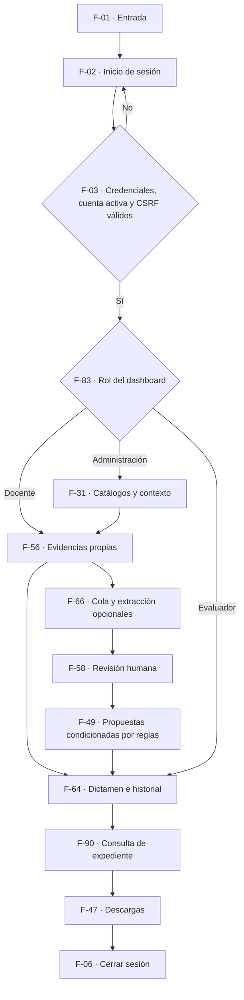

## Acceso, registro y sesión

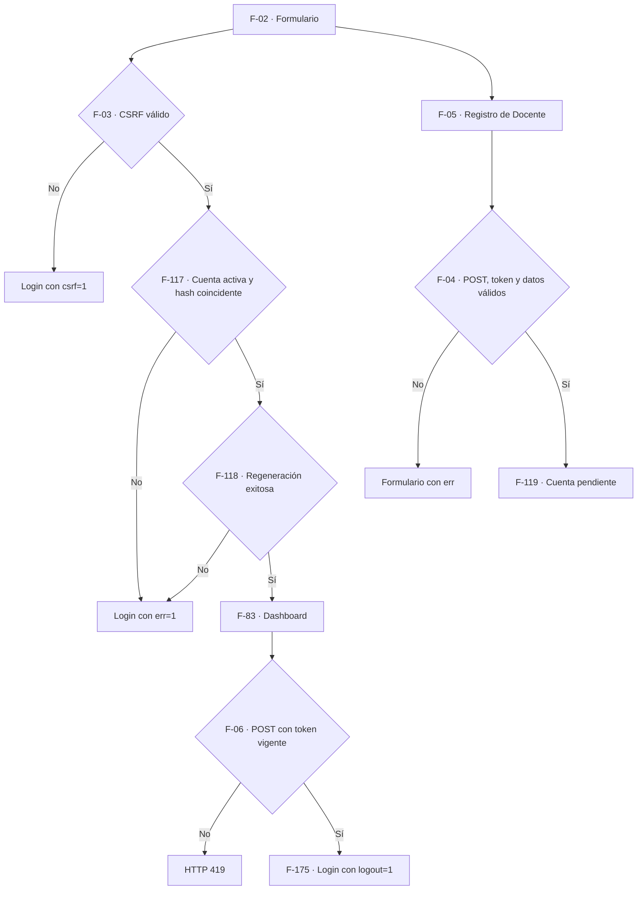

## Usuarios y asignaciones

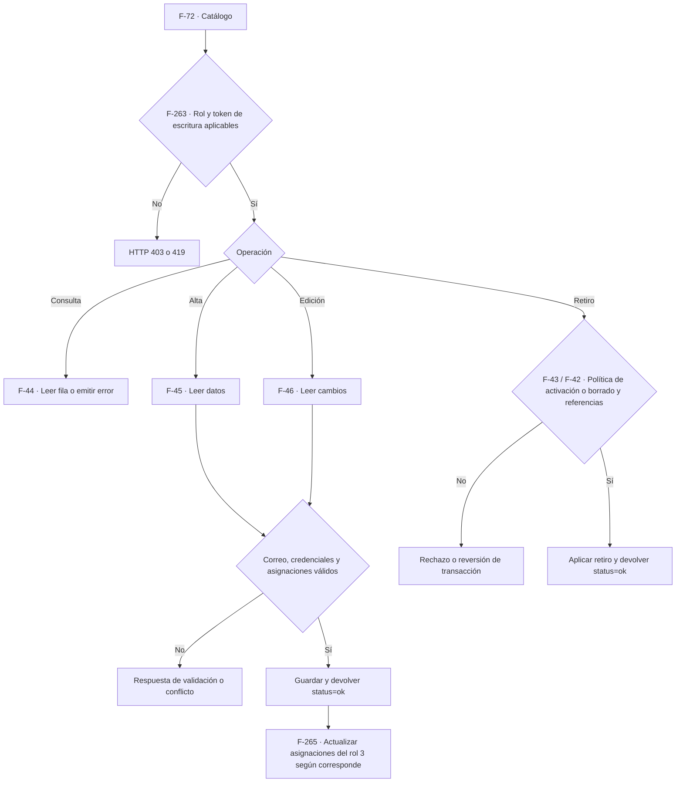

## Instrumentos


## Tipos documentales

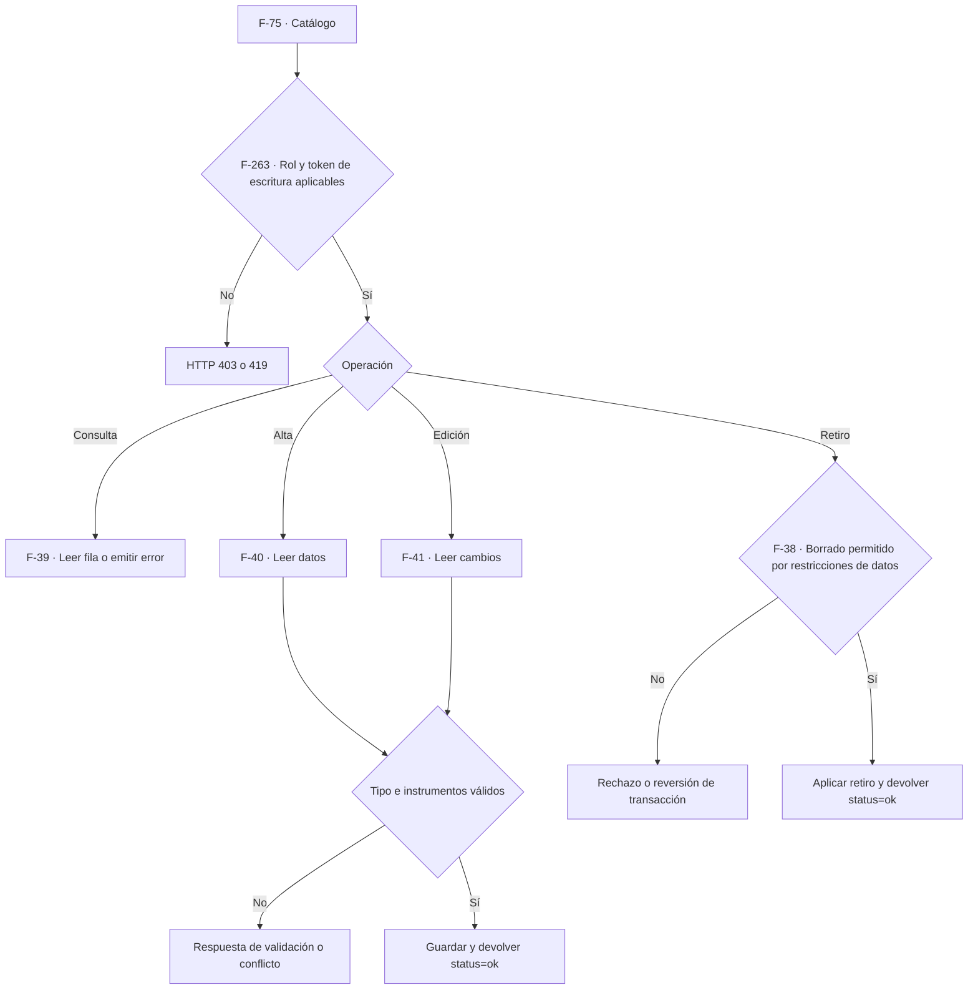

## Definiciones de atributos

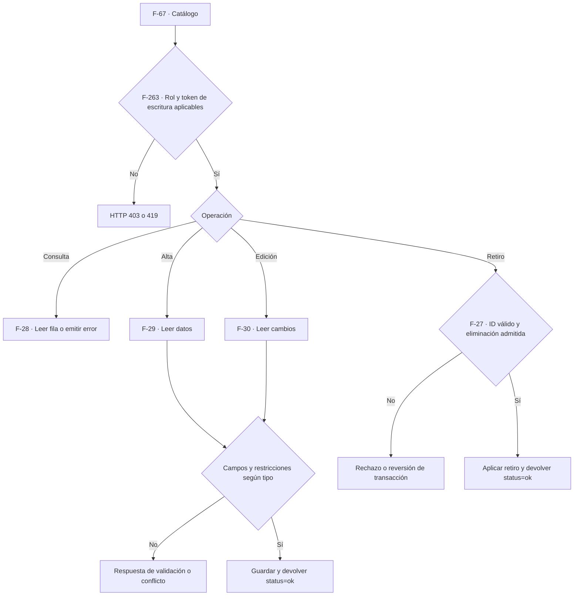

## Configuración académica y publicación

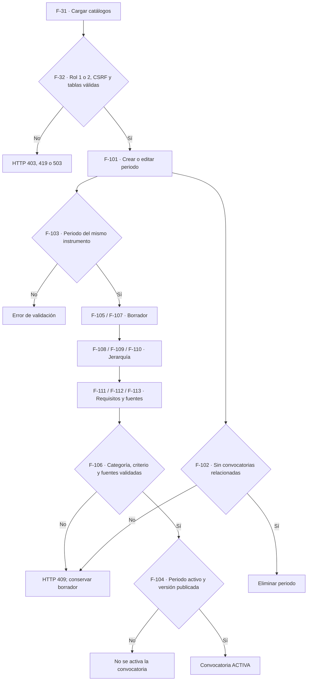

## Carga, edición, atributos y retiro de evidencia

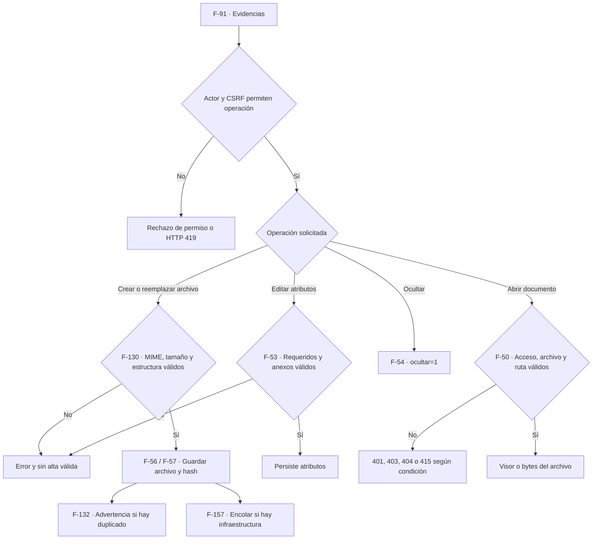

## Worker, OCR y revisión humana

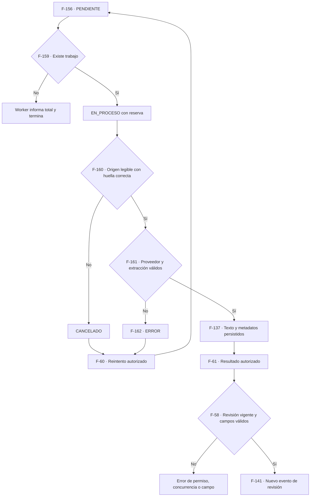

## Clasificación y decisión de propuesta

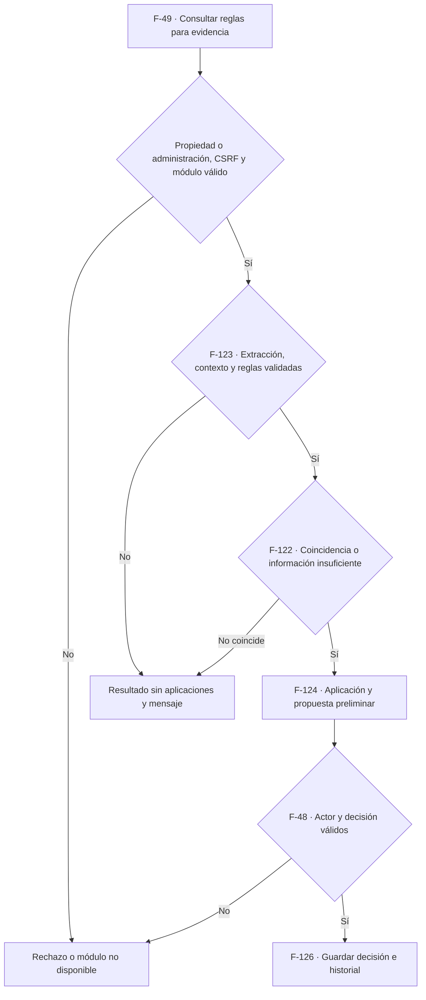

## Evaluación, revisión y cierre

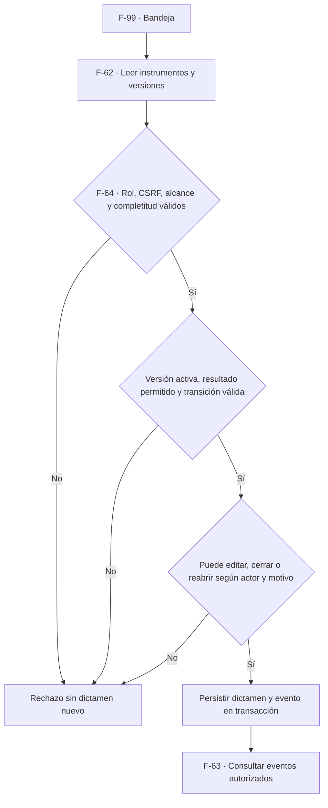

## Expediente, PDF y ZIP

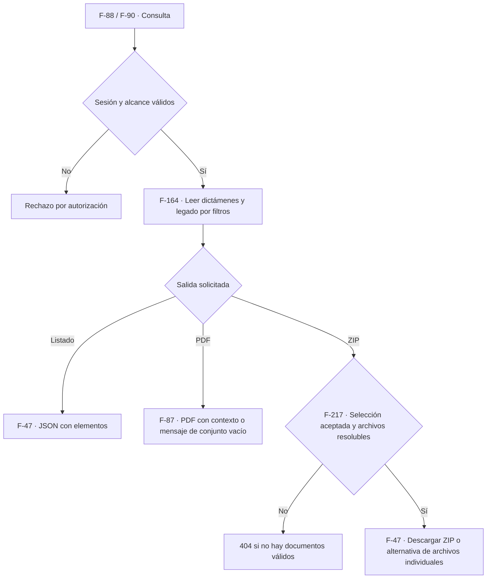


# 5. BASE DE DATOS

## Motor y esquema

Configuración predeterminada `gestor_evidencia_produccion`. En la copia de pruebas se utiliza `odea_qa` sobre MariaDB 10.4.32. El diccionario refleja las declaraciones del volcado v2 más las migraciones ascendentes y su materialización en QA. `COLUMN_TYPE` conserva precisión/escala, longitud lógica y literales ENUM. Donde MariaDB presenta JSON como `longtext`, el CHECK de validez aparece en restricciones. `—` en Default significa que `INFORMATION_SCHEMA` no devuelve una expresión de valor por omisión. Una FK compuesta se presenta en su orden declarado.

### `actividades_academicas`

Actividades de un contexto de criterios versionados. Motor `InnoDB`, cotejamiento `utf8mb4_general_ci`. [DDL de origen](../sql/migrations/20261123_motor_clasificacion_multiinstrumento.sql)

| Campo | Tipo declarado | Longitud o precisión | Nulo | Default | Atributos extra |
|---|---|---|---|---|---|
| `id_actividad` | `int(11)` | 10,0 | No | — | `auto_increment` |
| `id_version` | `int(11)` | 10,0 | No | — | — |
| `codigo` | `varchar(60)` | 60 | No | — | — |
| `nombre` | `varchar(180)` | 180 | No | — | — |
| `descripcion` | `text` | 65535 | Sí | `NULL` | — |
| `activa` | `tinyint(1)` | 3,0 | No | `1` | — |

- **PK:** `id_actividad`.
- **FK:** `fk_actividad_version` (`id_version`) → `versiones_criterios` (`id_version`), ON DELETE RESTRICT, ON UPDATE CASCADE.
- **Índices y unicidad:** `PRIMARY` BTREE UNIQUE (`id_actividad`) · `uq_actividad_id_version` BTREE UNIQUE (`id_actividad`, `id_version`) · `uq_actividad_version_codigo` BTREE UNIQUE (`id_version`, `codigo`).
- **CHECK:** —.

### `atributos_tipo_evidencia`

Definiciones de campos, multiplicidad, obligatoriedad y validadores por tipo documental. Motor `InnoDB`, cotejamiento `utf8mb4_general_ci`. [DDL de origen](../sql/gestor_evidencia_produccion_v2.sql)

| Campo | Tipo declarado | Longitud o precisión | Nulo | Default | Atributos extra |
|---|---|---|---|---|---|
| `id_ate` | `int(11)` | 10,0 | No | — | `auto_increment` |
| `id_tipo_evidencia` | `int(11)` | 10,0 | No | — | — |
| `id_tipo_atributo` | `int(11)` | 10,0 | No | — | — |
| `nombre_atributo` | `varchar(120)` | 120 | No | — | — |
| `slug` | `varchar(120)` | 120 | No | — | — |
| `descripcion` | `text` | 65535 | Sí | `NULL` | — |
| `orden` | `int(11)` | 10,0 | No | `1` | — |
| `requerido` | `tinyint(1)` | 3,0 | No | `0` | — |
| `unico_por_evidencia` | `tinyint(1)` | 3,0 | No | `0` | — |
| `multiple` | `tinyint(1)` | 3,0 | No | `0` | — |
| `min_longitud` | `int(11)` | 10,0 | Sí | `NULL` | — |
| `max_longitud` | `int(11)` | 10,0 | Sí | `NULL` | — |
| `min_valor` | `decimal(18,6)` | 18,6 | Sí | `NULL` | — |
| `max_valor` | `decimal(18,6)` | 18,6 | Sí | `NULL` | — |
| `opciones_json` | `longtext` | 4294967295 | Sí | `NULL` | — |

- **PK:** `id_ate`.
- **FK:** `fk_ate_tipo_atributo` (`id_tipo_atributo`) → `tipos_atributo` (`id_tipo_atributo`), ON DELETE RESTRICT, ON UPDATE RESTRICT · `fk_ate_tipo_evidencia` (`id_tipo_evidencia`) → `tipos_de_evidencia` (`id_tipo_evidencia`), ON DELETE CASCADE, ON UPDATE RESTRICT.
- **Índices y unicidad:** `idx_ate_tipo_atributo` BTREE (`id_tipo_atributo`) · `idx_ate_tipo_evidencia` BTREE (`id_tipo_evidencia`) · `PRIMARY` BTREE UNIQUE (`id_ate`) · `uq_ate_tipo_slug` BTREE UNIQUE (`id_tipo_evidencia`, `slug`).
- **CHECK:** `opciones_json` `json_valid(′opciones_json′)`.

### `calificacion_evidencia`

Calificación legada por evidencia e instrumento y datos del evaluador. Motor `InnoDB`, cotejamiento `utf8mb4_general_ci`. [DDL de origen](../sql/gestor_evidencia_produccion_v2.sql)

| Campo | Tipo declarado | Longitud o precisión | Nulo | Default | Atributos extra |
|---|---|---|---|---|---|
| `id_calificacion` | `int(11)` | 10,0 | No | — | `auto_increment` |
| `id_evidencia` | `int(11)` | 10,0 | No | — | — |
| `id_instrumento` | `int(11)` | 10,0 | No | — | — |
| `resultado` | `decimal(6,2)` | 6,2 | No | — | — |
| `comentario` | `varchar(1000)` | 1000 | Sí | `NULL` | — |
| `id_usuario_eval` | `int(11)` | 10,0 | Sí | `NULL` | — |
| `calificado_en` | `timestamp` | precisión temporal 0 | No | `current_timestamp()` | — |
| `actualizado_en` | `timestamp` | precisión temporal 0 | No | `current_timestamp()` | `on update current_timestamp()` |

- **PK:** `id_calificacion`.
- **FK:** `fk_ce_eval` (`id_usuario_eval`) → `usuarios` (`id_usuario`), ON DELETE RESTRICT, ON UPDATE CASCADE · `fk_ce_evi` (`id_evidencia`) → `evidencias` (`id_evidencia`), ON DELETE CASCADE, ON UPDATE CASCADE · `fk_ce_inst` (`id_instrumento`) → `instrumentos` (`id_instrumento`), ON DELETE CASCADE, ON UPDATE CASCADE.
- **Índices y unicidad:** `fk_ce_eval` BTREE (`id_usuario_eval`) · `idx_evi` BTREE (`id_evidencia`) · `idx_inst` BTREE (`id_instrumento`) · `PRIMARY` BTREE UNIQUE (`id_calificacion`) · `uniq_evi_inst` BTREE UNIQUE (`id_evidencia`, `id_instrumento`).
- **CHECK:** —.

### `categorias_academicas`

Categorías de criterios dentro de una versión. Motor `InnoDB`, cotejamiento `utf8mb4_general_ci`. [DDL de origen](../sql/migrations/20261119_modelo_academico_versionado.sql)

| Campo | Tipo declarado | Longitud o precisión | Nulo | Default | Atributos extra |
|---|---|---|---|---|---|
| `id_categoria` | `int(11)` | 10,0 | No | — | `auto_increment` |
| `id_version` | `int(11)` | 10,0 | No | — | — |
| `codigo` | `varchar(60)` | 60 | No | — | — |
| `nombre` | `varchar(150)` | 150 | No | — | — |
| `descripcion` | `text` | 65535 | Sí | `NULL` | — |
| `orden` | `int(11)` | 10,0 | No | `1` | — |
| `activa` | `tinyint(1)` | 3,0 | No | `1` | — |
| `ponderacion` | `decimal(12,6)` | 12,6 | Sí | `NULL` | — |

- **PK:** `id_categoria`.
- **FK:** `fk_categoria_version` (`id_version`) → `versiones_criterios` (`id_version`), ON DELETE RESTRICT, ON UPDATE CASCADE.
- **Índices y unicidad:** `PRIMARY` BTREE UNIQUE (`id_categoria`) · `uq_categoria_id_version` BTREE UNIQUE (`id_categoria`, `id_version`) · `uq_categoria_version_codigo` BTREE UNIQUE (`id_version`, `codigo`).
- **CHECK:** —.

### `convocatorias`

Convocatoria académica de un instrumento y periodo. Motor `InnoDB`, cotejamiento `utf8mb4_general_ci`. [DDL de origen](../sql/migrations/20261119_modelo_academico_versionado.sql)

| Campo | Tipo declarado | Longitud o precisión | Nulo | Default | Atributos extra |
|---|---|---|---|---|---|
| `id_convocatoria` | `int(11)` | 10,0 | No | — | `auto_increment` |
| `id_instrumento` | `int(11)` | 10,0 | No | — | — |
| `id_periodo` | `int(11)` | 10,0 | No | — | — |
| `codigo` | `varchar(60)` | 60 | No | — | — |
| `nombre` | `varchar(150)` | 150 | No | — | — |
| `descripcion` | `text` | 65535 | Sí | `NULL` | — |
| `fecha_apertura` | `date` | — | Sí | `NULL` | — |
| `fecha_cierre` | `date` | — | Sí | `NULL` | — |
| `estado` | `enum('BORRADOR','ACTIVA','CERRADA','INACTIVA')` | 8 | No | `'BORRADOR'` | — |
| `creado_en` | `timestamp` | precisión temporal 0 | No | `current_timestamp()` | — |

- **PK:** `id_convocatoria`.
- **FK:** `fk_conv_instrumento` (`id_instrumento`) → `instrumentos` (`id_instrumento`), ON DELETE RESTRICT, ON UPDATE CASCADE · `fk_conv_periodo_instrumento` (`id_periodo`, `id_instrumento`) → `periodos_academicos` (`id_periodo`, `id_instrumento`), ON DELETE RESTRICT, ON UPDATE CASCADE.
- **Índices y unicidad:** `fk_conv_periodo_instrumento` BTREE (`id_periodo`, `id_instrumento`) · `PRIMARY` BTREE UNIQUE (`id_convocatoria`) · `uq_conv_id_instrumento` BTREE UNIQUE (`id_convocatoria`, `id_instrumento`) · `uq_conv_instrumento_codigo` BTREE UNIQUE (`id_instrumento`, `codigo`).
- **CHECK:** `CONSTRAINT_1` `′fecha_apertura′ is null or ′fecha_cierre′ is null or ′fecha_cierre′ >= ′fecha_apertura′`.

### `criterios_academicos`

Criterios por categoría y versión con vigencia y ponderación configurables. Motor `InnoDB`, cotejamiento `utf8mb4_general_ci`. [DDL de origen](../sql/migrations/20261119_modelo_academico_versionado.sql)

| Campo | Tipo declarado | Longitud o precisión | Nulo | Default | Atributos extra |
|---|---|---|---|---|---|
| `id_criterio` | `int(11)` | 10,0 | No | — | `auto_increment` |
| `id_version` | `int(11)` | 10,0 | No | — | — |
| `id_categoria` | `int(11)` | 10,0 | No | — | — |
| `codigo` | `varchar(60)` | 60 | No | — | — |
| `nombre` | `varchar(180)` | 180 | No | — | — |
| `descripcion` | `text` | 65535 | Sí | `NULL` | — |
| `orden` | `int(11)` | 10,0 | No | `1` | — |
| `activo` | `tinyint(1)` | 3,0 | No | `1` | — |
| `ponderacion` | `decimal(12,6)` | 12,6 | Sí | `NULL` | — |
| `regla_vigencia_json` | `longtext` | 4294967295 | Sí | `NULL` | — |

- **PK:** `id_criterio`.
- **FK:** `fk_criterio_categoria_version` (`id_categoria`, `id_version`) → `categorias_academicas` (`id_categoria`, `id_version`), ON DELETE RESTRICT, ON UPDATE CASCADE · `fk_criterio_version` (`id_version`) → `versiones_criterios` (`id_version`), ON DELETE RESTRICT, ON UPDATE CASCADE.
- **Índices y unicidad:** `fk_criterio_categoria_version` BTREE (`id_categoria`, `id_version`) · `PRIMARY` BTREE UNIQUE (`id_criterio`) · `uq_criterio_id_version` BTREE UNIQUE (`id_criterio`, `id_version`) · `uq_criterio_version_codigo` BTREE UNIQUE (`id_version`, `codigo`).
- **CHECK:** `regla_vigencia_json` `′regla_vigencia_json′ is null or json_valid(′regla_vigencia_json′)`.

### `criterio_actividad`

Vínculos de criterios con actividades de la misma versión. Motor `InnoDB`, cotejamiento `utf8mb4_general_ci`. [DDL de origen](../sql/migrations/20261123_motor_clasificacion_multiinstrumento.sql)

| Campo | Tipo declarado | Longitud o precisión | Nulo | Default | Atributos extra |
|---|---|---|---|---|---|
| `id_version` | `int(11)` | 10,0 | No | — | — |
| `id_criterio` | `int(11)` | 10,0 | No | — | — |
| `id_actividad` | `int(11)` | 10,0 | No | — | — |

- **PK:** `id_criterio`, `id_actividad`.
- **FK:** `fk_criterio_actividad_actividad` (`id_actividad`, `id_version`) → `actividades_academicas` (`id_actividad`, `id_version`), ON DELETE RESTRICT, ON UPDATE CASCADE · `fk_criterio_actividad_criterio` (`id_criterio`, `id_version`) → `criterios_academicos` (`id_criterio`, `id_version`), ON DELETE RESTRICT, ON UPDATE CASCADE.
- **Índices y unicidad:** `fk_criterio_actividad_actividad` BTREE (`id_actividad`, `id_version`) · `fk_criterio_actividad_criterio` BTREE (`id_criterio`, `id_version`) · `PRIMARY` BTREE UNIQUE (`id_criterio`, `id_actividad`).
- **CHECK:** —.

### `criterio_fuente_normativa`

Asociaciones versionadas entre criterios y fuentes normativas. Motor `InnoDB`, cotejamiento `utf8mb4_general_ci`. [DDL de origen](../sql/migrations/20261119_modelo_academico_versionado.sql)

| Campo | Tipo declarado | Longitud o precisión | Nulo | Default | Atributos extra |
|---|---|---|---|---|---|
| `id_version` | `int(11)` | 10,0 | No | — | — |
| `id_criterio` | `int(11)` | 10,0 | No | — | — |
| `id_fuente` | `int(11)` | 10,0 | No | — | — |

- **PK:** `id_criterio`, `id_fuente`.
- **FK:** `fk_criterio_fuente_criterio` (`id_criterio`, `id_version`) → `criterios_academicos` (`id_criterio`, `id_version`), ON DELETE RESTRICT, ON UPDATE CASCADE · `fk_criterio_fuente_fuente` (`id_fuente`, `id_version`) → `fuentes_normativas` (`id_fuente`, `id_version`), ON DELETE RESTRICT, ON UPDATE CASCADE.
- **Índices y unicidad:** `fk_criterio_fuente_criterio` BTREE (`id_criterio`, `id_version`) · `fk_criterio_fuente_fuente` BTREE (`id_fuente`, `id_version`) · `PRIMARY` BTREE UNIQUE (`id_criterio`, `id_fuente`).
- **CHECK:** —.

### `estados_evaluacion`

Catálogo de estados del dictamen de evaluación. Motor `InnoDB`, cotejamiento `utf8mb4_general_ci`. [DDL de origen](../sql/migrations/20261120_historial_estados_evaluacion.sql)

| Campo | Tipo declarado | Longitud o precisión | Nulo | Default | Atributos extra |
|---|---|---|---|---|---|
| `id_estado` | `int(11)` | 10,0 | No | — | `auto_increment` |
| `codigo` | `varchar(40)` | 40 | No | — | — |
| `nombre` | `varchar(80)` | 80 | No | — | — |
| `descripcion` | `varchar(255)` | 255 | Sí | `NULL` | — |
| `activo` | `tinyint(1)` | 3,0 | No | `1` | — |
| `orden` | `int(11)` | 10,0 | No | `1` | — |

- **PK:** `id_estado`.
- **FK:** —.
- **Índices y unicidad:** `PRIMARY` BTREE UNIQUE (`id_estado`) · `uq_estado_codigo` BTREE UNIQUE (`codigo`).
- **CHECK:** —.

### `evaluaciones_versionadas`

Dictamen vigente por evidencia, instrumento y contexto de criterios. Motor `InnoDB`, cotejamiento `utf8mb4_general_ci`. [DDL de origen](../sql/migrations/20261120_historial_estados_evaluacion.sql)

| Campo | Tipo declarado | Longitud o precisión | Nulo | Default | Atributos extra |
|---|---|---|---|---|---|
| `id_evaluacion` | `bigint(20)` | 19,0 | No | — | `auto_increment` |
| `id_evidencia` | `int(11)` | 10,0 | No | — | — |
| `id_instrumento` | `int(11)` | 10,0 | No | — | — |
| `id_convocatoria` | `int(11)` | 10,0 | Sí | `NULL` | — |
| `id_version` | `int(11)` | 10,0 | Sí | `NULL` | — |
| `contexto_version_clave` | `int(11)` | 10,0 | Sí | `NULL` | `STORED GENERATED` · `ifnull(′id_version′,0)` |
| `id_estado` | `int(11)` | 10,0 | Sí | `NULL` | — |
| `resultado` | `decimal(6,2)` | 6,2 | Sí | `NULL` | — |
| `comentario` | `varchar(1000)` | 1000 | Sí | `NULL` | — |
| `id_usuario_eval` | `int(11)` | 10,0 | Sí | `NULL` | — |
| `id_calificacion_legada` | `int(11)` | 10,0 | Sí | `NULL` | — |
| `cerrada` | `tinyint(1)` | 3,0 | No | `0` | — |
| `creada_en` | `timestamp` | precisión temporal 0 | No | `current_timestamp()` | — |
| `actualizada_en` | `timestamp` | precisión temporal 0 | No | `current_timestamp()` | `on update current_timestamp()` |
| `cerrada_en` | `datetime` | precisión temporal 0 | Sí | `NULL` | — |

- **PK:** `id_evaluacion`.
- **FK:** `fk_eval_versionada_conv_inst` (`id_convocatoria`, `id_instrumento`) → `convocatorias` (`id_convocatoria`, `id_instrumento`), ON DELETE RESTRICT, ON UPDATE CASCADE · `fk_eval_versionada_estado` (`id_estado`) → `estados_evaluacion` (`id_estado`), ON DELETE RESTRICT, ON UPDATE CASCADE · `fk_eval_versionada_evidencia` (`id_evidencia`) → `evidencias` (`id_evidencia`), ON DELETE RESTRICT, ON UPDATE CASCADE · `fk_eval_versionada_instrumento` (`id_instrumento`) → `instrumentos` (`id_instrumento`), ON DELETE RESTRICT, ON UPDATE CASCADE · `fk_eval_versionada_legada` (`id_calificacion_legada`) → `calificacion_evidencia` (`id_calificacion`), ON DELETE RESTRICT, ON UPDATE CASCADE · `fk_eval_versionada_usuario` (`id_usuario_eval`) → `usuarios` (`id_usuario`), ON DELETE SET NULL, ON UPDATE CASCADE · `fk_eval_versionada_version_conv` (`id_version`, `id_convocatoria`) → `versiones_criterios` (`id_version`, `id_convocatoria`), ON DELETE RESTRICT, ON UPDATE CASCADE.
- **Índices y unicidad:** `fk_eval_versionada_estado` BTREE (`id_estado`) · `fk_eval_versionada_instrumento` BTREE (`id_instrumento`) · `fk_eval_versionada_usuario` BTREE (`id_usuario_eval`) · `fk_eval_versionada_version_conv` BTREE (`id_version`, `id_convocatoria`) · `idx_evaluacion_convocatoria` BTREE (`id_convocatoria`, `id_instrumento`) · `PRIMARY` BTREE UNIQUE (`id_evaluacion`) · `uq_evaluacion_contexto` BTREE UNIQUE (`id_evidencia`, `id_instrumento`, `contexto_version_clave`) · `uq_evaluacion_id_version` BTREE UNIQUE (`id_evaluacion`, `id_version`) · `uq_evaluacion_legada` BTREE UNIQUE (`id_calificacion_legada`).
- **CHECK:** `CONSTRAINT_1` `′id_convocatoria′ is null and ′id_version′ is null or ′id_convocatoria′ is not null and ′id_version′ is not null`.

### `evaluador_instrumento`

Asignaciones habilitadas de evaluador a instrumento. Motor `InnoDB`, cotejamiento `utf8mb4_general_ci`. [DDL de origen](../sql/gestor_evidencia_produccion_v2.sql)

| Campo | Tipo declarado | Longitud o precisión | Nulo | Default | Atributos extra |
|---|---|---|---|---|---|
| `id_evaluador` | `int(11)` | 10,0 | No | — | — |
| `id_instrumento` | `int(11)` | 10,0 | No | — | — |
| `asignado_en` | `timestamp` | precisión temporal 0 | No | `current_timestamp()` | — |

- **PK:** `id_evaluador`, `id_instrumento`.
- **FK:** `fk_ei_evaluador` (`id_evaluador`) → `usuarios` (`id_usuario`), ON DELETE CASCADE, ON UPDATE CASCADE · `fk_ei_instrumento` (`id_instrumento`) → `instrumentos` (`id_instrumento`), ON DELETE CASCADE, ON UPDATE CASCADE.
- **Índices y unicidad:** `idx_ei_instrumento` BTREE (`id_instrumento`) · `PRIMARY` BTREE UNIQUE (`id_evaluador`, `id_instrumento`).
- **CHECK:** —.

### `evidencias`

Registro de evidencia, propietario, tipo y referencia al documento físico. Motor `InnoDB`, cotejamiento `utf8mb4_general_ci`. [DDL de origen](../sql/gestor_evidencia_produccion_v2.sql) · [Metadatos documentales](../sql/migrations/20261118_integridad_documental.sql)

| Campo | Tipo declarado | Longitud o precisión | Nulo | Default | Atributos extra |
|---|---|---|---|---|---|
| `id_evidencia` | `int(11)` | 10,0 | No | — | `auto_increment` |
| `titulo` | `varchar(255)` | 255 | No | — | — |
| `archivo` | `varchar(255)` | 255 | No | — | — |
| `archivo_sha256` | `char(64)` | 64 | Sí | `NULL` | — |
| `archivo_mime` | `varchar(100)` | 100 | Sí | `NULL` | — |
| `archivo_bytes` | `bigint(20) unsigned` | 20,0 | Sí | `NULL` | — |
| `fecha_subida` | `timestamp` | precisión temporal 0 | No | `current_timestamp()` | — |
| `id_docente` | `int(11)` | 10,0 | No | — | — |
| `id_tipo_evidencia` | `int(11)` | 10,0 | No | — | — |
| `ocultar` | `int(11)` | 10,0 | No | `0` | — |

- **PK:** `id_evidencia`.
- **FK:** `evidencias_ibfk_1` (`id_docente`) → `usuarios` (`id_usuario`), ON DELETE CASCADE, ON UPDATE RESTRICT · `evidencias_ibfk_2` (`id_tipo_evidencia`) → `tipos_de_evidencia` (`id_tipo_evidencia`), ON DELETE CASCADE, ON UPDATE RESTRICT.
- **Índices y unicidad:** `idx_evidencias_archivo_sha256` BTREE (`archivo_sha256`) · `id_docente` BTREE (`id_docente`) · `id_tipo_evidencia` BTREE (`id_tipo_evidencia`) · `PRIMARY` BTREE UNIQUE (`id_evidencia`).
- **CHECK:** —.

### `evidencia_aplicaciones_academicas`

Aplicación académica preliminar de una evidencia en determinada convocatoria y versión. Motor `InnoDB`, cotejamiento `utf8mb4_general_ci`. [DDL de origen](../sql/migrations/20261123_motor_clasificacion_multiinstrumento.sql)

| Campo | Tipo declarado | Longitud o precisión | Nulo | Default | Atributos extra |
|---|---|---|---|---|---|
| `id_aplicacion` | `bigint(20)` | 19,0 | No | — | `auto_increment` |
| `id_evidencia` | `int(11)` | 10,0 | No | — | — |
| `id_instrumento` | `int(11)` | 10,0 | No | — | — |
| `id_convocatoria` | `int(11)` | 10,0 | No | — | — |
| `id_version` | `int(11)` | 10,0 | No | — | — |
| `estado` | `enum('PROPUESTA','CONFIRMADA','RECHAZADA')` | 10 | No | `'PROPUESTA'` | — |
| `validacion_documental` | `enum('SIN_INFORMACION','INCOMPLETA','PRELIMINAR')` | 15 | No | `'SIN_INFORMACION'` | — |
| `coincidencia_semantica` | `enum('NO_CONFIGURADA','COINCIDE','NO_COINCIDE','AMBIGUA')` | 14 | No | `'NO_CONFIGURADA'` | — |
| `dictamen_oficial` | `enum('NO_EMITIDO')` | 10 | No | `'NO_EMITIDO'` | — |
| `resumen_json` | `longtext` | 4294967295 | Sí | `NULL` | — |
| `decidido_por` | `int(11)` | 10,0 | Sí | `NULL` | — |
| `decidido_en` | `datetime` | precisión temporal 0 | Sí | `NULL` | — |
| `creada_en` | `timestamp` | precisión temporal 0 | No | `current_timestamp()` | — |
| `actualizada_en` | `timestamp` | precisión temporal 0 | No | `current_timestamp()` | `on update current_timestamp()` |

- **PK:** `id_aplicacion`.
- **FK:** `fk_aplicacion_conv_instrumento` (`id_convocatoria`, `id_instrumento`) → `convocatorias` (`id_convocatoria`, `id_instrumento`), ON DELETE RESTRICT, ON UPDATE CASCADE · `fk_aplicacion_decisor` (`decidido_por`) → `usuarios` (`id_usuario`), ON DELETE SET NULL, ON UPDATE CASCADE · `fk_aplicacion_evidencia` (`id_evidencia`) → `evidencias` (`id_evidencia`), ON DELETE RESTRICT, ON UPDATE CASCADE · `fk_aplicacion_instrumento` (`id_instrumento`) → `instrumentos` (`id_instrumento`), ON DELETE RESTRICT, ON UPDATE CASCADE · `fk_aplicacion_version_conv` (`id_version`, `id_convocatoria`) → `versiones_criterios` (`id_version`, `id_convocatoria`), ON DELETE RESTRICT, ON UPDATE CASCADE.
- **Índices y unicidad:** `fk_aplicacion_conv_instrumento` BTREE (`id_convocatoria`, `id_instrumento`) · `fk_aplicacion_decisor` BTREE (`decidido_por`) · `fk_aplicacion_version_conv` BTREE (`id_version`, `id_convocatoria`) · `idx_aplicacion_instrumento_conv` BTREE (`id_instrumento`, `id_convocatoria`, `id_version`, `estado`) · `PRIMARY` BTREE UNIQUE (`id_aplicacion`) · `uq_aplicacion_contexto` BTREE UNIQUE (`id_aplicacion`, `id_version`) · `uq_evidencia_conv_version` BTREE UNIQUE (`id_evidencia`, `id_convocatoria`, `id_version`).
- **CHECK:** `resumen_json` `′resumen_json′ is null or json_valid(′resumen_json′)`.

### `evidencia_criterio_versionado`

Asocia evidencia con criterio en el contexto versionado. Motor `InnoDB`, cotejamiento `utf8mb4_general_ci`. [DDL de origen](../sql/migrations/20261119_modelo_academico_versionado.sql)

| Campo | Tipo declarado | Longitud o precisión | Nulo | Default | Atributos extra |
|---|---|---|---|---|---|
| `id_version` | `int(11)` | 10,0 | No | — | — |
| `id_evidencia` | `int(11)` | 10,0 | No | — | — |
| `id_criterio` | `int(11)` | 10,0 | No | — | — |
| `vinculada_en` | `timestamp` | precisión temporal 0 | No | `current_timestamp()` | — |

- **PK:** `id_evidencia`, `id_criterio`, `id_version`.
- **FK:** `fk_evcrit_criterio` (`id_criterio`, `id_version`) → `criterios_academicos` (`id_criterio`, `id_version`), ON DELETE RESTRICT, ON UPDATE CASCADE · `fk_evcrit_evidencia` (`id_evidencia`) → `evidencias` (`id_evidencia`), ON DELETE RESTRICT, ON UPDATE CASCADE.
- **Índices y unicidad:** `fk_evcrit_criterio` BTREE (`id_criterio`, `id_version`) · `PRIMARY` BTREE UNIQUE (`id_evidencia`, `id_criterio`, `id_version`).
- **CHECK:** —.

### `evidencia_subcriterio_versionado`

Asocia evidencia con subcriterio en el contexto versionado. Motor `InnoDB`, cotejamiento `utf8mb4_general_ci`. [DDL de origen](../sql/migrations/20261119_modelo_academico_versionado.sql)

| Campo | Tipo declarado | Longitud o precisión | Nulo | Default | Atributos extra |
|---|---|---|---|---|---|
| `id_version` | `int(11)` | 10,0 | No | — | — |
| `id_evidencia` | `int(11)` | 10,0 | No | — | — |
| `id_subcriterio` | `int(11)` | 10,0 | No | — | — |
| `vinculada_en` | `timestamp` | precisión temporal 0 | No | `current_timestamp()` | — |

- **PK:** `id_evidencia`, `id_subcriterio`, `id_version`.
- **FK:** `fk_evsub_evidencia` (`id_evidencia`) → `evidencias` (`id_evidencia`), ON DELETE RESTRICT, ON UPDATE CASCADE · `fk_evsub_subcriterio` (`id_subcriterio`, `id_version`) → `subcriterios_academicos` (`id_subcriterio`, `id_version`), ON DELETE RESTRICT, ON UPDATE CASCADE.
- **Índices y unicidad:** `fk_evsub_subcriterio` BTREE (`id_subcriterio`, `id_version`) · `PRIMARY` BTREE UNIQUE (`id_evidencia`, `id_subcriterio`, `id_version`).
- **CHECK:** —.

### `evidencia_valores_atributo`

Valores tipados por atributo de evidencia y metadatos de anexos. Motor `InnoDB`, cotejamiento `utf8mb4_general_ci`. [DDL de origen](../sql/gestor_evidencia_produccion_v2.sql) · [Metadatos documentales](../sql/migrations/20261118_integridad_documental.sql)

| Campo | Tipo declarado | Longitud o precisión | Nulo | Default | Atributos extra |
|---|---|---|---|---|---|
| `id_eva` | `bigint(20)` | 19,0 | No | — | `auto_increment` |
| `id_evidencia` | `int(11)` | 10,0 | No | — | — |
| `id_ate` | `int(11)` | 10,0 | No | — | — |
| `indice` | `int(11)` | 10,0 | No | `1` | — |
| `valor_texto` | `varchar(500)` | 500 | Sí | `NULL` | — |
| `valor_largo` | `text` | 65535 | Sí | `NULL` | — |
| `valor_int` | `int(11)` | 10,0 | Sí | `NULL` | — |
| `valor_decimal` | `decimal(18,6)` | 18,6 | Sí | `NULL` | — |
| `valor_fecha` | `date` | — | Sí | `NULL` | — |
| `valor_bool` | `tinyint(1)` | 3,0 | Sí | `NULL` | — |
| `valor_archivo` | `varchar(255)` | 255 | Sí | `NULL` | — |
| `valor_archivo_sha256` | `char(64)` | 64 | Sí | `NULL` | — |
| `valor_archivo_mime` | `varchar(100)` | 100 | Sí | `NULL` | — |
| `valor_archivo_bytes` | `bigint(20) unsigned` | 20,0 | Sí | `NULL` | — |
| `valor_json` | `longtext` | 4294967295 | Sí | `NULL` | — |
| `created_at` | `timestamp` | precisión temporal 0 | No | `current_timestamp()` | — |
| `updated_at` | `timestamp` | precisión temporal 0 | No | `current_timestamp()` | `on update current_timestamp()` |

- **PK:** `id_eva`.
- **FK:** `fk_eva_ate` (`id_ate`) → `atributos_tipo_evidencia` (`id_ate`), ON DELETE CASCADE, ON UPDATE RESTRICT · `fk_eva_evidencia` (`id_evidencia`) → `evidencias` (`id_evidencia`), ON DELETE CASCADE, ON UPDATE RESTRICT.
- **Índices y unicidad:** `idx_eva_archivo_sha256` BTREE (`valor_archivo_sha256`) · `idx_eva_ate` BTREE (`id_ate`) · `idx_eva_evidencia` BTREE (`id_evidencia`) · `PRIMARY` BTREE UNIQUE (`id_eva`) · `uq_eva_unico` BTREE UNIQUE (`id_evidencia`, `id_ate`, `indice`).
- **CHECK:** `valor_json` `json_valid(′valor_json′)`.

### `fuentes_normativas`

Documento normativo, vigencia y validación para una versión. Motor `InnoDB`, cotejamiento `utf8mb4_general_ci`. [DDL de origen](../sql/migrations/20261119_modelo_academico_versionado.sql)

| Campo | Tipo declarado | Longitud o precisión | Nulo | Default | Atributos extra |
|---|---|---|---|---|---|
| `id_fuente` | `int(11)` | 10,0 | No | — | `auto_increment` |
| `id_version` | `int(11)` | 10,0 | No | — | — |
| `nombre_documento` | `varchar(255)` | 255 | No | — | — |
| `fecha_publicacion` | `date` | — | Sí | `NULL` | — |
| `vigencia_desde` | `date` | — | Sí | `NULL` | — |
| `vigencia_hasta` | `date` | — | Sí | `NULL` | — |
| `version_documento` | `varchar(100)` | 100 | Sí | `NULL` | — |
| `referencia_url` | `text` | 65535 | Sí | `NULL` | — |
| `id_responsable_validacion` | `int(11)` | 10,0 | Sí | `NULL` | — |
| `validacion_estado` | `enum('PENDIENTE','VALIDADA','RECHAZADA')` | 9 | No | `'PENDIENTE'` | — |
| `validada_en` | `datetime` | precisión temporal 0 | Sí | `NULL` | — |

- **PK:** `id_fuente`.
- **FK:** `fk_fuente_responsable` (`id_responsable_validacion`) → `usuarios` (`id_usuario`), ON DELETE SET NULL, ON UPDATE CASCADE · `fk_fuente_version` (`id_version`) → `versiones_criterios` (`id_version`), ON DELETE RESTRICT, ON UPDATE CASCADE.
- **Índices y unicidad:** `fk_fuente_responsable` BTREE (`id_responsable_validacion`) · `fk_fuente_version` BTREE (`id_version`) · `PRIMARY` BTREE UNIQUE (`id_fuente`) · `uq_fuente_id_version` BTREE UNIQUE (`id_fuente`, `id_version`).
- **CHECK:** `CONSTRAINT_1` `′vigencia_desde′ is null or ′vigencia_hasta′ is null or ′vigencia_hasta′ >= ′vigencia_desde′`.

### `historial_clasificacion_documental`

Eventos inmutables de propuestas y aplicaciones de clasificación. Motor `InnoDB`, cotejamiento `utf8mb4_general_ci`. [DDL de origen](../sql/migrations/20261123_motor_clasificacion_multiinstrumento.sql)

| Campo | Tipo declarado | Longitud o precisión | Nulo | Default | Atributos extra |
|---|---|---|---|---|---|
| `id_evento` | `bigint(20)` | 19,0 | No | — | `auto_increment` |
| `id_aplicacion` | `bigint(20)` | 19,0 | No | — | — |
| `id_propuesta` | `bigint(20)` | 19,0 | Sí | `NULL` | — |
| `estado_anterior` | `varchar(32)` | 32 | Sí | `NULL` | — |
| `estado_nuevo` | `varchar(32)` | 32 | No | — | — |
| `actor_id` | `int(11)` | 10,0 | No | — | — |
| `actor_nombre` | `varchar(255)` | 255 | No | — | — |
| `motivo` | `varchar(1000)` | 1000 | Sí | `NULL` | — |
| `creado_en` | `timestamp` | precisión temporal 0 | No | `current_timestamp()` | — |

- **PK:** `id_evento`.
- **FK:** `fk_historial_clasificacion_actor` (`actor_id`) → `usuarios` (`id_usuario`), ON DELETE RESTRICT, ON UPDATE CASCADE · `fk_historial_clasificacion_aplicacion` (`id_aplicacion`) → `evidencia_aplicaciones_academicas` (`id_aplicacion`), ON DELETE RESTRICT, ON UPDATE CASCADE · `fk_historial_clasificacion_propuesta` (`id_propuesta`) → `propuestas_clasificacion_documental` (`id_propuesta`), ON DELETE RESTRICT, ON UPDATE CASCADE.
- **Índices y unicidad:** `fk_historial_clasificacion_actor` BTREE (`actor_id`) · `fk_historial_clasificacion_propuesta` BTREE (`id_propuesta`) · `idx_historial_clasificacion_aplicacion` BTREE (`id_aplicacion`, `creado_en`) · `PRIMARY` BTREE UNIQUE (`id_evento`).
- **CHECK:** —.

### `historial_evaluaciones`

Eventos inmutables de cambios de estado, resultado y comentario de evaluación. Motor `InnoDB`, cotejamiento `utf8mb4_general_ci`. [DDL de origen](../sql/migrations/20261120_historial_estados_evaluacion.sql)

| Campo | Tipo declarado | Longitud o precisión | Nulo | Default | Atributos extra |
|---|---|---|---|---|---|
| `id_historial` | `bigint(20)` | 19,0 | No | — | `auto_increment` |
| `id_evaluacion` | `bigint(20)` | 19,0 | No | — | — |
| `tipo_evento` | `enum('CREADA','ACTUALIZADA','OBSERVACION','CAMBIO_ESTADO','CIERRE','REAPERTURA','MIGRACION_LEGADA')` | 16 | No | — | — |
| `resultado_anterior` | `decimal(6,2)` | 6,2 | Sí | `NULL` | — |
| `resultado_nuevo` | `decimal(6,2)` | 6,2 | Sí | `NULL` | — |
| `comentario_anterior` | `varchar(1000)` | 1000 | Sí | `NULL` | — |
| `comentario_nuevo` | `varchar(1000)` | 1000 | Sí | `NULL` | — |
| `id_estado_anterior` | `int(11)` | 10,0 | Sí | `NULL` | — |
| `id_estado_nuevo` | `int(11)` | 10,0 | Sí | `NULL` | — |
| `id_usuario_actor` | `int(11)` | 10,0 | Sí | `NULL` | — |
| `actor_nombre` | `varchar(302)` | 302 | Sí | `NULL` | — |
| `actor_correo` | `varchar(150)` | 150 | Sí | `NULL` | — |
| `motivo` | `text` | 65535 | Sí | `NULL` | — |
| `creado_en` | `timestamp` | precisión temporal 0 | No | `current_timestamp()` | — |

- **PK:** `id_historial`.
- **FK:** `fk_historial_actor` (`id_usuario_actor`) → `usuarios` (`id_usuario`), ON DELETE SET NULL, ON UPDATE CASCADE · `fk_historial_estado_anterior` (`id_estado_anterior`) → `estados_evaluacion` (`id_estado`), ON DELETE RESTRICT, ON UPDATE CASCADE · `fk_historial_estado_nuevo` (`id_estado_nuevo`) → `estados_evaluacion` (`id_estado`), ON DELETE RESTRICT, ON UPDATE CASCADE · `fk_historial_evaluacion` (`id_evaluacion`) → `evaluaciones_versionadas` (`id_evaluacion`), ON DELETE RESTRICT, ON UPDATE CASCADE.
- **Índices y unicidad:** `fk_historial_estado_anterior` BTREE (`id_estado_anterior`) · `fk_historial_estado_nuevo` BTREE (`id_estado_nuevo`) · `idx_historial_actor` BTREE (`id_usuario_actor`) · `idx_historial_evaluacion_fecha` BTREE (`id_evaluacion`, `creado_en`, `id_historial`) · `PRIMARY` BTREE UNIQUE (`id_historial`).
- **CHECK:** —.

### `instrumentos`

Catálogo de instrumentos y rangos de calificación. Motor `InnoDB`, cotejamiento `utf8mb4_general_ci`. [DDL de origen](../sql/gestor_evidencia_produccion_v2.sql)

| Campo | Tipo declarado | Longitud o precisión | Nulo | Default | Atributos extra |
|---|---|---|---|---|---|
| `id_instrumento` | `int(11)` | 10,0 | No | — | `auto_increment` |
| `abreviatura` | `varchar(20)` | 20 | No | — | — |
| `nombre_completo` | `varchar(150)` | 150 | No | — | — |
| `tipo_calificacion` | `enum('APROBACION','NUMERICA')` | 10 | No | `'APROBACION'` | — |
| `min_calificacion` | `decimal(5,2)` | 5,2 | Sí | `NULL` | — |
| `max_calificacion` | `decimal(5,2)` | 5,2 | Sí | `NULL` | — |
| `activo` | `tinyint(1)` | 3,0 | No | `1` | — |
| `creado_en` | `timestamp` | precisión temporal 0 | No | `current_timestamp()` | — |
| `actualizado_en` | `timestamp` | precisión temporal 0 | No | `current_timestamp()` | `on update current_timestamp()` |

- **PK:** `id_instrumento`.
- **FK:** —.
- **Índices y unicidad:** `abreviatura` BTREE UNIQUE (`abreviatura`) · `nombre_completo` BTREE UNIQUE (`nombre_completo`) · `PRIMARY` BTREE UNIQUE (`id_instrumento`).
- **CHECK:** —.

### `instrumento_tipo_evidencia`

Asociación entre instrumentos y tipos documentales admitidos. Motor `InnoDB`, cotejamiento `utf8mb4_general_ci`. [DDL de origen](../sql/gestor_evidencia_produccion_v2.sql)

| Campo | Tipo declarado | Longitud o precisión | Nulo | Default | Atributos extra |
|---|---|---|---|---|---|
| `id_instrumento` | `int(11)` | 10,0 | No | — | — |
| `id_tipo_evidencia` | `int(11)` | 10,0 | No | — | — |
| `asignado_en` | `timestamp` | precisión temporal 0 | No | `current_timestamp()` | — |

- **PK:** `id_instrumento`, `id_tipo_evidencia`.
- **FK:** `fk_ite_instrumento` (`id_instrumento`) → `instrumentos` (`id_instrumento`), ON DELETE CASCADE, ON UPDATE CASCADE · `fk_ite_tipo` (`id_tipo_evidencia`) → `tipos_de_evidencia` (`id_tipo_evidencia`), ON DELETE CASCADE, ON UPDATE CASCADE.
- **Índices y unicidad:** `idx_ite_tipo` BTREE (`id_tipo_evidencia`) · `PRIMARY` BTREE UNIQUE (`id_instrumento`, `id_tipo_evidencia`).
- **CHECK:** —.

### `origenes_trabajo_documental`

Enlaces de un trabajo a evidencias o atributos que aportan el documento. Motor `InnoDB`, cotejamiento `utf8mb4_general_ci`. [DDL de origen](../sql/migrations/20261121_procesamiento_documental.sql)

| Campo | Tipo declarado | Longitud o precisión | Nulo | Default | Atributos extra |
|---|---|---|---|---|---|
| `id_origen_trabajo` | `bigint(20)` | 19,0 | No | — | `auto_increment` |
| `id_trabajo` | `bigint(20)` | 19,0 | No | — | — |
| `id_evidencia` | `int(11)` | 10,0 | No | — | — |
| `tipo_origen` | `enum('EVIDENCIA','ATRIBUTO')` | 9 | No | — | — |
| `id_origen` | `bigint(20)` | 19,0 | No | — | — |
| `creado_en` | `timestamp` | precisión temporal 0 | No | `current_timestamp()` | — |

- **PK:** `id_origen_trabajo`.
- **FK:** `fk_origen_evidencia` (`id_evidencia`) → `evidencias` (`id_evidencia`), ON DELETE RESTRICT, ON UPDATE CASCADE · `fk_origen_trabajo` (`id_trabajo`) → `trabajos_documentales` (`id_trabajo`), ON DELETE RESTRICT, ON UPDATE CASCADE.
- **Índices y unicidad:** `idx_origen_evidencia` BTREE (`id_evidencia`, `id_origen_trabajo`) · `PRIMARY` BTREE UNIQUE (`id_origen_trabajo`) · `uq_origen_trabajo` BTREE UNIQUE (`id_trabajo`, `tipo_origen`, `id_origen`).
- **CHECK:** —.

### `periodos_academicos`

Periodos por instrumento, fechas y estado. Motor `InnoDB`, cotejamiento `utf8mb4_general_ci`. [DDL de origen](../sql/migrations/20261119_modelo_academico_versionado.sql)

| Campo | Tipo declarado | Longitud o precisión | Nulo | Default | Atributos extra |
|---|---|---|---|---|---|
| `id_periodo` | `int(11)` | 10,0 | No | — | `auto_increment` |
| `id_instrumento` | `int(11)` | 10,0 | No | — | — |
| `codigo` | `varchar(60)` | 60 | No | — | — |
| `nombre` | `varchar(150)` | 150 | No | — | — |
| `fecha_inicio` | `date` | — | Sí | `NULL` | — |
| `fecha_fin` | `date` | — | Sí | `NULL` | — |
| `estado` | `enum('BORRADOR','ACTIVO','INACTIVO')` | 8 | No | `'BORRADOR'` | — |
| `creado_en` | `timestamp` | precisión temporal 0 | No | `current_timestamp()` | — |

- **PK:** `id_periodo`.
- **FK:** `fk_periodo_instrumento` (`id_instrumento`) → `instrumentos` (`id_instrumento`), ON DELETE RESTRICT, ON UPDATE CASCADE.
- **Índices y unicidad:** `PRIMARY` BTREE UNIQUE (`id_periodo`) · `uq_periodo_id_instrumento` BTREE UNIQUE (`id_periodo`, `id_instrumento`) · `uq_periodo_instrumento_codigo` BTREE UNIQUE (`id_instrumento`, `codigo`).
- **CHECK:** `CONSTRAINT_1` `′fecha_inicio′ is null or ′fecha_fin′ is null or ′fecha_fin′ >= ′fecha_inicio′`.

### `propuestas_clasificacion_documental`

Propuestas preliminares de criterio y subcriterio con justificación y decisión. Motor `InnoDB`, cotejamiento `utf8mb4_general_ci`. [DDL de origen](../sql/migrations/20261123_motor_clasificacion_multiinstrumento.sql)

| Campo | Tipo declarado | Longitud o precisión | Nulo | Default | Atributos extra |
|---|---|---|---|---|---|
| `id_propuesta` | `bigint(20)` | 19,0 | No | — | `auto_increment` |
| `id_aplicacion` | `bigint(20)` | 19,0 | No | — | — |
| `id_version` | `int(11)` | 10,0 | No | — | — |
| `id_criterio` | `int(11)` | 10,0 | No | — | — |
| `id_subcriterio` | `int(11)` | 10,0 | Sí | `NULL` | — |
| `id_actividad` | `int(11)` | 10,0 | No | — | — |
| `id_subcriterio_unico` | `bigint(20)` | 19,0 | Sí | `NULL` | `STORED GENERATED` · `ifnull(′id_subcriterio′,0)` |
| `id_regla` | `bigint(20)` | 19,0 | No | — | — |
| `estado` | `enum('PROPUESTA','CONFIRMADA','RECHAZADA','INFORMACION_INSUFICIENTE')` | 24 | No | `'PROPUESTA'` | — |
| `coincidencia_regla` | `enum('COINCIDE','INFORMACION_INSUFICIENTE')` | 24 | No | — | — |
| `justificacion` | `varchar(1000)` | 1000 | No | — | — |
| `datos_utilizados_json` | `longtext` | 4294967295 | No | — | — |
| `requisitos_cumplidos_json` | `longtext` | 4294967295 | No | — | — |
| `requisitos_faltantes_json` | `longtext` | 4294967295 | No | — | — |
| `requisitos_no_aplicables_json` | `longtext` | 4294967295 | No | — | — |
| `confianza` | `decimal(5,4)` | 5,4 | Sí | `NULL` | — |
| `decidido_por` | `int(11)` | 10,0 | Sí | `NULL` | — |
| `decidido_en` | `datetime` | precisión temporal 0 | Sí | `NULL` | — |
| `evaluado_en` | `timestamp` | precisión temporal 0 | No | `current_timestamp()` | — |

- **PK:** `id_propuesta`.
- **FK:** `fk_propuesta_actividad` (`id_actividad`, `id_version`) → `actividades_academicas` (`id_actividad`, `id_version`), ON DELETE RESTRICT, ON UPDATE CASCADE · `fk_propuesta_aplicacion` (`id_aplicacion`, `id_version`) → `evidencia_aplicaciones_academicas` (`id_aplicacion`, `id_version`), ON DELETE RESTRICT, ON UPDATE CASCADE · `fk_propuesta_criterio` (`id_criterio`, `id_version`) → `criterios_academicos` (`id_criterio`, `id_version`), ON DELETE RESTRICT, ON UPDATE CASCADE · `fk_propuesta_decisor` (`decidido_por`) → `usuarios` (`id_usuario`), ON DELETE SET NULL, ON UPDATE CASCADE · `fk_propuesta_regla` (`id_regla`, `id_version`) → `reglas_clasificacion_documental` (`id_regla`, `id_version`), ON DELETE RESTRICT, ON UPDATE CASCADE · `fk_propuesta_subcriterio` (`id_subcriterio`, `id_version`) → `subcriterios_academicos` (`id_subcriterio`, `id_version`), ON DELETE RESTRICT, ON UPDATE CASCADE.
- **Índices y unicidad:** `fk_propuesta_actividad` BTREE (`id_actividad`, `id_version`) · `fk_propuesta_aplicacion` BTREE (`id_aplicacion`, `id_version`) · `fk_propuesta_criterio` BTREE (`id_criterio`, `id_version`) · `fk_propuesta_decisor` BTREE (`decidido_por`) · `fk_propuesta_subcriterio` BTREE (`id_subcriterio`, `id_version`) · `PRIMARY` BTREE UNIQUE (`id_propuesta`) · `uq_propuesta_aplicacion_criterio_actividad` BTREE UNIQUE (`id_aplicacion`, `id_criterio`, `id_subcriterio_unico`, `id_actividad`) · `uq_propuesta_regla_version` BTREE UNIQUE (`id_regla`, `id_version`) · `uq_propuesta_version` BTREE UNIQUE (`id_propuesta`, `id_version`).
- **CHECK:** `datos_utilizados_json` `json_valid(′datos_utilizados_json′)` · `requisitos_cumplidos_json` `json_valid(′requisitos_cumplidos_json′)` · `requisitos_faltantes_json` `json_valid(′requisitos_faltantes_json′)` · `requisitos_no_aplicables_json` `json_valid(′requisitos_no_aplicables_json′)`.

### `reglas_clasificacion_documental`

Condiciones declarativas de propuesta asociadas a criterio, actividad y fuente. Motor `InnoDB`, cotejamiento `utf8mb4_general_ci`. [DDL de origen](../sql/migrations/20261123_motor_clasificacion_multiinstrumento.sql)

| Campo | Tipo declarado | Longitud o precisión | Nulo | Default | Atributos extra |
|---|---|---|---|---|---|
| `id_regla` | `bigint(20)` | 19,0 | No | — | `auto_increment` |
| `id_version` | `int(11)` | 10,0 | No | — | — |
| `id_criterio` | `int(11)` | 10,0 | No | — | — |
| `id_subcriterio` | `int(11)` | 10,0 | Sí | `NULL` | — |
| `id_actividad` | `int(11)` | 10,0 | No | — | — |
| `id_fuente` | `int(11)` | 10,0 | No | — | — |
| `regla_json` | `longtext` | 4294967295 | No | — | — |
| `activa` | `tinyint(1)` | 3,0 | No | `1` | — |
| `creada_en` | `timestamp` | precisión temporal 0 | No | `current_timestamp()` | — |

- **PK:** `id_regla`.
- **FK:** `fk_regla_actividad` (`id_actividad`, `id_version`) → `actividades_academicas` (`id_actividad`, `id_version`), ON DELETE RESTRICT, ON UPDATE CASCADE · `fk_regla_criterio` (`id_criterio`, `id_version`) → `criterios_academicos` (`id_criterio`, `id_version`), ON DELETE RESTRICT, ON UPDATE CASCADE · `fk_regla_fuente` (`id_fuente`, `id_version`) → `fuentes_normativas` (`id_fuente`, `id_version`), ON DELETE RESTRICT, ON UPDATE CASCADE · `fk_regla_subcriterio` (`id_subcriterio`, `id_version`) → `subcriterios_academicos` (`id_subcriterio`, `id_version`), ON DELETE RESTRICT, ON UPDATE CASCADE.
- **Índices y unicidad:** `fk_regla_actividad` BTREE (`id_actividad`, `id_version`) · `fk_regla_criterio` BTREE (`id_criterio`, `id_version`) · `fk_regla_fuente` BTREE (`id_fuente`, `id_version`) · `fk_regla_subcriterio` BTREE (`id_subcriterio`, `id_version`) · `idx_regla_version_criterio` BTREE (`id_version`, `id_criterio`, `activa`) · `PRIMARY` BTREE UNIQUE (`id_regla`) · `uq_regla_id_version` BTREE UNIQUE (`id_regla`, `id_version`).
- **CHECK:** `regla_json` `json_valid(′regla_json′)`.

### `requisitos_documentales`

Definiciones de requisitos aplicables a versiones. Motor `InnoDB`, cotejamiento `utf8mb4_general_ci`. [DDL de origen](../sql/migrations/20261119_modelo_academico_versionado.sql)

| Campo | Tipo declarado | Longitud o precisión | Nulo | Default | Atributos extra |
|---|---|---|---|---|---|
| `id_requisito` | `int(11)` | 10,0 | No | — | `auto_increment` |
| `id_version` | `int(11)` | 10,0 | No | — | — |
| `codigo` | `varchar(60)` | 60 | No | — | — |
| `nombre` | `varchar(180)` | 180 | No | — | — |
| `descripcion` | `text` | 65535 | Sí | `NULL` | — |
| `obligatorio` | `tinyint(1)` | 3,0 | Sí | `NULL` | — |
| `activo` | `tinyint(1)` | 3,0 | No | `1` | — |
| `vigencia_desde` | `date` | — | Sí | `NULL` | — |
| `vigencia_hasta` | `date` | — | Sí | `NULL` | — |
| `regla_vigencia_json` | `longtext` | 4294967295 | Sí | `NULL` | — |

- **PK:** `id_requisito`.
- **FK:** `fk_requisito_version` (`id_version`) → `versiones_criterios` (`id_version`), ON DELETE RESTRICT, ON UPDATE CASCADE.
- **Índices y unicidad:** `PRIMARY` BTREE UNIQUE (`id_requisito`) · `uq_requisito_id_version` BTREE UNIQUE (`id_requisito`, `id_version`) · `uq_requisito_version_codigo` BTREE UNIQUE (`id_version`, `codigo`).
- **CHECK:** `CONSTRAINT_1` `′vigencia_desde′ is null or ′vigencia_hasta′ is null or ′vigencia_hasta′ >= ′vigencia_desde′` · `regla_vigencia_json` `′regla_vigencia_json′ is null or json_valid(′regla_vigencia_json′)`.

### `requisito_criterio`

Relación versionada de un requisito con un criterio. Motor `InnoDB`, cotejamiento `utf8mb4_general_ci`. [DDL de origen](../sql/migrations/20261119_modelo_academico_versionado.sql)

| Campo | Tipo declarado | Longitud o precisión | Nulo | Default | Atributos extra |
|---|---|---|---|---|---|
| `id_version` | `int(11)` | 10,0 | No | — | — |
| `id_requisito` | `int(11)` | 10,0 | No | — | — |
| `id_criterio` | `int(11)` | 10,0 | No | — | — |

- **PK:** `id_requisito`, `id_criterio`.
- **FK:** `fk_req_criterio_criterio` (`id_criterio`, `id_version`) → `criterios_academicos` (`id_criterio`, `id_version`), ON DELETE RESTRICT, ON UPDATE CASCADE · `fk_req_criterio_req` (`id_requisito`, `id_version`) → `requisitos_documentales` (`id_requisito`, `id_version`), ON DELETE RESTRICT, ON UPDATE CASCADE.
- **Índices y unicidad:** `fk_req_criterio_criterio` BTREE (`id_criterio`, `id_version`) · `fk_req_criterio_req` BTREE (`id_requisito`, `id_version`) · `PRIMARY` BTREE UNIQUE (`id_requisito`, `id_criterio`).
- **CHECK:** —.

### `requisito_subcriterio`

Relación versionada de un requisito con un subcriterio. Motor `InnoDB`, cotejamiento `utf8mb4_general_ci`. [DDL de origen](../sql/migrations/20261119_modelo_academico_versionado.sql)

| Campo | Tipo declarado | Longitud o precisión | Nulo | Default | Atributos extra |
|---|---|---|---|---|---|
| `id_version` | `int(11)` | 10,0 | No | — | — |
| `id_requisito` | `int(11)` | 10,0 | No | — | — |
| `id_subcriterio` | `int(11)` | 10,0 | No | — | — |

- **PK:** `id_requisito`, `id_subcriterio`.
- **FK:** `fk_req_sub_req` (`id_requisito`, `id_version`) → `requisitos_documentales` (`id_requisito`, `id_version`), ON DELETE RESTRICT, ON UPDATE CASCADE · `fk_req_sub_subcriterio` (`id_subcriterio`, `id_version`) → `subcriterios_academicos` (`id_subcriterio`, `id_version`), ON DELETE RESTRICT, ON UPDATE CASCADE.
- **Índices y unicidad:** `fk_req_sub_req` BTREE (`id_requisito`, `id_version`) · `fk_req_sub_subcriterio` BTREE (`id_subcriterio`, `id_version`) · `PRIMARY` BTREE UNIQUE (`id_requisito`, `id_subcriterio`).
- **CHECK:** —.

### `requisito_tipo_documental`

Tipos de documento admitidos para un requisito. Motor `InnoDB`, cotejamiento `utf8mb4_general_ci`. [DDL de origen](../sql/migrations/20261119_modelo_academico_versionado.sql)

| Campo | Tipo declarado | Longitud o precisión | Nulo | Default | Atributos extra |
|---|---|---|---|---|---|
| `id_requisito` | `int(11)` | 10,0 | No | — | — |
| `id_tipo_evidencia` | `int(11)` | 10,0 | No | — | — |

- **PK:** `id_requisito`, `id_tipo_evidencia`.
- **FK:** `fk_req_tipo_documental` (`id_tipo_evidencia`) → `tipos_de_evidencia` (`id_tipo_evidencia`), ON DELETE RESTRICT, ON UPDATE CASCADE · `fk_req_tipo_req` (`id_requisito`) → `requisitos_documentales` (`id_requisito`), ON DELETE RESTRICT, ON UPDATE CASCADE.
- **Índices y unicidad:** `fk_req_tipo_documental` BTREE (`id_tipo_evidencia`) · `PRIMARY` BTREE UNIQUE (`id_requisito`, `id_tipo_evidencia`).
- **CHECK:** —.

### `resultados_trabajo_documental`

Texto extraído y metadatos estructurados por trabajo. Motor `InnoDB`, cotejamiento `utf8mb4_general_ci`. [DDL de origen](../sql/migrations/20261121_procesamiento_documental.sql)

| Campo | Tipo declarado | Longitud o precisión | Nulo | Default | Atributos extra |
|---|---|---|---|---|---|
| `id_trabajo` | `bigint(20)` | 19,0 | No | — | — |
| `texto_extraido` | `mediumtext` | 16777215 | Sí | `NULL` | — |
| `metadatos_json` | `longtext` | 4294967295 | Sí | `NULL` | — |
| `creado_en` | `timestamp` | precisión temporal 0 | No | `current_timestamp()` | — |
| `actualizado_en` | `timestamp` | precisión temporal 0 | No | `current_timestamp()` | `on update current_timestamp()` |

- **PK:** `id_trabajo`.
- **FK:** `fk_resultado_trabajo` (`id_trabajo`) → `trabajos_documentales` (`id_trabajo`), ON DELETE RESTRICT, ON UPDATE CASCADE.
- **Índices y unicidad:** `PRIMARY` BTREE UNIQUE (`id_trabajo`).
- **CHECK:** `metadatos_json` `′metadatos_json′ is null or json_valid(′metadatos_json′)`.

### `resultado_criterio_versionado`

Resultados individuales de criterios para una evaluación versionada. Motor `InnoDB`, cotejamiento `utf8mb4_general_ci`. [DDL de origen](../sql/migrations/20261120_historial_estados_evaluacion.sql)

| Campo | Tipo declarado | Longitud o precisión | Nulo | Default | Atributos extra |
|---|---|---|---|---|---|
| `id_evaluacion` | `bigint(20)` | 19,0 | No | — | — |
| `id_version` | `int(11)` | 10,0 | No | — | — |
| `id_criterio` | `int(11)` | 10,0 | No | — | — |
| `resultado_json` | `longtext` | 4294967295 | Sí | `NULL` | — |
| `comentario` | `text` | 65535 | Sí | `NULL` | — |

- **PK:** `id_evaluacion`, `id_criterio`.
- **FK:** `fk_rescrit_criterio` (`id_criterio`, `id_version`) → `criterios_academicos` (`id_criterio`, `id_version`), ON DELETE RESTRICT, ON UPDATE CASCADE · `fk_rescrit_evaluacion` (`id_evaluacion`, `id_version`) → `evaluaciones_versionadas` (`id_evaluacion`, `id_version`), ON DELETE RESTRICT, ON UPDATE CASCADE.
- **Índices y unicidad:** `fk_rescrit_criterio` BTREE (`id_criterio`, `id_version`) · `fk_rescrit_evaluacion` BTREE (`id_evaluacion`, `id_version`) · `PRIMARY` BTREE UNIQUE (`id_evaluacion`, `id_criterio`).
- **CHECK:** `resultado_json` `′resultado_json′ is null or json_valid(′resultado_json′)`.

### `resultado_subcriterio_versionado`

Resultados individuales de subcriterios para una evaluación versionada. Motor `InnoDB`, cotejamiento `utf8mb4_general_ci`. [DDL de origen](../sql/migrations/20261120_historial_estados_evaluacion.sql)

| Campo | Tipo declarado | Longitud o precisión | Nulo | Default | Atributos extra |
|---|---|---|---|---|---|
| `id_evaluacion` | `bigint(20)` | 19,0 | No | — | — |
| `id_version` | `int(11)` | 10,0 | No | — | — |
| `id_subcriterio` | `int(11)` | 10,0 | No | — | — |
| `resultado_json` | `longtext` | 4294967295 | Sí | `NULL` | — |
| `comentario` | `text` | 65535 | Sí | `NULL` | — |

- **PK:** `id_evaluacion`, `id_subcriterio`.
- **FK:** `fk_ressub_evaluacion` (`id_evaluacion`, `id_version`) → `evaluaciones_versionadas` (`id_evaluacion`, `id_version`), ON DELETE RESTRICT, ON UPDATE CASCADE · `fk_ressub_subcriterio` (`id_subcriterio`, `id_version`) → `subcriterios_academicos` (`id_subcriterio`, `id_version`), ON DELETE RESTRICT, ON UPDATE CASCADE.
- **Índices y unicidad:** `fk_ressub_evaluacion` BTREE (`id_evaluacion`, `id_version`) · `fk_ressub_subcriterio` BTREE (`id_subcriterio`, `id_version`) · `PRIMARY` BTREE UNIQUE (`id_evaluacion`, `id_subcriterio`).
- **CHECK:** `resultado_json` `′resultado_json′ is null or json_valid(′resultado_json′)`.

### `revisiones_metadatos_documentales`

Revisiones humanas inmutables de campos extraídos, por evidencia y trabajo. Motor `InnoDB`, cotejamiento `utf8mb4_general_ci`. [DDL de origen](../sql/migrations/20261122_revision_metadatos_documentales.sql)

| Campo | Tipo declarado | Longitud o precisión | Nulo | Default | Atributos extra |
|---|---|---|---|---|---|
| `id_revision` | `bigint(20)` | 19,0 | No | — | `auto_increment` |
| `id_evidencia` | `int(11)` | 10,0 | No | — | — |
| `id_trabajo` | `bigint(20)` | 19,0 | No | — | — |
| `numero_revision` | `int(10) unsigned` | 10,0 | No | — | — |
| `datos_json` | `longtext` | 4294967295 | No | — | — |
| `id_usuario` | `int(11)` | 10,0 | No | — | — |
| `creado_en` | `timestamp` | precisión temporal 0 | No | `current_timestamp()` | — |

- **PK:** `id_revision`.
- **FK:** `fk_revision_metadatos_evidencia` (`id_evidencia`) → `evidencias` (`id_evidencia`), ON DELETE RESTRICT, ON UPDATE CASCADE · `fk_revision_metadatos_trabajo` (`id_trabajo`) → `trabajos_documentales` (`id_trabajo`), ON DELETE RESTRICT, ON UPDATE CASCADE · `fk_revision_metadatos_usuario` (`id_usuario`) → `usuarios` (`id_usuario`), ON DELETE RESTRICT, ON UPDATE CASCADE.
- **Índices y unicidad:** `fk_revision_metadatos_trabajo` BTREE (`id_trabajo`) · `fk_revision_metadatos_usuario` BTREE (`id_usuario`) · `idx_revision_metadatos_reciente` BTREE (`id_evidencia`, `id_trabajo`, `creado_en`) · `PRIMARY` BTREE UNIQUE (`id_revision`) · `uq_revision_metadatos` BTREE UNIQUE (`id_evidencia`, `id_trabajo`, `numero_revision`).
- **CHECK:** `datos_json` `json_valid(′datos_json′)`.

### `roles`

Catálogo de roles de usuario. Motor `InnoDB`, cotejamiento `utf8mb4_general_ci`. [DDL de origen](../sql/gestor_evidencia_produccion_v2.sql)

| Campo | Tipo declarado | Longitud o precisión | Nulo | Default | Atributos extra |
|---|---|---|---|---|---|
| `id_rol` | `int(11)` | 10,0 | No | — | `auto_increment` |
| `nombre` | `varchar(50)` | 50 | No | — | — |

- **PK:** `id_rol`.
- **FK:** —.
- **Índices y unicidad:** `nombre` BTREE UNIQUE (`nombre`) · `PRIMARY` BTREE UNIQUE (`id_rol`).
- **CHECK:** —.

### `subcriterios_academicos`

Subcriterios del criterio en la versión correspondiente. Motor `InnoDB`, cotejamiento `utf8mb4_general_ci`. [DDL de origen](../sql/migrations/20261119_modelo_academico_versionado.sql)

| Campo | Tipo declarado | Longitud o precisión | Nulo | Default | Atributos extra |
|---|---|---|---|---|---|
| `id_subcriterio` | `int(11)` | 10,0 | No | — | `auto_increment` |
| `id_version` | `int(11)` | 10,0 | No | — | — |
| `id_criterio` | `int(11)` | 10,0 | No | — | — |
| `codigo` | `varchar(60)` | 60 | No | — | — |
| `nombre` | `varchar(180)` | 180 | No | — | — |
| `descripcion` | `text` | 65535 | Sí | `NULL` | — |
| `orden` | `int(11)` | 10,0 | No | `1` | — |
| `activo` | `tinyint(1)` | 3,0 | No | `1` | — |
| `ponderacion` | `decimal(12,6)` | 12,6 | Sí | `NULL` | — |
| `regla_vigencia_json` | `longtext` | 4294967295 | Sí | `NULL` | — |

- **PK:** `id_subcriterio`.
- **FK:** `fk_subcriterio_criterio_version` (`id_criterio`, `id_version`) → `criterios_academicos` (`id_criterio`, `id_version`), ON DELETE RESTRICT, ON UPDATE CASCADE.
- **Índices y unicidad:** `fk_subcriterio_criterio_version` BTREE (`id_criterio`, `id_version`) · `PRIMARY` BTREE UNIQUE (`id_subcriterio`) · `uq_subcriterio_id_version` BTREE UNIQUE (`id_subcriterio`, `id_version`) · `uq_subcriterio_version_codigo` BTREE UNIQUE (`id_version`, `codigo`).
- **CHECK:** `regla_vigencia_json` `′regla_vigencia_json′ is null or json_valid(′regla_vigencia_json′)`.

### `tipos_atributo`

Tipos de captura y grupos de almacenamiento de valores. Motor `InnoDB`, cotejamiento `utf8mb4_general_ci`. [DDL de origen](../sql/gestor_evidencia_produccion_v2.sql)

| Campo | Tipo declarado | Longitud o precisión | Nulo | Default | Atributos extra |
|---|---|---|---|---|---|
| `id_tipo_atributo` | `int(11)` | 10,0 | No | — | `auto_increment` |
| `nombre_tipo` | `varchar(100)` | 100 | No | — | — |
| `slug` | `varchar(60)` | 60 | No | — | — |
| `grupo_storage` | `enum('texto_corto','texto_largo','entero','decimal','fecha','booleano','archivo','json')` | 11 | No | — | — |
| `descripcion` | `text` | 65535 | Sí | `NULL` | — |
| `validador_regex` | `varchar(500)` | 500 | Sí | `NULL` | — |

- **PK:** `id_tipo_atributo`.
- **FK:** —.
- **Índices y unicidad:** `PRIMARY` BTREE UNIQUE (`id_tipo_atributo`) · `uq_tipos_atributo_nombre` BTREE UNIQUE (`nombre_tipo`) · `uq_tipos_atributo_slug` BTREE UNIQUE (`slug`).
- **CHECK:** —.

### `tipos_de_evidencia`

Catálogo de tipos documentales. Motor `InnoDB`, cotejamiento `utf8mb4_general_ci`. [DDL de origen](../sql/gestor_evidencia_produccion_v2.sql)

| Campo | Tipo declarado | Longitud o precisión | Nulo | Default | Atributos extra |
|---|---|---|---|---|---|
| `id_tipo_evidencia` | `int(11)` | 10,0 | No | — | `auto_increment` |
| `nombre_tipo` | `varchar(100)` | 100 | No | — | — |
| `descripcion` | `text` | 65535 | Sí | `NULL` | — |

- **PK:** `id_tipo_evidencia`.
- **FK:** —.
- **Índices y unicidad:** `nombre_tipo` BTREE UNIQUE (`nombre_tipo`) · `PRIMARY` BTREE UNIQUE (`id_tipo_evidencia`).
- **CHECK:** —.

### `trabajos_documentales`

Cola deduplicada de procesamiento, estados, reservas e intentos. Motor `InnoDB`, cotejamiento `utf8mb4_general_ci`. [DDL de origen](../sql/migrations/20261121_procesamiento_documental.sql)

| Campo | Tipo declarado | Longitud o precisión | Nulo | Default | Atributos extra |
|---|---|---|---|---|---|
| `id_trabajo` | `bigint(20)` | 19,0 | No | — | `auto_increment` |
| `sha256` | `char(64)` | 64 | No | — | — |
| `mime` | `varchar(100)` | 100 | No | — | — |
| `bytes` | `bigint(20) unsigned` | 20,0 | No | — | — |
| `pipeline_version` | `varchar(40)` | 40 | No | — | — |
| `proveedor_solicitado` | `varchar(60)` | 60 | No | — | — |
| `proveedor_usado` | `varchar(100)` | 100 | Sí | `NULL` | — |
| `estado` | `enum('PENDIENTE','EN_PROCESO','PROCESADO','REQUIERE_REVISION','ERROR','CANCELADO')` | 17 | No | `'PENDIENTE'` | — |
| `intentos` | `smallint(5) unsigned` | 5,0 | No | `0` | — |
| `max_intentos` | `smallint(5) unsigned` | 5,0 | No | `3` | — |
| `mensaje_error` | `varchar(500)` | 500 | Sí | `NULL` | — |
| `token_worker` | `char(32)` | 32 | Sí | `NULL` | — |
| `lease_hasta` | `datetime` | precisión temporal 0 | Sí | `NULL` | — |
| `creado_en` | `timestamp` | precisión temporal 0 | No | `current_timestamp()` | — |
| `iniciado_en` | `datetime` | precisión temporal 0 | Sí | `NULL` | — |
| `procesado_en` | `datetime` | precisión temporal 0 | Sí | `NULL` | — |
| `actualizado_en` | `timestamp` | precisión temporal 0 | No | `current_timestamp()` | `on update current_timestamp()` |

- **PK:** `id_trabajo`.
- **FK:** —.
- **Índices y unicidad:** `idx_trabajo_lease` BTREE (`estado`, `lease_hasta`) · `idx_trabajo_pendiente` BTREE (`estado`, `intentos`, `creado_en`) · `PRIMARY` BTREE UNIQUE (`id_trabajo`) · `uq_trabajo_documento` BTREE UNIQUE (`sha256`, `pipeline_version`, `proveedor_solicitado`).
- **CHECK:** —.

### `transiciones_estado_evaluacion`

Matriz opcional de transiciones activas por instrumento y motivo obligatorio. Motor `InnoDB`, cotejamiento `utf8mb4_general_ci`. [DDL de origen](../sql/migrations/20261120_historial_estados_evaluacion.sql)

| Campo | Tipo declarado | Longitud o precisión | Nulo | Default | Atributos extra |
|---|---|---|---|---|---|
| `id_transicion` | `int(11)` | 10,0 | No | — | `auto_increment` |
| `id_instrumento` | `int(11)` | 10,0 | No | — | — |
| `id_estado_anterior` | `int(11)` | 10,0 | Sí | `NULL` | — |
| `estado_anterior_clave` | `int(11)` | 10,0 | Sí | `NULL` | `STORED GENERATED` · `ifnull(′id_estado_anterior′,0)` |
| `id_estado_nuevo` | `int(11)` | 10,0 | No | — | — |
| `requiere_motivo` | `tinyint(1)` | 3,0 | No | `0` | — |
| `activo` | `tinyint(1)` | 3,0 | No | `1` | — |

- **PK:** `id_transicion`.
- **FK:** `fk_transicion_anterior` (`id_estado_anterior`) → `estados_evaluacion` (`id_estado`), ON DELETE RESTRICT, ON UPDATE CASCADE · `fk_transicion_instrumento` (`id_instrumento`) → `instrumentos` (`id_instrumento`), ON DELETE RESTRICT, ON UPDATE CASCADE · `fk_transicion_nuevo` (`id_estado_nuevo`) → `estados_evaluacion` (`id_estado`), ON DELETE RESTRICT, ON UPDATE CASCADE.
- **Índices y unicidad:** `fk_transicion_anterior` BTREE (`id_estado_anterior`) · `fk_transicion_nuevo` BTREE (`id_estado_nuevo`) · `PRIMARY` BTREE UNIQUE (`id_transicion`) · `uq_transicion` BTREE UNIQUE (`id_instrumento`, `estado_anterior_clave`, `id_estado_nuevo`).
- **CHECK:** —.

### `usuarios`

Cuentas, datos de identidad, hash de contraseña, rol y activación. Motor `InnoDB`, cotejamiento `utf8mb4_general_ci`. [DDL de origen](../sql/gestor_evidencia_produccion_v2.sql)

| Campo | Tipo declarado | Longitud o precisión | Nulo | Default | Atributos extra |
|---|---|---|---|---|---|
| `id_usuario` | `int(11)` | 10,0 | No | — | `auto_increment` |
| `nombre` | `varchar(100)` | 100 | No | — | — |
| `apellidop` | `varchar(100)` | 100 | No | — | — |
| `apellidom` | `varchar(100)` | 100 | No | — | — |
| `correo` | `varchar(150)` | 150 | No | — | — |
| `password` | `varchar(255)` | 255 | No | — | — |
| `rol` | `int(11)` | 10,0 | No | — | — |
| `activo` | `tinyint(1)` | 3,0 | No | `1` | — |
| `created_at` | `timestamp` | precisión temporal 0 | No | `current_timestamp()` | — |
| `updated_at` | `timestamp` | precisión temporal 0 | No | `current_timestamp()` | `on update current_timestamp()` |

- **PK:** `id_usuario`.
- **FK:** —.
- **Índices y unicidad:** `correo` BTREE UNIQUE (`correo`) · `PRIMARY` BTREE UNIQUE (`id_usuario`).
- **CHECK:** —.

### `versiones_criterios`

Versiones publicables de la estructura de una convocatoria. Motor `InnoDB`, cotejamiento `utf8mb4_general_ci`. [DDL de origen](../sql/migrations/20261119_modelo_academico_versionado.sql)

| Campo | Tipo declarado | Longitud o precisión | Nulo | Default | Atributos extra |
|---|---|---|---|---|---|
| `id_version` | `int(11)` | 10,0 | No | — | `auto_increment` |
| `id_convocatoria` | `int(11)` | 10,0 | No | — | — |
| `codigo_version` | `varchar(40)` | 40 | No | — | — |
| `nombre` | `varchar(150)` | 150 | Sí | `NULL` | — |
| `estado` | `enum('BORRADOR','PUBLICADA','CERRADA','RETIRADA')` | 9 | No | `'BORRADOR'` | — |
| `vigencia_desde` | `date` | — | Sí | `NULL` | — |
| `vigencia_hasta` | `date` | — | Sí | `NULL` | — |
| `publicada_en` | `datetime` | precisión temporal 0 | Sí | `NULL` | — |
| `creada_en` | `timestamp` | precisión temporal 0 | No | `current_timestamp()` | — |

- **PK:** `id_version`.
- **FK:** `fk_version_convocatoria` (`id_convocatoria`) → `convocatorias` (`id_convocatoria`), ON DELETE RESTRICT, ON UPDATE CASCADE.
- **Índices y unicidad:** `PRIMARY` BTREE UNIQUE (`id_version`) · `uq_version_conv_codigo` BTREE UNIQUE (`id_convocatoria`, `codigo_version`) · `uq_version_id_conv` BTREE UNIQUE (`id_version`, `id_convocatoria`).
- **CHECK:** `CONSTRAINT_1` `′vigencia_desde′ is null or ′vigencia_hasta′ is null or ′vigencia_hasta′ >= ′vigencia_desde′`.


## Relaciones y diagrama ER

Las claves puente representan relaciones N:M. Cada FK de una fila hija apunta a 0 o 1 fila padre si alguna columna admite NULL, y a 1 fila padre cuando todas son obligatorias. El lado hijo es 0..N salvo si la FK completa es única. La relación `usuarios.rol` a `roles.id_rol` se aplica en las consultas y se marca como lógica.

```mermaid
erDiagram
    versiones_criterios ||--o{ actividades_academicas : "fk_actividad_version"
    tipos_atributo ||--o{ atributos_tipo_evidencia : "fk_ate_tipo_atributo"
    tipos_de_evidencia ||--o{ atributos_tipo_evidencia : "fk_ate_tipo_evidencia"
    usuarios |o--o{ calificacion_evidencia : "fk_ce_eval"
    evidencias ||--o{ calificacion_evidencia : "fk_ce_evi"
    instrumentos ||--o{ calificacion_evidencia : "fk_ce_inst"
    versiones_criterios ||--o{ categorias_academicas : "fk_categoria_version"
    instrumentos ||--o{ convocatorias : "fk_conv_instrumento"
    periodos_academicos ||--o{ convocatorias : "fk_conv_periodo_instrumento"
    categorias_academicas ||--o{ criterios_academicos : "fk_criterio_categoria_version"
    versiones_criterios ||--o{ criterios_academicos : "fk_criterio_version"
    actividades_academicas ||--o{ criterio_actividad : "fk_criterio_actividad_actividad"
    criterios_academicos ||--o{ criterio_actividad : "fk_criterio_actividad_criterio"
    criterios_academicos ||--o{ criterio_fuente_normativa : "fk_criterio_fuente_criterio"
    fuentes_normativas ||--o{ criterio_fuente_normativa : "fk_criterio_fuente_fuente"
    convocatorias |o--o{ evaluaciones_versionadas : "fk_eval_versionada_conv_inst"
    estados_evaluacion |o--o{ evaluaciones_versionadas : "fk_eval_versionada_estado"
    evidencias ||--o{ evaluaciones_versionadas : "fk_eval_versionada_evidencia"
    instrumentos ||--o{ evaluaciones_versionadas : "fk_eval_versionada_instrumento"
    calificacion_evidencia |o--o| evaluaciones_versionadas : "fk_eval_versionada_legada"
    usuarios |o--o{ evaluaciones_versionadas : "fk_eval_versionada_usuario"
    versiones_criterios |o--o{ evaluaciones_versionadas : "fk_eval_versionada_version_conv"
    usuarios ||--o{ evaluador_instrumento : "fk_ei_evaluador"
    instrumentos ||--o{ evaluador_instrumento : "fk_ei_instrumento"
    usuarios ||--o{ evidencias : "evidencias_ibfk_1"
    tipos_de_evidencia ||--o{ evidencias : "evidencias_ibfk_2"
    convocatorias ||--o{ evidencia_aplicaciones_academicas : "fk_aplicacion_conv_instrumento"
    usuarios |o--o{ evidencia_aplicaciones_academicas : "fk_aplicacion_decisor"
    evidencias ||--o{ evidencia_aplicaciones_academicas : "fk_aplicacion_evidencia"
    instrumentos ||--o{ evidencia_aplicaciones_academicas : "fk_aplicacion_instrumento"
    versiones_criterios ||--o{ evidencia_aplicaciones_academicas : "fk_aplicacion_version_conv"
    criterios_academicos ||--o{ evidencia_criterio_versionado : "fk_evcrit_criterio"
    evidencias ||--o{ evidencia_criterio_versionado : "fk_evcrit_evidencia"
    evidencias ||--o{ evidencia_subcriterio_versionado : "fk_evsub_evidencia"
    subcriterios_academicos ||--o{ evidencia_subcriterio_versionado : "fk_evsub_subcriterio"
    atributos_tipo_evidencia ||--o{ evidencia_valores_atributo : "fk_eva_ate"
    evidencias ||--o{ evidencia_valores_atributo : "fk_eva_evidencia"
    usuarios |o--o{ fuentes_normativas : "fk_fuente_responsable"
    versiones_criterios ||--o{ fuentes_normativas : "fk_fuente_version"
    usuarios ||--o{ historial_clasificacion_documental : "fk_historial_clasificacion_actor"
    evidencia_aplicaciones_academicas ||--o{ historial_clasificacion_documental : "fk_historial_clasificacion_aplicacion"
    propuestas_clasificacion_documental |o--o{ historial_clasificacion_documental : "fk_historial_clasificacion_propuesta"
    usuarios |o--o{ historial_evaluaciones : "fk_historial_actor"
    estados_evaluacion |o--o{ historial_evaluaciones : "fk_historial_estado_anterior"
    estados_evaluacion |o--o{ historial_evaluaciones : "fk_historial_estado_nuevo"
    evaluaciones_versionadas ||--o{ historial_evaluaciones : "fk_historial_evaluacion"
    instrumentos ||--o{ instrumento_tipo_evidencia : "fk_ite_instrumento"
    tipos_de_evidencia ||--o{ instrumento_tipo_evidencia : "fk_ite_tipo"
    evidencias ||--o{ origenes_trabajo_documental : "fk_origen_evidencia"
    trabajos_documentales ||--o{ origenes_trabajo_documental : "fk_origen_trabajo"
    instrumentos ||--o{ periodos_academicos : "fk_periodo_instrumento"
    actividades_academicas ||--o{ propuestas_clasificacion_documental : "fk_propuesta_actividad"
    evidencia_aplicaciones_academicas ||--o{ propuestas_clasificacion_documental : "fk_propuesta_aplicacion"
    criterios_academicos ||--o{ propuestas_clasificacion_documental : "fk_propuesta_criterio"
    usuarios |o--o{ propuestas_clasificacion_documental : "fk_propuesta_decisor"
    reglas_clasificacion_documental ||--o| propuestas_clasificacion_documental : "fk_propuesta_regla"
    subcriterios_academicos |o--o{ propuestas_clasificacion_documental : "fk_propuesta_subcriterio"
    actividades_academicas ||--o{ reglas_clasificacion_documental : "fk_regla_actividad"
    criterios_academicos ||--o{ reglas_clasificacion_documental : "fk_regla_criterio"
    fuentes_normativas ||--o{ reglas_clasificacion_documental : "fk_regla_fuente"
    subcriterios_academicos |o--o{ reglas_clasificacion_documental : "fk_regla_subcriterio"
    versiones_criterios ||--o{ requisitos_documentales : "fk_requisito_version"
    criterios_academicos ||--o{ requisito_criterio : "fk_req_criterio_criterio"
    requisitos_documentales ||--o{ requisito_criterio : "fk_req_criterio_req"
    requisitos_documentales ||--o{ requisito_subcriterio : "fk_req_sub_req"
    subcriterios_academicos ||--o{ requisito_subcriterio : "fk_req_sub_subcriterio"
    tipos_de_evidencia ||--o{ requisito_tipo_documental : "fk_req_tipo_documental"
    requisitos_documentales ||--o{ requisito_tipo_documental : "fk_req_tipo_req"
    trabajos_documentales ||--o| resultados_trabajo_documental : "fk_resultado_trabajo"
    criterios_academicos ||--o{ resultado_criterio_versionado : "fk_rescrit_criterio"
    evaluaciones_versionadas ||--o{ resultado_criterio_versionado : "fk_rescrit_evaluacion"
    evaluaciones_versionadas ||--o{ resultado_subcriterio_versionado : "fk_ressub_evaluacion"
    subcriterios_academicos ||--o{ resultado_subcriterio_versionado : "fk_ressub_subcriterio"
    evidencias ||--o{ revisiones_metadatos_documentales : "fk_revision_metadatos_evidencia"
    trabajos_documentales ||--o{ revisiones_metadatos_documentales : "fk_revision_metadatos_trabajo"
    usuarios ||--o{ revisiones_metadatos_documentales : "fk_revision_metadatos_usuario"
    criterios_academicos ||--o{ subcriterios_academicos : "fk_subcriterio_criterio_version"
    estados_evaluacion |o--o{ transiciones_estado_evaluacion : "fk_transicion_anterior"
    instrumentos ||--o{ transiciones_estado_evaluacion : "fk_transicion_instrumento"
    estados_evaluacion ||--o{ transiciones_estado_evaluacion : "fk_transicion_nuevo"
    convocatorias ||--o{ versiones_criterios : "fk_version_convocatoria"
    roles ||..o{ usuarios : "usuarios.rol por código"
```

## Triggers, procedimientos y vistas

| Trigger | Tabla | Momento | Evento | Acción |
|---|---|---|---|---|
| `historial_clasificacion_no_delete` | `historial_clasificacion_documental` | BEFORE | DELETE | `SIGNAL SQLSTATE '45000' SET MESSAGE_TEXT='El historial de clasificaci├│n es inmutable'` |
| `historial_clasificacion_no_update` | `historial_clasificacion_documental` | BEFORE | UPDATE | `SIGNAL SQLSTATE '45000' SET MESSAGE_TEXT='El historial de clasificaci├│n es inmutable'` |
| `trg_historial_evaluaciones_no_delete` | `historial_evaluaciones` | BEFORE | DELETE | `SIGNAL SQLSTATE '45000' SET MESSAGE_TEXT='El historial de evaluaciones es inmutable'` |
| `trg_historial_evaluaciones_no_update` | `historial_evaluaciones` | BEFORE | UPDATE | `SIGNAL SQLSTATE '45000' SET MESSAGE_TEXT='El historial de evaluaciones es inmutable'` |
| `revisiones_metadatos_no_delete` | `revisiones_metadatos_documentales` | BEFORE | DELETE | `SIGNAL SQLSTATE '45000' SET MESSAGE_TEXT='El historial de metadatos es inmutable'` |
| `revisiones_metadatos_no_update` | `revisiones_metadatos_documentales` | BEFORE | UPDATE | `SIGNAL SQLSTATE '45000' SET MESSAGE_TEXT='El historial de metadatos es inmutable'` |

El archivo `sql/migrations/20261124_gestion_academica.down.sql` define `odea_down_gestion_academica_guard()` para efectuar una reversión con verificaciones de datos. La secuencia del archivo lo invoca y elimina la definición si el flujo termina. En el esquema QA activo no hay procedimientos ni vistas instalados. Las rutas `vista-*.php` son fragmentos HTML de la aplicación. [Migración de reversión](../sql/migrations/20261124_gestion_academica.down.sql)

## Semillas

- `sql/gestor_evidencia_produccion_v2.sql` incluye el esquema base de 11 tablas, roles, cuatro cuentas de muestra, SNII, PRODEP y ESDEPED, tipos, atributos y evidencias de ejemplo. Los archivos de evidencia del volcado requieren su almacén correspondiente.
- `sql/migrations/20261120_historial_estados_evaluacion.sql` carga seis estados de revisión y representa las calificaciones legadas en el modelo de historial sin deducir un estado académico.
- `sql/prueba/demostracion_completa.sql` añade el conjunto ficticio documentado. El script `sql/prueba/preparar_archivos_demo.ps1` prepara sus PDF a partir de `sql/prueba/Evidencia de prueba.pdf`. La sección 2 contiene el orden de carga.
- Los registros `QA_ODEA` de la auditoría pertenecen a la copia viva. Sus IDs y relaciones se registran en el manifiesto persistente. [Manifiesto QA](qa_integral/06_manifiesto_datos_persistentes.md)

# 6. DATOS PARA PRUEBAS

## Identidades de prueba por rol

| Rol | Ejemplo ficticio en `sql/prueba/usuarios_demo.csv` | Cuenta de la auditoría |
|---|---|---|
| Super Usuario | `superusuario@demo.example` | Cuenta preexistente de rol 1. Correo y contraseña privados. |
| Administrador | `administrador@demo.example` | Usuario QA 7. |
| Evaluador | `evaluador.snii@demo.example` | Usuario QA 6, asignado a instrumentos 1, 2 y 3. |
| Docente | `ana.mendoza@demo.example` | Usuario QA 5, propietario de evidencias QA 5–15. |

La semilla extendida documenta la contraseña ficticia pública `1234` para sus propios usuarios `@demo.example`. Requiere importar la demostración, y se usa exclusivamente sobre un entorno de laboratorio aislado. La contraseña de cuentas vivas de la auditoría no se incluye en esta ficha. [CSV de demostración](../sql/prueba/usuarios_demo.csv) · [Instrucciones del conjunto ficticio](../sql/prueba/README_demo.md)

## Reglas de negocio y límites

- **Cuentas públicas.** Registro Docente con correo válido/único, contraseña confirmada de 12 a 72 bytes, nombre y apellido paterno obligatorios, apellido materno opcional en servidor. La cuenta nace con `activo=0`. Los límites del alta pública están en `registrarDocente`, y los modales administrativos declaran un mínimo de 6 caracteres. Los controladores administrativos verifican los campos requeridos, correo y coincidencia de contraseñas según la operación.
- **Sesiones.** `SESSION_IDLE_TIMEOUT=1800` segundos. `CSRF_TOKEN_TTL=7200` segundos. Token de 64 caracteres hexadecimales. Cookie SameSite Lax y HttpOnly, Secure cuando se detecta HTTPS. El código de alta, acceso y cierre usa las guardas de sesión y de CSRF descritas en la sección 3.
- **Documentos.** Máximo 10 485 760 bytes. Formatos `application/pdf`, `image/jpeg`, `image/png`, `image/webp` en nuevas cargas. `documentoAnalizar` coteja extensión, MIME real y estructura. Título de evidencia de hasta 255 caracteres. Los duplicados por SHA-256 pueden guardarse con advertencia, y el worker reutiliza trabajos por huella, versión de pipeline y proveedor solicitado. La detección de coincidencia ajena conserva la identidad del otro docente.
- **Atributos.** Definición por `atributos_tipo_evidencia` y `tipos_atributo`. La captura admite los grupos `texto_corto`, `texto_largo`, `entero`, `decimal`, `fecha`, `booleano`, `archivo` y `json`. Los valores requeridos, multiplicidad, límites, formato y otros validadores dependen de las definiciones.
- **Periodos y convocatorias.** Periodo `BORRADOR`, `ACTIVO` o `INACTIVO`. Solo puede activarse una convocatoria en `BORRADOR`, con periodo `ACTIVO` y versión `PUBLICADA`. Una convocatoria `ACTIVA` puede cerrarse · `BORRADOR` y `ACTIVA` pueden inactivarse. Fechas de inicio y fin deben estar ordenadas si ambas existen.
- **Versiones y fuentes.** La edición de estructura se hace en `BORRADOR`. Para publicar se exige al menos una categoría, un criterio y una fuente `VALIDADA` por criterio. El catálogo de versión también declara `CERRADA` y `RETIRADA`. La ruta administrativa de transición a esos dos estados es **NO DETERMINADO**. Las fuentes pueden estar `PENDIENTE`, `VALIDADA` o `RECHAZADA`.
- **Dictamen.** `APROBACION` admite resultados 0 o 1. `NUMERICA` exige el rango del instrumento. El estado general es independiente del valor de resultado. El catálogo carga `PENDIENTE_REVISION`, `EN_REVISION`, `OBSERVADA`, `ACEPTADA`, `RECHAZADA` y `REENVIADA_REVISION`. Si un instrumento tiene transiciones activas se exige una combinación permitida y, si la fila lo indica, un motivo. Si no se configuraron transiciones, el servidor admite los estados activos. El cierre es administrativo y el historial se agrega en la transacción.
- **Reportes.** Para el modelo con dictamen, se usa `ACEPTADA` y se exige completitud documental en el conjunto de aceptadas. El legado conserva el criterio binario y el umbral `mínimo + 0.60 × (máximo − mínimo)` en instrumentos numéricos. La consulta general omite la fila legada si existe dictamen vigente del mismo par evidencia–instrumento. Un filtro explícito `LEGADA` permite consultarla. Criterios y subcriterios almacenan resultados individuales · el código aquí documentado no los suma ni promedia para el reporte.
- **Worker y revisión.** `ODEA_DOCUMENT_PIPELINE_VERSION='2'`, presupuesto de 45 segundos, límite del documento de 10 MiB, reserva habitual de 90 segundos y OCR de hasta 12 páginas en PDF. Los estados de cola y límites de intentos están en el diccionario y `config/procesamiento_documental.php`. Una revisión humana obsoleta se rechaza. El reemplazo de valores confirmados requiere autorización explícita del formulario.
- **Clasificación.** Exige una extracción previa y usa reglas activas en contexto vigente, con fuente normativa validada. Una sugerencia puede marcar coincidencia o información insuficiente según los campos y requisitos. Una decisión humana confirma o rechaza una propuesta y queda en el historial. El sistema distingue coincidencia de reglas, validación documental y dictamen académico.

## Comportamientos dependientes de configuración, tiempo o estado externo

| Factor | Efecto |
|---|---|
| Esquema y migraciones | Sin integridad documental no se completa el guardado con metadatos. La disponibilidad de cola, revisión, clasificación y estructura académica se detecta por módulo. |
| Configuración de instrumentos | Asignación, activación, tipos asociados, escala y transiciones cambian el alcance de Evaluación y reportes. |
| Periodo, convocatoria, versión y fuentes | El dictamen versionado exige contexto activo y publicado. La clasificación usa además los filtros de vigencia y reglas documentales. Los reportes consultan el contexto histórico seleccionado. |
| Reloj del servidor | Vencimiento de sesión, expiración de CSRF, reservas del worker, vigencias y marcas temporales. Zona horaria de un despliegue diferente de QA **NO DETERMINADO**. |
| Sistema de archivos y servidor web | Disponibilidad de binarios, permisos de escritura y resolución del archivo. Las rutas de archivo se resuelven en el servidor. |
| CDN de interfaz | Las versiones fijadas por URL se cargan en el navegador. Disponibilidad de un CDN o política de caché externa **NO DETERMINADO**. |
| Proveedor de extracción | `disabled` registra indisponibilidad cuando el worker atiende el trabajo. `local` depende de ejecutables e idiomas instalados. Extracción y OCR pueden devolver ausencias, inferencias o errores. |

## Elementos sin documentación funcional completa

- **Flujos ausentes o sin punto de entrada identificado:** edición del perfil propio · reenvío de una observación mediante acción docente independiente · mantenimiento interactivo de reglas de clasificación, actividades o transiciones · escritura web de resultados individuales en resultado_criterio_versionado y resultado_subcriterio_versionado. Implementación o circuito administrativo adicional: **NO DETERMINADO**. El esquema, las lecturas disponibles y la acción de clonado se documentan en sus secciones.
- **Interfaces de servicios sin adaptador identificado en el checkout:** DocumentoSemanticClassifierProvider::clasificar y DocumentoCriteriaComparatorProvider::comparar. Proveedor semántico externo o versión operativa: **NO DETERMINADO**.
- **Presentación histórica y externa:** inventario interno de la librería FPDF y los CDN · interfaces de ejemplo, estilos y plantillas que no implementan operaciones de negocio. Vigencia en el circuito del menú: **NO DETERMINADO** para las pantallas de ejemplo o anteriores.
- **Archivos PHP sin entrada funcional propia:** `components/layout/footer.php`, `components/layout/plantilla-vacia.php`, `components/layout/plantilla.php`, `components/layout/template_with_menu.php`, `components/ui/icons-gallery.php`, `public/index-old.php`, `views/admin/admin-ui-styles.php`. Se trata de plantillas, hojas en PHP o pantallas de ejemplo sin un contrato de negocio separado identificado.
- **Callbacks anónimos y expresiones sin API propia:** se describen en los componentes, incluyendo capturas de formularios, filtros, confirmaciones y renderizado.
- **Tablas omitidas:** ninguna de las 41 declaradas en el volcado v2 y en las seis migraciones ascendentes.
- **Información no inferible del código:** procedimiento institucional previo, hosts o credenciales de despliegue reales, alcance administrativo de rol 1 fuera de las reglas expresas del código y datos de cuentas que no sean ficticias.
